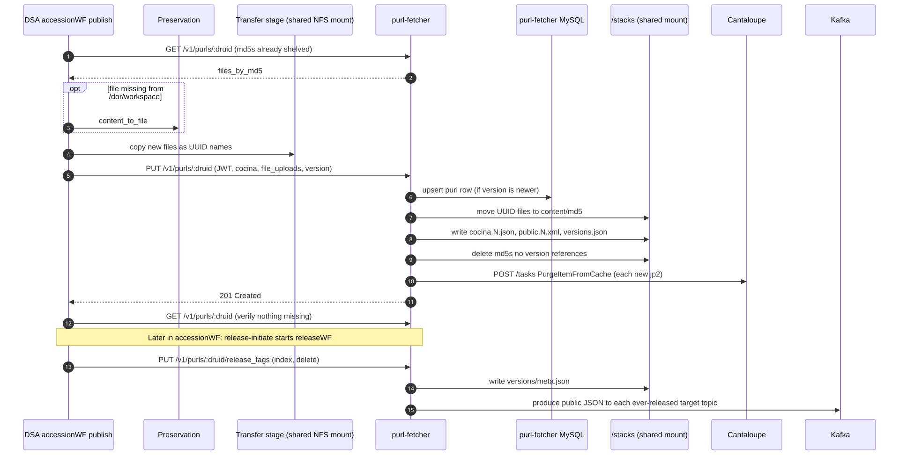
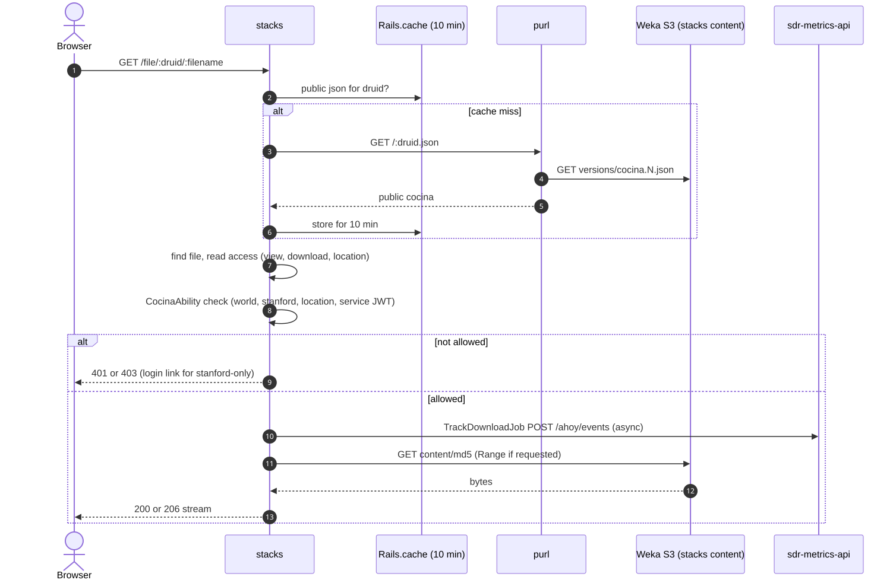

# Access and discovery

This page covers what happens to an SDR object after accessioning: how it is published to the public stacks, how the public web services deliver its metadata, files, images, media and web archives, and how discovery systems (SearchWorks, EarthWorks, Exhibits, content search, the purl sitemap) index it. The boundary with the SDR back end is the DSA `publish` and `release-publish` robot steps: DSA ([dor-services-app](repository-core.md)) calls purl-fetcher, and everything downstream of purl-fetcher is covered here. Almost all of these services belong to the access team, have **stage, prod and (often) uat** environments, and have **no QA environment**. SDR QA publishes to stage ([ADR 0024](../adr/0024-qa-shares-stage-access-systems.md)). Terms such as druid, cocina, release tag and shelve are defined in the [Glossary](../../GLOSSARY.md).

The page is in two halves: [Publication and delivery](#part-1-publication-and-delivery) and [Discovery](#part-2-discovery).

Diagram source: [access-delivery.mmd](../diagrams/access-delivery.mmd)

---

# Part 1: Publication and delivery

## Components

| Component | Purpose | Repo | Runtime | Datastores |
| --- | --- | --- | --- | --- |
| purl-fetcher | The publish API. It is the only writer of public metadata and shelved files in `/stacks`, and the only Kafka producer for discovery ([ADR 0011](../adr/0011-purl-fetcher-publish-api.md)). It also serves an index of published objects (release tags, collection membership); its README says it is not canonical for anything. | [purl-fetcher](https://github.com/sul-dlss/purl-fetcher) | Rails 8.1 on Passenger in production (Puma only in development); whenever cron; racecar used **only as a producer**; no Sidekiq, no consumers | MariaDB on the app host; shared mounts for `/stacks` (rw) and the transfer stage |
| purl_fetcher-client | Ruby client for the API above. DSA and Exhibits use it. | [purl_fetcher-client](https://github.com/sul-dlss/purl_fetcher-client) | gem | — |
| purl | The public resolver at `purl.stanford.edu`. It serves landing pages, `/:druid.json` (public cocina), `/:druid.xml` (public XML), `.mods`, `.meta_json`, versioned pages (`/:druid/version/:n`), IIIF Presentation v2/v3 manifests, `/:druid/embed`, and the sitemap. | [purl](https://github.com/sul-dlss/purl) | Rails 8.1 on Passenger in production; monthly sitemap cron on sul-purl-prod-b | Weka S3 (read only); Rails.cache (IIIF manifests 1 h) |
| stacks | File, image and media delivery at `stacks.stanford.edu`, with rights checks on every request ([ADR 0015](../adr/0015-stacks-enforces-rights-per-request.md)). It provides `/file`, `/v2/file/.../version/:v`, `/object` (zip), the IIIF Image proxy, IIIF Auth v1/v2, and Wowza token minting. | [stacks](https://github.com/sul-dlss/stacks) | Rails on Passenger; ActiveJob for metrics | No database. Weka S3 (read); Rails.cache (public cocina 10 min) |
| Cantaloupe image server (prod) | IIIF Image API 2 and 3 server, using a SUL fork of Cantaloupe with the Kakadu JP2 processor | [sul-dlss/cantaloupe](https://github.com/sul-dlss/cantaloupe), configured by puppet | Java | Reads stacks content (JP2s) |
| Wowza Streaming Engine | HLS streaming of SDR audio and video on a prod and a stage streaming host, using Wowza's built-in SecureToken. stacks builds the URLs (default `https://sul-mediaserver.stanford.edu/stacks-with-token/_definst_`, token prefix `wowzatoken`), and their paths carry a `weka/` prefix. | host built by puppet | Java | Reads stacks content |
| sul-embed | `embed.stanford.edu`: the oEmbed provider (`/embed`), the `/iframe` viewers (file list, PDF, geo, media, Mirador, 3D, web-archive seed), and `/iiif` (Mirador for any manifest) | [sul-embed](https://github.com/sul-dlss/sul-embed) | Rails on Passenger | none |
| cocina_display | Gem for rendering and indexing public cocina. It fetches `/:druid.json` from purl and builds stacks URLs. It is used by purl, sul-embed, purl-fetcher, the SearchWorks indexer, SearchWorks, EarthWorks and Exhibits. | [cocina_display](https://github.com/sul-dlss/cocina_display) | gem | — |
| was-pywb (SWAP) | Web archive replay at `swap.stanford.edu`: pywb with a single collection `was` ([ADR 0019](../adr/0019-pywb-for-web-archive-replay.md)) | [was-pywb](https://github.com/sul-dlss/was-pywb) | uWSGI (`uv run uwsgi`), Capistrano wrapper | shared mount `/web-archiving-stacks` (WARCs and CDXJ indexes) |
| sdr-metrics-api | Records view and download events (Ahoy) by druid and serves `GET /:druid/metrics` | [sdr-metrics-api](https://github.com/sul-dlss/sdr-metrics-api) | Rails 8.1 (ahoy_matey) | Postgres on a separate database host |

All Rails apps here deploy with Capistrano. Jenkins (`sul-ci-prod`) deploys them on GitHub release; they are not in sdr-deploy (see [Platform and operations](platform-and-operations.md)).

## Interfaces

### HTTP APIs

| Endpoint | Server | Auth | Callers |
| --- | --- | --- | --- |
| `PUT /v1/purls/:druid` (legacy `POST /v1/resources`) | purl-fetcher | JWT, HS256 ([ADR 0007](../adr/0007-jwt-for-service-auth.md)) | DSA `Publish::MetadataTransferService` |
| `DELETE /v1/purls/:druid?version=` | purl-fetcher | JWT | DSA, when an object goes dark |
| `PUT/PATCH /v1/purls/:druid/release_tags` | purl-fetcher | JWT | DSA releaseWF `release-publish` |
| `PUT /v1/purls/:druid/versions/:v/{withdraw,restore}` | purl-fetcher | JWT | DSA `WithdrawRestoreJob` |
| `GET /v1/purls/:druid` → `{files_by_md5}` | purl-fetcher | none | DSA `DigitalStacksDiffer`, common-accessioning start-accession |
| `GET /collections/:druid/purls` | purl-fetcher | none | Exhibits |
| `GET /purls/:druid`, `GET /released/:release_tag` | purl-fetcher | none | Unverified: no current caller found |
| `POST /v1/mods` (cocina → MODS) | purl-fetcher | none | Argo metadata preview (per controller comment) |
| `/:druid(.json, .xml, .mods, .meta_json)`, `/version/:n`, `/iiif[3]/manifest` | purl | public | stacks (rights), sul-embed, indexers, Exhibits, content_search, browsers |
| `/file`, `/v2/file`, `/object`, `/image/iiif/...`, `/iiif/auth/v2/{probe,token}` | stacks | public, Shibboleth webauth, client IP location, or service JWT (`Authorization: Bearer`) | sul-embed, purl, SearchWorks, EarthWorks, Mirador, users |
| IIIF `/iiif/2/`, `/iiif/3/`, admin `/tasks` | Cantaloupe | `/tasks` uses basic auth | stacks (proxy), purl-fetcher (cache purge) |
| `/ahoy/events`, `/:druid/metrics` | sdr-metrics-api | none observed | stacks (server side), sul-embed and purl (browser JS) |
| `/embed` (oEmbed), `/iframe`, `/iiif` | sul-embed | public | purl, SearchWorks, Exhibits, DLME, stanford-arclight |
| HLS `/stacks-with-token/_definst_/weka/<tree>/<druid>/content/mp4:<md5>/playlist.m3u8` | Wowza | SecureToken (`wowzatokenendtime`, `wowzatokenhash`, 24 h) | browsers (sul-embed media viewer) |

### Storage: a shared mount for the writer, S3 for readers

purl-fetcher writes through a shared filesystem mount, and purl and stacks read over S3 from `https://sul-weka-s3.stanford.edu` ([ADR 0013](../adr/0013-weka-s3-read-path.md)). purl and stacks default to the `stacks-test` bucket in their repos; each deployed environment sets its own bucket.

| Store | Path or bucket | Writers | Readers |
| --- | --- | --- | --- |
| Transfer stage | A shared NFS mount (DSA `stacks.transfer_stage_root`, purl-fetcher `filesystems.transfer`); stage's `/access-transfer-stage` is shared by DSA qa and stage | DSA web and workers (files under UUID names) | purl-fetcher (moves them into `/stacks`) |
| Stacks (prod) | Mounted at `/stacks` on purl-fetcher; read over S3 by purl and stacks | purl-fetcher (mount, rw) | purl, stacks (S3); the image server; Wowza; the prod Globus server; a backup host |
| Stacks (stage) | As prod, with the `stacks-test` S3 bucket | purl-fetcher-stage | stage purl, stacks (S3); the stage image servers |
| Web archives | Shared mount at `/web-archiving-stacks` | DSA `accessionWF/shelve` (WARCs), WAS robots (CDXJ) | was-pywb |

Each object's layout in stacks is written by purl-fetcher's `VersionedFilesService` ([ADR 0012](../adr/0012-versioned-public-data.md)):

- `<aa>/<bbb>/<cc>/<dddd>/<druid>/versions/{versions.json, meta.json, cocina.N.json, public.N.xml}`
- `<aa>/<bbb>/<cc>/<dddd>/<druid>/content/<md5>`. Content is addressed by checksum: every version that includes a file points at the same `content/<md5>` file, so an unchanged file is stored once (purl-fetcher skips an MD5 already present). Hard links are used only for the legacy and Globus paths below.
- Legacy hard links `<aa>/<bbb>/<cc>/<dddd>/<filename>` "for consistency with unversioned layout". Inference: no current reader uses them.
- `meta.json` holds the release booleans `{sitemap, searchworks, earthworks}`.
- For a configured list of druids, head-version files are also hard-linked under `/stacks/globus/<tree>`.

Public cocina is generated in purl-fetcher, not DSA, as is public XML (purl-fetcher holds the cocina → MODS mapping; [ADR 0014](../adr/0014-access-systems-consume-cocina.md)). See [Data model](data-model.md).

## Key flows

### Publish

Diagram source: [access-publish-sequence.mmd](../diagrams/access-publish-sequence.mmd)

1. Closing a version starts accessionWF. Its `shelve` step now acts only for web-archive crawls, which it copies to `/web-archiving-stacks`. The `publish` step runs the DSA robot `Accession::Publish` → `Publish::MetadataTransferService.publish` (see [Accessioning](accessioning.md)).
   - For a collection, DSA also enqueues `PublishJob` (queue `publish_low`) for each publishable member.
   - A dark object takes the unpublish path instead (below).
2. `DigitalStacksDiffer` calls `GET /v1/purls/:druid` to learn which md5s are already shelved. Files marked `shelve` whose md5 is absent need transferring.
3. `ShelvableFilesStager` makes sure those files are in `/dor/workspace`, restoring them from preservation (`Preservation::Client ... content_to_file`) if needed. `TransferStager` copies each one to `<transfer stage>/<uuid>`.
4. DSA sends `PUT /v1/purls/:druid` with the public cocina, `file_uploads` (filename → uuid), `version`, `version_date` and `must_version`. If the call fails, DSA deletes the staged files.
5. purl-fetcher `PurlsController#create`:
   1. Upserts the MariaDB row (title, type, catkey, collections, `public_json`, version) when the version is not older, and clears `deleted_at`.
   2. Moves transfer files to `content/<md5>`.
   3. Generates and writes `cocina.N.json` and `public.N.xml`, and marks version N available in `versions.json`.
   4. Deletes content no version references.
   5. POSTs `PurgeItemFromCache` to the image server's `/tasks` for each new `.jp2`.
   6. Refreshes Globus hard links.
6. DSA calls `GET /v1/purls/:druid` again and fails the step with "Files are missing from stacks" if anything is still absent. It then republishes the constituents of virtual objects.
7. Readers see the change at different times: purl immediately (it reads S3 directly), stacks within 10 minutes (public cocina cache), IIIF manifests within 1 hour (purl cache).

**Publishing does not produce a Kafka message.** Discovery is updated only by the release step that follows (see [Part 2](#part-2-discovery)).

### Rights enforcement at stacks

Diagram source: [access-file-request-sequence.mmd](../diagrams/access-file-request-sequence.mmd)

Every `/file`, `/image/iiif`, `/object` and IIIF Auth probe request is authorized against the purl public cocina for that druid and version ([ADR 0015](../adr/0015-stacks-enforces-rights-per-request.md)):

1. `Cocina.find` fetches `https://purl.stanford.edu/<druid>.json` (or `/<druid>/version/<n>.json`), caching it for 10 minutes. If purl returns an error, so does stacks.
2. stacks finds the file and reads its `access` (`view`, `download`, `location`).
3. `CocinaAbility` decides:
   - `world`: allowed.
   - `stanford`: allowed for users authenticated through Shibboleth webauth with Stanford groups, or with a service JWT.
   - `location-based`: allowed when the client IP is in the configured ranges for that location code (kept in shared_configs).
   - A service token with `download_all` may download anything.
   - Restricted images get thumbnails or degraded sizes only, and IIIF `info.json` size limits depend on access level.
4. If the request is allowed, stacks queues `TrackDownloadJob` (POST to sdr-metrics-api, prod only) and streams the file from S3 (`<tree>/<druid>/content/<md5>`), with range requests and up to 3 resumes.

### Embargo lifting

stacks does not lift embargoes itself. During an embargo, public cocina carries the embargoed access, and stacks uses `access.embargo.releaseDate` only for messages. Lifting happens in DSA ([ADR 0017](../adr/0017-embargo-release-opens-version.md)):

1. A DSA cron runs `rake dsa:embargo_release` daily at 02:16.
2. `EmbargoReleaseService` opens a new version, copies the `embargo` access onto the object and its files, and closes the version. This records an `embargo_released` event.
3. Closing the version runs accessionWF, which republishes the object. stacks enforces the new access within 10 minutes of publish.

The `sdr.objects.embargo_lifted` RabbitMQ message that DSA also emits is believed unused (see Known issues).

### IIIF image delivery

1. A viewer (Mirador in sul-embed, SearchWorks, Exhibits) loads `https://purl.stanford.edu/<druid>/iiif3/manifest`. Its image services point at `https://stacks.stanford.edu/image/iiif/<druid>/<file>`.
2. stacks authorizes the request (above), maps the filename to an md5, and proxies to `Settings.imageserver.base_uri` with the identifier `CGI.escape("<tree>/<druid>/content/<md5>")`.
   - prod and uat use Cantaloupe (`http://imageserver-prod.stanford.edu/iiif/2/`, `https://sul-imageserver-uat.stanford.edu/iiif/2/`).
   - stage uses a new IIIF server under test (`https://imageserver-test.stanford.edu/v3/`).
3. The image server reads the JP2 from stacks content and decodes it (Cantaloupe uses Kakadu).
4. On republish, purl-fetcher purges the cache entries for new `.jp2` files.

### Streaming

1. The sul-embed media viewer calls the stacks IIIF Auth v2 probe (`/iiif/auth/v2/probe?id=<stacks file URL>`).
2. If the user may access the file and it is streamable, stacks replies with a redirect to a Wowza URL. `StacksMediaStream` and `WowzaSecureToken` build it: `https://sul-mediaserver.stanford.edu/stacks-with-token/_definst_/weka/<tree>/<druid>/content/mp4:<md5>/playlist.m3u8?wowzatokenendtime=…&wowzatokenhash=…`. The hash is SHA-256 over the path, a shared secret and the end time; the token expires after 24 hours.
3. Wowza checks the SecureToken and streams the file.

History: stacks moved from the dlss-wowza callback plugin to Wowza's built-in SecureToken in August 2025 (stacks PR #1476).

### Unpublish, dark takedown and withdrawal

- **Make dark.**
  1. A new version with `view: dark` is accessioned. DSA publish sees that the object is not discoverable and calls `DELETE /v1/purls/:druid`.
  2. purl-fetcher returns 409 if the object was never published or is already deleted. Otherwise it sets `deleted_at` and `DarkenService` runs `rm -rf` on the object's pair-tree leaf in `/stacks` (versions, content, legacy links), pruning empty parent directories.
  3. purl-fetcher produces Kafka tombstones (nil values) to the SearchWorks and EarthWorks topics.
  4. purl returns 404 at once. stacks fails once its 10-minute cache expires.
  5. **Gaps:** no sitemap tombstone is sent, and the image cache is not purged (stacks still blocks those requests).
- **Withdraw a non-head version.** `PUT .../versions/:v/withdraw` marks the version withdrawn in `versions.json`. purl then serves "withdrawn" cocina for it. The head version cannot be withdrawn.
- **Remove from one discovery target.** Set a `release: false` tag. This sends that target in `false_targets` and the indexer deletes the record.

### Web archive replay (SWAP)

DSA's `accessionWF/shelve` copies WARCs for `webarchive-binary` objects to `/web-archiving-stacks/<collection druid>/`. `wasCrawlDisseminationWF` (WAS robots) produces and merges CDXJ indexes. pywb serves them from `/web-archiving-stacks/data/{collections,indexes/cdxj}`, applying an access-control file. sul-embed's `was_seed` viewer shows a seed's timemap from SWAP. See [Accessioning](accessioning.md) for the WAS workflows.

---

# Part 2: Discovery

Discovery is driven by **release tags** ([ADR 0018](../adr/0018-release-tags-drive-discovery.md)): an object appears in SearchWorks, EarthWorks or the purl sitemap only when it has been released to that target. purl-fetcher turns release changes into Kafka messages. Kafka is used only for discovery; SDR events go through RabbitMQ ([ADR 0006](../adr/0006-rabbitmq-for-events-kafka-for-discovery.md)).

Diagram source: [access-discovery-indexing.mmd](../diagrams/access-discovery-indexing.mmd)

## Components

| Component | Purpose | Repo | Runtime | Datastores |
| --- | --- | --- | --- | --- |
| Kafka | One broker per environment (sul-kafka-prod-a, sul-kafka-stage-a). Kafka with ZooKeeper on the same host; no redundancy. | puppet only | Kafka, ZooKeeper | local disk |
| searchworks_traject_indexer | Kafka → traject → Solr for SearchWorks: FOLIO MARC records, and SDR items without a catkey | [searchworks_traject_indexer](https://github.com/sul-dlss/searchworks_traject_indexer) | systemd user units generated by Capistrano (`set :indexers`); whenever cron for FOLIO loads | Kafka; SolrCloud |
| SearchWorks | Blacklight library catalog | [SearchWorks](https://github.com/sul-dlss/SearchWorks) | Rails on Passenger | MySQL on a separate database host; Redis for throttling; Solr |
| EarthWorks | GeoBlacklight `6.0.0.pre.beta.2` geospatial discovery. It indexes SDR items itself with a racecar consumer, and indexes OpenGeoMetadata daily (`geocombine:pull`). | [earthworks](https://github.com/sul-dlss/earthworks) | web; `SdrConsumer` and cron on earthworks-worker-* | Postgres and Redis on separate database hosts; Solr |
| Exhibits | Spotlight exhibits. Curators add druids to a `DorHarvester` resource; there is no Kafka consumer. | [exhibits](https://github.com/sul-dlss/exhibits) | web; Sidekiq Pro on exhibits-worker-* | MySQL and Redis on separate database hosts; Solr |
| content_search | IIIF Content Search 0.9 (search within OCR). It indexes lazily on first search and uses Kafka only to invalidate its cache. | [content_search](https://github.com/sul-dlss/content_search) | web; racecar `PublishConsumer`; Sidekiq | Redis; Solr |
| purl sitemap | A monthly `sitemap:refresh:no_ping` job on sul-purl-prod-b reads the whole sitemap topic from the beginning | [purl](https://github.com/sul-dlss/purl) | cron (rdkafka) | Kafka |
| SolrCloud | Solr 9 on nine nodes with a three-node ZooKeeper ensemble; clients use `sul-solr.stanford.edu`. A three-node Solr 10 test cluster (`sul-solr-test`). | puppet; configsets in [sul-solr-configs](https://github.com/sul-dlss/sul-solr-configs) (Jenkins deploys on merge) | Solr | — |
| solr-proxy | A proxy host: an Apache reverse proxy from paths to `https://sul-solr.stanford.edu/solr/<collection>`. The repo sul-dlss/solr-proxy is not on GitHub; config lives in puppet. | puppet only | Apache | — |

DLME and stanford-arclight consume SDR only through public purl and embed URLs (oEmbed, Mirador iframe, stacks IIIF images). They use neither Kafka nor purl-fetcher.

## Kafka topics

purl-fetcher's message value is `Purl#as_public_json`: druid, object_type, content_type, title, catkey, `true_targets`, `false_targets`, collections and timestamps. The key is the druid. A nil value is a tombstone, meaning delete. `true_targets` always includes `SearchWorksPreview` and `ContentSearch`. Topic names are set in puppet env vars on purl-fetcher (`SETTINGS__INDEXER__*`).

| Topic (prod / stage) | Producer | Consumers (consumer group) | Payload | Envs |
| --- | --- | --- | --- | --- |
| `purl_fetcher_prod` / `purl_fetcher_stage` | purl-fetcher, on release if `Searchworks` was ever released (true or false); tombstone on unpublish | traject `sdr_prod_indexer_2025` (`sdr_prod_indexer_2025`); traject `sdr_preview_indexer` (`traject_sdr_preview_prod`); content_search prod and uat (one consumer group each); stage: `sdr_preview_stage_indexer`, content_search stage; stage experiments `sw_gryphonsearch_*` and `sw_solr9_*` read the **prod** topic | public JSON or tombstone | prod, stage |
| EarthWorks release topic (one per environment) | purl-fetcher, if `Earthworks` was ever released; tombstone on unpublish | earthworks-worker `SdrConsumer` | public JSON or tombstone | prod, stage |
| `sitemap_release_prod` / a stage sitemap topic | purl-fetcher, if `PURL sitemap` was ever released; **no tombstone** | purl monthly sitemap job (reads from offset 0) | public JSON | prod, stage |
| `marc_folio_prod` / `folio_test` | FOLIO loader scripts on sw-indexing (cron every 5 minutes, plus full loads) | traject FOLIO indexers | MARC | prod, stage |

## Key flows

### Release tags → Kafka → Solr

1. Release tags are set in Argo (moving to Argo-B3; [ADR 0023](../adr/0023-argo-b3-replaces-argo-and-pre-assembly.md)) through DSA, which saves them and starts releaseWF for a published object. accessionWF's `release-initiate` also starts releaseWF after every accession, unless `skipReleaseWF` is set.
2. releaseWF runs `release-members → release-publish → update-marc → update-holdings`. `release-publish` skips dark items, waits until the published version is available, then sends `PUT /v1/purls/:druid/release_tags {actions: {index: [...], delete: [...]}}`. `update-marc` and `update-holdings` update FOLIO, so catalogued items reach SearchWorks through the MARC path.
3. purl-fetcher `ReleaseService` upserts its `release_tags` rows, writes `versions/meta.json`, and `IndexerLogWriter` produces synchronously to each topic whose target has ever been released.
4. The consumers act:
   - **traject SDR indexer** (target `Searchworks`): deletes on a tombstone, on a false target, or when the item has a catkey (those come from FOLIO MARC). Otherwise it fetches public cocina and `.meta_json` from purl through cocina_display and indexes into `searchworks-prod-2025`.
   - **traject preview indexer** (target `SearchWorksPreview`, always true): indexes everything, including catalogued items, into `sw-preview-prod`.
   - **EarthWorks `SdrConsumer`**: deletes on a tombstone, `deleted_at`, false or missing target, or missing cocina. Otherwise it maps cocina with `CocinaToSolrMapper` into `earthworks-aardvark-prod`.
   - **content_search**: `delete_by_query druid:<x>`, so the next search rebuilds the index from purl public XML and stacks OCR files.
   - **purl sitemap**: the next monthly run rebuilds from the whole topic.
5. The traject and EarthWorks indexers report `indexing_success`, `deleted`, `skipped` or `errored` events to RabbitMQ (exchange `sdr.objects.event`, vhost `workflow`) through dor-event-client. DSA records them as object events ([ADR 0005](../adr/0005-events-recorded-in-dsa.md)).
6. To reindex everything, loop over `IndexerLogWriter` in a purl-fetcher Rails console (purl-fetcher README "Reindexing").

### EarthWorks and geo delivery

EarthWorks indexes SDR in its own codebase; traject no longer has a geo config. Geo data is delivered as files from stacks: PMTiles, COG, FlatGeobuf, GeoJSON, metadata and index maps. gis-robot-suite creates these derivatives during accessioning. GeoServer and PostGIS are retired for SDR ([ADR 0027](../adr/0027-geoserver-retired-cloud-optimized-gis.md)):

- gisDeliveryWF robots were removed in April 2026.
- The geoservers were decommissioned in June 2026.
- The stacks geo proxy was removed in July 2026.

Leftovers are listed under Known issues.

### Exhibits

A curator adds item or collection druids to an exhibit. Exhibits expands collections with `GET purl-fetcher /collections/druid:<x>/purls`, fetches public cocina from purl, maps it with `lib/traject/dor_config.rb`, and harvests IIIF manifests for canvases and full text. Sidekiq writes to `exhibits_prod`. Reindexing is started by curators or jobs, not by publish or release events.

## SolrCloud collections

All collections below live on the prod SolrCloud (`sul-solr.stanford.edu`) unless noted. The DSA-written Argo collections are on the same cluster ([ADR 0025](../adr/0025-shared-prod-solrcloud.md); see [Repository core](repository-core.md)).

| Collection | Written by | Read by |
| --- | --- | --- |
| `searchworks-prod-2025` | traject `folio_prod_indexer_2025`, `sdr_prod_indexer_2025` | SearchWorks prod via `searchworks-prod` (inference: an alias) |
| `searchworks-bots-prod` | Unverified | SearchWorks bot hosts |
| `sw-preview-prod` / `sw-preview-stage` | traject preview indexers | SearchWorks preview sandboxes |
| `searchworks-folio-dev` | traject `folio_dev_indexer` (stage) | SearchWorks stage |
| `searchworks-folio-prod` | Unverified | SearchWorks uat |
| `searchworks-gryphon-search` | stage experiment indexers (prod topics) | sw-webapp-sandbox-c/-d |
| `searchworks-solr9-test` (**test cluster** `sul-solr-test`) | stage experiment indexers (prod topics) | — |
| `earthworks-aardvark-prod` / `-stage` | earthworks-worker `SdrConsumer`, `geocombine` cron | EarthWorks prod and uat / stage |
| `exhibits_prod` / `exhibits-stage` | Exhibits Sidekiq | Exhibits |
| content_search's prod collection / `contentsearch-stage` / `contentsearch-uat` | content_search (lazy) | content_search |
| `argo_prod` / `argo_stage` / `argo_qa` | DSA ([ADR 0010](../adr/0010-dsa-writes-argo-index.md)) | Argo, Argo-B3 |

sul-solr-configs holds configsets (for example `searchworks-prod-20251211`, `earthworks-aardvark-prod`, `exhibits_prod`, `contentsearch-prod`), not collections. No configset matches `sw-preview-*`, `searchworks-bots-prod` or `searchworks-folio-*`.

---

## Hosts and environments

Hosts are defined in the private puppet repo's node data. There is no QA environment for any access system; SDR QA publishes to stage ([ADR 0024](../adr/0024-qa-shares-stage-access-systems.md), a decision worth reconsidering). See [Environments](environments.md).

| Service | prod | stage | uat / test |
| --- | --- | --- | --- |
| purl-fetcher | purl-fetcher-prod (single host, MariaDB local) | purl-fetcher-stage (used by DSA qa **and** stage) | — |
| purl | sul-purl-prod-a/-b | sul-purl-stage (stage indexer uses `sul-purl-test`) | sul-purl-uat |
| stacks | sul-stacks-prod-a/-b/-c | sul-stacks-stage | sul-stacks-uat-a/-b |
| Image server | Cantaloupe, four hosts (`imageserver-prod`) | Cantaloupe, two hosts (purged by purl-fetcher-stage) | a new IIIF server under test (`imageserver-test`, used by stage stacks); Cantaloupe sul-imageserver-uat |
| Wowza | one host (alias sul-mediaserver; also used by uat stacks) | one host | — |
| sul-embed | embed-prod-a/-b | embed-stage | embed-uat |
| sdr-metrics-api | sdr-metrics-api-prod-a, plus a database host | sdr-metrics-api-stage-a, plus a database host | — |
| was-pywb | was-pywb-prod | was-pywb-stage | was-pywb-qa; a dev host |
| Kafka | sul-kafka-prod-a | sul-kafka-stage-a | — |
| SearchWorks indexing | sw-indexing-prod-a | sw-indexing-stage-a | — |
| SearchWorks | sw-webapp-a…-e; sw-webapp-bot-a/-b | sw-webapp-stage-a…-c | seven SearchWorks sandbox hosts (preview, gryphon, relevancy, folio-dev, uat) |
| EarthWorks | earthworks-prod-a/-b, earthworks-worker-prod-a | earthworks-stage-a/-b, earthworks-worker-stage-a | earthworks-uat-a/-b |
| Exhibits | exhibits-prod-a/-b, exhibits-bots, exhibits-worker-prod-a/-b | exhibits-stage-a/-b, exhibits-worker-stage-a/-b | — |
| content_search | sul-contentsearch-prod-a/-b | sul-contentsearch-stage | sul-contentsearch-uat (reads the **prod** Kafka topic) |
| SolrCloud | nine Solr nodes, three ZooKeeper nodes | (same prod cluster) | `sul-solr-test`: three Solr nodes, three ZooKeeper nodes; a proxy host |

## Configuration

- Most apps follow the usual layering: `config/settings.yml` in the repo, overridden by the shared_configs branch named in the host's puppet node data (for example `sul-stacks-prod`, `sul-purl-prod`, `embed-prod`, `searchworks-prod`, `earthworks-prod`, `sw-indexing-prod`, `sul-contentsearch-prod`), plus secrets as puppet env vars. See [Platform and operations](platform-and-operations.md).
- **purl-fetcher has no shared_configs branch.** It is configured only through puppet env vars on its node (`SETTINGS__INDEXER__*`, `SETTINGS__FILESYSTEMS__TRANSFER`, `SETTINGS__IMAGE_SERVER__HOSTNAME`, `RACECAR_BROKERS`).
- **Cantaloupe, sdr-metrics-api and Wowza have no shared_configs branches.** Cantaloupe and Wowza are configured on their hosts, not in shared_configs.
- **Storage:** the S3 buckets and their users are not defined in any repository; puppet holds only the filesystem mounts and firewall rules.
- **Kafka topics and SearchWorks indexers** are set in puppet env vars (topics) and in `searchworks_traject_indexer/config/deploy/{prod,stage}.rb` (`set :indexers`).

## Known issues and cleanup

Deliberate decisions worth reconsidering:

- No access system has a QA environment, so DSA qa and stage both publish to purl-fetcher-stage and share `/access-transfer-stage` ([ADR 0024](../adr/0024-qa-shares-stage-access-systems.md)).
- All environments' Argo indexes, and the stage access collections, live on the prod SolrCloud ([ADR 0025](../adr/0025-shared-prod-solrcloud.md)).
- Stage experiment indexers and content_search uat read **prod** Kafka topics.

Gaps in the flows (inferred from code):

- Unpublish sends no tombstone to the sitemap topic, so dark druids can stay in the purl sitemap.
- `purl_fetcher_*` messages are sent only when `Searchworks` has ever been released. content_search cache invalidation and the SearchWorks preview index therefore miss objects never released to SearchWorks, even though `true_targets` always lists `SearchWorksPreview` and `ContentSearch`.
- A republish with no release-tag change produces no Kafka message. Indexers rely on releaseWF running after accessioning; `skipReleaseWF` bypasses it.
- Unpublish does not purge the image server cache. stacks still blocks those requests.
- Stage purl-fetcher purges the stage Cantaloupe servers, but stage stacks reads from `imageserver-test`, so stage cache purges do nothing for stage stacks.
- Kafka is a single broker per environment, with ZooKeeper.

Dead code and config:

- DSA's `sdr.objects.embargo_lifted` and `sdr.objects.created` messages and the `dor.indexing-by-druid` queue are believed unused and need cleanup (see [Repository core](repository-core.md)).
- GeoServer leftovers:
  - DSA `config/workflows/gisDeliveryWF.xml`, with no robots left.
  - A `geoserver` database and PostGIS on the two prod EarthWorks database hosts.
  - `restricted_url` / `proxy_url` pointing at a decommissioned stage geoserver host in shared_configs `earthworks-stage`.
  - `geo.proxy_url` in `sul-stacks-stage` and `sul-stacks-uat`.
  - The decommissioned stage geoserver hosts in the stale `processes:` block of the `sw-indexing-*` branches.
- Wowza leftovers:
  - The dlss-wowza plugin (last commit 2025-03-24) is obsolete since stacks switched to SecureToken.
  - sul-embed's `stream.url` (`/stacks/_definst_`) predates SecureToken and looks stale.
- stacks:
  - shared_configs `sul-stacks-prod` keeps unused `stacks.driver`, `remote_iiif.*` and `cdl.*` keys. CDL (controlled digital lending) is decommissioned; vestiges remain in `CocinaRights` and sul-embed.
  - `MediaAuthenticationJson` appears unreferenced (streaming now goes through the IIIF Auth v2 probe).
  - The Apache vhost still sets an `XSendFilePath` for `/stacks`, although the stacks hosts no longer mount it.
  - The `sul-stacks-cdn` branch has no puppet node.
- An experimental Cantaloupe host was decommissioned in puppet on 2026-11-16 ([puppet `d9c709c16`](https://github.com/sul-dlss/puppet/commit/d9c709c16)); its `sul-stacks-cdn` config branch remains. Another host with read-only access to the stage stacks data (repo not on GitHub) looks like a proof of concept.
- purl-fetcher:
  - `config/database.yml` says sqlite3; production uses MariaDB from the linked config on the host.
  - The README's "in a future workcycle" note about readers adopting the versioned layout is stale, as are its notes on the sitemap using `GET /purls/:druid`, `db/schema.rb` and a dev host.
  - `GET /purls/:druid`, `/released/:tag` and the legacy stacks hard links may be unused.
- DSA still carries `stacks.local_document_cache_root: /purl/document_cache` and `document_cache_host`, unused since purl moved to S3.
- Some of the Solr proxy host's mappings look stale.
- shared_configs `sw-indexing-{prod,stage}` keep an obsolete `processes:` list (Symphony and JRuby era).

Stale docs:

- DevOpsDocs operations pages for purl-fetcher describe a racecar consumer, `/docs/changes` APIs and a shared_configs branch.
- The purl page cites `/purl/document_cache`.
- The Wowza page cites the callback plugin.
- The purl README describes an unversioned `cocina.json` layout, and the stacks README cites Ruby 2.2.

Open questions are tracked in [Open questions](open-questions.md): which collections back `searchworks-prod` and the bots index, whether `sul-purl-test` is an alias of `sul-purl-stage`, who schedules was-pywb CDXJ indexing, and what an extra data mount on the purl prod nodes is for.

## Sources

- [purl-fetcher `config/routes.rb`](https://github.com/sul-dlss/purl-fetcher/blob/main/config/routes.rb), [`app/controllers/v1/purls_controller.rb`](https://github.com/sul-dlss/purl-fetcher/blob/main/app/controllers/v1/purls_controller.rb), [`app/models/indexer_log_writer.rb`](https://github.com/sul-dlss/purl-fetcher/blob/main/app/models/indexer_log_writer.rb), [`app/models/purl.rb`](https://github.com/sul-dlss/purl-fetcher/blob/main/app/models/purl.rb), [`app/services/release_service.rb`](https://github.com/sul-dlss/purl-fetcher/blob/main/app/services/release_service.rb), [`app/services/darken_service.rb`](https://github.com/sul-dlss/purl-fetcher/blob/main/app/services/darken_service.rb), [`app/services/versioned_files_service/update_action.rb`](https://github.com/sul-dlss/purl-fetcher/blob/main/app/services/versioned_files_service/update_action.rb), [`app/services/clear_imageserver_cache.rb`](https://github.com/sul-dlss/purl-fetcher/blob/main/app/services/clear_imageserver_cache.rb), [`config/schedule.rb`](https://github.com/sul-dlss/purl-fetcher/blob/main/config/schedule.rb), [README](https://github.com/sul-dlss/purl-fetcher/blob/main/README.md)
- [purl_fetcher-client `lib/purl_fetcher/client/`](https://github.com/sul-dlss/purl_fetcher-client/tree/main/lib/purl_fetcher/client)
- [purl `config/routes.rb`](https://github.com/sul-dlss/purl/blob/main/config/routes.rb), [`app/services/resource_retriever.rb`](https://github.com/sul-dlss/purl/blob/main/app/services/resource_retriever.rb), [`config/sitemap.rb`](https://github.com/sul-dlss/purl/blob/main/config/sitemap.rb), [`lib/sitemap_kafka_reader.rb`](https://github.com/sul-dlss/purl/blob/main/lib/sitemap_kafka_reader.rb), [`config/schedule.rb`](https://github.com/sul-dlss/purl/blob/main/config/schedule.rb)
- [stacks `config/routes.rb`](https://github.com/sul-dlss/stacks/blob/main/config/routes.rb), [`app/models/cocina.rb`](https://github.com/sul-dlss/stacks/blob/main/app/models/cocina.rb), [`app/models/cocina_ability.rb`](https://github.com/sul-dlss/stacks/blob/main/app/models/cocina_ability.rb), [`app/models/stacks_file.rb`](https://github.com/sul-dlss/stacks/blob/main/app/models/stacks_file.rb), [`app/models/wowza_secure_token.rb`](https://github.com/sul-dlss/stacks/blob/main/app/models/wowza_secure_token.rb), [`app/controllers/file_controller.rb`](https://github.com/sul-dlss/stacks/blob/main/app/controllers/file_controller.rb), [`app/controllers/iiif/auth/v2/probe_service_controller.rb`](https://github.com/sul-dlss/stacks/blob/main/app/controllers/iiif/auth/v2/probe_service_controller.rb), [`config/settings.yml`](https://github.com/sul-dlss/stacks/blob/main/config/settings.yml)
- [sul-embed `config/routes.rb`](https://github.com/sul-dlss/sul-embed/blob/main/config/routes.rb), [cocina_display README](https://github.com/sul-dlss/cocina_display/blob/main/README.md), [was-pywb `pywb/config.yaml`](https://github.com/sul-dlss/was-pywb/blob/main/pywb/config.yaml), [sdr-metrics-api README](https://github.com/sul-dlss/sdr-metrics-api/blob/main/README.md)
- [dor-services-app `app/services/publish/metadata_transfer_service.rb`](https://github.com/sul-dlss/dor-services-app/blob/main/app/services/publish/metadata_transfer_service.rb), [`app/jobs/robots/dor_repo/release/release_publish.rb`](https://github.com/sul-dlss/dor-services-app/blob/main/app/jobs/robots/dor_repo/release/release_publish.rb), [`app/services/embargo_release_service.rb`](https://github.com/sul-dlss/dor-services-app/blob/main/app/services/embargo_release_service.rb), [`config/schedule.rb#L45-L48`](https://github.com/sul-dlss/dor-services-app/blob/main/config/schedule.rb#L45-L48), [`config/workflows/releaseWF.xml`](https://github.com/sul-dlss/dor-services-app/blob/main/config/workflows/releaseWF.xml), [`config/workflows/gisDeliveryWF.xml`](https://github.com/sul-dlss/dor-services-app/blob/main/config/workflows/gisDeliveryWF.xml)
- [searchworks_traject_indexer `config/deploy/prod.rb`](https://github.com/sul-dlss/searchworks_traject_indexer/blob/main/config/deploy/prod.rb), [`config/deploy/stage.rb`](https://github.com/sul-dlss/searchworks_traject_indexer/blob/main/config/deploy/stage.rb), [`lib/traject/config/sdr_config.rb`](https://github.com/sul-dlss/searchworks_traject_indexer/blob/main/lib/traject/config/sdr_config.rb), [`lib/traject/readers/kafka_purl_fetcher_reader.rb`](https://github.com/sul-dlss/searchworks_traject_indexer/blob/main/lib/traject/readers/kafka_purl_fetcher_reader.rb)
- [earthworks `app/consumers/sdr_consumer.rb`](https://github.com/sul-dlss/earthworks/blob/main/app/consumers/sdr_consumer.rb), [`app/services/cocina_to_solr_mapper.rb`](https://github.com/sul-dlss/earthworks/blob/main/app/services/cocina_to_solr_mapper.rb); [exhibits `app/models/dor_harvester.rb`](https://github.com/sul-dlss/exhibits/blob/main/app/models/dor_harvester.rb); [content_search `app/consumers/publish_consumer.rb`](https://github.com/sul-dlss/content_search/blob/main/app/consumers/publish_consumer.rb); [sul-solr-configs README](https://github.com/sul-dlss/sul-solr-configs/blob/main/README.md); [dor-event-client `create_operation.rb`](https://github.com/sul-dlss/dor-event-client/blob/main/lib/dor/event/client/create_operation.rb)
- [Puppet](https://github.com/sul-dlss/puppet) (private): node and project data and templates for purl-fetcher, the image servers, Wowza, Kafka, SolrCloud and the EarthWorks database hosts
- shared_configs: [`sul-stacks-prod`](https://github.com/sul-dlss/shared_configs/blob/sul-stacks-prod/config/settings/production.yml), [`sul-stacks-stage`](https://github.com/sul-dlss/shared_configs/blob/sul-stacks-stage/config/settings/production.yml), [`sul-stacks-uat`](https://github.com/sul-dlss/shared_configs/blob/sul-stacks-uat/config/settings/production.yml), [`sul-purl-prod`](https://github.com/sul-dlss/shared_configs/blob/sul-purl-prod/config/settings/production.yml), [`embed-prod`](https://github.com/sul-dlss/shared_configs/blob/embed-prod/config/settings/production.yml), [`searchworks-prod`](https://github.com/sul-dlss/shared_configs/blob/searchworks-prod/config/blacklight.yml), [`earthworks-stage`](https://github.com/sul-dlss/shared_configs/blob/earthworks-stage/config/settings/production.yml), [`sul-contentsearch-prod`](https://github.com/sul-dlss/shared_configs/blob/sul-contentsearch-prod/config/settings/production.yml), [`dor-services-app-qa`](https://github.com/sul-dlss/shared_configs/blob/dor-services-app-qa/config/settings/production.yml)
- History: gis-robot-suite PR [#1052](https://github.com/sul-dlss/gis-robot-suite/pull/1052), stacks PRs [#1476](https://github.com/sul-dlss/stacks/pull/1476), [#1517](https://github.com/sul-dlss/stacks/pull/1517), [#1536](https://github.com/sul-dlss/stacks/pull/1536), [#1597](https://github.com/sul-dlss/stacks/pull/1597), purl PR [#1677](https://github.com/sul-dlss/purl/pull/1677), earthworks PR [#1683](https://github.com/sul-dlss/earthworks/pull/1683), puppet PR [#13873](https://github.com/sul-dlss/puppet/pull/13873); operations-tasks issue [#4578](https://github.com/sul-dlss/operations-tasks/issues/4578)
- [DevOpsDocs](https://github.com/sul-dlss/DevOpsDocs) project pages for purl-fetcher, imageserver, purl and Wowza (stale; see Known issues)

_Verified against default branches on 2026-11-16; private-source details redacted 2026-11-17._
