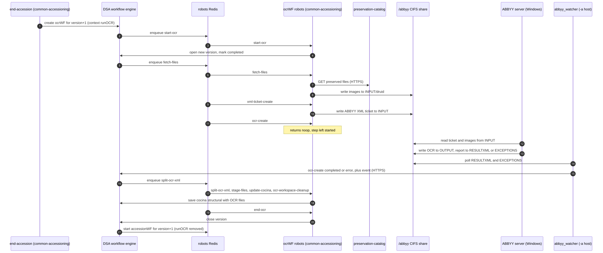

# Accessioning

Accessioning is the workflow-driven pipeline that turns a deposited or registered object version into a published, preserved SDR object. [dor-services-app](repository-core.md) (DSA) is the workflow engine: it stores workflow state, decides which step runs next, and pushes one Sidekiq job per step onto a shared robots Redis. Robots, which are Sidekiq Pro workers built on the `lyber-core` gem, run on dedicated VMs (common-accessioning, gis-robot-suite, was_robot_suite, preservation_robots) and inside DSA itself, and report each step's status back to DSA over HTTPS. This page covers the robot framework, every workflow template, the robot hosts and the shared filesystems the robots use. Deposit front ends are covered in [Management and deposit](management-and-deposit.md), the Moab ingest that follows `sdr-ingest-transfer` in [Preservation](preservation.md), and publishing and release targets in [Access and discovery](access-and-discovery.md). Terms such as druid, cocina, APO and Moab are defined in the [Glossary](../../GLOSSARY.md).

Argo-B3 will replace Argo and pre-assembly in the coming months ([ADR 0023](../adr/0023-argo-b3-replaces-argo-and-pre-assembly.md)). Both currently start accessioning workflows; the robot pipeline described here does not change with that transition.

Diagram source: [accession-accessionwf.mmd](../diagrams/accession-accessionwf.mmd)

## Components

| Component | Purpose | Repo | Runtime | Datastores |
| --- | --- | --- | --- | --- |
| DSA workflow engine | Stores workflow templates and step state; enqueues the next steps; hosts the DSA robots (publish, shelve, preservation transfer, DOI, ORCID, release, Goobi, FOLIO) | [dor-services-app](https://github.com/sul-dlss/dor-services-app) | Rails; Sidekiq processes labelled `robot` consume the `*_dsa` queues on robots Redis | `workflow` Postgres DB (separate from the DSA DB); robots Redis |
| common-accessioning | Main robot suite: assemblyWF, the non-DSA accessionWF steps, ocrWF, speechToTextWF; ABBYY and speech-to-text watcher daemons | [common-accessioning](https://github.com/sul-dlss/common-accessioning) | Plain Ruby (no Rails), lyber-core, Sidekiq Pro; systemd `sidekiq-1..N`; `abbyy_watcher`, `speech_to_text_watcher`; whenever cron | robots Redis; `/dor`, `/sdr-deposit-staging`, `/abbyy` mounts |
| lyber-core | Robot framework gem: `LyberCore::Robot` (a `Sidekiq::Job`), workflow status client, boot and settings | [lyber-core](https://github.com/sul-dlss/lyber-core) | Library | – |
| assembly-image, assembly-objectfile | JP2 creation (libvips plus Kakadu `kdu_compress`); file size, mimetype and EXIF (exiftool) | [assembly-image](https://github.com/sul-dlss/assembly-image), [assembly-objectfile](https://github.com/sul-dlss/assembly-objectfile) | Libraries used by common-accessioning | – |
| gis-robot-suite | gisAssemblyWF and gisDerivativeWF: geo metadata extraction and COG, FlatGeobuf, PMTiles and thumbnail derivatives | [gis-robot-suite](https://github.com/sul-dlss/gis-robot-suite) | Plain Ruby, lyber-core, GDAL, tippecanoe, xsltproc; 3 Sidekiq processes | robots Redis; `/dor`, `/gis_workflow_data` |
| was_robot_suite | Web archive crawl and seed workflows: WARC/WACZ handling, CDXJ indexing for pywb, seed thumbnails | [was_robot_suite](https://github.com/sul-dlss/was_robot_suite) | Ruby, lyber-core; Node.js Puppeteer with Chrome; Python `cdxj-indexer`; 3 Sidekiq processes; whenever cron | robots Redis; `/dor`, `/web-archiving-stacks`, `/was_unaccessioned_data` |
| preservation_robots | preservationIngestWF (see [Preservation](preservation.md)) | [preservation_robots](https://github.com/sul-dlss/preservation_robots) | Ruby, lyber-core, Sidekiq | robots Redis; `/dor` (read-only), Moab storage roots |
| robots Redis | Sidekiq queues for every robot, including DSA robots | puppet | Redis on a dedicated host in each environment, port 6379, DB 0 | – |
| robot-console | Sidekiq Web UI for robots Redis (queues, retries, morgue, busy) | [robot-console](https://github.com/sul-dlss/robot-console) | Rack `Sidekiq::Web` behind Apache and Shibboleth (Stanford-only) | robots Redis |

`workflow-server-rails` and `dor-workflow-client` are archived: the workflow service was merged into DSA ([ADR 0008](../adr/0008-workflow-engine-in-dsa.md)).

### Robot framework

Robots are Sidekiq Pro workers on lyber-core, one queue per workflow (per step for accessionWF) and lane ([ADR 0009](../adr/0009-robots-as-sidekiq-workers.md)).

- **Enqueueing.** When a step becomes `completed` or `skipped`, DSA's `Workflow::ProcessService` saves it and calls `NextStepService`. That service loads the template, finds the steps whose prerequisites are all done and that are not `skip-queue`, sets them from `waiting` to `queued` under a row lock, and after the transaction pushes one job per step to robots Redis with `ROBOT_SIDEKIQ_CLIENT.push`. The job class is the robot class name and the arguments are `[druid, version]`. Creating a workflow (`POST /v1/objects/:druid/workflows/:wf`, with optional `lane_id` and `context`) runs the same enqueue from the first step.
- **Queue naming.** `QueueService` builds `<workflow>[_<step>]_<lane>[_dsa]`:
  - the step is included only for accessionWF (`QUEUE_PER_PROCESS_WORKFLOWS`), so each accessionWF step has its own queue, e.g. `accessionWF_technical-metadata_default`;
  - the lane is `high`, `default` or `low`; `default` unless the workflow was created with a `lane_id`;
  - `_dsa` is appended for robots listed in `DSA_ROBOTS`;
  - two special cases: `assemblyWF_jp2` for jp2-create (memory-limited, one per host) and `releaseWF_update-marc_dsa` for update-marc (single-threaded FOLIO writes).
- **Class naming.** `Robots::DorRepo::<Workflow without WF>::<Step>`, or `Robots::SdrRepo::...` for preservationIngestWF and sdrIngestWF; e.g. `Robots::DorRepo::Accession::StartAccession`.
- **Lanes.** common-accessioning and DSA robot configs weight the lanes (high above default above low), so `high` work is preferred but `low` is not starved. gis-robot-suite and was_robot_suite list the lanes unweighted, which Sidekiq treats as strict priority.
- **Running a step.** `LyberCore::Robot#perform` first skips the step (status `skipped`) if it is not for the object's active version, and refuses to run (Honeybadger notice) unless the status is `queued` or `retrying`. It then sets the step `started` with the hostname, runs `perform_work`, and sets `completed`, or the status of a returned `ReturnState` (`completed`, `skipped` or `noop`).
- **Reporting to DSA.** Robots outside DSA update status through dor-services-client: HTTPS `PUT /v1/objects/:druid/workflows/:wf/processes/:process` against `dor-services-{env}-lb.stanford.edu`, with a bearer JWT ([ADR 0007](../adr/0007-jwt-for-service-auth.md)). DSA's own robots subclass `LyberCore::Robot` as `Robots::Robot` and update the workflow DB in-process.
- **Errors and retries.** Exceptions listed in `retriable_exceptions` set the step to `retrying` and are re-raised so Sidekiq retries. Other exceptions, and exhausted retries, record the step as `error` with the message and host. Argo and Argo-B3 can reset an errored step to queued.
- **Steps left `started`.** A robot that returns `noop` leaves its step `started` so another system can complete it:

  | Step | Completed by |
  | --- | --- |
  | accessionWF `technical-metadata` | technical-metadata-service `TechnicalMetadataWorkflowJob` |
  | accessionWF `sdr-ingest-received` (`skip-queue`, never enqueued) | preservation_robots `complete-ingest` |
  | ocrWF `ocr-create` | `abbyy_watcher` on the common-accessioning `-a` host |
  | speechToTextWF `stt-create` | `speech_to_text_watcher` on the common-accessioning `-a` host |
  | preservationIngestWF `validate-moab` | preservation-catalog `ValidateMoabJob` |

- **Side effects of every step update.** DSA reindexes the druid in the Argo Solr index synchronously ([ADR 0010](../adr/0010-dsa-writes-argo-index.md)) and, for `error` statuses and for `end-accession` `completed`, publishes to the RabbitMQ topic exchange `sdr.workflow` with routing key `<step>.<status>` ([ADR 0006](../adr/0006-rabbitmq-for-events-kafka-for-discovery.md)). pre-assembly and H3 consume `end-accession.completed`.
- **Monitoring.** DSA's `Workflow::Monitor` cron alerts (with a Honeybadger check-in) on steps `queued` for more than 24 hours or `started` for more than 48 hours. robot-console shows queue depth, busy workers, retries and the morgue.
- **Configuration.** Robot suites read `config/settings.yml`, overridden by the shared_configs branch, and secrets from puppet-managed `SETTINGS__*` environment variables (lyber-core uses `env_prefix SETTINGS`, separator `__`). Sidekiq uses `super_fetch!` (Sidekiq Pro reliable fetch).

Diagram source: [accession-robot-runtime.mmd](../diagrams/accession-robot-runtime.mmd)

## Workflows

Templates are XML files in [dor-services-app `config/workflows/`](https://github.com/sul-dlss/dor-services-app/tree/main/config/workflows) (32 files). `Workflow::TemplateParser` reads `<process name>`, `<prereq>` and `skip-queue` only.

### Summary

| Workflow | Purpose | Started by | Robots run on |
| --- | --- | --- | --- |
| assemblyWF | Build structural metadata, JP2s, checksums and file metadata, then close the version | DSA default workflow on accession, pre-assembly, Argo, Argo-B3 | common-accessioning |
| accessionWF | Stage files, technical metadata, publish, release, DOI, ORCID, preservation, cleanup | DSA `VersionService` when a version closes | common-accessioning and DSA |
| releaseWF | Send release tags to purl-fetcher and update FOLIO | accessionWF `release-initiate`, DSA release tag and publish services | DSA |
| goobiWF | Notify Goobi of a newly registered digitization object | Registration (Argo, Argo-B3) | DSA |
| ocrWF | ABBYY OCR into a new version | accessionWF `end-accession` (`runOCR` context), Argo text extraction | common-accessioning |
| speechToTextWF | Whisper transcription into a new version; **off in prod by design** | `end-accession` (`runSpeechToText`), Argo (feature flag) | common-accessioning |
| gisAssemblyWF | Geo metadata extraction and descriptive metadata | pre-assembly for geo objects | gis-robot-suite |
| gisDerivativeWF | COG, FlatGeobuf, PMTiles, thumbnails; close version | gisAssemblyWF | gis-robot-suite |
| wasCrawlPreassemblyWF | Build the druid tree for a web archive crawl | was-registrar-app | was_robot_suite |
| wasSeedPreassemblyWF | Description, thumbnail and structural metadata for a seed | Argo, Argo-B3 | was_robot_suite |
| wasDisseminationWF | Route web archive items to crawl dissemination | `end-accession`, from the APO's `disseminationWorkflow` | was_robot_suite |
| wasCrawlDisseminationWF | Extract WARCs and merge CDXJ into the pywb index | wasDisseminationWF | was_robot_suite |
| preservationIngestWF | Bag to Moab, validation, catalog | accessionWF `sdr-ingest-transfer` | preservation_robots, preservation-catalog |
| captionWF, gisDeliveryWF, wasSeedDisseminationWF | **Orphaned**: templates with no robot code | – | – |

"Runs on" in the step tables below: **CA** = common-accessioning (any `common-accessioning-<env>-*` host); **DSA** = DSA robot Sidekiq on `dor-services-worker-<env>-*` (see [Hosts](#hosts-and-environments)); **GIS** = `kurma-robots-<env>-01`; **WAS** = `was-robots1-<env>`; **PR** = `preservation-robots1-<env>`.

### assemblyWF

| # | Step | Runs on | What it does / external calls |
| --- | --- | --- | --- |
| 1 | start-assembly | CA | Fails unless the version is open |
| 2 | content-metadata-create | CA | Converts `stubContentMetadata.xml` to cocina structural; saves to DSA |
| 3 | jp2-create | CA, queue `assemblyWF_jp2` (concurrency 1 per host) | assembly-image and Kakadu; may fetch source images from preservation-catalog |
| 4 | checksum-compute | CA | MD5 and SHA1 into cocina; saves to DSA |
| 5 | exif-collect | CA | Mimetype, size and EXIF via assembly-objectfile |
| 6 | accessioning-initiate | CA | Closes the version; DSA then starts accessionWF |

### accessionWF

Prerequisites are in the diagram at the top of the page; steps 4–9 run in parallel where their prerequisites allow.

| # | Step | Runs on | What it does / external calls |
| --- | --- | --- | --- |
| 1 | start-accession (lifecycle `submitted`) | CA | Fails if the version is open. For items, checks every shelved or preserved file is in staging, assembly or workspace, or (version > 1) already in preservation (preservation-catalog checksums) or on the shelf (purl-fetcher `files_by_digest`) |
| 2 | stage | CA | Moves files from `/dor/assembly` (rename) or copies from `/sdr-deposit-staging` into `/dor/workspace/<druid tree>`; checks sizes |
| 3 | technical-metadata | CA, then techmd | POSTs to technical-metadata-service `/v1/technical-metadata` (`techmd-{prod,stage}.stanford.edu`, `dor-techmd-qa-a.stanford.edu`) and returns `noop`; techmd completes the step |
| 4 | shelve | DSA | WAS crawls only: copies WARCs to `/web-archiving-stacks/data/collections/<collection>`; skipped otherwise |
| 5 | publish (lifecycle `published`) | DSA | Publishes cocina and files to purl-fetcher over HTTPS, files staged through `/access-transfer` ([ADR 0011](../adr/0011-purl-fetcher-publish-api.md)) |
| 6 | release-initiate | DSA | Creates releaseWF unless the workflow context skips it |
| 7 | update-doi | DSA | DataCite (`api.datacite.org`, prefix `10.25740` in prod; `api.test.datacite.org`, prefix `10.80343` in stage and qa); skipped when there is no DOI |
| 8 | update-orcid-work | DSA | ORCID API |
| 9 | sdr-ingest-transfer | DSA | Writes a Moab deposit bag to `/dor/export/<druid>` and creates preservationIngestWF (see [Preservation](preservation.md)) |
| 10 | sdr-ingest-received (lifecycle `deposited`, `skip-queue`) | PR | Completed by preservation_robots `complete-ingest` |
| 11 | reset-workspace | DSA | `CleanupService.cleanup_by_druid`: deletes the druid from the workspace, assembly and staging roots and its export bag |
| 12 | end-accession (lifecycle `accessioned`) | CA | Creates the APO's dissemination workflow if set; creates ocrWF or speechToTextWF for version + 1 when the context asks and the content qualifies (the flags are removed from the context passed on, to avoid loops); DSA publishes `end-accession.completed` |

### releaseWF

| # | Step | Runs on | What it does / external calls |
| --- | --- | --- | --- |
| 1 | start | DSA | Skips the FOLIO steps when there is no catalog link |
| 2 | release-members | DSA | For collections, creates releaseWF for published members |
| 3 | release-publish | DSA | purl-fetcher `ReleaseTags.release` (SearchWorks, EarthWorks targets; see [ADR 0018](../adr/0018-release-tags-drive-discovery.md)) |
| 4 | update-marc | DSA, queue `releaseWF_update-marc_dsa` (one process, concurrency 1, per env) | FOLIO 856 MARC update |
| 5 | update-holdings | DSA | FOLIO holdings, with a Redis lock per HRID |

### goobiWF

| # | Step | Runs on | What it does / external calls |
| --- | --- | --- | --- |
| 1 | register | – | Created `completed` |
| 2 | start | – | `skip-queue` |
| 3 | goobi-notify | DSA | HTTPS POST to Goobi: the prod Goobi server (prod), `goobi-stage-a.stanford.edu` (stage and qa) |

### ocrWF

| # | Step | Runs on | What it does / external calls |
| --- | --- | --- | --- |
| 1 | start-ocr | CA | Opens a new version, or skips the whole workflow when not applicable |
| 2 | fetch-files | CA | Fetches files from preservation-catalog into `/abbyy/INPUT/<druid>`; multipage images reduced to the first page |
| 3 | xml-ticket-create | CA | Writes the ABBYY XML ticket (languages from the workflow context) |
| 4 | ocr-create | CA, then `abbyy_watcher` | Returns `noop`; the watcher completes or errors it |
| 5 | split-ocr-xml | CA | Splits ALTO into per-page files |
| 6 | stage-files | CA | ABBYY output → workspace |
| 7 | update-cocina | CA | Adds OCR files to structural metadata in DSA |
| 8 | ocr-workspace-cleanup | CA | – |
| 9 | end-ocr | CA | Closes the version; DSA starts accessionWF |

### speechToTextWF

Speech-to-text is **intentionally off in prod** for now. Consistent with that, `common-accessioning-prod` has no AWS Batch job queue or job definition settings; stage and qa do. Argo gates the workflow with `Settings.features.speech_to_text_workflow`.

| # | Step | Runs on | What it does / external calls |
| --- | --- | --- | --- |
| 1 | start-stt | CA | Opens a version, or skips the workflow |
| 2 | fetch-files | CA | Preservation-catalog → an S3 bucket per environment (us-west-2) |
| 3 | stt-create | CA, then `speech_to_text_watcher` | AWS Batch `submit_job` (a per-environment job queue and definition) running a Whisper container; returns `noop`; the watcher long-polls a per-environment SQS done queue and completes or errors the step |
| 4 | stage-files | CA | S3 → workspace |
| 5 | process-files | CA | Hallucination filters (`config/speech_to_text_filters.yaml`) |
| 6 | update-cocina | CA | – |
| 7 | stt-workspace-cleanup | CA | – |
| 8 | end-stt | CA | Closes the version; DSA starts accessionWF |

OCR and speech-to-text as accessioning workflows backed by external services: [ADR 0020](../adr/0020-derivative-generation-in-accessioning.md).

### GIS workflows

gis-robot-suite services only gisAssemblyWF and gisDerivativeWF. GeoServer and PostGIS are retired for SDR: EarthWorks uses PMTiles, COG and FlatGeobuf files served by stacks ([ADR 0027](../adr/0027-geoserver-retired-cloud-optimized-gis.md)). The `gisDeliveryWF` template (load-geoserver and similar steps) has no robot code; see [Known issues](#known-issues-and-cleanup).

| Workflow | # | Step | What it does / external calls |
| --- | --- | --- | --- |
| gisAssemblyWF | 1 | start-gis-assembly-workflow | Checks the version is open |
| | 2 | register-druid | Created `completed` |
| | 3–5 | extract-iso19139-metadata, extract-iso19110-metadata, extract-fgdc-metadata | XSLT over ArcGIS, ISO and FGDC metadata |
| | 6 | generate-tag | Administrative tags |
| | 7 | generate-descriptive | Cocina descriptive metadata |
| | 8 | assign-placenames | Local gazetteer |
| | 9 | extract-boundingbox | – |
| | 10 | finish-gis-assembly-workflow | Copies from `/gis_workflow_data/stage` (or `/dor/assembly`) to `/dor/workspace`, deletes the staged copy |
| | 11 | start-derivative-workflow | Creates gisDerivativeWF |
| gisDerivativeWF | 1 | start-gis-derivative-workflow | Version must be open |
| | 2 | fetch-files | Preservation-catalog → workspace for missing files |
| | 3 | create-derivatives | COG (raster), FlatGeobuf and PMTiles via `ogr2ogr` and `tippecanoe` (vector), thumbnail |
| | 4 | start-accession-workflow | Closes the version → accessionWF |

All GIS metadata steps save to DSA. After accessionWF, releaseWF sends EarthWorks release tags through purl-fetcher.

### Web archiving workflows

| Workflow | Steps | What they do / external calls |
| --- | --- | --- |
| wasCrawlPreassemblyWF | start → build-was-crawl-druid-tree → end-was-crawl-preassembly | `/was_unaccessioned_data/jobs/<label>` → `/dor/workspace` druid tree; closes the version |
| wasSeedPreassemblyWF | start → desc-metadata-generator → thumbnail-generator → content-metadata-generator → end-was-seed-preassembly | Works in `/dor/assembly/<druid>`; thumbnail is a Puppeteer screenshot of the first memento, found through the pywb CDX API and wayback (`swap.stanford.edu` in prod) |
| wasDisseminationWF | start (`skip-queue`) → start-special-dissemination | Creates wasCrawlDisseminationWF for `webarchive-binary` objects |
| wasCrawlDisseminationWF | start → warc-extractor → cdxj-generator → cdxj-merge | WACZ → WARC; CDXJ per WARC into `/web-archiving-stacks`; merge into `level0.cdxj`, which pywb serves ([ADR 0019](../adr/0019-pywb-for-web-archive-replay.md)). Runs on the concurrency-1 process, which serializes merges (inference) |

was-robots whenever cron (role `rollup`) rolls CDXJ indexes up daily, weekly, monthly and yearly (`cdxj:index:rollup:level{1,2,3}`) and cleans up weekly, each with a Honeybadger check-in.

### preservationIngestWF

start-ingest → transfer-object → validate-bag → update-moab → validate-moab → update-catalog → complete-ingest, all on PR except validate-moab, which preservation-catalog completes. Details are in [Preservation](preservation.md#ingest-flow).

### Indexing-only and legacy templates

- `disseminationWF`, `swIndexWF`, `sdrAuditWF`, `accession2WF`: empty templates kept for indexing ("isn't a real wf"); `accession2WF` is in DSA `skip_workflows`.
- `registrationWF`, `versioningWF`: lifecycle markers.
- `hydrusAssemblyWF`, `etdSubmitWF`, `preservationAuditWF`: every step `skip-queue`.
- `digitizationWF`, `dpgImageWF`, `eemsAccessionWF`, `googleScannedBookWF`, `sdrIngestWF`, `sdrMigrationWF`, `sdrRecoveryWF`: no robots in any repo checked. Inference: historical, kept for display of old objects.

## Interfaces

| From → to | Transport | Detail |
| --- | --- | --- |
| DSA → robots Redis | Redis, Sidekiq client push | `robots_redis_url` points at the robots Redis host, DB 0; DSA's own jobs use a separate DSA Redis host |
| Robot suites → robots Redis | Sidekiq Pro `super_fetch` | All suites use DB 0 |
| Robots → DSA | HTTPS, bearer JWT | Step status `PUT .../workflows/:wf/processes/:process`; create workflow; `skip_all`; object find and update; version open, close and status |
| DSA → RabbitMQ | AMQP, topic `sdr.workflow` (`sul-rabbit-<env>`, vhost `workflow`) | `<step>.error`, `end-accession.completed` |
| technical-metadata step → techmd | HTTPS POST, bearer token | Body: druid, files with URIs and MD5s, lane, base path; techmd completes the step through DSA |
| CA, GIS robots → preservation-catalog | HTTPS JWT (preservation-client) | Checksums (start-accession), file content (jp2-create, OCR and speech-to-text fetch-files, gisDerivativeWF fetch-files) |
| start-accession → purl-fetcher | HTTPS | `files_by_digest` for files already shelved |
| DSA publish, release-publish → purl-fetcher | HTTPS (purl_fetcher-client) | Files via `/access-transfer` (prod) or `/access-transfer-stage` |
| DSA update-marc, update-holdings → FOLIO | FOLIO API (folio_client) | MARC 856 and holdings |
| DSA update-doi → DataCite; update-orcid-work → ORCID; goobi-notify → Goobi | HTTPS | See step tables |
| DSA sdr-ingest-transfer → preservation_robots | NFS bag in `/dor/export`, plus preservationIngestWF | — |
| ocrWF ↔ ABBYY | CIFS share mounted at `/abbyy`, served by the ABBYY server | CA writes tickets and images to `INPUT`; ABBYY (Windows, sees the share as `S:\AbbyyShare\sdr-ocr-<env>`) writes `OUTPUT`, `RESULTXML`, `EXCEPTIONS` |
| abbyy_watcher → DSA | Polling (Listen) on the share, then HTTPS | Completes or errors `ocr-create`; writes a DSA event |
| speechToTextWF ↔ AWS (stage, qa) | S3, AWS Batch, SQS in us-west-2, via an assumed IAM role | A bucket and an SQS done queue per environment; the Whisper image comes from sul-dlss/speech-to-text |
| was_robot_suite → was-pywb | HTTPS CDX API | Seed thumbnails |
| robot-console → robots Redis | Redis | Admin UI |

### Shared filesystems

All are NFS mounts from shared network storage unless noted. Mount details: [Platform and operations](platform-and-operations.md).

| Mount | Purpose | Writers | Readers | Envs |
| --- | --- | --- | --- | --- |
| `/dor` | `/dor/assembly` (assembly input), `/dor/workspace` (accessioning workspace), `/dor/export` (preservation bags), `/dor/stopped` (cleanup backup) | pre-assembly, Argo, Argo-B3 (assembly); sdr-api, ETD (workspace); CA `stage`; GIS and WAS robots (workspace, assembly); DSA (export bags, cleanup) | CA, GIS, WAS robots; techmd; preservation_robots (read-only); DSA | prod has its own volume; **stage and qa share** one |
| `/sdr-deposit-staging` | Uploads staged by H3 and Argo-B3; the backed-up copy until preservation, so `stage` copies rather than moves | H3, Argo-B3 | CA `stage`; techmd; DSA `reset-workspace` deletes | One volume per environment |
| `/access-transfer`, `/access-transfer-stage` | Files handed from DSA publish to purl-fetcher | DSA | purl-fetcher | `/access-transfer` in prod; `/access-transfer-stage` shared by stage and qa |
| `/web-archiving-stacks` | Shelved WARCs and pywb CDXJ indexes | DSA `shelve`; WAS `cdxj-generator`, `cdxj-merge`, rollups | was-pywb | One volume per environment |
| `/was_unaccessioned_data` | Downloaded crawl jobs awaiting accessioning | was-registrar-app (Unverified: sole writer) | WAS `build-was-crawl-druid-tree` | One volume per environment |
| `/gis_workflow_data` | Staged GIS uploads | pre-assembly, Argo-B3 | GIS `finish-gis-assembly-workflow` (copies, then deletes) | One volume per environment |
| `/abbyy` | ABBYY hot folders | CA ocrWF; ABBYY server | ABBYY server; `abbyy_watcher`; CA ocrWF | CIFS share on the ABBYY server, one per environment, on all CA hosts |
| `/maps` | No consumer in robot code (inference: legacy) | – | – | Ceph NFS volume, CA prod only |
| Local temp volumes | vips and JP2 temp (CA), GIS temp (kurma), CDXJ temp (was-robots prod) | – | – | local disks |

Assembly roots searched by CA (`assembly.root_dir`): prod `/dor/assembly` and `/sdr-deposit-staging`; stage and qa also `/dor/workspace`.

## Key flows

### Item deposit to accessioned

1. Files land in `/dor/assembly` (pre-assembly, Argo, Argo-B3), `/sdr-deposit-staging` (H3, Argo-B3), or directly in `/dor/workspace` (sdr-api, ETD).
2. assemblyWF runs on CA when needed; `accessioning-initiate` closes the version.
3. DSA starts accessionWF. CA `start-accession` checks files and `stage` fills `/dor/workspace`.
4. technical-metadata-service runs in parallel and completes `technical-metadata`.
5. DSA `shelve` (WAS crawls only) and `publish` (purl-fetcher) run, then in parallel `release-initiate` (releaseWF: purl-fetcher release tags, FOLIO), `update-doi` (DataCite), `update-orcid-work` (ORCID) and `sdr-ingest-transfer` (bag in `/dor/export`, preservationIngestWF).
6. preservation_robots completes `sdr-ingest-received`; DSA `reset-workspace` cleans up; CA `end-accession` runs.
7. `end-accession` may start a dissemination workflow, or ocrWF or speechToTextWF for the next version.
8. DSA publishes `end-accession.completed` on `sdr.workflow`; pre-assembly and H3 update their own state.

### OCR loop

Diagram source: [accession-ocr-sequence.mmd](../diagrams/accession-ocr-sequence.mmd)

1. `end-accession` (context `runOCR`) or Argo creates ocrWF for version + 1; `start-ocr` opens the version.
2. `fetch-files` copies preserved images to `/abbyy/INPUT/<druid>`; `xml-ticket-create` writes the ticket.
3. `ocr-create` returns `noop`. The ABBYY server (a separate Windows host) processes the ticket from the share.
4. `abbyy_watcher` on the `-a` host polls `RESULTXML` and `EXCEPTIONS` and marks `ocr-create` completed or errored, with a DSA event.
5. `split-ocr-xml`, `stage-files`, `update-cocina` and cleanup run; `end-ocr` closes the version and DSA starts accessionWF without `runOCR`.

The speech-to-text loop has the same shape, with S3, AWS Batch and SQS in place of the share, ABBYY and polling (stage and qa only).

### GIS and web archiving

- GIS: pre-assembly stages to `/gis_workflow_data/stage` and creates gisAssemblyWF → gisDerivativeWF → accessionWF → releaseWF (EarthWorks).
- Web archive crawl: was-registrar-app creates wasCrawlPreassemblyWF → accessionWF (DSA `shelve` copies WARCs) → `end-accession` starts wasDisseminationWF → wasCrawlDisseminationWF updates the pywb index.
- Web archive seed: Argo or Argo-B3 creates wasSeedPreassemblyWF → accessionWF.

## Hosts and environments

All three levels (prod, stage, qa) exist for every robot suite. Every robot host in an environment uses that environment's robots Redis. Hosts are defined in the private puppet repo; environment wiring: [Environments](environments.md).

| Role | prod | stage | qa |
| --- | --- | --- | --- |
| common-accessioning | `common-accessioning-prod-{a..f}` | `common-accessioning-stage-{a,b}` | `common-accessioning-qa-{a,b}` |
| DSA robot Sidekiq | `dor-services-worker-prod-{a..e}` | `dor-services-worker-stage-a` | `dor-services-worker-qa-a` |
| gis-robot-suite | `kurma-robots-prod-01` | `kurma-robots-stage-01` | `kurma-robots-qa-01` |
| was_robot_suite | `was-robots1-prod` | `was-robots1-stage` | `was-robots1-qa` |
| preservation_robots | `preservation-robots1-prod` (robots2 is a warm standby) | `preservation-robots1-stage` | `preservation-robots1-qa` |
| robots Redis | One dedicated host | One dedicated host | One dedicated host |
| robot-console | `robot-console-prod` | `robot-console-stage` | `robot-console-qa` |

All hostnames end in `.stanford.edu`. QA DSA and robots publish to the **stage** purl-fetcher, and QA and stage share `/dor`. This is deliberate, because the access systems have no QA environment ([ADR 0024](../adr/0024-qa-shares-stage-access-systems.md)); it is a decision worth reconsidering.

### Sidekiq process layouts

Puppet starts a configured number of Sidekiq systemd units per host; unit N loads `sidekiqN.yml` from the app's shared_configs branch. Process counts, concurrency and queue weighting are deployment-configured; the table lists only which queues each suite's processes serve.

| Suite | Queues |
| --- | --- |
| common-accessioning | assemblyWF, ocrWF, speechToTextWF, accessionWF `start-accession`, `stage`, `technical-metadata`, `end-accession` (plus vestigial goobiWF, releaseWF, disseminationWF); a dedicated process for `assemblyWF_jp2`; in prod, a dedicated process for `ocrWF_{high,default,low}` |
| DSA | All `*_dsa` queues: releaseWF, goobiWF, accessionWF `shelve`, `publish`, `release-initiate`, `update-doi`, `update-orcid-work`, `sdr-ingest-transfer`, `reset-workspace`; plus `publish_low` (and `migration` outside prod); a dedicated process for `releaseWF_update-marc_dsa` |
| gis-robot-suite (repo `config/sidekiq.yml`) | gisAssemblyWF, gisDerivativeWF, all lanes |
| was_robot_suite | wasCrawlPreassemblyWF, wasSeedPreassemblyWF, wasDisseminationWF, wasSeedDisseminationWF; a dedicated process for `wasCrawlDisseminationWF_{default,low}` |
| preservation_robots | `preservationIngestWF_{high,default,low}` |

The FOLIO `update-marc` process must run on exactly one VM per environment, to avoid concurrent MARC updates to the same record; puppet enforces this by giving one worker more Sidekiq processes than the others. `abbyy_watcher` and `speech_to_text_watcher` run only on the `-a` common-accessioning host of each environment, which also runs the weekly `abbyy:cleanup` cron (Mondays 01:00). Non-robot DSA Sidekiq processes are described in [Repository core](repository-core.md).

### Deploy

All robot suites and robot-console deploy with Capistrano (`dlss-capistrano`) to VMs; nothing runs on Kubernetes. common-accessioning and gis-robot-suite deploy to `/opt/app/lyberadmin/<app>` as `lyberadmin`; was_robot_suite as `was`; preservation_robots to `/opt/app/pres/preservation_robots`. The `shared_configs:update` hook runs before publishing, and common-accessioning restarts both watchers on every deploy. `ROBOT_ENVIRONMENT=production` on every environment; gis-robot-suite stage instead loads `config/settings/staging.yml`.

## Configuration

Settings layer as `config/settings.yml` in each repo → the shared_configs branch → puppet `SETTINGS__*` environment variables (secrets).

| App | shared_configs branches | Notes |
| --- | --- | --- |
| common-accessioning | `common-accessioning-{prod,stage,qa}` | `config/settings/production.yml` and `config/sidekiq{1..4}.yml` |
| DSA | `dor-services-app-{prod,stage,qa}` | `robots_redis_url`, `redis_url`, RabbitMQ, DataCite, Goobi, Sidekiq configs |
| gis-robot-suite | `kurma-robots1-{prod,stage,qa}` | No Sidekiq files; the repo's `config/sidekiq.yml` applies |
| was_robot_suite | `was-robots1-{prod,stage,qa}` | `config/sidekiq{1,2,3}.yml` |
| preservation_robots | `preservation_robots_{prod,stage,qa}` | `config/environments/<env>.yml` |
| robot-console | none | `SETTINGS__REDIS__HOSTNAME` from puppet |

## Known issues and cleanup

- **Orphaned templates.** `gisDeliveryWF` (GeoServer and PostGIS loading, retired), `captionWF` (superseded by speechToTextWF) and `wasSeedDisseminationWF` (no `UpdateThumbnailGenerator` class, although its queues are consumed on was-robots, so any job would fail) have no robot code. Unverified: whether any APO still names one as its `disseminationWorkflow`. Candidates for deletion from DSA `config/workflows`, along with the legacy templates listed above if old-object display does not need them.
- **GIS leftovers.** kurma puppet still has a TSM backup entry for a GeoServer raster directory and a PostgreSQL client; the only code reference to PostGIS is a `layertype` label.
- **Vestigial queues.** common-accessioning sidekiq1 and sidekiq2 listen on `goobiWF_*`, `releaseWF_*` and `disseminationWF_*`, which never receive jobs (those robots are DSA robots, or do not exist).
- **Unparsed XML attributes.** `batch-limit`, `error-limit` and `queue-limit` in templates are ignored by `TemplateParser` (inference: left from the robot-master era).
- **Dead settings.** `workflow.url` (pointing at the retired workflow service hosts) remains in shared_configs for DSA, common-accessioning stage and qa, kurma-robots stage and qa, and was-robots (removed from common-accessioning-prod in June 2026). Also unused: the `rabbitmq` block in common-accessioning-stage, `solr.url` in was-robots, `sqs_todo_queue_url` in common-accessioning-prod (older speech-to-text design), and the `/maps` mount on common-accessioning prod.
- **Stale comment.** The `reset-workspace` robot class comment and its accessionWF label describe renaming the druid tree to a versioned directory; the code deletes it.
- **Stale docs.**
  - [common-accessioning README](https://github.com/sul-dlss/common-accessioning/blob/main/README.md) says jobs are enqueued by workflow-server-rails and links templates there; lists captionWF and a disseminationWF that "cleans up the workspace"; describes release and publish as its own work; and its `run_robot` example (`Accession::Publish`) is a DSA robot.
  - [DSA README](https://github.com/sul-dlss/dor-services-app/blob/main/README.md) says DSA robots must be added to workflow-server-rails' `QueueService`; it is in DSA.
  - [was_robot_suite README](https://github.com/sul-dlss/was_robot_suite/blob/main/README.md) refers to robot-master and `bundle exec controller boot`.
  - [DevOpsDocs](https://github.com/sul-dlss/DevOpsDocs) gis-robot-suite operations concerns describe gisDeliveryWF, GeoServer, PostGIS hosts, `/var/geomdtk/current/stage` (now `/gis_workflow_data/stage`) and `kurma-robots1-prod` (now `kurma-robots-prod-01`); the common-accessioning and was-robots pages list workflow-server-rails as a dependency and say workflow errors live in the workflow service; the OCR page names `ocr-cleanup` (the step is `ocr-workspace-cleanup`).

## Sources

- [dor-services-app `config/workflows/`](https://github.com/sul-dlss/dor-services-app/tree/main/config/workflows), [`app/services/queue_service.rb`](https://github.com/sul-dlss/dor-services-app/blob/main/app/services/queue_service.rb), [`app/services/workflow/next_step_service.rb`](https://github.com/sul-dlss/dor-services-app/blob/main/app/services/workflow/next_step_service.rb), [`app/services/workflow/template_parser.rb`](https://github.com/sul-dlss/dor-services-app/blob/main/app/services/workflow/template_parser.rb), [`config/initializers/sidekiq.rb`](https://github.com/sul-dlss/dor-services-app/blob/main/config/initializers/sidekiq.rb), [`app/jobs/robots/`](https://github.com/sul-dlss/dor-services-app/tree/main/app/jobs/robots), [`app/services/workflow/monitor.rb`](https://github.com/sul-dlss/dor-services-app/blob/main/app/services/workflow/monitor.rb), [`app/services/cleanup_service.rb`](https://github.com/sul-dlss/dor-services-app/blob/main/app/services/cleanup_service.rb)
- [lyber-core `lib/lyber_core/robot.rb`](https://github.com/sul-dlss/lyber-core/blob/main/lib/lyber_core/robot.rb), [`lib/lyber_core/boot.rb`](https://github.com/sul-dlss/lyber-core/blob/main/lib/lyber_core/boot.rb)
- [common-accessioning `lib/robots/dor_repo/`](https://github.com/sul-dlss/common-accessioning/tree/main/lib/robots/dor_repo), [`bin/abbyy_watcher`](https://github.com/sul-dlss/common-accessioning/blob/main/bin/abbyy_watcher), [`lib/dor/text_extraction/`](https://github.com/sul-dlss/common-accessioning/tree/main/lib/dor/text_extraction), [`config/deploy.rb`](https://github.com/sul-dlss/common-accessioning/blob/main/config/deploy.rb), [`config/schedule.rb`](https://github.com/sul-dlss/common-accessioning/blob/main/config/schedule.rb)
- [technical-metadata-service `app/jobs/technical_metadata_workflow_job.rb`](https://github.com/sul-dlss/technical-metadata-service/blob/main/app/jobs/technical_metadata_workflow_job.rb)
- [gis-robot-suite README](https://github.com/sul-dlss/gis-robot-suite/blob/main/README.md), [`config/sidekiq.yml`](https://github.com/sul-dlss/gis-robot-suite/blob/main/config/sidekiq.yml)
- [was_robot_suite `lib/robots/dor_repo/`](https://github.com/sul-dlss/was_robot_suite/tree/main/lib/robots/dor_repo), [`config/schedule.rb`](https://github.com/sul-dlss/was_robot_suite/blob/main/config/schedule.rb)
- [preservation_robots `lib/robots/sdr_repo/preservation_ingest/`](https://github.com/sul-dlss/preservation_robots/tree/main/lib/robots/sdr_repo/preservation_ingest)
- [robot-console `config.ru`](https://github.com/sul-dlss/robot-console/blob/main/config.ru)
- [puppet](https://github.com/sul-dlss/puppet) (private): node data for the common-accessioning, DSA worker, gis-robot-suite, was_robot_suite, robots Redis and robot-console hosts
- shared_configs: [common-accessioning-prod `config/settings/production.yml`](https://github.com/sul-dlss/shared_configs/blob/common-accessioning-prod/config/settings/production.yml), [common-accessioning-stage](https://github.com/sul-dlss/shared_configs/blob/common-accessioning-stage/config/settings/production.yml), [dor-services-app-prod `config/sidekiq6.yml`](https://github.com/sul-dlss/shared_configs/blob/dor-services-app-prod/config/sidekiq6.yml), [`config/sidekiq8.yml`](https://github.com/sul-dlss/shared_configs/blob/dor-services-app-prod/config/sidekiq8.yml), [kurma-robots1-prod](https://github.com/sul-dlss/shared_configs/blob/kurma-robots1-prod/config/settings/production.yml), [was-robots1-prod](https://github.com/sul-dlss/shared_configs/tree/was-robots1-prod/config)
- [DevOpsDocs](https://github.com/sul-dlss/DevOpsDocs) `projects/common-accessioning/`, `projects/gis-robot-suite/`
- ADRs: [0007](../adr/0007-jwt-for-service-auth.md), [0008](../adr/0008-workflow-engine-in-dsa.md), [0009](../adr/0009-robots-as-sidekiq-workers.md), [0010](../adr/0010-dsa-writes-argo-index.md), [0011](../adr/0011-purl-fetcher-publish-api.md), [0018](../adr/0018-release-tags-drive-discovery.md), [0019](../adr/0019-pywb-for-web-archive-replay.md), [0020](../adr/0020-derivative-generation-in-accessioning.md), [0023](../adr/0023-argo-b3-replaces-argo-and-pre-assembly.md), [0024](../adr/0024-qa-shares-stage-access-systems.md), [0027](../adr/0027-geoserver-retired-cloud-optimized-gis.md)

_Verified against default branches on 2026-11-16; private-source details redacted 2026-11-17._
