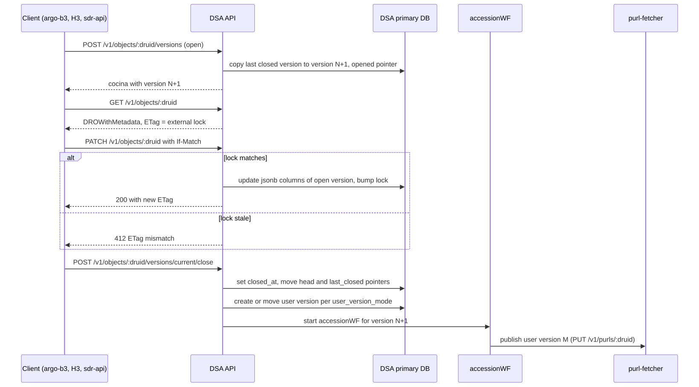

# Data model and data flows

This page describes the data that SDR (Stanford Digital Repository) stores and passes between services. It covers the Cocina model, identifiers, versions, how dor-services-app (DSA) persists objects, and the representations derived from them for public access, discovery and preservation. Cocina is the one shared model ([ADR 0003](../adr/0003-cocina-shared-model-lockstep.md)). DSA's Postgres database is the system of record for cocina objects and their versions ([ADR 0002](../adr/0002-dsa-postgres-system-of-record.md)). Every other representation listed here (public cocina and XML, Solr documents, Moab versions, zip parts, messages) is derived from DSA data, and can be rebuilt from it or from the Moab.

Sections 1–3 cover the model, sections 4–5 the stores and derived copies, and sections 6–7 the messages and the end-to-end lifecycle. The service pages cover the processes behind them: [Repository core](repository-core.md), [Accessioning](accessioning.md), [Preservation](preservation.md), [Access and discovery](access-and-discovery.md), [Management and deposit](management-and-deposit.md). The [Glossary](../../GLOSSARY.md) defines SDR terms.

Diagram source: [data-lifecycle.mmd](../diagrams/data-lifecycle.mmd)

Short names used below: **DSA** = dor-services-app, **PF** = purl-fetcher, **prescat** = preservation_catalog, **APO** = AdminPolicy, **H3** = hungry-hungry-hippo.

## 1. Cocina model

### 1.1 Where the model lives

- [cocina-models](https://github.com/sul-dlss/cocina-models) defines the model as a JSON Schema, [`schema.json`](https://github.com/sul-dlss/cocina-models/blob/main/schema.json), with definitions under `$defs`. The Ruby classes under `Cocina::Models` are generated from it with `exe/generator generate`. cocina-models has no `openapi.yml`.
- The version current at the time of writing is gem 0.133.0. Every app that reads or writes cocina through the gem pins that version: DSA, purl-fetcher, Argo, argo-b3, sdr-api, prescat, H3, pre-assembly and common-accessioning. Upgrades roll out in lockstep ([ADR 0003](../adr/0003-cocina-shared-model-lockstep.md)).
- purl, EarthWorks and searchworks_traject_indexer read *public* cocina through the [`cocina_display`](https://github.com/sul-dlss/cocina_display) gem and do not depend on cocina-models.
- Schemas are composed from mixins. Terminal schemas (`DRO`, `Collection`, `AdminPolicy`, `*WithMetadata`, `Request*`) set `unevaluatedProperties: false`, so unknown keys are rejected. Mixins (`DROMixin`, `CollectionMixin`, `AccessMixin` and so on) stay open.

Diagram source: [data-cocina-classes.mmd](../diagrams/data-cocina-classes.mmd)

### 1.2 Object types and content types

All `type` values are URIs with the prefix `https://cocina.sul.stanford.edu/models/`.

| Kind | Schemas | `type` values |
|---|---|---|
| DRO (Digital Repository Object, an item) | `DRO`, `DROWithMetadata`, `RequestDRO` | `object`, `3d`, `agreement`, `book`, `document`, `geo`, `image`, `page`, `photograph`, `manuscript`, `map`, `media`, `track`, `webarchive-binary`, `webarchive-seed` |
| Collection | `Collection`, `CollectionWithMetadata`, `RequestCollection` | `collection`, `curated-collection`, `user-collection`, `exhibit`, `series` |
| AdminPolicy (APO) | `AdminPolicy`, `AdminPolicyWithMetadata`, `RequestAdminPolicy` | `admin_policy` |
| FileSet (a resource within a DRO) | `FileSet`, `RequestFileSet` | `resources/{audio, attachment, document, file, image, media, object, page, preview, 3d, thumb, video}` |
| File | `File`, `RequestFile` | `file` |

DSA stores the DRO `type` in `repository_object_versions.content_type`, and Argo indexes it as `content_type_ssimdv`. The content type determines which accessioning and display behaviour applies (for example, `geo` items go through the GIS workflows, and `image`/`book` items get IIIF manifests).

### 1.3 Top-level sections

| Section | DRO | Collection | APO | Holds |
|---|---|---|---|---|
| `cocinaVersion` | required | required | required | cocina-models version that wrote the object (`^\d+\.\d+\.\d+$`). DSA stamps the current gem version on every save. |
| `externalIdentifier` | required | required | required | the druid, `druid:` prefixed (§2) |
| `type` | required | required | required | the type URI (§1.2) |
| `version` | required | required | required | the system version (§3) |
| `access` | `DROAccess` | `CollectionAccess` (view `world` or `dark` only, plus copyright, use statement and license) | none (the template is in `administrative`) | §1.6 |
| `administrative` | `{hasAdminPolicy}` | `{hasAdminPolicy}` | `AdminPolicyAdministrative` | the governing APO; for an APO, registration defaults (§1.5) |
| `description` | required | required | required | descriptive metadata (§1.7) |
| `identification` | `{sourceId (required), barcode, catalogLinks[], doi}` | `{sourceId, catalogLinks[]}` | none | §2 |
| `structural` | `DROStructural` | none | none | file sets, files, collection membership, virtual-object members (§1.4) |
| `geographic` | optional `{iso19139}` | none | none | ISO 19139 XML as a string, for GIS items |

Things that are *not* in cocina:

- There is **no top-level `label`** on DRO, Collection or AdminPolicy; only FileSet and File have `label`. PF adds a derived `label` (computed by `CocinaDisplay::CocinaRecord#label`) to the public cocina it writes, and uses the same value for `objectLabel` in the public XML.
- **Release tags** are not in cocina. DSA keeps them in its `release_tags` table (§4.1).
- **Administrative tags**, including the project tag, are not in cocina either. `partOfProject` exists only on `RequestAdministrative`: DSA turns it into a `Project : …` administrative tag at registration.

### 1.4 Structural metadata (DROs)

`DROStructural` has three parts:

- `contains`: an ordered list of FileSets.
- `isMemberOf`: the druids of the collections the item belongs to. DSA has a GIN index on `structural->'isMemberOf'` for membership queries.
- `hasMemberOrders`: a list of `Sequence {members[], viewingDirection}`. `hasMemberOrders[0].members` lists the constituent druids of a **virtual object** (also GIN-indexed). `viewingDirection` is `left-to-right` or `right-to-left`.

A `FileSet` has `externalIdentifier`, `label`, `type`, `version` and `structural.contains` (its Files). All are required.

A `File` has:

| Attribute | Required | Meaning |
|---|---|---|
| `externalIdentifier` | yes | File URI (format below) |
| `label`, `filename` | yes | Display label and the path within the object |
| `type`, `version` | yes | `…/models/file`; the system version in which the file was last changed |
| `hasMessageDigests[]` | yes | `{type: md5\|sha1, digest}` |
| `access` | yes | `FileAccess`: the same view/download combinations as the object (§1.6), with no embargo or license |
| `administrative.publish` | yes (default false) | Include the file in public cocina and public XML. `PublicCocinaService` drops unpublished files, then drops any FileSet left empty. |
| `administrative.shelve` | yes (default false) | Put the file in Stacks so it can be delivered (download, IIIF image, streaming). |
| `administrative.sdrPreserve` | yes (default true) | Store the file in the Moab. |
| `size`, `hasMimeType` | no | Bytes and MIME type (usually set from technical metadata) |
| `languageTag` | no | BCP 47 tag, validated |
| `use` | no | Role of the file, for example `transcription` |
| `sdrGeneratedText`, `correctedForAccessibility` | no | Flags for OCR/speech-to-text output and for files remediated for accessibility |
| `presentation` | no | `{height, width}` |

DSA's `Cocina::IdGenerator` mints the FileSet and File identifiers:

- FileSet: `https://cocina.sul.stanford.edu/fileSet/<bare druid>-<resourceId>`
- File: `https://cocina.sul.stanford.edu/file/<bare druid>-<resourceId>/<fileId or uuid>`

A file identifier in another format only raises a Honeybadger notice; it is not rejected.

### 1.5 AdminPolicy (APO)

Every DRO and Collection names its governing APO in `administrative.hasAdminPolicy`. The APO's `AdminPolicyAdministrative` holds:

| Field | Required | Meaning |
|---|---|---|
| `hasAdminPolicy` | yes | The APO's own governing APO |
| `hasAgreement` | yes | Druid of the agreement object (a DRO of type `agreement`) |
| `accessTemplate` | yes | Default access for new objects: view, download, location, controlledDigitalLending, copyright, useAndReproductionStatement, license. No embargo. |
| `registrationWorkflow[]` | no | Workflow names offered at registration (for example `registrationWF`, `goobiWF`) |
| `disseminationWorkflow` | no | Workflow name |
| `collectionsForRegistration[]` | no | Collection druids offered at registration |
| `roles[]` | no | `{name, members[{type: sunetid\|workgroup, identifier}]}` |

- **Role names** (an enum): `dor-apo-depositor`, `dor-apo-manager`, `dor-apo-viewer`, `sdr-administrator`, `sdr-viewer`, and the Hydrus-era `hydrus-collection-{creator, manager, depositor, item-depositor, reviewer, viewer}`. DSA indexes the members into the Argo field `apo_register_permissions_ssim`. Argo and argo-b3 use these roles to authorise users ([ADR 0026](../adr/0026-shibboleth-entitlements-for-authz.md)).
- **How the access template is applied:** at registration, `CreateObjectService` calls `AccessMergeService.merge(request, apo)`:
  - If the request has no `access.view`, the template's view, download, location and controlledDigitalLending are copied in.
  - Copyright, useAndReproductionStatement and license are copied only where the request leaves them out.
- **Reapplying defaults:** `POST /v1/objects/:druid/apply_admin_policy_defaults` reapplies the template to an existing object and all its files. A file that ends up dark also gets `shelve: false`.

### 1.6 Access and rights

`DROAccess` = one access combination + `embargo` + `copyright` + `useAndReproductionStatement` + `license`. The combinations are a JSON Schema `oneOf`: `Access` is `AccessMixin` or `CitationOnlyAccess`, and `AccessMixin` is one of Dark, ControlledDigitalLending, LocationBased, LocationBasedDownload, Stanford or World. A combination not in this table fails validation.

| `view` | `download` | `location` | `controlledDigitalLending` | Schema | Meaning |
|---|---|---|---|---|---|
| `world` | `world` | — | false | World | Anyone can view and download. |
| `world` | `stanford` | — | false | World | Anyone can view; only Stanford-authenticated users can download. |
| `world` | `none` | — | false | World | Anyone can view (for example, stream or zoom images); nobody can download. |
| `world` | `location-based` | a location | false | LocationBasedDownload | Anyone can view; download only from the given location's on-site network. |
| `stanford` | `stanford` | — | false | Stanford | Stanford users can view and download. |
| `stanford` | `none` | — | false | ControlledDigitalLending | Stanford users can view but not download. |
| `stanford` | `none` | — | true | ControlledDigitalLending | Stanford users borrow the item through Stacks CDL checkout (one borrower per physical copy, tracked by barcode). |
| `stanford` | `location-based` | a location | false | LocationBasedDownload | Stanford users can view; download only on site. |
| `location-based` | `location-based` | a location | false | LocationBased | View and download only from the location's on-site network. |
| `location-based` | `none` | a location | false | LocationBased | View on site only; no download. |
| `citation-only` | `none` | — | false | CitationOnly | Only the description is public; files are not available. Object level only: `FileAccess` does not allow it. |
| `dark` | `none` | — | false | Dark | Nothing is public. The object is not published to PURL (it is unpublished if it was public). |

- Locations are `spec` (Special Collections), `music` (Music Library), `ars` (Archive of Recorded Sound), `art` (Art Library), `hoover` (Hoover) and `m&m` (Media & Microtext).
- `embargo` holds `releaseDate` (required) and the access that will apply *after* release, plus an optional `useAndReproductionStatement`. Until the release date the object-level access applies.
  - DSA's embargo release job finds objects with `RepositoryObject.currently_embargoed_and_releaseable`. It opens a new version, applies the embargo access and re-accessions the object, which republishes it ([ADR 0017](../adr/0017-embargo-release-opens-version.md)).
- `license` is an enum of about 30 URIs: Creative Commons 3.0 and 4.0, ODC, common open-source licences, and `https://cocina.sul.stanford.edu/licenses/none`.
- `DarkVisitorValidator` enforces that, when an object's view is `dark` (or absent), every file is dark and not shelved.
- File-level access can differ from object-level access. Stacks checks file-level access in the public cocina on every request ([ADR 0015](../adr/0015-stacks-enforces-rights-per-request.md)).

### 1.7 Description and its MODS heritage

`Description` is required on stored objects, with `title[]` (at least one) and `purl` (which `PurlValidator` checks against the druid).

- **Repeating properties** are arrays of `DescriptiveValue`: `title`, `contributor`, `event`, `form`, `geographic`, `language`, `note`, `identifier`, `subject`, `relatedResource`, `marcEncodedData`.
- **Single objects:** `access` (URL, physical and digital location, access contact, repository, note), `adminMetadata` (record-level contributor, event, language, note, metadata standard, identifier) and `valueAt`.
- A **`DescriptiveValue`** carries exactly one of `value`, `parallelValue` (the same value in several languages or scripts), `groupedValue` or `structuredValue`. It can also carry `type`, `status`, `code`, `uri`, `standard`, `encoding`, `source`, `displayLabel`, `valueLanguage`, `note` and `appliesTo`.
  - The valid `type` strings for each property are listed in cocina-models [`docs/description_types.md`](https://github.com/sul-dlss/cocina-models/blob/main/docs/description_types.md) and enforced by `DescriptionTypesVisitorValidator`.
- **`Contributor`** has `name[]`, `type`, `status`, `role[]`, `identifier[]` (for example an ORCID), `affiliation[]` and `note[]`. **`Event`** (publication, creation, capture and so on) has `type`, `date[]`, `contributor[]`, `location[]`, `identifier[]` and `note[]`.
- **`RelatedResource`** has the description fields plus `type`, `dataCiteRelationType` (the DataCite enum: `IsCitedBy`, `IsSupplementTo`, `HasVersion`, `IsPartOf`, and so on), `purl`, `displayLabel` and `version`.
  - For each virtual object that contains an item, PF adds `{type: "part of", displayLabel: "Appears in", purl, title}` to the item's *public* cocina.

**MODS heritage.** The description model was designed as a lossless round trip with MODS 3.x, and the property names still follow MODS:

| MODS | Cocina |
|---|---|
| `titleInfo` | `title` |
| `name` | `contributor` |
| `originInfo` | `event` |
| `physicalDescription`, `genre`, `typeOfResource` | `form` |
| `subject` | `subject` |
| `relatedItem` | `relatedResource` |
| `recordInfo` | `adminMetadata` |
| `location` | `access` |

The full mapping specification is the Consul page "Digital Object Metadata Documentation", linked from the cocina-models README. Since [ADR 0014](../adr/0014-access-systems-consume-cocina.md), access systems read cocina rather than MODS, and the mappings have been split up:

| Mapping | Lives in | Used for |
|---|---|---|
| MODS → cocina | cocina-models [`lib/cocina/models/mapping/from_mods/`](https://github.com/sul-dlss/cocina-models/tree/main/lib/cocina/models/mapping/from_mods) | Argo `ApplyModsMetadata` (MODS spreadsheet or XML upload). Argo and argo-b3 also use `FromMods::Title::TYPES` to validate descriptive spreadsheets. |
| cocina → MODS | purl-fetcher [`app/services/to_mods/`](https://github.com/sul-dlss/purl-fetcher/tree/main/app/services/to_mods) and `Publish::PublicDescMetadataService` | The `<mods>` block in public XML (and so purl `.mods`); `POST /v1/mods`, which Argo uses to preview metadata. |
| MARC (FOLIO) → cocina | DSA [`app/services/cocina/from_marc/`](https://github.com/sul-dlss/dor-services-app/tree/main/app/services/cocina/from_marc) | `RefreshDescriptionFromCatalog`: at registration and on refresh, for a FOLIO catalog link with `refresh: true`. |
| cocina → DataCite | DSA `Cocina::ToDatacite` | accessionWF step `update-doi`. |
| cocina → contentMetadata and rightsMetadata XML | DSA `Cocina::ToXml`; PF `Publish::RightsMetadata` reuses `Cocina::ToXml::AccessGenerator` | `contentMetadata.xml` in the preservation bag; `contentMetadata` and `rightsMetadata` in the public XML. |

### 1.8 Request, stored and with-metadata forms

| Form | Used for | Differences |
|---|---|---|
| `RequestDRO` / `RequestCollection` / `RequestAdminPolicy` | Body of `POST /v1/objects` (registration) | No `externalIdentifier`; `version` must be `1`. `access` is optional (the APO template fills it). `RequestAdministrative` adds `partOfProject`. `RequestIdentification` has no `doi`. `RequestDescription` does not require `title` or `purl`. `RequestFileSet` and `RequestFile` have optional identifiers. |
| `DRO` / `Collection` / `AdminPolicy` | Body of `PATCH /v1/objects/:druid`; what DSA stores | All required sections present; druid and purl set. |
| `DROWithMetadata` etc. | What DSA returns from `GET /v1/objects/:druid` | The stored form plus `ObjectMetadata`: `created` (`repository_objects.created_at`), `modified` (`repository_object_versions.updated_at`) and `lock` (the external lock, §3.3). |

`DROLite` (Ruby only) is a DRO whose sections may be omitted, used for partial responses.

### 1.9 Validation layers

Validation is applied in this order:

1. **HTTP request (DSA).** `JSONSchemer::Rails::OpenApiValidator` validates each request against DSA's [`openapi.yml`](https://github.com/sul-dlss/dor-services-app/blob/main/openapi.yml). Its cocina `$ref`s point at a tagged cocina-models `schema.json` URL, but `ApplicationController#ref_resolver` substitutes the installed gem's copy, so the tag in the URL has no effect.
2. **cocina-models construction.** `Cocina::Models::X.new(...)` runs every validator in `Validators::Validator::VALIDATORS`, unless called with `validate: false`:
   - `JsonSchemaValidator`: the whole object against `#/$defs/<Class>`, with format checks. Nested objects are not validated again.
   - `CompositeDescriptionValidator`: 17 description checks in one pass (types, identifier/role/subject/title/language source codes, dates, scripts, locations and more).
   - `CompositeStructuralValidator`: dark-access consistency, BCP 47 language tags, and reserved filenames (a filename may not be the bare druid or start with `<druid>/`).
   - `PurlValidator`, `CatalogLinksValidator` (at most one `refresh: true` link per catalog; valid `sortKey`), `AssociatedNameValidator`, `MarcRelatorRoleValidator`, `NonAlternativeTitleValidator`.
3. **DSA domain rules.** `Cocina::ObjectValidator` checks that the APO and any collections exist, and checks the file hierarchy. It runs in `CreateObjectService` and `UpdateObjectService`.
4. **Whole-repository checks.** Before releasing a schema change, developers run `bin/validate-data` (against an export) or `bin/validate-cocina` (on sdr-infra) to check it against every stored object (cocina-models README, "Testing validation changes").

## 2. Identifiers

| Identifier | Format | Minted or owned by | Where it appears |
|---|---|---|---|
| **Druid** | `druid:` + `^[b-df-hjkmnp-tv-z]{2}[0-9]{3}[b-df-hjkmnp-tv-z]{2}[0-9]{4}$`, for example `druid:bc123df4567`. No vowels and no `l`. The *bare* druid drops the prefix. | SURI (`POST /identifiers`; `sul-suri-{prod,stage,qa}.stanford.edu`), called by DSA at registration | `externalIdentifier`; the `druid` column of every DSA, PF and prescat table; Argo `id`, `druid_bare_ssi`, `druid_prefixed_ssi` |
| **Druid tree** | `bc123df4567` → `bc/123/df/4567/bc123df4567/`: four pattern groups plus the druid ([druid-tools `DruidTools::Druid#tree`](https://github.com/sul-dlss/druid-tools/blob/main/lib/druid_tools/druid.rb)) | druid-tools | `/dor/workspace/<tree>`, `/dor/assembly/<tree>`, Moab `<root>/sdr2objects/<tree>/vNNNN`, `/stacks/<tree>/{content,versions}` and the same keys in the Weka S3 bucket, zip keys `<tree>.vNNNN.zip` |
| **sourceId** | `namespace:value` (`^.+:.+$`), for example `sul:M0001_123` | the depositor | `identification.sourceId` (required for DROs); `repository_objects.source_id`, with a **unique** index; `GET /v1/objects/find?sourceId=`; Argo `source_id_ssi`; public XML `<sourceId>` |
| **Barcode** | One of: Stanford `36105\d{9}`, Business `2050\d{7}`, Lane `245\d{8}`, CHS `405\d{9}`, or catkey-style `\d+-\d+` | the library's physical-item record | `identification.barcode`; public XML `otherId name="barcode"` (Stacks uses it for CDL); Argo `barcode_id_ssimdv` |
| **Catalog link / FOLIO HRID** | `{catalog, catalogRecordId, refresh, partLabel, sortKey}`. FOLIO instance HRIDs are `a\d+` (migrated Symphony records), `L\d+` (Lane) or `in\d+` (FOLIO-native). Legacy `symphony` links have numeric ids. | FOLIO | `identification.catalogLinks[]`. The `folio` link with `refresh: true` drives description refresh from MARC. Public XML `otherId name="folio_instance_hrid"` and legacy `catkey`; PF `purls.catkey`; Argo `folio_instance_hrid_ssim` |
| **DOI** | Repository DOI `10.25740/<bare druid>` (prod) or `10.80343/<bare druid>` (stage, qa); pre-registered `10.(25740\|80343)/xxxx-xxxx` (minted before the druid exists, common since 2025); Libraries DOI `10.25936/xxxx-xxxx` | DataCite: `api.datacite.org` in prod, `api.test.datacite.org` in stage and qa | `identification.doi` (DRO only); pushed by accessionWF `update-doi`; Argo `doi_ssimdv`; EarthWorks `dct_identifier_sm` |
| **PURL** | `https://purl.stanford.edu/<bare druid>` (prod), `https://sul-purl-stage.stanford.edu/<bare druid>` (stage and qa). Versioned: `…/<druid>/version/<N>` where N is a user version. | `Cocina::Models::Mapping::Purl.base_url`, set from DSA `release.purl_base_url` | `description.purl`; Argo `purl_ss`; IIIF manifest ids; EarthWorks references |
| **ORCID** | A contributor `identifier` holding an ORCID iD | the researcher | accessionWF `update-orcid-work` creates or updates ORCID works; DSA `orcid_works` stores the ORCID put-code and a hash of the last work sent; Argo `contributor_orcids_ssimdv` |
| **SUNet ID / workgroup** | APO role member `{type: sunetid\|workgroup, identifier}`; workgroups such as `dlss:...` | Stanford identity management and Workgroup Manager | APO `roles`; Argo `apo_register_permissions_ssim`; argo-b3 `permissions` table |
| **File and FileSet ids** | `https://cocina.sul.stanford.edu/{fileSet,file}/…` | DSA `Cocina::IdGenerator` | `structural` (§1.4) |

## 3. Versions

Diagram source: [data-versions.mmd](../diagrams/data-versions.mmd)

### 3.1 System versions

- A **system version** is a row in `repository_object_versions`. Its number is the cocina `version`, and it is the version that workflows (`workflow_steps.version`) and the Moab (`vNNNN`) use.
- Version 1 is created and opened at registration, with the description "Initial version".
- Rows migrated from before the current model may have no cocina (`has_cocina?` is false when `cocina_version` is blank).

### 3.2 Opening and closing

- **Open** (`POST /v1/objects/:druid/versions`): DSA copies the last closed version into a new row numbered N+1 and points `opened_version_id` and `head_version_id` at it. Changes are only allowed while a version is open.
- **Close** (`POST /v1/objects/:druid/versions/current/close`): DSA sets `closed_at`, points `last_closed_version_id` and `head_version_id` at the version, clears `opened_version_id`, applies the user-version mode (§3.4) and normally starts accessionWF.
- **Discard** (`DELETE /v1/objects/:druid/versions/current`) deletes the open row.
- `reopen!` exists for remediation only.
- Invariants: the head version is either the opened version or the last closed version, and never both. An object is **open** when head = opened and **closed** when head = last closed.

### 3.3 Locks and ETags

- Both `repository_objects` and `repository_object_versions` use ActiveRecord optimistic locking on an integer `lock` column.
- The **external lock** is `<druid>=<repository_objects.lock>=<head_version.lock>`. DSA returns it as the `lock` in `ObjectMetadata` and as the HTTP `ETag`.
- `PATCH /v1/objects/:druid` with `If-Match: <lock>` checks the lock. A stale lock returns **412 "ETag mismatch"**. A PATCH without `If-Match` skips the check, so the last writer wins.
- `GET` and `HEAD` honour `If-None-Match` and return 304 when nothing has changed.
- Editing an open version's *description* (`PATCH …/versions/current`) uses `update_column`, so it does not change the lock.

### 3.4 User versions

- **User versions** (table `user_versions`) are the public, citable versions. They are numbered 1, 2, 3 … per object, and each one points at a closed system version that has cocina. Several user versions can point at the same system version.
- State is `available`, `withdrawn` or `permanently_withdrawn`. The head user version cannot be withdrawn, and `permanently_withdrawn` is final.
- On close, DSA's `VersionService` applies `user_version_mode`:
  - `none`: do nothing.
  - `new`: create the next user version.
  - `update`: move the head user version to the newly closed system version, creating user version 1 if none exists.
  - `update_if_existing` (the default): as `update`, but only if a user version already exists.
- If the object is now dark and has more than one user version, the earlier ones become `permanently_withdrawn`.
- Events `user_version_created`, `user_version_moved`, `user_version_withdrawn` and `user_version_permanently_withdrawn` record each change.
- **Publishing uses user-version numbers.** `Publish::Item` publishes the requested user version, or else the latest one. An object with no user versions is published as version 1 from its last closed system version. So PURL `version/N`, `cocina.N.json` and `versions.json` all use user-version numbers, not system versions ([ADR 0012](../adr/0012-versioned-public-data.md)).
- Withdrawing or restoring a user version (`PATCH /v1/objects/:druid/user_versions/:id`) runs `WithdrawRestoreJob`, which calls PF `PUT /v1/purls/:druid/versions/:v/{withdraw,restore}`. Only `versions.json` changes.

## 4. DSA persistence

DSA has two Postgres databases ([`config/database.yml`](https://github.com/sul-dlss/dor-services-app/blob/main/config/database.yml)):

- **primary**, deployed as database `dor_services` in every environment (puppet `DATABASE_NAME`; `dor_services_<env>` is only the Rails default), schema [`db/structure.sql`](https://github.com/sul-dlss/dor-services-app/blob/main/db/structure.sql).
- **workflow**, deployed as database `workflow` (puppet `WORKFLOW_DATABASE_NAME`), schema [`db/workflow_structure.sql`](https://github.com/sul-dlss/dor-services-app/blob/main/db/workflow_structure.sql), migrations in `db/workflow_migrate`. These tables used to belong to workflow-server-rails; DSA now owns them through `WorkflowApplicationRecord` ([ADR 0008](../adr/0008-workflow-engine-in-dsa.md)).

Diagram source: [data-dsa-er.mmd](../diagrams/data-dsa-er.mmd)

Dotted lines in the diagram are joins on `druid` only: those tables have no foreign keys to `repository_objects`. The workflow tables are in the separate workflow database.

### 4.1 Primary database

| Table | Key columns | Notes |
|---|---|---|
| `repository_objects` | `object_type` (`dro`, `admin_policy`, `collection`), `external_identifier` (unique), `source_id` (unique), `lock`, `head_version_id`, `last_closed_version_id`, `opened_version_id` | One row per object. |
| `repository_object_versions` | `repository_object_id`, `version` (unique per object), `version_description`, `cocina_version`, `content_type`, jsonb `access`, `administrative`, `description`, `identification`, `structural`, `geographic`, `closed_at`, `lock` | One row per system version; the cocina sections are stored as separate jsonb columns. GIN indexes on `isMemberOf` and on virtual-object members. |
| `user_versions` | `version`, `repository_object_version_id`, `state` | §3.4 |
| `events` | `druid`, `event_type`, `data` (jsonb), `created_at` | The provenance log ([ADR 0005](../adr/0005-events-recorded-in-dsa.md)). DSA adds `host` and `invoked_by` (the JWT subject) to the data of events it writes. |
| `release_tags` | `druid`, `who`, `what` (`self` or `collection`), `released_to` (`Searchworks`, `Earthworks`, `PURL sitemap`), `release` (true or false), timestamps | The history of release decisions ([ADR 0018](../adr/0018-release-tags-drive-discovery.md)). |
| `administrative_tags` → `tag_labels` | `druid`, `tag_label_id` → `tag` (unique) | Colon-separated hierarchies such as `Project : X` and `Registered By : <sunetid>`. |
| `orcid_works` | `orcidid`, `druid` (unique together), `put_code`, `md5` | §2 |
| `background_job_results` | `output` (json), `status` (`pending`, `processing`, `complete`) | Clients poll these for asynchronous operations. |

### 4.2 Workflow database

| Table | Key columns | Notes |
|---|---|---|
| `workflow_steps` | `druid`, `workflow` (for example `accessionWF`), `process` (the step), `status` (`waiting`, `queued`, `started`, `completed`, `error`, `skipped`), `version` (system version), `lane_id`, `lifecycle`, `active_version`, `attempts`, `error_msg`, `error_txt`, `completed_at` | One row per step per version. Templates are in [`config/workflows/*.xml`](https://github.com/sul-dlss/dor-services-app/tree/main/config/workflows). |
| `version_contexts` | `druid`, `version` (unique together), `values` (jsonb) | Per-version workflow switches: `runOCR`, `ocrLanguages`, `manuallyCorrectedOCR`, `runSpeechToText`, `skipReleaseWF`. |

Steps that carry a `lifecycle` attribute in the template mark **milestones** when they complete: `registered`, `opened`, `submitted`, `published`, `deposited`, `accessioned`, plus `released`, `archived` and a few digitization milestones. Argo's `milestones_ssim` and DSA's `Workflow::LifecycleService` are derived from them.

### 4.3 Other databases on the data path

| Database | Tables (key columns) |
|---|---|
| purl-fetcher (MariaDB on the purl-fetcher host, installed by puppet; SQLite only in development; [`db/schema.rb`](https://github.com/sul-dlss/purl-fetcher/blob/main/db/schema.rb)) | `purls (druid, object_type, content_type, title, catkey, version, published_at, deleted_at)`; `public_jsons (purl_id, data` = gzipped public cocina`)`; `release_tags (purl_id, name, release_type)`; `collections`, `collections_purls`; `constituent_memberships (parent_id, child_id, sort_order)` |
| preservation_catalog (Postgres) | §5.6 |
| argo-b3 (Postgres) | `contents`, `content_file_sets`, `content_files`, `content_file_binaries` (draft structural metadata before it is written to cocina); `bulk_actions` and deposit-action tables; `permissions`; `users` |

## 5. Derived representations

### 5.1 Public cocina, public XML and the versions manifest

PF is the only writer of public metadata and shelved files ([ADR 0011](../adr/0011-purl-fetcher-publish-api.md)). Publication is versioned by user version ([ADR 0012](../adr/0012-versioned-public-data.md)).

1. DSA `Publish::MetadataTransferService` builds the **public cocina** with `PublicCocinaService`: unpublished files and empty FileSets are removed and administrative-only data is stripped.
2. DSA copies the shelvable files to `transfer_stage_root` under UUID names. That is `/access-transfer` in prod and `/access-transfer-stage` in stage and qa.
3. DSA calls `PurlFetcher::Client::Publish` → PF `PUT /v1/purls/:druid` with the cocina, the file-to-UUID map, the user version, `must_version` and `version_date` (the version's `closed_at`). For a dark object, DSA calls `DELETE /v1/purls/:druid` instead.
4. PF updates its database (`purls`, `public_jsons`), adds virtual-object `relatedResource` entries and the derived `label`, and writes to `/stacks` ([`versioned_files_service/paths.rb`](https://github.com/sul-dlss/purl-fetcher/blob/main/app/services/versioned_files_service/paths.rb)):

| Path under `/stacks/<druid tree>/` | Content |
|---|---|
| `content/<md5>` | Shelved files, content-addressed by MD5; every version that includes a file references the same `content/<md5>`, so it is stored once |
| `versions/cocina.<N>.json` | Public cocina for user version N |
| `versions/public.<N>.xml` | Public XML for user version N |
| `versions/versions.json` | `{versions: {N: {state, date}}, head: N}`, where head is the highest non-withdrawn version |
| `versions/meta.json` | Written on release: `{"$schemaVersion": 1, sitemap, searchworks, earthworks}` booleans |
| `versions/.lock` | Lock file for concurrent writes |

The **public XML** root is `<publicObject id published publishVersion="cocina-models/<version>">`. It contains:

- `identityMetadata`: object type, `objectLabel`, `otherId` (catkey, `folio_instance_hrid`, barcode) and `sourceId`
- `contentMetadata`
- `rightsMetadata`: access, embargo release date, use statement, license and copyright
- `relationships`: collection membership and virtual-object constituents
- the MODS description
- `<thumb>`

purl and stacks read the same tree over S3 from `https://sul-weka-s3.stanford.edu`, while purl-fetcher writes it through the shared `/stacks` mount ([ADR 0013](../adr/0013-weka-s3-read-path.md)).

### 5.2 purl views and IIIF manifests

purl stores nothing itself. It renders every view on request from public cocina and public XML ([`config/routes.rb`](https://github.com/sul-dlss/purl/blob/main/config/routes.rb)):

- `/<druid>`: HTML landing page. `.json`: public cocina. `.xml`: public XML. `.mods`: the MODS element of the public XML. `.meta_json`: `meta.json`.
- Every view also exists per user version under `/<druid>/version/<N>`.
- **IIIF Presentation manifests** are built from the public cocina:
  - `/<druid>/iiif/manifest` (v2, or v3 when requested with an `Accept` header) and `/<druid>/iiif3/manifest` (v3); versioned `/<druid>/version/<N>/iiif3/manifest`. Classes `IiifPresentationManifest` and `Iiif3PresentationManifest`.
  - Annotation pages and lists carry OCR text and transcripts.
  - Image service ids are `<stacks>/image/iiif/<druid>%2F<file basename>`. File links are `<stacks>/file/<druid>/<filename>`, or `<stacks>/v2/file/<druid>/version/<N>/<filename>` for non-head versions. Auth services are `<stacks>/auth/iiif` and `<stacks>/image/iiif/token`.

### 5.3 Argo Solr document

DSA builds and writes the Argo index itself ([ADR 0010](../adr/0010-dsa-writes-argo-index.md)). Registration, workflow updates and release-tag changes index synchronously; object updates (PATCH), administrative-tag changes and version open/close enqueue a `ReindexJob` (`Indexer.reindex_later`), so search can briefly lag an edit ([`update_object_service.rb`](https://github.com/sul-dlss/dor-services-app/blob/main/app/services/update_object_service.rb#L54), [`indexer.rb`](https://github.com/sul-dlss/dor-services-app/blob/main/app/services/indexer.rb#L44-L52)). Collections are `argo_prod`, `argo_stage` and `argo_qa`, all on the prod SolrCloud `https://sul-solr.stanford.edu/solr/` ([ADR 0025](../adr/0025-shared-prod-solrcloud.md)).

- `Indexing::Builders::DocumentBuilder` chooses indexers by object type ([`document_builder.rb`](https://github.com/sul-dlss/dor-services-app/blob/main/app/services/indexing/builders/document_builder.rb)):
  - APO: tags, basic, role, default object rights, identity, descriptive, identifiable, workflows, events.
  - Collection: adds rights and releasable.
  - Item: adds embargo, object files, collection title, constituent-of and releasable.
- Field suffixes: `_ssi`/`_ssim` strings, `_tesim` text, `_dttsi` dates, and `dv` for docValues facet fields.

| Family | Example fields |
|---|---|
| Identity | `id`, `druid_bare_ssi`, `druid_prefixed_ssi`, `source_id_ssi`, `identifier_ssim`, `barcode_id_ssimdv`, `doi_ssimdv`, `folio_instance_hrid_ssim` |
| Governance | `governed_by_ssim`, `apo_title_ssimdv`, `member_of_collection_ssim`, `collection_title_ssimdv`, `has_constituents_ssimdv`, `is_constituent_of_title_druid_ssimdv`, `apo_register_permissions_ssim` |
| Description | `display_title_ss`, `sort_title_ssidv`, `author_display_ss`, `contributor_orcids_ssimdv`, `format_ssimdv`, `genre_ssimdv`, `subject_*`, `publication_year_ssidv` |
| Rights and embargo | `rights_descriptions_ssimdv`, `copyright_ssim`, `use_statement_ssim`, `use_license_*`, `embargo_status_ssim`, `embargo_release_dtpsimdv` |
| Files | `content_type_ssimdv`, `content_file_mimetypes_ssimdv`, `content_file_roles_ssimdv`, `first_shelved_image_ss`, `human_preserved_size_ss` |
| Release | `released_to_ssim`, `released_to_{searchworks,earthworks,purl_sitemap}_dtpsidv` |
| Tags | `tag_ssim`, `project_tag_ssim`, `exploded_*_tag_ssimdv` |
| Workflow | `wf_ssim`, `workflow_status_ssim`, `wf_error_ssim`, `milestones_ssim`, `status_ssi`, `opened_dttsim` |
| Bookkeeping | `last_updated_at_dtpsidv`, `current_as_of_dttsi`, `created_at_dttsi`, `purl_ss` |

### 5.4 SearchWorks documents from SDR

[searchworks_traject_indexer](https://github.com/sul-dlss/searchworks_traject_indexer) `lib/traject/config/sdr_config.rb` builds SearchWorks documents for SDR items.

- It consumes the PF Kafka topic (§6.2). For each message, `PurlRecord` fetches the public cocina (`.json`) and `.meta_json` from purl.
- It skips items that have a catkey: those reach SearchWorks through the FOLIO MARC record (856 link) instead. The preview indexer turns this skip off.
- Each outcome is reported back as an `indexing_success`, `indexing_deleted`, `indexing_skipped` or `indexing_errored` event.
- Main fields:
  - `id` (bare druid) and `hashed_id_ssi`
  - `cocina_struct`, a stored copy of the description, identification and access sections that SearchWorks displays
  - title, author, subject and publication-date search, facet and display fields
  - `format_hsim`, `iiif_manifest_url_ssim`, `access_facet`, `building_facet`
  - `collection`, `collection_with_title`, `set`, `set_with_title`
  - `schema_dot_org_struct`
- Target collections: prod `searchworks-prod-2025` (SDR and FOLIO records together) and `sw-preview-prod`; stage `sw-preview-stage` and others. See [Access and discovery](access-and-discovery.md).

### 5.5 EarthWorks documents from SDR

EarthWorks indexes SDR items in its own codebase, not with traject ([ADR 0018](../adr/0018-release-tags-drive-discovery.md)).

- The Racecar consumer [`SdrConsumer`](https://github.com/sul-dlss/earthworks/blob/main/app/consumers/sdr_consumer.rb) reads the per-environment EarthWorks release topic.
- It deletes the document when the message is a tombstone, has `deleted_at` set, lists EarthWorks in `false_targets` or leaves it out of `true_targets`, or when purl has no public cocina.
- Otherwise [`CocinaToSolrMapper`](https://github.com/sul-dlss/earthworks/blob/main/app/services/cocina_to_solr_mapper.rb) maps the public cocina to an OpenGeoMetadata Aardvark (GeoBlacklight) document. Main fields:
  - `dct_title_s`, `dct_creator_sm`, `dct_subject_sm`, `dct_spatial_sm`, `dct_temporal_sm`, `gbl_indexYear_im`
  - `gbl_resourceClass_sm`, `dct_accessRights_s`, `dct_license_sm`
  - `dct_identifier_sm` (PURL and DOI URLs)
  - `dct_references_s`: JSON links to the PURL, IIIF and downloads, and to the cloud-optimized GIS files served by stacks ([ADR 0027](../adr/0027-geoserver-retired-cloud-optimized-gis.md))
  - `pcdm_memberOf_sm`, `locn_geometry`, `dcat_bbox`
- EarthWorks has its own Solr collection in prod and stage.

### 5.6 Preservation: bag, Moab, zip parts and catalog

Preservation keeps a Moab for every version on on-prem storage, plus three cloud copies ([ADR 0016](../adr/0016-moab-and-three-cloud-copies.md)). Details are on the [Preservation](preservation.md) page.

- **Deposit bag.** accessionWF step `sdr-ingest-transfer` (DSA `PreservationIngestService`) writes a BagIt bag to `/dor/export/<druid>`:
  - `data/metadata/` holds `versionMetadata.xml`, `contentMetadata.xml` and `cocina.json`.
  - `data/content/` holds only the files that are new in this version (computed against the Moab's signature catalog).
  - The bag also holds `versionInventory.xml` and `versionAdditions.xml`.
- **Moab** ([moab-versioning](https://github.com/sul-dlss/moab-versioning)). preservation_robots builds `<storage root>/sdr2objects/<druid tree>/vNNNN/`, which contains:
  - `manifests/` with `versionInventory.xml`, `versionAdditions.xml`, `manifestInventory.xml` and `signatureCatalog.xml`
  - `data/content/` and `data/metadata/`

  The signature catalog maps every file signature (size, MD5, SHA1, SHA256) to the version and path where the file was first stored, so a later version stores only new or changed files. `fileInventoryDifference` is a moab-versioning class, not a stored manifest.
- **Replication zips.** prescat creates one zip per druid, version and endpoint:
  - The command is `zip -r0X -s 10g <druid>/vNNNN`: stored without compression, split into 10 GB parts.
  - Keys are `<druid tree>.vNNNN.zip`, for example `bc/123/df/4567/bc123df4567.v0001.zip`. Multi-part zips add `.z01`, `.z02`, …, and the final part is `.zip`.
  - Each part has a local `.md5` sidecar and S3 metadata `checksum_md5` and `size`.
  - Prod endpoints: a bucket each in AWS S3 us-west-2, AWS S3 us-east-1 and GCP us-south1 (through S3 interop).
- **prescat tables** ([`db/schema.rb`](https://github.com/sul-dlss/preservation_catalog/blob/main/db/schema.rb)):

| Table | Key columns |
|---|---|
| `preserved_objects` | `druid`, `current_version`, `last_archive_audit` |
| `moab_records` | `preserved_object_id`, `moab_storage_root_id`, `version`, `size`, `status` (`ok`, `invalid_moab`, `invalid_checksum`, `moab_on_storage_not_found`, `unexpected_version_on_storage`, `validity_unknown`), `last_moab_validation`, `last_checksum_validation`, `last_version_audit` |
| `moab_storage_roots` | `name`, `storage_location` |
| `zip_endpoints` | `endpoint_name`, `endpoint_node`, `storage_location` (the bucket) |
| `zipped_moab_versions` | `preserved_object_id`, `zip_endpoint_id`, `version`, `status` (`created`, `incomplete`, `ok`, `failed`), `zip_parts_count` |
| `zip_parts` | `zipped_moab_version_id`, `suffix`, `md5`, `size` |

## 6. Messages as data

[ADR 0006](../adr/0006-rabbitmq-for-events-kafka-for-discovery.md): RabbitMQ carries SDR events and workflow notices; Kafka carries only discovery changes.

### 6.1 RabbitMQ

Topic exchanges on vhost `workflow` on `sul-rabbit-{prod,stage,qa}`.

| Exchange | Publisher | Routing key | Payload | Consumers |
|---|---|---|---|---|
| `sdr.objects.event` | dor-event-client (`Dor::Event::Client.create`), used by prescat, searchworks_traject_indexer, argo-b3 and others | the event type | `{druid, event_type, data}` | Queue `dsa.create-event` (bound `#`) → DSA `CreateEventJob` → `events` row |
| `sdr.workflow` | DSA `Notifications::WorkflowStepUpdated`, only when a step goes to `error` or `end-accession` completes ([`next_step_service.rb`](https://github.com/sul-dlss/dor-services-app/blob/main/app/services/workflow/next_step_service.rb)) | `<process>.<status>`, for example `end-accession.completed`, `shelve.error` | `{druid, version, name, status, lifecycle, laneId, elapsed, attempts, datetime, note, context, activeVersion, errorMessage, action: "workflow updated"}` | `preassembly.accession_complete` (`end-accession.completed`, `*.error`); `h3.deposit_complete` (`end-accession.completed`) |
| `sdr.workflow` | (as above) | `#` | (as above) | **Dead:** queue `dor.indexing-by-druid` is declared in DSA [`lib/tasks/rabbitmq.rake`](https://github.com/sul-dlss/dor-services-app/blob/main/lib/tasks/rabbitmq.rake) but nothing consumes it. |
| `sdr.objects.created` | DSA `Notifications::ObjectCreated` (not for APOs) | the first project tag | `{model: <cocina>, created_at, modified_at}` | **Dead:** no consumer. |
| `sdr.objects.embargo_lifted` | DSA `Notifications::EmbargoLifted` | the project tag, or `SDR` for an APO | `{model: <cocina>}` | **Dead:** no consumer. |

**DSA event types** (the `events.event_type` column):

- Written by DSA itself: `registration`, `update`, `version_open`, `version_close`, `version_discard`, `version_description_update`, `user_version_*`, `publish_request_received`, `publishing_complete`, `shelving_complete`, `accession_request`, `accession_request_aborted`, `embargo_released`, `collection_changed`, `delete`, `cleanup`.
- Arriving through `POST /v1/objects/:druid/events` or RabbitMQ:
  - `preservation_audit_success`, `preservation_audit_failure` and `druid_version_replicated` (prescat)
  - `ocr_success`, `ocr_errored`, `stt-create-success` and `stt-create-error` (common-accessioning)
  - `indexing_*` with a target (searchworks_traject_indexer)
  - permission events (argo-b3)

### 6.2 Kafka

purl-fetcher is the only producer.

- **Key:** the bare druid.
- **Value:** `Purl#as_public_json` ([`app/models/purl.rb`](https://github.com/sul-dlss/purl-fetcher/blob/main/app/models/purl.rb)), with blank values removed: `{druid, object_type, content_type, title, catkey, true_targets[], false_targets[], collections[], updated_at, published_at, deleted_at, latest_change}`.
  - A deleted purl sends only `druid` and the timestamps.
  - `true_targets` always includes `SearchWorksPreview` and `ContentSearch` (`always_send_true_targets`).
- **When messages are sent:**
  - **Release** (`PUT /v1/purls/:druid/release_tags`, called by DSA releaseWF): PF refreshes its release tags, writes `meta.json`, then sends one message to each topic whose target has ever been released (true or false). `Searchworks` maps to the searchworks topic, `Earthworks` to the earthworks topic, and `PURL sitemap` to the sitemap topic.
  - **Unpublish** (`DELETE /v1/purls/:druid`): PF marks the purl deleted, removes public files, and sends tombstones (null values) to the searchworks and earthworks topics.
  - A plain **publish** (`PUT /v1/purls/:druid`) sends no Kafka message. Discovery indexes update only when releaseWF runs.
- Prod topics on `sul-kafka-prod-a:9092`: `purl_fetcher_prod` (SearchWorks), an EarthWorks release topic, `sitemap_release_prod` (purl reads it from the beginning to build its sitemap). Stage uses its own environment-specific topics.

## 7. Object lifecycle

The diagram at the top of this page shows the same flow. The table follows one item from deposit to discovery. In step 9, N is a user version; in steps 12 and 14, NNNN is a system version.

| # | Representation | Writer | Store or transport | Readers |
|---|---|---|---|---|
| 1 | Draft structure and staged files (argo-b3 `contents` tables; H3 works; files on Globus, `/dor/assembly` or a mount) | argo-b3, H3, pre-assembly, sdr-api clients | App databases; Globus and NFS mounts | The same app; argo-b3 `StageFilesJob` |
| 2 | `RequestDRO` JSON (no druid, version 1) | argo-b3, H3, pre-assembly, sdr-api, Argo | HTTPS `POST /v1/objects` to DSA with a JWT ([ADR 0007](../adr/0007-jwt-for-service-auth.md), [ADR 0004](../adr/0004-deposit-api-for-external-depositors.md)) | DSA `CreateObjectService` |
| 3 | Druid; merged APO access; optional MARC description; DOI | DSA, with SURI and FOLIO | in memory, then step 4 | — |
| 4 | Stored cocina, version 1 open; `administrative_tags`; `registration` event | DSA | DSA primary DB | DSA API (`GET` returns `DROWithMetadata` and an ETag) |
| 5 | `sdr.objects.created` message (dead) | DSA | RabbitMQ | none |
| 6 | Workflow rows (`registrationWF`, then `accessionWF` on close) and `version_contexts`; `sdr.workflow` messages for step errors and `end-accession` completion | DSA, with robots reporting status | DSA workflow DB; RabbitMQ; Sidekiq queues in Redis ([ADR 0009](../adr/0009-robots-as-sidekiq-workers.md)) | Robots; pre-assembly; H3 |
| 7 | Edits (PATCH with `If-Match`); close: `closed_at` set, user version created or moved | DSA | DSA primary DB | — |
| 8 | Files in `/dor/workspace/<tree>/content`; technical metadata | common-accessioning; technical-metadata-service | NFS `/dor`; technical-metadata DB | Shelving, preservation |
| 9 | Shelved files `content/<md5>`; `cocina.N.json`, `public.N.xml`, `versions.json` | DSA (via `/access-transfer`) → purl-fetcher | `/stacks` mount (purl-fetcher writes); Weka S3 (purl and stacks read) | purl, stacks, image server, Wowza, sul-embed |
| 10 | `purls`, `public_jsons`, collection and constituent rows | purl-fetcher | PF MariaDB | PF API (DSA's `DigitalStacksDiffer` reads file MD5s) |
| 11 | Deposit bag `/dor/export/<druid>` | DSA `sdr-ingest-transfer` | NFS `/dor` | preservation_robots |
| 12 | Moab `vNNNN` | preservation_robots | On-prem preservation storage | prescat audits; Preservation::Client (file and signature-catalog reads by DSA) |
| 13 | `preserved_objects`, `moab_records`, `zipped_moab_versions`, `zip_parts` | prescat (`PATCH /v1/catalog/:druid` from preservation_robots; replication jobs) | prescat Postgres | prescat audits and dashboard |
| 14 | Zip parts `<tree>.vNNNN.zip`; `druid_version_replicated` event | prescat | AWS S3 us-west-2 and us-east-1; GCP us-south1 | prescat replication audit |
| 15 | `deposited` and `accessioned` milestones; `end-accession.completed` message | preservation_robots and DSA workflow | DSA workflow DB; RabbitMQ | pre-assembly, H3, Argo, argo-b3 |
| 16 | Release: `release_tags` row → releaseWF → PF release tags, `meta.json`, Kafka message | DSA, purl-fetcher | DSA primary DB; `/stacks`; Kafka | searchworks_traject_indexer, EarthWorks, purl sitemap, content_search |
| 17 | Argo Solr document (after every change and workflow update) | DSA | Solr `argo_<env>` | Argo, argo-b3 |
| 18 | SearchWorks document (items without a catkey) | searchworks_traject_indexer, reading purl `.json` and `.meta_json` | Solr `searchworks-prod-2025`, `sw-preview-prod` | SearchWorks |
| 19 | EarthWorks document (Aardvark) | EarthWorks `SdrConsumer` | EarthWorks Solr collection | EarthWorks |
| 20 | Landing page, `.json`, `.xml`, `.mods`, IIIF manifests | purl, on request | none (rendered) | Browsers, Mirador, sul-embed, harvesters |
| 21 | Unpublish (object made dark): purl marked deleted, public files removed, Kafka tombstones; earlier user versions permanently withdrawn | DSA → purl-fetcher | `/stacks`; Kafka | searchworks_traject_indexer and EarthWorks delete their documents |

## Known issues and cleanup

- **Dead messaging, needing cleanup:** queue `dor.indexing-by-druid` (declared, never consumed), and the `sdr.objects.created` and `sdr.objects.embargo_lifted` exchanges (published, never consumed). See [`rabbitmq.rake`](https://github.com/sul-dlss/dor-services-app/blob/main/lib/tasks/rabbitmq.rake), [`notifications/object_created.rb`](https://github.com/sul-dlss/dor-services-app/blob/main/app/services/notifications/object_created.rb) and [`notifications/embargo_lifted.rb`](https://github.com/sul-dlss/dor-services-app/blob/main/app/services/notifications/embargo_lifted.rb).
- **Misleading `$ref` tag:** DSA `openapi.yml` points cocina `$ref`s at `cocina-models` tag `v0.113.0`, while the gem is 0.133.0. The resolver uses the installed gem's schema, so validation is correct, but readers of the published API docs see an old schema URL.
- **Stale docs about the cocina spec and mappings:** older documents describe the cocina spec as `openapi.yml`, list a top-level `label`, or point to cocina-models for cocina→MODS. The spec is `schema.json`, there is no `label`, and cocina→MODS is in purl-fetcher. The purl README "Data" section still describes the unversioned `cocina.json`/`public` layout rather than `versions/cocina.N.json`.
- **PATCH without `If-Match` skips locking**, so clients that omit it can overwrite concurrent edits (last writer wins).
- **No foreign keys** from `events`, `release_tags`, `administrative_tags` or `orcid_works` to `repository_objects`. They join on `druid` only, so rows can outlive a deleted object.
- **Decisions worth reconsidering** (deliberate, see [Environments](environments.md)): QA DSA publishes to stage purl-fetcher and shares `/access-transfer-stage` with stage ([ADR 0024](../adr/0024-qa-shares-stage-access-systems.md)); all environments' Argo indexes are on the prod SolrCloud ([ADR 0025](../adr/0025-shared-prod-solrcloud.md)).
- **Argo-B3's repository default Solr URL** (`…/solr/argo`) is only for development; deployed environments read `argo_<env>` on `sul-solr.stanford.edu` ([`config/deploy.prod.yml`](https://github.com/sul-dlss/argo-b3/blob/main/config/deploy.prod.yml)), the same collections as Argo.
- **Open:** the policy for when a change becomes a new public (user) version. See [Open questions](open-questions.md).

## Sources

- cocina-models: [`schema.json`](https://github.com/sul-dlss/cocina-models/blob/main/schema.json) (DROMixin [L613](https://github.com/sul-dlss/cocina-models/blob/main/schema.json#L613), DROAccess [L673](https://github.com/sul-dlss/cocina-models/blob/main/schema.json#L673), Description [L779](https://github.com/sul-dlss/cocina-models/blob/main/schema.json#L779), Druid [L1371](https://github.com/sul-dlss/cocina-models/blob/main/schema.json#L1371), FileAdministrative [L1603](https://github.com/sul-dlss/cocina-models/blob/main/schema.json#L1603), AdminPolicyAdministrative [L173](https://github.com/sul-dlss/cocina-models/blob/main/schema.json#L173), ObjectMetadata [L2116](https://github.com/sul-dlss/cocina-models/blob/main/schema.json#L2116), RequestDRO [L2577](https://github.com/sul-dlss/cocina-models/blob/main/schema.json#L2577)); [`README.md`](https://github.com/sul-dlss/cocina-models/blob/main/README.md); [`lib/cocina/models/validators/`](https://github.com/sul-dlss/cocina-models/tree/main/lib/cocina/models/validators); [`lib/cocina/models/mapping/from_mods/`](https://github.com/sul-dlss/cocina-models/tree/main/lib/cocina/models/mapping/from_mods)
- dor-services-app: [`db/structure.sql`](https://github.com/sul-dlss/dor-services-app/blob/main/db/structure.sql), [`db/workflow_structure.sql`](https://github.com/sul-dlss/dor-services-app/blob/main/db/workflow_structure.sql), [`config/database.yml`](https://github.com/sul-dlss/dor-services-app/blob/main/config/database.yml), [`app/models/repository_object.rb`](https://github.com/sul-dlss/dor-services-app/blob/main/app/models/repository_object.rb#L261-L272), [`app/models/repository_object_version.rb`](https://github.com/sul-dlss/dor-services-app/blob/main/app/models/repository_object_version.rb), [`app/models/user_version.rb`](https://github.com/sul-dlss/dor-services-app/blob/main/app/models/user_version.rb), [`app/services/version_service.rb`](https://github.com/sul-dlss/dor-services-app/blob/main/app/services/version_service.rb#L130-L157), [`app/controllers/objects_controller.rb`](https://github.com/sul-dlss/dor-services-app/blob/main/app/controllers/objects_controller.rb#L74-L95), [`app/controllers/application_controller.rb`](https://github.com/sul-dlss/dor-services-app/blob/main/app/controllers/application_controller.rb#L41-L52), [`app/services/create_object_service.rb`](https://github.com/sul-dlss/dor-services-app/blob/main/app/services/create_object_service.rb), [`app/services/access_merge_service.rb`](https://github.com/sul-dlss/dor-services-app/blob/main/app/services/access_merge_service.rb), [`app/services/cocina/id_generator.rb`](https://github.com/sul-dlss/dor-services-app/blob/main/app/services/cocina/id_generator.rb), [`app/services/publish/metadata_transfer_service.rb`](https://github.com/sul-dlss/dor-services-app/blob/main/app/services/publish/metadata_transfer_service.rb), [`app/services/publish/public_cocina_service.rb`](https://github.com/sul-dlss/dor-services-app/blob/main/app/services/publish/public_cocina_service.rb), [`app/services/indexing/`](https://github.com/sul-dlss/dor-services-app/tree/main/app/services/indexing), [`app/services/notifications/`](https://github.com/sul-dlss/dor-services-app/tree/main/app/services/notifications), [`app/models/workflow_step.rb`](https://github.com/sul-dlss/dor-services-app/blob/main/app/models/workflow_step.rb), [`lib/tasks/rabbitmq.rake`](https://github.com/sul-dlss/dor-services-app/blob/main/lib/tasks/rabbitmq.rake), [`config/routes.rb`](https://github.com/sul-dlss/dor-services-app/blob/main/config/routes.rb), [`openapi.yml`](https://github.com/sul-dlss/dor-services-app/blob/main/openapi.yml)
- purl-fetcher: [`app/models/purl.rb`](https://github.com/sul-dlss/purl-fetcher/blob/main/app/models/purl.rb#L67-L82), [`config/settings.yml`](https://github.com/sul-dlss/purl-fetcher/blob/main/config/settings.yml), [`app/services/versioned_files_service/`](https://github.com/sul-dlss/purl-fetcher/tree/main/app/services/versioned_files_service), [`app/services/publish/public_xml_service.rb`](https://github.com/sul-dlss/purl-fetcher/blob/main/app/services/publish/public_xml_service.rb), [`app/services/to_mods/`](https://github.com/sul-dlss/purl-fetcher/tree/main/app/services/to_mods), [`app/controllers/v1/purls_controller.rb`](https://github.com/sul-dlss/purl-fetcher/blob/main/app/controllers/v1/purls_controller.rb), [`db/schema.rb`](https://github.com/sul-dlss/purl-fetcher/blob/main/db/schema.rb)
- purl: [`config/routes.rb`](https://github.com/sul-dlss/purl/blob/main/config/routes.rb), [`app/models/iiif3_presentation_manifest.rb`](https://github.com/sul-dlss/purl/blob/main/app/models/iiif3_presentation_manifest.rb), [`app/services/resource_retriever.rb`](https://github.com/sul-dlss/purl/blob/main/app/services/resource_retriever.rb)
- preservation_catalog: [`db/schema.rb`](https://github.com/sul-dlss/preservation_catalog/blob/main/db/schema.rb), [`app/services/replication/zip_creator.rb`](https://github.com/sul-dlss/preservation_catalog/blob/main/app/services/replication/zip_creator.rb#L16-L73), [`app/services/replication/zip_part_pathfinder.rb`](https://github.com/sul-dlss/preservation_catalog/blob/main/app/services/replication/zip_part_pathfinder.rb)
- moab-versioning: [`lib/moab/storage_object_version.rb`](https://github.com/sul-dlss/moab-versioning/blob/main/lib/moab/storage_object_version.rb), [`lib/moab/signature_catalog.rb`](https://github.com/sul-dlss/moab-versioning/blob/main/lib/moab/signature_catalog.rb), [`lib/moab/file_inventory.rb`](https://github.com/sul-dlss/moab-versioning/blob/main/lib/moab/file_inventory.rb)
- druid-tools: [`lib/druid_tools/druid.rb`](https://github.com/sul-dlss/druid-tools/blob/main/lib/druid_tools/druid.rb)
- searchworks_traject_indexer: [`lib/traject/config/sdr_config.rb`](https://github.com/sul-dlss/searchworks_traject_indexer/blob/main/lib/traject/config/sdr_config.rb), [`lib/purl_record.rb`](https://github.com/sul-dlss/searchworks_traject_indexer/blob/main/lib/purl_record.rb)
- earthworks: [`app/consumers/sdr_consumer.rb`](https://github.com/sul-dlss/earthworks/blob/main/app/consumers/sdr_consumer.rb), [`app/services/cocina_to_solr_mapper.rb`](https://github.com/sul-dlss/earthworks/blob/main/app/services/cocina_to_solr_mapper.rb)
- dor-event-client: [`lib/dor/event/client/create_operation.rb`](https://github.com/sul-dlss/dor-event-client/blob/main/lib/dor/event/client/create_operation.rb)
- shared_configs: [`dor-services-app-prod:config/settings/production.yml`](https://github.com/sul-dlss/shared_configs/blob/dor-services-app-prod/config/settings/production.yml) (SURI, DataCite, PURL base URL, transfer stage root), [`sul-purl-prod:config/settings/production.yml`](https://github.com/sul-dlss/shared_configs/blob/sul-purl-prod/config/settings/production.yml) (S3 settings)

_Verified against default branches on 2026-11-16; private-source details redacted 2026-11-17._
