# Environments

SDR back-end services (management, repository core, accessioning, preservation) run in three environments: **prod, stage and qa**. Access and discovery services run in **prod and stage**, and some also have **uat**. A few hosts are labelled **dev** or **test** in puppet. Each environment mostly has its own VMs, databases, Redis and RabbitMQ. There are deliberate exceptions: SDR qa publishes to stage access systems and shares stage storage, every environment's Argo index is on the prod SolrCloud, and every environment mounts the prod Globus server. This page shows what runs where, what each environment is for, and how the environments connect. Hosts are defined in the private puppet repository's node data. Terms are defined in the [Glossary](../../GLOSSARY.md).

Diagram source: [env-wiring.mmd](../diagrams/env-wiring.mmd)

## What each environment is for

| Environment | Purpose | Who uses it |
| --- | --- | --- |
| prod | Production users and data, preserved and backed up | Everyone |
| stage | The last test step before prod, closest to production. It is the default target of [infrastructure-integration-test](https://github.com/sul-dlss/infrastructure-integration-test). It is also the only pre-production level of the access systems, so SDR qa publishes into it | Developers, integration tests, service teams |
| qa | Early testing of SDR back-end changes. It exists only for SDR stacks: there is no qa for purl-fetcher, purl, stacks, SearchWorks or the other access systems ([ADR 0024](../adr/0024-qa-shares-stage-access-systems.md)) | Infrastructure developers; integration tests with `SDR_ENV=qa` |
| uat | User acceptance testing for access apps (purl, stacks, sul-embed, EarthWorks, content_search, image server) and Heracles ETD | Access team, stakeholders outside the department |
| dev, test | Sandboxes and experiments: SearchWorks sandboxes, a web archive replay experiment, the Solr 10 test cluster, and the new IIIF server under test (`imageserver-test`) | Access team developers |

These definitions follow [DeveloperPlaybook `best-practices/environments.md`](https://github.com/sul-dlss/DeveloperPlaybook/blob/main/best-practices/environments.md). That page does not mention qa's use of stage access systems or the shared prod Solr.

## Environment matrix

The roles each environment has, with hostnames where they appear in public repositories (for example in an app's deploy config) and otherwise the role and number of hosts; "—" means the environment does not exist for that service. Hostnames omit `.stanford.edu`. Puppet's environment classification of a host is sometimes wrong, so this table follows the host names. Database, Redis and secondary hosts are defined in the private puppet repository's node data.

### Management and deposit

| Service | prod | stage | qa | uat | dev |
| --- | --- | --- | --- | --- | --- |
| Argo (legacy) | `argo-prod-01`, `-02` | `argo-stage-a`, `-b` | `argo-qa-a`, `-b` | — | — |
| Argo-B3 | `argo-b3-prod-a` | `argo-b3-stage-a` | `argo-b3-qa-a` | — | — |
| pre-assembly (legacy) | `sul-preassembly-prod` | `sul-preassembly-stage` | `sul-preassembly-qa` | — | — |
| H3 | `sul-h3-prod` | `sul-h3-stage` | `sul-h3-qa` | — | — |
| sdr-api | `sdr-api-prod` | `sdr-api-stage` | `sdr-api-qa` | — | — |
| Heracles ETD | `sul-hydra-etd-prod` | `sul-hydra-etd-stage` | `sul-hydra-etd-qa` | `sul-hydra-etd-uat` | — |
| Google Books | `sul-gbooks-prod` | one host | one host | — | — |
| was-registrar-app | `was-registrar-app` | `was-registrar-app-stage` | `was-registrar-app-qa` | — | — |
| modsulator-app | `modsulator-app-prod` | `modsulator-app-stage` | `modsulator-app-qa` | — | — |
| robot-console | `robot-console-prod` | `robot-console-stage` | `robot-console-qa` | — | — |

### Repository core, accessioning and preservation

| Service | prod | stage | qa | uat | dev |
| --- | --- | --- | --- | --- | --- |
| DSA web | `dor-services-app-prod-{a,b}` | `dor-services-app-stage-{a,b}` | `dor-services-app-qa-{a,b}` | — | — |
| DSA workers | `dor-services-worker-prod-{a..e}` | `dor-services-worker-stage-a` | `dor-services-worker-qa-a` | — | — |
| technical-metadata-service | `dor-techmd-prod-a`, `dor-techmd-worker-prod-a` | `dor-techmd-stage-a`, worker | `dor-techmd-qa-a`, worker | — | — |
| SURI | `sul-suri-prod` | `sul-suri-stage` | `sul-suri-qa` | — | — |
| RabbitMQ | three-node cluster (`sul-rabbit-prod`) | three-node cluster (`sul-rabbit-stage`) | `sul-rabbit-qa` (single node) | — | — |
| robots Redis | one Redis host | one Redis host | one Redis host | — | — |
| common-accessioning | `common-accessioning-prod-{a..f}` | `common-accessioning-stage-{a,b}` | `common-accessioning-qa-{a,b}` | — | — |
| gis-robot-suite | `kurma-robots-prod-01` | `kurma-robots-stage-01` | `kurma-robots-qa-01` | — | — |
| was_robot_suite | `was-robots1-prod` | `was-robots1-stage` | `was-robots1-qa` | — | — |
| preservation_robots | `preservation-robots1-prod` | `preservation-robots1-stage` | `preservation-robots1-qa` | — | — |
| preservation-catalog | `preservation-catalog-web-prod-{01,02}`, `-worker-prod-{01..03}` | `preservation-catalog-web-stage-{01,02}`, `-worker-stage-01` | `preservation-catalog-web-qa-{01,02}`, `-worker-qa-01` | — | — |

### Access and discovery

| Service | prod | stage | qa | uat | dev |
| --- | --- | --- | --- | --- | --- |
| purl-fetcher | `purl-fetcher-prod` | `purl-fetcher-stage` (also used by SDR qa) | — | — | — |
| purl | `sul-purl-prod-{a,b}` | `sul-purl-stage` | — | `sul-purl-uat` | — |
| stacks | `sul-stacks-prod-{a,b,c}` | `sul-stacks-stage` | — | `sul-stacks-uat-{a,b}` | — |
| Image server | Cantaloupe, four hosts (`imageserver-prod`) | Cantaloupe, two hosts; stage stacks uses the new IIIF server under test (`imageserver-test`, two hosts) | — | Cantaloupe `sul-imageserver-uat` | — |
| Wowza | one streaming server | one streaming server | — | — (uat stacks uses prod) | — |
| sul-embed | `embed-prod-{a,b}` | `embed-stage` | — | `embed-uat` | — |
| sdr-metrics-api | `sdr-metrics-api-prod-a` | `sdr-metrics-api-stage-a` | — | — | — |
| was-pywb (SWAP) | `was-pywb-prod` | `was-pywb-stage` | `was-pywb-qa` | — | one experimental replay host |
| Kafka | `sul-kafka-prod-a` | `sul-kafka-stage-a` | — | — | — |
| SearchWorks indexing | `sw-indexing-prod-a` | `sw-indexing-stage-a` | — | — | — |
| SearchWorks | `sw-webapp-a…-e`, `sw-webapp-bot-{a,b}` | `sw-webapp-stage-a…-c` | — | — | seven SearchWorks sandbox hosts (preview, gryphon, relevancy, folio-dev; one uses the `searchworks-uat` config) |
| EarthWorks | `earthworks-prod-{a,b}`, `earthworks-worker-prod-a` | `earthworks-stage-{a,b}`, `earthworks-worker-stage-a` | — | `earthworks-uat-{a,b}` | — |
| Exhibits | `exhibits-prod-{a,b}`, `exhibits-worker-prod-{a,b}` | `exhibits-stage-{a,b}`, `exhibits-worker-stage-{a,b}` | — | — | — |
| content_search | `sul-contentsearch-prod-{a,b}` | `sul-contentsearch-stage` | — | `sul-contentsearch-uat` | — |
| SolrCloud | nine nodes behind `sul-solr` (serves every environment) | (prod cluster) | (prod cluster) | (prod cluster) | test cluster, three nodes (`sul-solr-test`) |

### External endpoints by environment

| External system | prod | stage | qa |
| --- | --- | --- | --- |
| FOLIO (Okapi) | `folio-prod-api` | `folio-stage-api` | `folio-test-api` |
| DataCite | `api.datacite.org`, prefix `10.25740` | `api.test.datacite.org`, prefix `10.80343` | same as stage |
| MaIS (ORCID tokens) | `mais.suapi.stanford.edu` | `mais.suapiuat` | `mais.suapiuat` |
| Goobi | the prod Goobi server | `goobi-stage-a` | `goobi-stage-a` |
| Globus | the prod Globus server | the prod Globus server | the prod Globus server |
| Preservation cloud endpoints | the environment's own buckets | own buckets | own buckets |

Sources: [Repository core](repository-core.md#dsa-responsibilities), [Accessioning](accessioning.md#goobiwf), [Preservation](preservation.md#hosts-and-environments).

## Cross-environment wiring

Most calls stay within one environment: stage DSA talks to stage pres cat, stage RabbitMQ and stage robots Redis, and so on. These are the exceptions.

1. **SDR qa uses stage access systems.** No access system has a qa environment, so DSA qa and DSA stage both publish to `purl-fetcher-stage` and stage files through the same `/access-transfer-stage` mount. qa objects therefore appear on `sul-purl-stage` and in stage discovery, and qa's PURL base URL is the stage purl. This is deliberate and worth reconsidering ([ADR 0024](../adr/0024-qa-shares-stage-access-systems.md)). See [Repository core](repository-core.md#hosts-and-environments) and [Access and discovery](access-and-discovery.md#hosts-and-environments).
2. **qa and stage share `/dor`.** Both mount the same `/dor` export, so their workspace, assembly and export directories are the same. `argo-qa` also mounts the stage Argo workspace volume. This is part of the same deliberate decision ([ADR 0024](../adr/0024-qa-shares-stage-access-systems.md)). See [Accessioning](accessioning.md#shared-filesystems) and [Management and deposit](management-and-deposit.md#hosts-and-environments).
3. **Every environment's Argo index is on the prod SolrCloud.** DSA writes, and Argo and Argo-B3 read, `argo_prod`, `argo_stage` and `argo_qa` on `sul-solr.stanford.edu`. The stage access collections (`sw-preview-stage`, `earthworks-aardvark-stage`, `exhibits-stage`, `contentsearch-stage`) are on the same cluster. This is deliberate and worth reconsidering ([ADR 0025](../adr/0025-shared-prod-solrcloud.md)). See [Access and discovery](access-and-discovery.md#solrcloud-collections).
4. **Every environment mounts the prod Globus server.** qa, stage and prod mount `/globus` from the prod Globus server, separated by per-environment directories (for example Argo-B3's `argo_ingest/<env>`). Test uploads therefore land on the prod Globus server. Whether this is intended is an [open question](open-questions.md#management-and-deposit). See [Management and deposit](management-and-deposit.md#file-staging-and-mounts).
5. **Stage stacks and image servers.**
   - purl-fetcher-stage writes through its shared mount, and stage purl and stacks read the S3 bucket `stacks-test` ([ADR 0013](../adr/0013-weka-s3-read-path.md)).
   - Stage stacks proxies IIIF requests to `imageserver-test`, the new IIIF server under test, not to the stage Cantaloupe hosts.
   - purl-fetcher-stage purges the cache of the stage Cantaloupe server, which stage stacks does not use, so stage cache purges have no effect on what stage stacks serves.
   - Stage stacks streams from the stage Wowza server. **uat stacks streams from prod Wowza**.
   - The stage traject indexer reads purl through `sul-purl-test` (Unverified: an alias of `sul-purl-stage`).
   See [Access and discovery](access-and-discovery.md#iiif-image-delivery).
6. **uat and experiments read prod Kafka.** content_search uat consumes the prod `purl_fetcher_prod` topic, with its own consumer group. The stage SearchWorks experiment indexers (`sw_gryphonsearch_*`, `sw_solr9_*`) also read prod topics and write `searchworks-gryphon-search` (prod cluster) and `searchworks-solr9-test` (test cluster). EarthWorks uat reads the prod `earthworks-aardvark-prod` collection. See [Access and discovery](access-and-discovery.md#kafka-topics).
7. **Integration tests.** infrastructure-integration-test runs against stage by default (`SDR_ENV=qa` for qa). PURL and SearchWorks checks always point at stage, consistent with item 1. See [Platform and operations](platform-and-operations.md#integration-tests).

Decisions worth reconsidering: items 1–3 are deliberate ([ADR 0024](../adr/0024-qa-shares-stage-access-systems.md), [ADR 0025](../adr/0025-shared-prod-solrcloud.md)). They mean qa tests can change stage public data, and a prod SolrCloud outage takes down Argo and Argo-B3 search in every environment.

## Finding the config and hosts for service X in environment Y

1. Find the service in the matrix above. Hosts are defined in the private puppet repository's node data.
2. Follow the recipe in [Platform and operations](platform-and-operations.md#recipe-find-a-services-configuration): each host's puppet node data names its shared_configs branch and the env var names, and the shared_configs branch gives the settings. Argo-B3 uses `config/deploy.<env>.yml` instead.
3. Check the cross-environment exceptions above before assuming a service talks to its own environment. For example, DSA qa's `purl_fetcher.url` points at stage.

## Known issues and cleanup

- **Misclassified hosts.** Some hosts carry incorrect puppet classifications, so tooling keyed on the classification treats them as the wrong environment or stack. See [Platform and operations](platform-and-operations.md#known-issues-and-cleanup).
- **Stage image cache purges** go to a server that stage stacks does not use (item 5).
- **Single nodes.** Kafka is one broker per environment. `sul-rabbit-qa` and every Redis VM are single nodes.
- **Stale environment docs.** DeveloperPlaybook `best-practices/environments.md` (2020) omits the qa → stage wiring and the shared prod Solr.

## Sources

- [puppet](https://github.com/sul-dlss/puppet) node data (private; host classification)
- shared_configs: [`dor-services-app-qa`](https://github.com/sul-dlss/shared_configs/blob/dor-services-app-qa/config/settings/production.yml), [`dor-services-app-stage`](https://github.com/sul-dlss/shared_configs/blob/dor-services-app-stage/config/settings/production.yml), [`sul-stacks-stage`](https://github.com/sul-dlss/shared_configs/blob/sul-stacks-stage/config/settings/production.yml), [`sul-stacks-uat`](https://github.com/sul-dlss/shared_configs/blob/sul-stacks-uat/config/settings/production.yml)
- argo-b3 [`config/deploy.qa.yml`](https://github.com/sul-dlss/argo-b3/blob/main/config/deploy.qa.yml), [`config/deploy.stage.yml`](https://github.com/sul-dlss/argo-b3/blob/main/config/deploy.stage.yml), [`config/deploy.prod.yml`](https://github.com/sul-dlss/argo-b3/blob/main/config/deploy.prod.yml) (`SETTINGS__SOLR__URL`)
- [searchworks_traject_indexer `config/deploy`](https://github.com/sul-dlss/searchworks_traject_indexer/tree/main/config/deploy)
- [DeveloperPlaybook `best-practices/environments.md`](https://github.com/sul-dlss/DeveloperPlaybook/blob/main/best-practices/environments.md)
- [infrastructure-integration-test](https://github.com/sul-dlss/infrastructure-integration-test)
- [ADR 0024](../adr/0024-qa-shares-stage-access-systems.md), [ADR 0025](../adr/0025-shared-prod-solrcloud.md), [ADR 0013](../adr/0013-weka-s3-read-path.md)

_Verified against default branches on 2026-11-16; private-source details redacted 2026-11-17._
