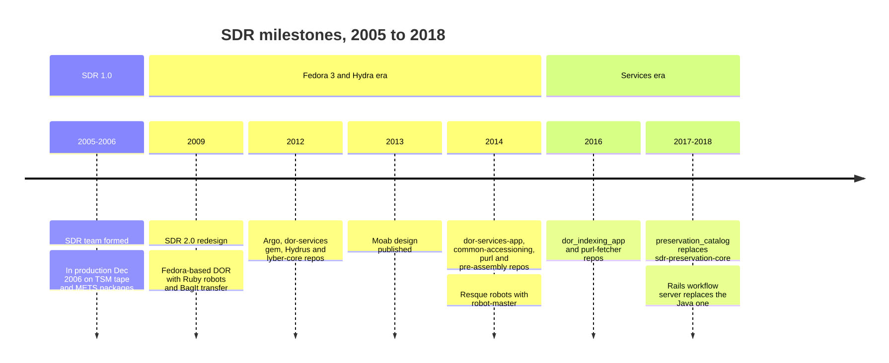
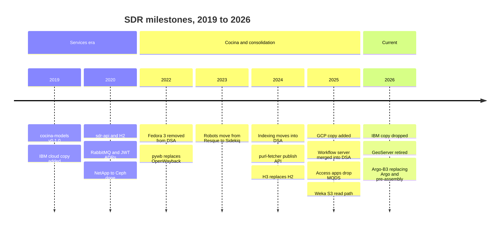

# History and lessons learned

The Stanford Digital Repository (SDR) has been in production since 2006. Over that time it has moved through several architectures. It began as a preservation system on tape. It then grew a Fedora 3 "Digital Object Registry" (DOR) with Ruby robots, split into many small services, and has since consolidated around dor-services-app (DSA), PostgreSQL and the cocina data model. This page records the dated milestones, the components that were retired, and what those changes teach. It is for developers and operators who need to know why things look the way they do. Current architecture is described in the [overview](index.md) and the [ADRs](../adr/README.md). Technical recommendations are in [Recommendations](recommendations.md).

How dates were found. Repository creation dates and archive state come from the GitHub API (`gh repo list`, `gh api repos/...`). GitHub does not record when a repository was archived, so "last push" is used as an approximate retirement date. Migration dates come from merged pull requests and from the dates EDA (engineering-design-adrs) ADRs were merged. Retired repositories now live in the [`sul-dlss-deprecated`](https://github.com/sul-dlss-deprecated) organization. Dates marked "≈" are approximate, and the evidence for each is given.

Diagram source: [history-timeline.mmd](../diagrams/history-timeline.mmd)

Diagram source: [history-timeline-recent.mmd](../diagrams/history-timeline-recent.mmd)

## Eras

### SDR 1.0: a preservation system on tape (2005–2009)

- Stanford Libraries formed a team of about ten people in 2005 to build SDR. It entered production in December 2006 ([Cramer and Kott, D-Lib 2010](https://www.dlib.org/dlib/september10/cramer/09cramer.html)). The SDR services site says "in production since 2005" ([SDR About](https://sdr.library.stanford.edu/about)). This page uses the D-Lib date because it is the contemporary account.
- After a 2005 survey that looked at Fedora and DSpace, Stanford built its own ingest, storage management, administration and access modules. It bought IBM Tivoli Storage Manager (TSM) for tape and Sun Honeycomb for online storage. Packages were METS-based: a METS "transfer manifest" was the SIP, and METS also underlay the AIP and DIP (D-Lib 2010).
- Problems found in practice (D-Lib 2010):
  - Small objects ingested slowly to TSM tape, because each object needed its own connection.
  - METS made submission heavy.
  - Staff numbers fell after the 2008 budget cuts. Only two of the original developers remained.
  - The system could not scale to the Google Books digitization stream.

### Fedora 3, DOR and Hydra (2009–2019)

- **SDR 2.0 redesign (2009).** Working groups met from April to June 2009 and recommended a simpler, narrower SDR ([D-Lib 2010](https://www.dlib.org/dlib/september10/cramer/09cramer.html)). Management, accessioning and packaging moved "above" SDR into DOR, which was built on Fedora 3, used REST services, and processed objects through Ruby "robots". SDR adopted BagIt as the transfer format from DOR. Fedora was chosen in 2008 for its object-management features and its growing community adoption. D-Lib 2010 lists Fedora, Hydra, Blacklight, Solr and djatoka among the community components Stanford reused and collaborated on.
- **Moab (2013).** Preservation stayed out of Fedora. Objects were serialized to files in a versioned layout, Moab, published by Richard Anderson in [Code4Lib Journal issue 21 (2013-07-15)](https://journal.code4lib.org/articles/8482). The gem is [moab-versioning](https://github.com/sul-dlss/moab-versioning) (repo created 2013-05-18). Moab is still the on-premises preservation format ([ADR 0016](../adr/0016-moab-and-three-cloud-copies.md)).
- **The Ruby code base (2012–2014).** GitHub repositories created in this period: [lyber-core](https://github.com/sul-dlss/lyber-core) (robot framework, 2012-01-05), [argo](https://github.com/sul-dlss/argo) (2012-07-11; its history starts 2012-04-30), the [dor-services](https://github.com/sul-dlss-deprecated/dor-services) gem (Fedora models and services, 2012-07-11), [hydrus](https://github.com/sul-dlss-deprecated/hydrus) (self-deposit, "a Hydra application", 2012-05-03), [dor-services-app](https://github.com/sul-dlss/dor-services-app) (2014-02-07), [common-accessioning](https://github.com/sul-dlss/common-accessioning) (2014-02-11), [purl](https://github.com/sul-dlss/purl) (2014-07-30), [pre-assembly](https://github.com/sul-dlss/pre-assembly) (2014-08-01), [gis-robot-suite](https://github.com/sul-dlss/gis-robot-suite) (2014-07-15) and [stacks](https://github.com/sul-dlss/stacks) (2015-08-28). In mid-2013 Argo used Blacklight 3.7, `dor-services` and `solrizer-fedora` ([argo Gemfile at f8a5645](https://github.com/sul-dlss/argo/blob/f8a56457e72cbdc23acee85efb423de6d7c9a00e/Gemfile)). At first DSA was a thin REST layer over the dor-services gem. Its repo description still says "exposing Digital Object Registry functions".
- **Resque robots (≈2014–2023).** Robots ran on Resque. [robot-master](https://github.com/sul-dlss-deprecated/robot-master) (2014) moved jobs from the workflow service onto Resque priority queues, and [robot-controller](https://github.com/sul-dlss-deprecated/robot-controller) managed the robot processes. Both are marked deprecated, with last pushes in 2019. A [robot-suite-base](https://github.com/sul-dlss-deprecated/robot-suite-base) repo describes "the new resque-based robot framework".
- **Many small services (2014–2019).** Real-time indexing went from Fedora to ActiveMQ ([dor-camel-routes](https://github.com/sul-dlss-deprecated/dor-camel-routes)), which batched updates to [dor_indexing_app](https://github.com/sul-dlss-deprecated/dor_indexing_app) (2016). [dor-fetcher-service](https://github.com/sul-dlss-deprecated/dor-fetcher-service) (2014) listed druids for harvesters. The dor-camel-routes README records why it batched: Fedora 3 sent several messages for each update, and robots also touched the same object many times. The workflow service was Java ([workflow-service](https://github.com/sul-dlss-deprecated/workflow-service), last push 2017-03). The Rails [workflow-server-rails](https://github.com/sul-dlss-deprecated/workflow-server-rails) (2018-05-08) replaced it, after the [workflux](https://github.com/sul-dlss-deprecated/workflux) and [wfs_rails](https://github.com/sul-dlss-deprecated/wfs_rails) attempts.
- **Preservation rebuilt (2017–2020).** [preservation_catalog](https://github.com/sul-dlss/preservation_catalog) (2017-08-16; planned in the [preservation2017](https://github.com/sul-dlss/preservation2017) story repo) and [preservation_robots](https://github.com/sul-dlss/preservation_robots) (2018-02-22) replaced [sdr-preservation-core](https://github.com/sul-dlss-deprecated/sdr-preservation-core). Its description reads "replaced by preservation_robots", and its last push was 2018-03-31. They also replaced the Sinatra [sdr-services-app](https://github.com/sul-dlss-deprecated/sdr-services-app), and the tape and DPN replication work ([sdr-replication](https://github.com/sul-dlss-deprecated/sdr-replication), "possibly never completed or used"). Cloud zip replication began with an IBM endpoint, added to prod config on 2019-02-22 ([Preservation](preservation.md)). Preservation storage moved from NetApp to Ceph in a three-year project that finished in 2020 ([SDR About](https://sdr.library.stanford.edu/about)).
- **Planning "SDR3" (2017–2019).** [taco-truck](https://github.com/sul-dlss-deprecated/taco-truck) (SDR3 planning), [sdr3-models](https://github.com/sul-dlss-deprecated/sdr3-models), [docker-sdr](https://github.com/sul-dlss-deprecated/docker-sdr) (a prototype full environment) and [hydrox](https://github.com/sul-dlss-deprecated/hydrox) (Hyrax as a Hydrus replacement) were explored and archived. The data-model work fed into cocina. Inference: this is based on the timing and the README of the cocina-models successor; no document directly links them.

### Cocina and API-first (2019–2022)

- **Cocina (2019).** [cocina-models](https://github.com/sul-dlss/cocina-models) was created on 2019-04-25. v0.1.0 was tagged on 2019-09-05, and DSA adopted it the same day ([DSA #370](https://github.com/sul-dlss/dor-services-app/pull/370)). It has never reached 1.0: the latest tag is v0.133.0 and the latest GitHub release is v0.132.0 (2026-07-29). All apps upgrade together ([ADR 0003](../adr/0003-cocina-shared-model-lockstep.md)).
- **EDA ADRs (2019–2021).** The [engineering-design-adrs](https://github.com/sul-dlss-labs/engineering-design-adrs) repo collected rough drafts in 2019-10 and merged them in 2020-01. Over 2020–2021 came:
  - the deposit API, [sdr-api](https://github.com/sul-dlss/sdr-api) (repo 2019-11-14; EDA 0006, 2020-02; [ADR 0004](../adr/0004-deposit-api-for-external-depositors.md));
  - a message broker (EDA 0010, 2020-03; [ADR 0006](../adr/0006-rabbitmq-for-events-kafka-for-discovery.md)). Its stated reasons were fragile synchronous HTTP between a growing set of services, and an unreliable campus network;
  - JWT service tokens (EDA 0011, 2020-04; [ADR 0007](../adr/0007-jwt-for-service-auth.md));
  - replacing Fedora (EDA 0001, superseded by EDA 0012, drafted 2021-01). EDA 0001 notes that Fedora 3 had been unsupported for four years and needed a hard-to-support JVM.
- **Supporting pieces.** [dor-services-client](https://github.com/sul-dlss/dor-services-client) (2018-12) gave every app one client for DSA. [technical-metadata-service](https://github.com/sul-dlss/technical-metadata-service) (2020-02) replaced [jhove-service](https://github.com/sul-dlss-deprecated/jhove-service). [infrastructure-integration-test](https://github.com/sul-dlss/infrastructure-integration-test) (2019-12) and [sdr-deploy](https://github.com/sul-dlss/sdr-deploy) (2020-04) arrived in the same period. Self-deposit moved from Hydrus to H2, [happy-heron](https://github.com/sul-dlss-deprecated/happy-heron) (repo 2020-06-15; its README says it replaced Hydrus).
- **Fedora 3 removed (2022).** DSA first mapped Fedora to cocina, then wrote to both stores, then dropped Fedora:
  1. migration script and audits ([#3673](https://github.com/sul-dlss/dor-services-app/pull/3673), [#3732](https://github.com/sul-dlss/dor-services-app/pull/3732), 2022-03);
  2. PostgreSQL saved before Fedora ([#3964](https://github.com/sul-dlss/dor-services-app/pull/3964), 2022-05-02);
  3. "Stop persisting to Fedora" ([#3898](https://github.com/sul-dlss/dor-services-app/pull/3898), 2022-05-09);
  4. "Remove dor-services" ([#3640](https://github.com/sul-dlss/dor-services-app/pull/3640), 2022-05-10; "Completely decouple from Fedora concepts");
  5. Fedora removed from docker-compose ([#4113](https://github.com/sul-dlss/dor-services-app/pull/4113), 2022-06-16).

  The team's own account of this migration is Littman, Giarlo, Mangiafico, Wrubel, Dushay, Collier and Falcone, "Strategies for Digital Library Migration" ([*Code4Lib Journal* issue 56, 2023-04-21](https://journal.code4lib.org/articles/17290)). It names eight strategies: adopt a validatable data model (cocina), abstract the datastore behind an API (DSA), separate concerns (for example, technical metadata moved to its own service and store), test mappings against a cache of real objects, use reports to understand the data, template unit tests for round-trip mappings, perform a rolling migration with no "flag days" (reads preferred Postgres and fell back to Fedora; writes went to both), and fold the migration into ongoing project work under a multi-year "SDR Evolution" plan. The paper reports that over 4 million objects moved in under a week once migration began in May 2022, then the result was audited to confirm every Fedora object was in Postgres before Fedora was removed.

  The dor-services gem's last push was 2022-05-11. Outcome: [ADR 0002](../adr/0002-dsa-postgres-system-of-record.md). Leftovers took years to clear: Solr fields without the `info:fedora` prefix only arrived in 2025-10 ([#5533](https://github.com/sul-dlss/dor-services-app/pull/5533)).
- **Web archive replay (2022).** pywb replaced OpenWayback (EDA 0015, merged 2022-06-01; [was-pywb](https://github.com/sul-dlss/was-pywb) created 2022-05-11; [ADR 0019](../adr/0019-pywb-for-web-archive-replay.md)). The earlier [swap](https://github.com/sul-dlss-deprecated/swap) attempt to replace [openwayback](https://github.com/sul-dlss-deprecated/openwayback) was never finished.

### Consolidation (2023–2025)

- **Resque → Sidekiq.** preservation_catalog switched in 2022-12 ([#1984](https://github.com/sul-dlss/preservation_catalog/pull/1984)). The robots followed after EDA 0017 (accepted 2023-02-01): lyber-core got a Sidekiq base class ([#90](https://github.com/sul-dlss/lyber-core/pull/90), 2023-02-21), and common-accessioning switched over ([#1029](https://github.com/sul-dlss/common-accessioning/pull/1029), 2023-02-23). EDA 0017 gave these reasons: Resque was not a standard framework, robots were the last Resque users, only part of the team knew it, and it had no job retries ([ADR 0009](../adr/0009-robots-as-sidekiq-workers.md)).
- **Kafka for discovery (2023).** purl-fetcher started producing to Kafka in 2023-03/04 ([#573](https://github.com/sul-dlss/purl-fetcher/pull/573), [#582](https://github.com/sul-dlss/purl-fetcher/pull/582)).
- **Symphony → FOLIO (2023).** DSA was prepared for the FOLIO catalog cutover in 2023-08 ([#4551](https://github.com/sul-dlss/dor-services-app/pull/4551), [#4571](https://github.com/sul-dlss/dor-services-app/pull/4571)). `release.symphony_path` remains as dead config ([Repository core](repository-core.md)).
- **Indexing moved into DSA (spring 2024).** Indexing code was briefly extracted into a [dor_indexing](https://github.com/sul-dlss-deprecated/dor_indexing) gem (2024-01 to 2024-05). It was then inlined into DSA ([#4929](https://github.com/sul-dlss/dor-services-app/pull/4929), 2024-04-30: "Indexing is now only performed in DSA"). The dor_indexing_app README says it was deprecated "as of spring 2024" ([ADR 0010](../adr/0010-dsa-writes-argo-index.md)).
- **purl-fetcher publish API and versioned public data (2024).** EDA 0020 (approved 2024-04) and EDA 0021 (decided 2024-06) made purl-fetcher the single publish and shelve API, which removed DSA's direct writes to `/stacks` and `/purl` ([ADR 0011](../adr/0011-purl-fetcher-publish-api.md), [ADR 0012](../adr/0012-versioned-public-data.md)). OCR and speech-to-text workflows were approved in 2024-04 ([ADR 0020](../adr/0020-derivative-generation-in-accessioning.md)).
- **H3 (2024).** [hungry-hungry-hippo](https://github.com/sul-dlss/hungry-hungry-hippo) (repo 2024-10-31) replaced H2. happy-heron moved to the deprecated organization but is not archived; its last push was 2026-05-16.
- **Workflow service merged into DSA (2025).** EDA 0023 was merged on 2025-05-16. DSA ported the workflow templates and lifecycle in 2025-07 ([#5435](https://github.com/sul-dlss/dor-services-app/pull/5435), [#5438](https://github.com/sul-dlss/dor-services-app/pull/5438)) and made local workflows the default on 2025-08-01 ([#5477](https://github.com/sul-dlss/dor-services-app/pull/5477)). lyber-core moved its workflow calls to dor-services-client ([#242](https://github.com/sul-dlss/lyber-core/pull/242), 2025-07-16). [dor-workflow-client](https://github.com/sul-dlss-deprecated/dor-workflow-client) (last push 2025-08-18) and workflow-server-rails (last push 2025-09-02) were archived ([ADR 0008](../adr/0008-workflow-engine-in-dsa.md)).
- **Access systems drop MODS (2025).** [cocina_display](https://github.com/sul-dlss/cocina_display) was created on 2025-06-09. purl moved its display from MODS to cocina in 2025-08/09 (for example [#1563](https://github.com/sul-dlss/purl/pull/1563), [#1568](https://github.com/sul-dlss/purl/pull/1568)). The SearchWorks indexer adopted cocina_display in 2025-09 ([#1695](https://github.com/sul-dlss/searchworks_traject_indexer/pull/1695)) ([ADR 0014](../adr/0014-access-systems-consume-cocina.md)).
- **Heracles replaces hydra_etd (2025).** [heracles-etd](https://github.com/sul-dlss/heracles-etd) was created on 2025-08-05. [hydra_etd-deprecated](https://github.com/sul-dlss/hydra_etd-deprecated) is archived, with its last push on 2025-09-26.
- **GCP replaces IBM; replication redesigned.** A GCP endpoint was added in 2025-05 ([#2406](https://github.com/sul-dlss/preservation_catalog/pull/2406); prod config on 2025-05-28). The IBM references were removed in 2026-01 ([#2597](https://github.com/sul-dlss/preservation_catalog/pull/2597)) and the prod config on 2026-04-08. Per-endpoint delivery jobs were folded into one `ReplicationJob` in 2026-01 ([#2518](https://github.com/sul-dlss/preservation_catalog/pull/2518); [Preservation](preservation.md)).
- **Weka S3 read path (2025-11).** stacks and purl moved from filesystem reads to the Weka S3 API ([stacks#1517](https://github.com/sul-dlss/stacks/pull/1517), [purl#1677](https://github.com/sul-dlss/purl/pull/1677)); their public settings point at `https://sul-weka-s3.stanford.edu` ([ADR 0013](../adr/0013-weka-s3-read-path.md), [Access and discovery](access-and-discovery.md)). Separately, Wowza had years of instability. operations-tasks#3568 (2023-12 to 2025-10) describes intermittent streaming failures that needed restarts, and ended with new streaming servers.

### Current (2026)

- **GeoServer retired.** An EarthWorks GeoServer outage alert was raised in 2026-02 (global_alerts#92). gis-robot-suite removed `gisDeliveryWF` on 2026-04-29 (#1052). Servers were decommissioned in 2026-06 (puppet#13873, terraform#1970). The stacks geo proxy was removed on 2026-07-01 ([stacks#1597](https://github.com/sul-dlss/stacks/pull/1597)). GIS data is now served as cloud-native files from stacks ([ADR 0027](../adr/0027-geoserver-retired-cloud-optimized-gis.md)).
- **Argo-B3.** [argo-b3](https://github.com/sul-dlss/argo-b3) was created on 2025-11-03. It is planned to replace both Argo and pre-assembly, and all three run today ([ADR 0023](../adr/0023-argo-b3-replaces-argo-and-pre-assembly.md)). It is the first SDR app deployed in containers with Kamal ([ADR 0022](../adr/0022-argo-b3-containers-with-kamal.md)).
- **Architecture records.** In 2026-11 the EDA repository was replaced as the place for decisions by this site's [ADRs](../adr/README.md) ([ADR 0001](../adr/0001-record-architecture-decisions.md)).

## Retired components

"Years" run from repository creation (or the first evidence of use) to the last push or the removal PR. Repositories in `sul-dlss-deprecated` are archived unless the table says otherwise.

| Component | Role | Years (≈) | Replaced by | Evidence |
| --- | --- | --- | --- | --- |
| TSM tape and METS packages (SDR 1.0) | Preservation storage and package format | 2006–≈2012 (Inference: Moab on disk was in use by 2013) | Moab on disk, BagIt transfer | [D-Lib 2010](https://www.dlib.org/dlib/september10/cramer/09cramer.html), [Code4Lib 2013](https://journal.code4lib.org/articles/8482) |
| Fedora 3 (DOR) | Management metadata store | 2008–2022 | DSA on PostgreSQL with cocina | D-Lib 2010; [DSA #3898](https://github.com/sul-dlss/dor-services-app/pull/3898) |
| [dor-services](https://github.com/sul-dlss-deprecated/dor-services) gem | Fedora/Hydra models and services | 2012–2022 | DSA services and cocina-models | [DSA #3640](https://github.com/sul-dlss/dor-services-app/pull/3640) |
| [dor-rights-auth](https://github.com/sul-dlss-deprecated/dor-rights-auth) | Hydra `rightsMetadata` parsing | 2014–≈2022 | cocina `access` | Repo description |
| [hydrus](https://github.com/sul-dlss-deprecated/hydrus) | Self-deposit (Hydra) | 2012–≈2022 | H2, then H3 | Repo description: "Superseded by happy-heron" |
| [happy-heron](https://github.com/sul-dlss-deprecated/happy-heron) (H2) | Self-deposit | 2020–≈2025 | H3 | Not archived; no hosts in puppet ([Management and deposit](management-and-deposit.md)) |
| [hydra_etd](https://github.com/sul-dlss/hydra_etd-deprecated) | ETD submission | 2015–2025 | Heracles ETD | Repo description "DEPRECATED ETD application" |
| [workflow-service](https://github.com/sul-dlss-deprecated/workflow-service) (Java) | Workflow state | ≈2015–≈2018 | workflow-server-rails | Repo description |
| [workflow-server-rails](https://github.com/sul-dlss-deprecated/workflow-server-rails) | Workflow state and robot enqueueing | 2018–2025 | DSA workflow engine | [ADR 0008](../adr/0008-workflow-engine-in-dsa.md) |
| [dor-workflow-client](https://github.com/sul-dlss-deprecated/dor-workflow-client) | Workflow client gem | 2013–2025 | dor-services-client | [lyber-core #242](https://github.com/sul-dlss/lyber-core/pull/242) |
| [workflow-archiver](https://github.com/sul-dlss-deprecated/workflow-archiver), [-job](https://github.com/sul-dlss-deprecated/workflow-archiver-job) | Moved completed workflow rows to an archive table | 2014–2019 | None found | Repo descriptions |
| [robot-master](https://github.com/sul-dlss-deprecated/robot-master), [robot-controller](https://github.com/sul-dlss-deprecated/robot-controller) | Resque queue mediation and process control | 2014–2019 | Workflow server enqueueing and resque-pool, later Sidekiq | Repo descriptions |
| Resque robot framework | Robot job processing | ≈2014–2023 | Sidekiq on lyber-core | [CA #1029](https://github.com/sul-dlss/common-accessioning/pull/1029), EDA 0017 |
| [assembly](https://github.com/sul-dlss-deprecated/assembly), [item-release](https://github.com/sul-dlss-deprecated/item-release), [etd-robots](https://github.com/sul-dlss-deprecated/etd-robots), [goobi-robot](https://github.com/sul-dlss-deprecated/goobi-robot) | Separate robot suites | 2014–2019 | common-accessioning (merged) | Repo descriptions "merged into common-accessioning" |
| `was-*` robot repos (for example [was-crawl-preassembly](https://github.com/sul-dlss-deprecated/was-crawl-preassembly)) | Web archive robots | 2014–2016 | was_robot_suite | Repo descriptions |
| [dor-camel-routes](https://github.com/sul-dlss-deprecated/dor-camel-routes) (ActiveMQ) | Batches Fedora and workflow change messages for indexing | 2015–≈2021 | DSA-triggered indexing (Inference) | README |
| [dor_indexing_app](https://github.com/sul-dlss-deprecated/dor_indexing_app), [dor_indexing](https://github.com/sul-dlss-deprecated/dor_indexing) | Argo Solr indexing | 2016–2024 | DSA in-process indexing | README; [DSA #4929](https://github.com/sul-dlss/dor-services-app/pull/4929) |
| [dor-fetcher-service](https://github.com/sul-dlss-deprecated/dor-fetcher-service) | Druid harvesting API | 2014–2020 | Unverified: no direct successor documented | Last push 2020-02-18 |
| [gdor-indexer](https://github.com/sul-dlss-deprecated/gdor-indexer), [discovery-dispatcher](https://github.com/sul-dlss-deprecated/discovery-dispatcher) | Index PURLs into SearchWorks | 2014–2018 | searchworks_traject_indexer fed by Kafka (Inference) | Repo descriptions |
| [sdr-preservation-core](https://github.com/sul-dlss-deprecated/sdr-preservation-core) | Preservation ingest robots | 2014–2018 | preservation_robots | Repo description |
| [sdr-services-app](https://github.com/sul-dlss-deprecated/sdr-services-app) | Read access to preservation storage | 2014–2020 | preservation_catalog API (Inference) | Repo description "[DEPRECATED]" |
| [sdr-replication](https://github.com/sul-dlss-deprecated/sdr-replication), [archive-catalog](https://github.com/sul-dlss-deprecated/archive-catalog), [DPN_gem](https://github.com/sul-dlss-deprecated/DPN_gem) | Tape and DPN replication | 2014–2018 | preservation_catalog cloud zip replication | Repo descriptions ("possibly never completed or used") |
| NetApp preservation storage | On-premises Moab storage | –2020 | Ceph | [SDR About](https://sdr.library.stanford.edu/about) |
| IBM Cloud endpoint | Third preservation copy | 2019–2026 | GCP us-south1 | [prescat #2597](https://github.com/sul-dlss/preservation_catalog/pull/2597); [Preservation](preservation.md) |
| [jhove-service](https://github.com/sul-dlss-deprecated/jhove-service) | Technical metadata | 2013–2020 | technical-metadata-service | Repo description |
| [openwayback](https://github.com/sul-dlss-deprecated/openwayback), [swap](https://github.com/sul-dlss-deprecated/swap) | Web archive replay | 2014–≈2022 | pywb | [ADR 0019](../adr/0019-pywb-for-web-archive-replay.md) |
| [was-registrar](https://github.com/sul-dlss-deprecated/was-registrar) | Web archive registration | 2014–2019 | was-registrar-app | Repo dates |
| Symphony integration | Catalog (MARC 856, catkeys) | –2023 | FOLIO | [DSA #4551](https://github.com/sul-dlss/dor-services-app/pull/4551) |
| GeoServer and PostGIS (`gisDeliveryWF`) | GIS WMS/WFS delivery | –2026 | Cloud-native files from stacks | [ADR 0027](../adr/0027-geoserver-retired-cloud-optimized-gis.md) |
| Filesystem reads of `/stacks` by stacks and purl; dlss-wowza plugin | Public file and metadata reads; stream authorization | –2025 | Weka S3 reads; Wowza SecureToken | [ADR 0013](../adr/0013-weka-s3-read-path.md) |
| [hydrox](https://github.com/sul-dlss-deprecated/hydrox), [docker-sdr](https://github.com/sul-dlss-deprecated/docker-sdr), [taco-truck](https://github.com/sul-dlss-deprecated/taco-truck) | Experiments and SDR3 planning | 2017–2020 | Not adopted | Repo descriptions |
| Argo, pre-assembly (planned) | Staff management and batch deposit | 2012/2014– | Argo-B3 | [ADR 0023](../adr/0023-argo-b3-replaces-argo-and-pre-assembly.md) |

## Lessons learned

### 1. A retirement is not finished when the code merges

- **Evidence.** Every major consolidation left live configuration behind:
  - `workflow.url` and `dor_indexing.url` remain in shared_configs for DSA, Argo, pre-assembly, H3, sdr-api and the robots, months to years after the services were merged ([Repository core](repository-core.md), [Management and deposit](management-and-deposit.md)).
  - argo-stage still points at a Fedora URL.
  - preservation_catalog config keeps `delivery_class` keys and removed Sidekiq queues ([Preservation](preservation.md)).
  - The prescat web-server configuration still carries Resque-era entries almost four years after Sidekiq replaced Resque (2022-12).
  - Firewall rules outlived some retired services ([Platform and operations](platform-and-operations.md)).
  - GeoServer left a PostGIS database, stage config and puppet backup entries ([Access and discovery](access-and-discovery.md)).
  - Orphaned workflow templates with no robot code remain (`gisDeliveryWF`, `captionWF`, `wasSeedDisseminationWF`), as do unused all-`skip-queue` templates such as `preservationAuditWF` ([Accessioning](accessioning.md#known-issues-and-cleanup)).
- **Implication.** Plan a decommission as its own piece of work, with a checklist that covers every place a component is referenced (see [Opportunities](#opportunities-to-grow)).

### 2. Record what was built, not only what was proposed

- **Evidence.**
  - EDA statuses were rarely updated after a decision shipped. 0012 (Fedora replacement) still says "drafted", 0015 (pywb) "drafted" and 0023 (workflow merge) "proposed", although all three are in production.
  - Numbers collide (PRs #37, #47 and #54 reuse numbers already taken).
  - Some big decisions were not recorded in EDA when they were made: moving robots into DSA, which reversed part of EDA 0017; adding Kafka alongside RabbitMQ, whose EDA 0010 recommends RabbitMQ only; the Weka S3 read path; retiring GeoServer. They were first written down as this site's ADRs in 2026 ([ADR index](../adr/README.md), [ADR 0009](../adr/0009-robots-as-sidekiq-workers.md)).
- **Implication.** Update an ADR's status in the pull request that ships the change. Write an ADR when a decision reverses an earlier one.

### 3. Put your own seam in front of a platform before you replace it

- **Evidence.**
  - Fedora 3 was adopted in 2008 for its community momentum (D-Lib 2010). By EDA 0001 it had been unsupported for four years.
  - Removal became possible only after the team built its own model and API in front of it: cocina (2019), the DSA cocina API ([#370](https://github.com/sul-dlss/dor-services-app/pull/370), 2019), and dor-services-client (2018). The DSA team could then dual-write, switch the save order, and drop Fedora in a few weeks of 2022.
  - purl-fetcher's publish API (2024) did the same for the `/stacks` and `/purl` mounts, and made the later move of readers to S3 cheaper.
  - The team's 2023 paper calls this "abstract the datastore behind an API" and identifies rewriting applications to use cocina and DSA, instead of Fedora directly, as probably the largest single effort of the migration ([Code4Lib Journal 56](https://journal.code4lib.org/articles/17290)).
- **Implication.** Talk to infrastructure through an interface the team owns: a model, an API or a client gem. That keeps the next migration small. Argo-B3 should read through DSA and SDR APIs, not through shared mounts or the Solr schema alone.

### 4. Fewer, larger services suit a small team, but the blast radius grows

- **Evidence.**
  - D-Lib 2010 already argued for a "simpler, more narrowly scoped" SDR because staff numbers had fallen.
  - The 2014–2019 services era multiplied deployables. Indexing alone went through Fedora, ActiveMQ, Camel and dor_indexing_app. The broker ADR (EDA 0010) cites the fragility of many services calling each other synchronously over an unreliable network.
  - 2024–2025 reversed the split: indexing, the workflow engine and some robots moved into DSA.
  - The cost is concentration. A DSA outage now stops deposit, accessioning, indexing and the DSA-hosted robots ([ADR 0002](../adr/0002-dsa-postgres-system-of-record.md)). Synchronous Solr writes turn Solr problems into DSA errors ([ADR 0010](../adr/0010-dsa-writes-argo-index.md)). EDA 0023 accepted that workflow operations become less visible inside the monolith.
- **Implication.** Consolidate to cut operational load. When you do, record the new single points of failure, and make sure monitoring and runbooks keep up.

### 5. Prefer standard, widely known tools to bespoke frameworks

- **Evidence.**
  - The Resque robot stack (robot-master, robot-controller, Resque) was replaced by Sidekiq. Part of the reason was that only some of the team understood it, and it had no retries (EDA 0017).
  - The Java workflow service was rewritten in Rails, the language the team works in.
  - OpenWayback gave way to pywb, and a local fork (swap) was abandoned.
  - GeoServer's WMS/WFS stack gave way to static cloud-native files.
  - The custom Wowza auth plugin gave way to Wowza's built-in secure token.
- **Implication.** Count the knowledge and maintenance cost of a custom or forked component, not only how well it performs.

### 6. Storage assumptions outlive the storage

- **Evidence.**
  - Moab stores each object as a normal filesystem directory tree ([Code4Lib 2013](https://journal.code4lib.org/articles/8482)). Stanford has since helped specify OCFL, which is based on Moab, and says it plans to implement OCFL ([SDR About](https://sdr.library.stanford.edu/about)). Meanwhile public reads have moved to S3 (2025), and preservation copies go to cloud object stores as zip parts.
  - In the June 2022 campus power and network outages, Ceph/NFS metadata inconsistencies left some newly written Moab versions unreadable or incomplete; the team suspected that moab-versioning's hard-linking over NFS (translated to copies underneath) made it worse. During the response, an engineer raised the concern that pres cat might replicate known-bad versions, and another disputed that it would; it was not established as having happened. The affected objects were checksum-validated and repaired, two of them by recovery from the cloud copies, and the issue closed in July 2022 ([preservation_catalog#1896](https://github.com/sul-dlss/preservation_catalog/issues/1896)). preservation_robots now ingests with `use_links: false` (copying instead of hard-linking; [`update_moab.rb`](https://github.com/sul-dlss/preservation_robots/blob/main/lib/robots/sdr_repo/preservation_ingest/update_moab.rb#L25)).
  - NetApp → Ceph took three years (SDR About).
  - In 2016 a single storage change took down every system that mounted `/stacks` (operations-tasks#70).
  - preservation_catalog now gates replication on validation: it skips replication unless the Moab record's status is `ok` ([`replicate_version_service.rb`](https://github.com/sul-dlss/preservation_catalog/blob/main/app/services/replication/replicate_version_service.rb#L21)).
- **Implication.** Treat shared mounts as shared failure domains. Keep replication gated on validation. Prefer object-storage-friendly formats and paths: OCFL is on the SDR roadmap but is not implemented ([Preservation](preservation.md)).

### 7. Add the replacement before removing the original

- **Evidence.**
  - GCP was configured in 2025-05, about ten months before the IBM endpoint was dropped, so the replacement endpoint existed before the old one was removed. (Configuration dates alone don't prove every object had three complete copies throughout; that would need replication-audit records.)
  - DSA wrote to Fedora and PostgreSQL together before cutting over, preferring Postgres on read with fallback to Fedora. The design requirement was no "flag days", so the migration never needed SDR taken offline; the paper does still report one forced Fedora restart, to expand log disk, that took effort to recover ([Code4Lib Journal 56](https://journal.code4lib.org/articles/17290), strategy 7 and conclusion).
  - The workflow merge sat behind a `local_wf` flag before it became the default.
  - The FOLIO cutover used feature flags ([#4571](https://github.com/sul-dlss/dor-services-app/pull/4571)).
  - Argo-B3 is running alongside Argo and pre-assembly.
- **Implication.** Keep using overlap and flags. Pair each one with a removal date, so the flag and the old path do not become lesson 1's leftovers.

### 8. Data model changes take years to reach every consumer

- **Evidence.**
  - Cocina reached DSA in 2019. Fedora was gone in 2022. The access systems still read MODS until 2025, when cocina_display arrived.
  - cocina-models is at 0.133 and has never been declared stable. Every change requires a coordinated upgrade of all apps ([ADR 0003](../adr/0003-cocina-shared-model-lockstep.md)).
  - An open EDA draft (PR #54) proposes moving display logic out of the gem.
- **Implication.** Plan model migrations to cover consumers outside the core, and budget for them. Keep the shared gem small enough that lockstep upgrades stay cheap.

### 9. Cross-service safety nets pay off

- **Evidence.** [infrastructure-integration-test](https://github.com/sul-dlss/infrastructure-integration-test) (2019) runs end-to-end deposit flows. The DSA and robot PR templates ask authors to run it when a change has cross-service impact (for example [DSA #3898](https://github.com/sul-dlss/dor-services-app/pull/3898) in 2022, and [common-accessioning #1029](https://github.com/sul-dlss/common-accessioning/pull/1029)). This was the safety net for the 2022–2025 migrations.
- **Implication.** Extend the integration specs for each new front end. Argo-B3 already has its own specs.

## Recurring patterns

- **Migrations leave dead config and dead plumbing.** Examples: `workflow.url`, `dor_indexing.url`, `release.symphony_path`, `delivery_class`, the `/resque/` vhost path, stale firewall stacks, the `dor.indexing-by-druid` queue, and the `sdr.objects.created` and `sdr.objects.embargo_lifted` exchanges ([Repository core](repository-core.md)).
- **Docs lag code.** READMEs and wikis still point at workflow-server-rails for workflow definitions. The argo wiki has a Fedora-to-Solr diagram. DevOpsDocs lists Symphony and Nagios. This repo's own `sdr/messages.md` predated the workflow merge until these pages replaced it ([Overview](index.md#known-issues-and-cleanup)).
- **Names outlive systems.** "Digital Object Registry" in repo descriptions, `dlss:hydrus-app-*` workgroups in H3, the `info:fedora` Solr prefix until 2025, `dor_indexing` settings, and "SDR Preservation Core" labels.
- **Inconsistent retirement.** Most retired repos are archived in `sul-dlss-deprecated`. happy-heron, stanford-mods and sdr-replication were moved but not archived, and hydra_etd was renamed in place.
- **Successor builds run alongside the original.** Hydrus → H2 → H3, hydra_etd → Heracles, Argo → Argo-B3, Java → Rails workflow → DSA. Each cutover is followed by a long tail of cleanup.
- **Lessons live in Slack.** Incident analysis exists, but mostly as GitHub issues that link to Slack threads (for example preservation_catalog#1896 and operations-tasks#2637). No incident or postmortem series was found in DevOpsDocs or DeveloperPlaybook.
- **Outages trigger retirements.** Wowza instability (2023–2025) came before the new streaming servers. The GeoServer outage (2026-02) came before its decommissioning. Inference: both are temporal correlations, and the retirement plans may predate the outages.

## Opportunities to grow

Most of these are team and process opportunities. Technical changes are covered briefly here and in full in [Recommendations](recommendations.md).

- **A decommission checklist** used for every retirement, Argo and pre-assembly first:
  - shared_configs keys and branches;
  - puppet nodes, firewall stacks, vhost paths and monitoring;
  - DNS names;
  - RabbitMQ exchanges and queues, Sidekiq queues and workflow templates;
  - Solr fields;
  - READMEs, wikis, DevOpsDocs and these pages;
  - archiving the repository in `sul-dlss-deprecated` with a "replaced by" line.

  The current cleanup lists in each page's "Known issues" section are a ready-made first backlog.
- **Keep ADRs current.** Update status in the shipping PR, add an ADR when a decision reverses an earlier one (as for robots in DSA), and review the [ADR index](../adr/README.md) when this site is reverified.
- **Durable incident write-ups.** A short postmortem template stored in the repo, so that what an incident actually established, as opposed to what was suspected, survives (reconstructing preservation_catalog#1896 for these docs required reading the whole issue thread).
- **Spread knowledge before it concentrates.** EDA 0017 named concentrated Resque knowledge as a risk. The DSA monolith and the Wowza streaming setup are today's equivalents. Pairing and runbooks reduce that risk.
- **Date-stamp and reverify docs.** These pages end with a verification date. Doing the same for READMEs and DevOpsDocs pages would make drift visible.
- **Plan the Argo-B3 transition's tail now.** Argo's DSA GraphQL endpoint has no other client ([ADR 0021](../adr/0021-graphql-for-cocina-retrieval.md)). pre-assembly's RabbitMQ consumer and Argo's shared_configs keys will need explicit removal.
- **Technical, briefly.** Delete the dead config and messaging listed above. Add checksum-level verification of cloud copies and a tested restore path. Reconsider the deliberate shared-environment choices ([ADR 0024](../adr/0024-qa-shares-stage-access-systems.md), [ADR 0025](../adr/0025-shared-prod-solrcloud.md)). Details are in [Recommendations](recommendations.md).

## Sources

- GitHub API, 2026-11-16: `gh repo list sul-dlss` and `gh repo list sul-dlss-deprecated` (creation dates, last push, archive flag, descriptions); `gh api repos/sul-dlss-deprecated/<repo>/readme` for dor_indexing_app, workflow-server-rails, hydrus, happy-heron, dor-services and dor-camel-routes.
- Tom Cramer and Katherine Kott, "Designing and Implementing Second Generation Digital Preservation Services: A Scalable Model for the Stanford Digital Repository", *D-Lib Magazine* 16(9/10), 2010: <https://www.dlib.org/dlib/september10/cramer/09cramer.html>
- Richard Anderson, "The Moab Design for Digital Object Versioning", *Code4Lib Journal* issue 21, 2013-07-15: <https://journal.code4lib.org/articles/8482>
- Justin Littman, Mike Giarlo, Peter Mangiafico, Laura Wrubel, Naomi Dushay, Aaron Collier and Arcadia Falcone, "Strategies for Digital Library Migration", *Code4Lib Journal* issue 56, 2023-04-21: <https://journal.code4lib.org/articles/17290>
- OCFL Editorial Group, *Oxford Common File Layout Specification 1.1*, §5.5 "Moab in an OCFL Object": <https://ocfl.io/1.1/spec/#example-moab-in-ocfl>
- Stanford Digital Repository, "About": <https://sdr.library.stanford.edu/about>
- [engineering-design-adrs](https://github.com/sul-dlss-labs/engineering-design-adrs) (0001, 0010, 0012, 0016, 0017, 0020, 0023) and its PR list (`gh pr list --state all`).
- dor-services-app PRs [#370](https://github.com/sul-dlss/dor-services-app/pull/370), [#3640](https://github.com/sul-dlss/dor-services-app/pull/3640), [#3673](https://github.com/sul-dlss/dor-services-app/pull/3673), [#3898](https://github.com/sul-dlss/dor-services-app/pull/3898), [#3964](https://github.com/sul-dlss/dor-services-app/pull/3964), [#4113](https://github.com/sul-dlss/dor-services-app/pull/4113), [#4551](https://github.com/sul-dlss/dor-services-app/pull/4551), [#4929](https://github.com/sul-dlss/dor-services-app/pull/4929), [#5435](https://github.com/sul-dlss/dor-services-app/pull/5435), [#5477](https://github.com/sul-dlss/dor-services-app/pull/5477), [#5533](https://github.com/sul-dlss/dor-services-app/pull/5533).
- common-accessioning [#1029](https://github.com/sul-dlss/common-accessioning/pull/1029); lyber-core [#90](https://github.com/sul-dlss/lyber-core/pull/90), [#242](https://github.com/sul-dlss/lyber-core/pull/242); preservation_catalog [#1984](https://github.com/sul-dlss/preservation_catalog/pull/1984), [#2406](https://github.com/sul-dlss/preservation_catalog/pull/2406), [#2518](https://github.com/sul-dlss/preservation_catalog/pull/2518), [#2597](https://github.com/sul-dlss/preservation_catalog/pull/2597), issue [#1896](https://github.com/sul-dlss/preservation_catalog/issues/1896); purl-fetcher [#573](https://github.com/sul-dlss/purl-fetcher/pull/573); purl [#1563](https://github.com/sul-dlss/purl/pull/1563); searchworks_traject_indexer [#1695](https://github.com/sul-dlss/searchworks_traject_indexer/pull/1695); stacks [#1597](https://github.com/sul-dlss/stacks/pull/1597).
- Private repositories: [operations-tasks#70](https://github.com/sul-dlss/operations-tasks/issues/70), [#2637](https://github.com/sul-dlss/operations-tasks/issues/2637), [#3568](https://github.com/sul-dlss/operations-tasks/issues/3568); [global_alerts#92](https://github.com/sul-dlss/global_alerts/issues/92); puppet and shared_configs history as cited in [Preservation](preservation.md) and [Access and discovery](access-and-discovery.md).
- [argo Gemfile at f8a5645 (2013-05-31)](https://github.com/sul-dlss/argo/blob/f8a56457e72cbdc23acee85efb423de6d7c9a00e/Gemfile).
- This site's subsystem pages and [ADRs](../adr/README.md) for the current state and "Known issues" evidence.

_Verified against default branches on 2026-11-16; private-source details redacted 2026-11-17._
