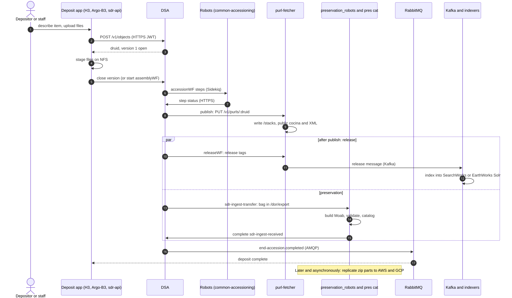

# Stanford Digital Repository architecture

The Stanford Digital Repository (SDR) takes in digital content and its metadata, turns each deposit into a versioned repository object, preserves every version, and publishes the public parts for delivery and discovery. Its path is **deposit → accession → preserve → publish/discover**. SDR proper covers the management and deposit apps, the repository core ([dor-services-app](repository-core.md), DSA), the accessioning robots and preservation. Its boundary is the publish call to purl-fetcher. The access and discovery systems downstream of purl-fetcher (purl, stacks, image and media delivery, SearchWorks, EarthWorks, Exhibits) belong mostly to the access team. They are documented here because they consume SDR data. Every service runs on puppet-managed VMs, and none runs on Kubernetes. Argo-B3 will replace Argo and pre-assembly in the coming months ([ADR 0023](../adr/0023-argo-b3-replaces-argo-and-pre-assembly.md)). These pages describe what runs today. Terms are defined in the [Glossary](../../GLOSSARY.md).

## System context

People and external systems around SDR. Depositors and staff use the management apps, the public uses delivery services, and discovery users use the catalogs, which link back to delivery.

Diagram source: [overview-context.mmd](../diagrams/overview-context.mmd)

| External system | Used by | For |
| --- | --- | --- |
| Shibboleth IdP and Workgroup Manager | Every staff and depositor web app; stacks | Login, plus `eduPersonEntitlement` workgroups for authorization ([ADR 0026](../adr/0026-shibboleth-entitlements-for-authz.md)) |
| Globus (the prod Globus server) | H3, sdr-api, pre-assembly, Argo-B3 | Large uploads, mounted at `/globus` ([Management and deposit](management-and-deposit.md)) |
| FOLIO | DSA, Heracles ETD, SearchWorks indexing | MARC-derived description, HRID and barcode lookups, 856 links and holdings ([Repository core](repository-core.md)) |
| DataCite | DSA (accessionWF `update-doi`) | DOIs with prefix `10.25740` in prod ([Repository core](repository-core.md)) |
| ORCID, via MaIS | DSA (accessionWF `update-orcid-work`) | Research works for contributors with ORCID iDs |
| ABBYY | common-accessioning ocrWF | OCR, through CIFS hot folders ([Accessioning](accessioning.md)) |
| AWS | preservation-catalog; common-accessioning | Zip-part copies in S3 us-west-2 and us-east-1 ([Preservation](preservation.md)); speech-to-text on Batch and SQS, which is off in prod ([Accessioning](accessioning.md)) |
| GCP | preservation-catalog | Zip-part copies in us-south1 |
| Archive-It, Google GRIN, Registrar (PeopleSoft), Goobi | was-registrar-app, Google Books, Heracles ETD, DSA goobiWF | Sources of web archives, digitized books and theses, and the digitization workflow tool |

## Component map

The SDR back end. Every management and deposit app reaches SDR through DSA. DSA queues robot work on Redis, and the robots report status back to DSA over HTTPS.

Diagram source: [overview-components.mmd](../diagrams/overview-components.mmd)

Access and discovery. purl-fetcher is the only writer of public data, and the only Kafka producer. It writes through a shared filesystem mount; readers use S3.

Diagram source: [overview-components-access.mmd](../diagrams/overview-components-access.mmd)

Main transports:

| Transport | Used for | Details |
| --- | --- | --- |
| HTTPS with JWT | Every app → DSA; robots → DSA (step status); DSA → purl-fetcher, preservation-catalog | [ADR 0007](../adr/0007-jwt-for-service-auth.md) |
| Sidekiq on Redis | DSA → robots: one queue per workflow (per step for accessionWF) and lane | [ADR 0009](../adr/0009-robots-as-sidekiq-workers.md), [Accessioning](accessioning.md) |
| RabbitMQ (AMQP) | Provenance events into DSA; workflow notices (`end-accession.completed`) to H3 and pre-assembly | [ADR 0005](../adr/0005-events-recorded-in-dsa.md), [ADR 0006](../adr/0006-rabbitmq-for-events-kafka-for-discovery.md), [Repository core](repository-core.md) |
| Kafka | purl-fetcher → discovery indexers (release and unpublish only) | [ADR 0018](../adr/0018-release-tags-drive-discovery.md), [Access and discovery](access-and-discovery.md) |
| NFS (shared filesystems, including Ceph) | Staging and workspace (`/dor`, `/sdr-deposit-staging`), transfer to purl-fetcher (`/access-transfer`), public files written by purl-fetcher (`/stacks`), Moab storage roots | [Accessioning](accessioning.md), [Preservation](preservation.md) |
| S3 | Public readers on Weka S3 (`https://sul-weka-s3.stanford.edu`); preservation zip parts on AWS and GCP | [ADR 0013](../adr/0013-weka-s3-read-path.md), [ADR 0016](../adr/0016-moab-and-three-cloud-copies.md) |
| Solr | DSA writes `argo_<env>`; indexers write the discovery collections, all on the prod SolrCloud | [ADR 0010](../adr/0010-dsa-writes-argo-index.md), [ADR 0025](../adr/0025-shared-prod-solrcloud.md) |

## Life of an item

Diagram source: [overview-item-lifecycle.mmd](../diagrams/overview-item-lifecycle.mmd)

1. **Deposit.** A depositor uses H3, or staff use Argo-B3 (or legacy Argo and pre-assembly), or a program uses sdr-api. The app describes the item and puts its files on a staging mount or Globus. See [Management and deposit](management-and-deposit.md).
2. **Register.** The app calls `POST /v1/objects` on DSA. DSA mints a druid from SURI, applies the APO's access template, optionally assigns a DOI, and stores version 1 as an open version. See [Repository core](repository-core.md) and [Data model](data-model.md).
3. **Assemble and close.** Items with files go through assemblyWF (or the GIS and web archive equivalents), which closes the version. Other changes close the version directly. Closing starts accessionWF. See [Accessioning](accessioning.md).
4. **Accession.** Robots move files into the workspace and request technical metadata. DSA's own robots publish, start release, update DataCite and ORCID, and export a preservation bag. See [Accessioning](accessioning.md).
5. **Publish.** DSA stages changed files in `/access-transfer` and calls purl-fetcher. purl-fetcher writes the public cocina, public XML and shelved files to `/stacks`, versioned by user version. purl and stacks serve them right away. See [Access and discovery](access-and-discovery.md#publish).
6. **Preserve.** preservation_robots builds or extends the Moab, and preservation-catalog validates and catalogs it, which completes the preservation steps of accessioning. Separately and asynchronously, preservation-catalog replicates the version as zip parts to AWS (two regions) and GCP and audits all the copies; accessioning does not wait for replication. See [Preservation](preservation.md).
7. **Finish accessioning.** The workspace is cleaned up, `end-accession` runs, and DSA publishes `end-accession.completed`. H3 and pre-assembly use it to update their own state. "Accessioned" therefore does not mean "replicated to the cloud".
8. **Release and discover.** Release does not wait for the end of accessioning: accessionWF starts releaseWF right after publishing. releaseWF sends the object's release tags to purl-fetcher. purl-fetcher produces Kafka messages, and the SearchWorks indexer and EarthWorks index the item. Exhibits harvests the druids its curators add. See [Access and discovery](access-and-discovery.md#part-2-discovery).
9. **Change later.** Staff open a new version, edit, and close it again, which repeats steps 3–8. Embargo release opens and closes a version automatically ([ADR 0017](../adr/0017-embargo-release-opens-version.md)). Making an object dark unpublishes it and sends Kafka tombstones.

The [Data model](data-model.md#7-object-lifecycle) page follows the same item through each stored representation.

## Subsystems

| Subsystem | Responsibility | Main services | Page |
| --- | --- | --- | --- |
| Data model | The cocina model, identifiers, versions, and every derived representation | cocina-models, DSA databases | [Data model and data flows](data-model.md) |
| Management and deposit | Every way content and metadata enter SDR; staff management tools | Argo, Argo-B3, pre-assembly, H3, sdr-api, sdr-client, Heracles ETD, Google Books, was-registrar-app, modsulator-app | [Management and deposit](management-and-deposit.md) |
| Repository core | System of record, versioning, workflow engine, Argo index, events, identifiers | dor-services-app, dor-services-client, SURI, technical-metadata-service, RabbitMQ | [Repository core](repository-core.md) |
| Accessioning | Workflow templates and the robots that run them | DSA robots, common-accessioning, gis-robot-suite, was_robot_suite, lyber-core, robot-console | [Accessioning](accessioning.md) |
| Preservation | Moab storage, cloud replication, audits, retrieval | preservation_robots, preservation-catalog, preservation-client, moab-versioning | [Preservation](preservation.md) |
| Access and discovery | Publishing, public delivery, and discovery indexing | purl-fetcher, purl, stacks, Cantaloupe, Wowza, sul-embed, was-pywb, sdr-metrics-api, Kafka, SearchWorks, EarthWorks, Exhibits, content_search | [Access and discovery](access-and-discovery.md) |
| Platform and operations | Provisioning, configuration, authentication, deployment, CI, observability, shared services | Puppet and hiera, Vault, shared_configs, Capistrano, Kamal, sdr-deploy, Jenkins, CircleCI | [Platform and operations](platform-and-operations.md) |
| Environments | What each environment is for, and how they connect | all | [Environments](environments.md) |

## How to navigate

- **Start here, then the subsystem pages** above. Each opens with a summary, a diagram, and its components, interfaces, key flows, hosts, configuration, and known issues.
- **[Environments](environments.md)**: the service × environment matrix and the cross-environment wiring. Hosts themselves are defined in the private puppet repository's node data.
- **[Architecture decision records](../adr/README.md)**: why SDR is built this way. Decisions worth reconsidering are recorded as ADRs, e.g. [ADR 0024](../adr/0024-qa-shares-stage-access-systems.md) and [ADR 0025](../adr/0025-shared-prod-solrcloud.md).
- **[Glossary](../../GLOSSARY.md)**: the canonical SDR terms. Use them in code, docs and tickets.
- **[Open questions](open-questions.md)**: things these docs could not determine from code or config, grouped by subsystem.
- **[Recommendations](recommendations.md)**: proposed cleanup and changes, drawn from the "Known issues and cleanup" sections.
- **Finding config for a service:** follow the recipe in [Platform and operations](platform-and-operations.md#recipe-find-a-services-configuration).

## Conventions in these docs

- **Sources.** Facts come from each repository's default branch, puppet hiera and shared_configs, in that order of authority. Where prose docs (READMEs, DevOpsDocs, DeveloperPlaybook) disagree with code, the code wins and the disagreement is listed under "Known issues and cleanup". Each page ends with its sources and the date it was verified.
- **Uncertainty.** "Unverified:" marks a claim that could not be confirmed. "Inference:" marks a conclusion drawn from evidence rather than read directly. Unresolved items are collected in [Open questions](open-questions.md).
- **Deliberate choices.** Unusual wiring that is intentional, such as QA using stage access systems or every environment using the prod SolrCloud, is labelled "a decision worth reconsidering", not a bug.
- **Names.** Hostnames are written without `.stanford.edu`. `<env>` stands for `prod`, `stage` or `qa` (sometimes `uat`). `{a,b}` and `a…-d` abbreviate host series. Short names: DSA (dor-services-app), pres cat (preservation-catalog), PF (purl-fetcher), H3 (hungry-hungry-hippo), CA (common-accessioning), APO (admin policy).
- **Workflows.** Workflow and step names are written as in DSA's templates, e.g. accessionWF `sdr-ingest-transfer`. Queue and exchange names are in code font.
- **Diagrams.** Mermaid sources live in [`docs/diagrams`](../diagrams/), each with its rendered SVG beside it. Render them with `npm run diagrams`. Flowcharts use one palette: blue boxes are applications, amber cylinders are datastores and filesystems, green hexagons are message brokers, and dashed grey boxes are external systems. Edge labels name the transport.
- **Secrets and private details.** Hostnames, paths, queues and buckets are published only where they already appear in public repositories; infrastructure details known only from private repositories (puppet, shared_configs values, operations tickets) are described by role instead. Credentials, tokens, endpoint IDs and IP addresses are never published.

## Known issues and cleanup

These pages disagree with older documentation in many places. These pages replace this repo's former `sdr/` pages (`messages.md`, `concepts_and_interactions.md`), which predated the merge of the workflow service into DSA; they remain in git history. Each subsystem page lists its own stale docs, dead config and inconsistencies. [Recommendations](recommendations.md) will consolidate them.

## Sources

- [dor-services-app](https://github.com/sul-dlss/dor-services-app), including [`config/workflows/accessionWF.xml`](https://github.com/sul-dlss/dor-services-app/blob/main/config/workflows/accessionWF.xml)
- [cocina-models](https://github.com/sul-dlss/cocina-models)
- [purl-fetcher](https://github.com/sul-dlss/purl-fetcher)
- [preservation_catalog](https://github.com/sul-dlss/preservation_catalog), [preservation_robots](https://github.com/sul-dlss/preservation_robots)
- [common-accessioning](https://github.com/sul-dlss/common-accessioning)
- [hungry-hungry-hippo](https://github.com/sul-dlss/hungry-hungry-hippo), [argo-b3](https://github.com/sul-dlss/argo-b3), [sdr-api](https://github.com/sul-dlss/sdr-api)
- [puppet](https://github.com/sul-dlss/puppet) node data (private)
- The subsystem pages linked above, and their sources

_Verified against default branches on 2026-11-16; private-source details redacted 2026-11-17._
