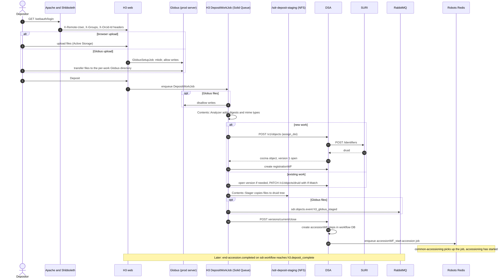

# Management and deposit

This page covers every way content and metadata enter the Stanford Digital Repository (SDR), and the staff tools that manage objects once they are there. Each entry point is a separate application with its own users and authentication. All of them end at [dor-services-app (DSA)](repository-core.md), which registers objects, holds versions, and starts workflows; sdr-api is the only intermediary. What happens after a deposit (assembly, accessioning, preservation, publishing) is covered in [Accessioning](accessioning.md), [Preservation](preservation.md) and [Access and discovery](access-and-discovery.md). For terms such as druid, APO, cocina and version, see the [Glossary](../../GLOSSARY.md).

**Transition in progress:** Argo-B3 will replace both Argo and pre-assembly in the coming months ([ADR 0023](../adr/0023-argo-b3-replaces-argo-and-pre-assembly.md)). Today all three run in production. This page describes what runs now.

Diagram source: [deposit-entry-points.mmd](../diagrams/deposit-entry-points.mmd)

## Components

| Component | Purpose | Repo | Runtime | Datastores |
| --- | --- | --- | --- | --- |
| Argo (legacy) | Staff search, view, edit, registration, bulk actions, workflow grid. Blacklight UI. | [argo](https://github.com/sul-dlss/argo) | Passenger + 1 Sidekiq process (`default`, concurrency 6) per web node; Capistrano | Postgres `argo` on a separate database host; Redis on a separate host; reads Solr `argo_<env>`; NFS `/workspace`, `/dor` |
| Argo-B3 | Replacement for Argo and pre-assembly: everything Argo does plus single-object file deposit and Multi-Item Deposit (MID). Custom search, no Blacklight. | [argo-b3](https://github.com/sul-dlss/argo-b3) | Docker via Kamal: `web` role (Puma behind kamal-proxy, fronted by Apache) and `job` role (Solid Queue: `real_time`; `background,default,cleanup`). Daily `ContentCleanupJob` | Postgres `argo_production` (+ `_queue`, `_cache`, `_cable`) on `argo-b3-db-*`; no Redis; reads Solr `argo_<env>`; many NFS mounts (below) |
| pre-assembly (legacy) | Batch deposit from a mount plus manifest ("BatchContext" and "JobRun"). Being replaced by Argo-B3 MID. | [pre-assembly](https://github.com/sul-dlss/pre-assembly) | Passenger; 4 Sidekiq processes; Sneakers consumer `AccessionCompleteJob`; cron `GlobusCleanup` | Local Postgres and Redis; job output in `/dor/preassembly` |
| Hungry Hungry Hippo (H3) | Self-deposit of works and collections by Stanford users, at sdr.stanford.edu. DOIs, ORCID, GitHub release deposit, Globus for large files. Replaced H2 (happy-heron), which replaced Hydrus. | [hungry-hungry-hippo](https://github.com/sul-dlss/hungry-hungry-hippo) | Passenger; Solid Queue; Sneakers consumer `DepositCompleteJob`; whenever cron | Postgres `h3_production` (+ `_queue`, `_cache`, `_cable`) on a separate database host; an NFS-backed Active Storage directory; `/sdr-deposit-staging` |
| sdr-api | Token-authenticated HTTP deposit API for external and CLI depositors ([ADR 0004](../adr/0004-deposit-api-for-external-depositors.md)). | [sdr-api](https://github.com/sul-dlss/sdr-api) | Web; 5 Sidekiq processes (`default`, `active_storage_purge`); cron `DirectUploadsSweeper` | Local Postgres and Redis; Active Storage on disk (prod: an NFS volume) |
| sdr-client | Ruby CLI and library for sdr-api: login, direct upload, deposit, poll. | [sdr-client](https://github.com/sul-dlss/sdr-client) | Gem / CLI | — |
| Heracles ETD | Thesis and dissertation submission and approval, integrated with the Registrar (PeopleSoft) and FOLIO. | [heracles-etd](https://github.com/sul-dlss/heracles-etd) | Rails, Solid Queue (`CatalogStatusJob` hourly) | Local Postgres `etd`, `etd_queue`; uploads in `/opt/app/etd/workspace` |
| Google Books | Retrieves Google-digitized books from GRIN and deposits them. Private repo. | google-books (private) | Sidekiq (3 prod); cron every 15 min `gb:all_download_and_deposit`, daily populate | Local Postgres and Redis; 500 GB local `/opt/app` |
| was-registrar-app (WRA) | Schedules Archive-It (WASAPI) crawl fetches and registers web archive crawl objects. | [was-registrar-app](https://github.com/sul-dlss/was-registrar-app) | Web; 1 Sidekiq; daily `fetch_collections` | Local Postgres and Redis; `/was_unaccessioned_data` |
| modsulator-app | Stateless spreadsheet → MODS conversion API. Used by legacy Argo only. | [modsulator-app-rails](https://github.com/sul-dlss/modsulator-app-rails) | Web | none |
| robot-console | Sidekiq Web over the robots' Redis; used to inspect and retry robot jobs. A management UI, not a deposit path. | [robot-console](https://github.com/sul-dlss/robot-console) | Web | The robots' Redis host in each environment |

Supporting libraries used by these apps: [dor-services-client](https://github.com/sul-dlss/dor-services-client) (HTTP client for DSA), [dor-event-client](https://github.com/sul-dlss/dor-event-client) (publishes events to RabbitMQ), [folio_client](https://github.com/sul-dlss/folio_client), [globus_client](https://github.com/sul-dlss/globus_client), [mais_person_client](https://github.com/sul-dlss/mais_person_client) (H3 only), [voids](https://github.com/sul-dlss/voids) (form-object base for Argo-B3), and [sdr_view_components](https://github.com/sul-dlss/sdr_view_components) (Argo-B3 and H3). DOI minting and ORCID updates happen in DSA, not in the deposit apps (see [Repository core](repository-core.md)). google-grin (last commit 2015, no hosts) and happy-heron (no hosts) are historical.

### Users, roles and authentication

All web apps authenticate with Shibboleth in Apache. Authorization uses Workgroup Manager entitlements (`eduPersonEntitlement`) passed to the app ([ADR 0026](../adr/0026-shibboleth-entitlements-for-authz.md)). Service-to-service calls to DSA use JWTs ([ADR 0007](../adr/0007-jwt-for-service-auth.md)).

| App | Who uses it | Apache gate | App-level roles |
| --- | --- | --- | --- |
| Argo | SDR staff | entitlement `sdr:argo-access` | `sdr:administrator-role`, `sdr:manager-role`, `sdr:viewer-role`, `sdr:api-authorized-users` (may mint sdr-api tokens); per-object rights from APO roles. App reads `REMOTE_USER` via devise. |
| Argo-B3 | SDR staff | entitlement `sdr:argo-access` | Apache passes `X-Remote-User`, `X-Groups`, `X-Person-Formal-Name` headers. Permissions stored in Postgres (`Permission` model) and applied as Solr filter queries; Action Policy, admins pass every rule; admins can impersonate workgroups. |
| pre-assembly | Accessioning staff | entitlement `sdr:accessioning` | none beyond the gate |
| H3 | Any Stanford user | Shibboleth optional site-wide; `/webauth/login` requires any authenticated Stanford user | Workgroups `dlss:hydrus-app-administrators`, `dlss:hydrus-app-collection-creators`; collection-level depositor, manager and reviewer roles in the H3 DB. ORCID iD from the `X-Orcid-Id` header. |
| Heracles ETD | Students, readers, Registrar staff, SUL catalogers | any authenticated Stanford user | `sdr:etds-sul-staff`, `sdr:etds-registrar-staff`, `sdr:etds-quarterly-reports`. The Registrar endpoint is a machine POST, checked by request origin (plus HTTP Basic outside prod). |
| Google Books | Staff | a SUL staff entitlement | — |
| WRA | Web archivists, developers | `sdr:developer`, `sdr:was-staff` | — |
| robot-console | Developers, ops | `sdr:developer`, a systems-team entitlement | — |
| sdr-api | Programs and CLI users | firewall: Stanford administrative networks only | Users kept in the sdr-api DB, with full access or limited to listed collections. `POST /v1/auth/login` returns a JWT; Argo calls `POST /v1/auth/proxy` to issue tokens to `sdr:api-authorized-users`. |
| modsulator-app | Argo (server to server) | firewall: Stanford administrative networks | — |

## Interfaces

### How each entry point reaches DSA

Every app except Google Books and CLI users calls DSA directly with dor-services-client over HTTPS (bearer JWT) at `dor-services-{prod,stage,qa}-lb.stanford.edu`. Only external and CLI depositors go through sdr-api.

| Caller | Path to DSA | Main operations |
| --- | --- | --- |
| Argo | dor-services-client | everything, including `reindex` |
| Argo-B3 | dor-services-client; dor-event-client to RabbitMQ | register, update (`Sdr::Repository.update`), version open/close (`Sdr::VersionService`), workflows, events |
| pre-assembly | dor-services-client | find object, start accession |
| H3 | dor-services-client (not sdr-api); dor-event-client | register (with `assign_doi`), update, version open/close/discard, user versions, `registrationWF`, events |
| sdr-api | dor-services-client | register, workflow create, version close |
| Heracles ETD | dor-services-client | register + `registrationWF`, embargo, tags, release tags, version close |
| WRA | dor-services-client | register, create `wasCrawlPreassemblyWF` |
| Google Books | sdr-client → sdr-api; dor-services-client for MARCXML lookup only | `deposit_model(accession: true, priority: 'low')` |
| sdr-client CLI users | sdr-client → sdr-api | deposit, register |

### sdr-api endpoints

Defined in [`openapi.yml`](https://github.com/sul-dlss/sdr-api/blob/main/openapi.yml):

- `POST /v1/auth/login`, `POST /v1/auth/proxy?to=<email>`: return a JWT.
- `POST /v1/direct_uploads`, then `PUT /v1/disk/{encoded_token}`: Active Storage direct upload of each file.
- `POST /v1/resources?accession=&priority=&assign_doi=&user_versions=`: register (and accession if `accession=true`) from a cocina request and signed blob ids. Returns a background job URL. `PUT` and `GET /v1/resources/{id}` update and read.
- `GET /v1/background_job_results/{id}`: poll job status.

`IngestJob` copies blobs to `/dor/workspace/<druid tree>` (`StageBlobs`) and `globus://` paths from the Globus mount (`StageGlobus`). Clients: Google Books, Argo (agreement upload and token proxy), sdr-client CLI users, and the integration tests. H3 and Argo-B3 do not use sdr-api.

### RabbitMQ

Brokers `sul-rabbit-{prod,stage,qa}`, vhost `workflow`. Full topology is on [Repository core](repository-core.md#rabbitmq-topology). The deposit apps use:

- `h3.deposit_complete` (bound to `sdr.workflow`, key `end-accession.completed`): H3 marks the deposit complete and notifies the user.
- `preassembly.accession_complete` (keys `end-accession.completed`, `*.error`): pre-assembly marks the job run item complete or errored.
- Exchange `sdr.objects.event`: Argo-B3 and H3 publish provenance events with dor-event-client; DSA stores them ([ADR 0005](../adr/0005-events-recorded-in-dsa.md)).

No app in this area uses Kafka ([ADR 0006](../adr/0006-rabbitmq-for-events-kafka-for-discovery.md)).

### Solr

Argo and Argo-B3 read the same collection, `https://sul-solr.stanford.edu/solr/argo_<env>`. Neither writes it: DSA builds and writes every document ([ADR 0010](../adr/0010-dsa-writes-argo-index.md)). The qa, stage and prod collections all live on the prod SolrCloud, a deliberate choice ([ADR 0025](../adr/0025-shared-prod-solrcloud.md)).

### Other outbound calls

- Argo and Argo-B3: preservation-catalog, purl-fetcher, technical-metadata-service, stacks, FOLIO Okapi (`folio-{prod,stage,test}-api`).
- Argo only: modsulator-app, sdr-api, robot-console (link from the workflow grid).
- Heracles ETD: FOLIO (stub MARC record), PeopleSoft (status callback).
- Google Books: GRIN (OAuth), FOLIO.
- WRA: Archive-It WASAPI.

### File staging and mounts

Files reach the robots through shared NFS mounts. Most are exports from shared storage; Globus is a separate server.

Diagram source: [deposit-staging.mmd](../diagrams/deposit-staging.mmd)

| Path on host | Mounted by (prod) | Role |
| --- | --- | --- |
| `/sdr-deposit-staging` | H3, Argo-B3, DSA, common-accessioning, techmd, preservation_robots | Staging for single-object deposits from H3 and Argo-B3 (a separate volume per environment) |
| `/dor` (`workspace`, `assembly`, `staging`, `preassembly`) | Argo, Argo-B3, pre-assembly, H3, sdr-api, ETD, DSA, robots | `/dor/workspace`: sdr-api, ETD and WAS crawl staging. `/dor/assembly`: pre-assembly, Argo-B3 MID, geo and web archive seeds. Prod has its own volume; qa and stage share one |
| `/globus` | Argo-B3 (`argo_ingest/<env>`), H3 and sdr-api (a shared upload directory per environment), pre-assembly (its own directory per environment) | Landing area for large user uploads. Every environment mounts the prod Globus server |
| `/gis_workflow_data` | pre-assembly, Argo-B3 | Geo staging (`/gis_workflow_data/stage`), a volume per environment |
| `/was_unaccessioned_data` | WRA, pre-assembly, Argo-B3 | WARCs fetched from Archive-It |
| `/workspace` | Argo, Argo-B3 | Bulk action output (`/workspace/bulk`); Argo and Argo-B3 have separate volumes |
| H3 and sdr-api Active Storage directories, `/data/argo-files`, `/opt/app/etd/workspace` | each app | Browser uploads (Active Storage), each on its own NFS volume |
| Source mounts: `/spec1-3`, `/pwrvault`, `/ars` (CIFS); `/dpgthumper*`, `/thumpers`, `/maps` (Ceph NFS); `/datasets`, `/smpl2`, `/evis`, `/third_party` and others | pre-assembly prod, Argo-B3 prod | Digitization lab and vendor sources for batch deposit |

The accessionWF `reset-workspace` step (run in DSA) removes the druid's directories from the workspace, assembly and staging roots after accessioning ([Accessioning](accessioning.md)). Globus server endpoint IDs are not recorded here.

## Key flows

### H3 self-deposit (until accessioning starts)

Diagram source: [deposit-h3-sequence.mmd](../diagrams/deposit-h3-sequence.mmd)

1. The user logs in through `/webauth/login`. Apache passes identity, groups and ORCID iD as headers.
2. Files arrive by browser upload (Active Storage) or Globus. For Globus, `GlobusSetupJob` creates a per-work directory in the environment's upload area on the Globus share and grants write access.
3. On Deposit, H3 enqueues `DepositWorkJob` (Solid Queue). It removes Globus write access and computes missing digests and MIME types.
4. A new work is registered with `POST /v1/objects` (optionally `assign_doi`). DSA mints the druid from SURI, stores version 1, indexes it, and returns the cocina object. H3 then creates `registrationWF`. An existing work has its version opened if needed and is updated with `If-Match` locking.
5. `Contents::Stager` copies the files to `/sdr-deposit-staging/<druid tree>`. Globus deposits also publish an `h3_globus_staged` event.
6. H3 closes the version (`POST …/versions/current/close`). DSA creates `accessionWF` and enqueues `start-accession` on robots Redis. Accessioning has started; common-accessioning reads the files from `/sdr-deposit-staging`.
7. Later, DSA's `update-doi` robot pushes DOI metadata to DataCite (prefix `10.25740` in prod). When `end-accession` completes, the message on `h3.deposit_complete` lets H3 update the work's state.

### Argo-B3 single-object deposit (manage files)

1. Staff register an item (DSA mints the druid). Argo-B3 can also register items for Goobi digitization.
2. Manage files creates a mutable structural-metadata draft (`Content`, stored in Postgres). Files come from browser upload (`/data/argo-files`), discovery on a mount (`DiscoverFilesJob`), or Globus: a per-user, per-object directory under `/globus/argo_ingest/<env>`.
3. Populators build file sets, and the validator checks them.
4. `StageFilesJob` mints file IDs, computes digests and MIME types, and copies files to `/sdr-deposit-staging/<druid tree>` (or `/dor/assembly` for geo, web archive seeds and MID). It writes the structure into the cocina object with `CocinaObjectMutators::StructuralMutator` and `Sdr::Repository.update`.
5. On deposit, Argo-B3 starts an assembly workflow chosen by content type: `gisAssemblyWF` for geo objects, `wasSeedPreassemblyWF` for web archive seeds, and `assemblyWF` otherwise ([`app/services/sdr/repository.rb`](https://github.com/sul-dlss/argo-b3/blob/main/app/services/sdr/repository.rb)). Assembly ends by closing the version, and accessionWF follows. With no staged files it closes the version directly, except for seeds, which always assemble. OCR (`ocrWF`) is started separately, not as the deposit's assembly workflow.

### Argo-B3 Multi-Item Deposit (replacing pre-assembly)

1. Discovery checks each manifest row's folder on the mount.
2. File Check builds structure from a structural CSV or by content type, with OCR settings.
3. Deposit Initiation checks all items; if any fails, none start. Otherwise each item is staged to `/dor/assembly` and assembly then accessioning begins.

### pre-assembly batch (legacy)

1. A user with `sdr:accessioning` creates a BatchContext pointing at a directory on a mount and a manifest. Optionally a Globus destination is created in pre-assembly's directory on the `/globus` mount.
2. A JobRun (Sidekiq) produces a discovery report or performs a full run.
3. A full run copies files to `/dor/assembly` (or `/gis_workflow_data/stage`), updates structure, and starts accession through DSA.
4. The `preassembly.accession_complete` consumer marks items complete or errored.

### sdr-api deposit (sdr-client, Google Books)

1. The client logs in and gets a JWT.
2. Each file is uploaded with a direct upload, then a `PUT` to `/v1/disk`.
3. The client posts `/v1/resources` with cocina and blob ids (`accession=true` to accession).
4. `IngestJob` registers through DSA, copies files to `/dor/workspace`, creates the workflow and closes the version.
5. The client polls `/v1/background_job_results/{id}`.

Google Books deposits only the zip, checksum and METS files, with `priority: 'low'`.

### ETD

1. PeopleSoft POSTs to Heracles. Heracles registers the item in DSA and creates `registrationWF`.
2. The student uploads files; readers and the Registrar approve.
3. Heracles writes a stub MARC record to FOLIO.
4. Hourly, `CatalogStatusJob` checks FOLIO for cataloging, then `StartAccessionJob` refreshes metadata, sets access and structure, copies files to `/dor/workspace`, adds tags, and closes the version.
5. Heracles posts status back to PeopleSoft.

### Web archiving

1. WRA fetches WARCs from Archive-It into `/was_unaccessioned_data`.
2. WRA registers the crawl object and creates `wasCrawlPreassemblyWF`; WAS robots build the druid tree in `/dor/workspace` and close the version.
3. Web archive seeds are registered in Argo-B3 and staged to `/dor/assembly` (`wasSeedPreassemblyWF`).

## Argo, Argo-B3 and the transition

Argo-B3 is the planned single staff application ([ADR 0023](../adr/0023-argo-b3-replaces-argo-and-pre-assembly.md)). It runs in Docker with Kamal, unlike the other SDR apps ([ADR 0022](../adr/0022-argo-b3-containers-with-kamal.md)).

| Capability | Argo | Argo-B3 | pre-assembly |
| --- | --- | --- | --- |
| Search and object view | Blacklight | Custom search, dashboard, pinned searches and tags | — |
| Edit metadata, rights, tags, collections, embargo, release | Yes | Yes | — |
| Registration (form and CSV) | Yes | Yes, including Goobi option | — |
| Bulk actions (export/import descriptive, structural, tags, catalog data; purge; republish; reindex; text extraction) | Yes | Yes | — |
| Open-version and close-version bulk actions | Yes | No; a Redeposit bulk action opens a version if needed and deposits | — |
| Descriptive spreadsheet | MODS spreadsheet via modsulator, plus descriptive CSV | Descriptive CSV only | — |
| File upload and staging for one object | No (Agreement files only, via sdr-api) | Yes: upload, mount, Globus | — |
| Batch deposit from a mount | No | Multi-Item Deposit | Yes |
| sdr-api token page | Yes | No | — |
| Workflow grid | Yes, links to robot-console | Yes | — |

### Known gaps before Argo and pre-assembly can be retired

These come from comparing the code and platform config. They are not confirmed by the maintainers.

- No open-version or close-version bulk actions in Argo-B3 (Redeposit covers part of this).
- No MODS spreadsheet upload (modsulator) in Argo-B3; it uses its own descriptive CSV.
- No page for issuing sdr-api tokens to `sdr:api-authorized-users`.
- Platform: argo-b3's logging, health checks and host classification need verifying before cutover; each environment is one host. See [Platform and operations](platform-and-operations.md).
- Integration coverage: `argo_b3_web_archive_seed_deposit_spec.rb` exists in infrastructure-integration-test but is missing from the argo-b3 `AGENTS.md` list.

## Hosts and environments

Environments are qa, stage and prod (Heracles also has uat). Hosts are defined in the private puppet repo's node data.

| App | prod | stage | qa | Config | Deploy |
| --- | --- | --- | --- | --- | --- |
| Argo | argo-prod-01, -02 (argo.stanford.edu) | argo-stage-a, -b | argo-qa-a, -b | shared_configs `argo-<env>` | Capistrano |
| Argo-B3 | argo-b3-prod-a | argo-b3-stage-a (also Kamal image builder) | argo-b3-qa-a | `config/deploy.<env>.yml` + Vault | Kamal |
| pre-assembly | sul-preassembly-prod | sul-preassembly-stage | sul-preassembly-qa | `sul-preassembly-<env>` | Capistrano |
| H3 | sul-h3-prod (sdr.stanford.edu) | sul-h3-stage | sul-h3-qa | `sul-h3-<env>` | Capistrano; Jenkins CD to stage |
| sdr-api | sdr-api-prod | sdr-api-stage | sdr-api-qa | `sdr-api-<env>` | Capistrano |
| Heracles ETD | sul-hydra-etd-prod (etd.stanford.edu) | sul-hydra-etd-stage (+ uat) | sul-hydra-etd-qa | `sul-heracles-etd-<env>` | Capistrano |
| Google Books | sul-gbooks-prod | one host | one host | `google-books-<env>` | Capistrano |
| WRA | was-registrar-app (was-registrar-app.stanford.edu) | was-registrar-app-stage | was-registrar-app-qa | `was-registrar-app-<env>` | Capistrano |
| modsulator-app | modsulator-app-prod | -stage | -qa | honeybadger.yml only | Capistrano |
| robot-console | robot-console-prod | -stage | -qa | env vars | Capistrano |

Cross-environment wiring to know about:

- Every environment mounts `/globus` from the prod Globus server.
- qa and stage share one `/dor` volume, and argo-qa mounts stage's Argo `/workspace` volume. Sharing stage storage with qa is deliberate ([ADR 0024](../adr/0024-qa-shares-stage-access-systems.md)) and worth reconsidering.
- The integration tests ([infrastructure-integration-test](https://github.com/sul-dlss/infrastructure-integration-test)) run against stage by default (`SDR_ENV=qa` for qa); PURL and SearchWorks always point at stage.

## Configuration

- Capistrano apps: `config/settings.yml` in the repo, overridden by the shared_configs branch named in each host's puppet node data (for example [`argo-prod`](https://github.com/sul-dlss/shared_configs/blob/argo-prod/config/settings/production.yml)), with secrets injected as puppet env vars.
- Argo-B3: per-environment env vars in [`config/deploy.<env>.yml`](https://github.com/sul-dlss/argo-b3/blob/main/config/deploy.prod.yml); secrets from Vault through `.kamal/secrets-common`, loaded by Jenkins or `bin/kamal-otk`. It does not use shared_configs.
- robot-console: env vars from puppet (`SETTINGS__REDIS__HOSTNAME`).

## Known issues and cleanup

- **Stale config branch reference.** The argo-b3 hosts' puppet node data names an `argo-b3` shared_configs branch, but no such branch exists; argo-b3 `AGENTS.md` also points to it.
- **Dead shared_configs keys.** `workflow_url` (the retired workflow service, merged into DSA, [ADR 0008](../adr/0008-workflow-engine-in-dsa.md)) remains in argo, pre-assembly, H3, sdr-api and WRA branches; `dor_indexing_url` remains for argo; argo-stage still has a Fedora URL; `argo-prod` has `config/blacklight.yml.defunct`.
- **Stale READMEs.** Argo's README describes Jenkins CD, but Argo has no Jenkinsfile. sdr-api's "Sequence of operations" describes old routes (`/filesets`, `/dro`). sdr-client's README mentions Hydrus. pre-assembly's README says users are configured in puppet; access is the `sdr:accessioning` entitlement. Argo's `RemoteIndexingJob` comment still refers to dor-indexing-app.
- **Legacy names.** H3 still uses `dlss:hydrus-app-*` workgroups.
- **Prod Globus for all environments**: qa and stage test data lands on the prod Globus server (maintainer confirmation pending; see [Open questions](open-questions.md)).
- **sdr-api Active Storage** is NFS-backed in prod and local disk on stage and qa (inference: no mount there).

## Sources

- [argo `README.md`](https://github.com/sul-dlss/argo/blob/main/README.md), [`app/models/user.rb`](https://github.com/sul-dlss/argo/blob/main/app/models/user.rb#L8-L14), [`app/services/register_agreement.rb`](https://github.com/sul-dlss/argo/blob/main/app/services/register_agreement.rb), [`app/controllers/tokens_controller.rb`](https://github.com/sul-dlss/argo/blob/main/app/controllers/tokens_controller.rb), [`app/jobs`](https://github.com/sul-dlss/argo/tree/main/app/jobs)
- [argo-b3 `README.md`](https://github.com/sul-dlss/argo-b3/blob/main/README.md), [`GLOSSARY.md`](https://github.com/sul-dlss/argo-b3/blob/main/GLOSSARY.md), [`config/deploy.yml`](https://github.com/sul-dlss/argo-b3/blob/main/config/deploy.yml), [`config/queue.yml`](https://github.com/sul-dlss/argo-b3/blob/main/config/queue.yml), [`app/controllers/concerns/authentication.rb`](https://github.com/sul-dlss/argo-b3/blob/main/app/controllers/concerns/authentication.rb), [`app/jobs/bulk_actions`](https://github.com/sul-dlss/argo-b3/tree/main/app/jobs/bulk_actions), [`app/jobs/bulk_actions/redeposit_job.rb`](https://github.com/sul-dlss/argo-b3/blob/main/app/jobs/bulk_actions/redeposit_job.rb), [`app/forms/items_registration_form.rb`](https://github.com/sul-dlss/argo-b3/blob/main/app/forms/items_registration_form.rb)
- [pre-assembly `README.md`](https://github.com/sul-dlss/pre-assembly/blob/main/README.md), [`lib/tasks/rabbit.rake`](https://github.com/sul-dlss/pre-assembly/blob/main/lib/tasks/rabbit.rake#L16-L19), [`app/jobs/accession_complete_job.rb`](https://github.com/sul-dlss/pre-assembly/blob/main/app/jobs/accession_complete_job.rb)
- [hungry-hungry-hippo `README.md`](https://github.com/sul-dlss/hungry-hungry-hippo/blob/main/README.md), [`app/jobs/deposit_work_job.rb`](https://github.com/sul-dlss/hungry-hungry-hippo/blob/main/app/jobs/deposit_work_job.rb), [`app/services/sdr/repository.rb`](https://github.com/sul-dlss/hungry-hungry-hippo/blob/main/app/services/sdr/repository.rb#L51-L75), [`app/jobs/deposit_complete_job.rb`](https://github.com/sul-dlss/hungry-hungry-hippo/blob/main/app/jobs/deposit_complete_job.rb), [`config/settings.yml`](https://github.com/sul-dlss/hungry-hungry-hippo/blob/main/config/settings.yml#L20-L25)
- [sdr-api `openapi.yml`](https://github.com/sul-dlss/sdr-api/blob/main/openapi.yml), [`app/services/stage_globus.rb`](https://github.com/sul-dlss/sdr-api/blob/main/app/services/stage_globus.rb); [sdr-client `README.md`](https://github.com/sul-dlss/sdr-client/blob/main/README.md)
- [heracles-etd `README.md`](https://github.com/sul-dlss/heracles-etd/blob/main/README.md), [`app/services/register_service.rb`](https://github.com/sul-dlss/heracles-etd/blob/main/app/services/register_service.rb), [`config/recurring.yml`](https://github.com/sul-dlss/heracles-etd/blob/main/config/recurring.yml)
- google-books (private): `README.md`, `app/services/sdr_importer.rb`, `config/schedule.rb`
- [was-registrar-app `app/jobs/registering.rb`](https://github.com/sul-dlss/was-registrar-app/blob/main/app/jobs/registering.rb); [modsulator-app-rails `README.md`](https://github.com/sul-dlss/modsulator-app-rails/blob/main/README.md); [robot-console](https://github.com/sul-dlss/robot-console)
- [infrastructure-integration-test `spec/features`](https://github.com/sul-dlss/infrastructure-integration-test/tree/main/spec/features)
- Puppet node data in the private [puppet](https://github.com/sul-dlss/puppet) repository (argo-*, argo-b3-*, sul-preassembly-*, sul-h3-*, sdr-api-*, sul-hydra-etd-*, sul-gbooks-*, was-registrar-app*, robot-console-*, sul-suri-*)
- shared_configs: [`argo-prod`](https://github.com/sul-dlss/shared_configs/blob/argo-prod/config/settings/production.yml), [`sul-h3-prod`](https://github.com/sul-dlss/shared_configs/blob/sul-h3-prod/config/settings/production.yml), [`sdr-api-prod`](https://github.com/sul-dlss/shared_configs/blob/sdr-api-prod/config/settings/production.yml), [`sul-preassembly-prod`](https://github.com/sul-dlss/shared_configs/blob/sul-preassembly-prod/config/settings/production.yml)

_Verified against default branches on 2026-11-16; private-source details redacted 2026-11-17._
