# Platform and operations

This page describes the technical platform the Stanford Digital Repository (SDR) runs on: how its virtual machines are provisioned (Puppet and hiera), how app configuration and secrets are layered, how requests reach an app, how users and services authenticate, and how code is tested, deployed and observed. It also lists the ops-owned shared services (RabbitMQ, SolrCloud, Kafka, Weka, Ceph, Vault) that SDR stacks depend on. Every SDR service runs on puppet-managed VMs; none runs on Kubernetes. Ops-team processes (paging, on-call, alert routing, data refresh) are out of scope. For terms, see the [Glossary](../../GLOSSARY.md).

Diagram source: [platform-request-path.mmd](../diagrams/platform-request-path.mmd)

## Components

| Component | Purpose | Repo | Runtime | Datastores |
| --- | --- | --- | --- | --- |
| Puppet + hiera | Provisions and configures every SDR VM: packages, Apache/Shibboleth vhosts, firewall, NFS mounts, app users, env vars, monitoring agents | [sul-dlss/puppet](https://github.com/sul-dlss/puppet) (default branch `production`) | puppetserver + PuppetDB (ops) | PuppetDB; Vault via hiera-vault |
| Vault | Secret store for puppet (via hiera-vault), Kamal deploys and developer tooling | not in a repo (`vault.sul.stanford.edu`) | ops-run | Vault KV mount `puppet` |
| shared_configs | Per app × environment settings files copied into each app's Capistrano `shared/` dir | [sul-dlss/shared_configs](https://github.com/sul-dlss/shared_configs) (private; one branch per app × env) | git | — |
| dlss-capistrano | Shared Capistrano tasks used by nearly every SDR Ruby app | [sul-dlss/dlss-capistrano](https://github.com/sul-dlss/dlss-capistrano) | developer laptop or sdr-infra | — |
| capistrano-shared_configs | `shared_configs:update` task, bundled by dlss-capistrano | [sul-dlss/capistrano-shared_configs](https://github.com/sul-dlss/capistrano-shared_configs) | as above | — |
| Kamal | Container deploys for argo-b3 only | [sul-dlss/argo-b3](https://github.com/sul-dlss/argo-b3) (`config/deploy*.yml`, `bin/kamal-otk`) | developer laptop, sdr-infra or Jenkins | Kamal local registry |
| sdr-deploy | Tags and deploys the Infrastructure portfolio together | [sul-dlss/sdr-deploy](https://github.com/sul-dlss/sdr-deploy) | `sdr-infra.stanford.edu` | local Postgres `deploy` |
| Jenkins (`sul-ci-prod`) | Continuous deploy for access apps, H3 and argo-b3 stage; weekly dependency-update jobs | Jenkinsfiles in each repo | ops-run; not in puppet | — |
| CircleCI + `ruby-rails` orb | CI for Infrastructure repos | [sul-dlss/ruby-rails-orb](https://github.com/sul-dlss/ruby-rails-orb) | CircleCI cloud | — |
| access-update-scripts | Weekly dependency-update PRs for both Infrastructure and Access repos | [sul-dlss/access-update-scripts](https://github.com/sul-dlss/access-update-scripts) | Jenkins | — |
| infrastructure-integration-test | Browser-driven end-to-end tests across SDR apps | [sul-dlss/infrastructure-integration-test](https://github.com/sul-dlss/infrastructure-integration-test) | developer laptop | — |
| Zabbix, Prometheus, Honeybadger, CloudWatch, Splunk | Monitoring, metrics, errors/check-ins, logs | puppet; app Gemfiles | ops-run / SaaS / AWS us-west-2 | — |

## Host provisioning with Puppet

Ops owns the puppet repo. Developers change hiera data by PR against `production`; ops review and merge ([DeveloperPlaybook `best-practices/puppet_prs.md`](https://github.com/sul-dlss/DeveloperPlaybook/blob/main/best-practices/puppet_prs.md), stale in places; see [Known issues](#known-issues-and-cleanup)). Agents use the `production` environment.

Node classification is entirely data-driven: every host gets the same base node definition, and the classes, project, runtime baseline and log-shipping configuration it receives are all named in hiera data.

### Hiera hierarchy

Puppet resolves data from the most specific level to the least specific, first match wins:

1. Per-host node data: one file per host (about 750). This is where most SDR settings live.
2. Per-project data shared by the hosts of a clustered service (e.g. RabbitMQ, SolrCloud, storage).
3. A language/runtime baseline (see below).
4. Which log files ship to which CloudWatch group.
5. OS-family data.
6. Global defaults, including named lists of admin, VPN, load-balancer-management and monitoring networks.
7. **hiera-vault**: keys with a Vault prefix are looked up in Vault at `vault.sul.stanford.edu` (KV mount `puppet`), so node data references secrets rather than containing them.

Every Linux node fails catalog compilation if a test Vault lookup returns nothing ("Could not contact vault…"), so a Vault outage blocks puppet runs everywhere.

### Classification facts

Each host's node data includes a set of classification facts that puppet writes to the host as custom facts. Several drive puppet code; the rest are descriptive metadata.

| Classification | What it drives |
| --- | --- |
| shared_configs branch | Classic Rails hosts clone that shared_configs branch when it is set; robot hosts do the same directly |
| Stack level (environment) | Zabbix alerting (prod hosts alert ops; other levels none unless overridden); Zabbix agent host metadata for auto-registration; prod MOTD; RedHat patch schedule |
| Stack + stack level | **Firewall rules between tiers.** A host opening a port names the stacks and level allowed to reach it, and puppet queries PuppetDB for the matching hosts. Example: RabbitMQ prod opens 5672 to the prod DSA, preservation catalog, pre-assembly, H3, Argo and SearchWorks indexing stacks |
| Stack | CloudWatch Apache log group names (one access and one error group per stack) |
| Technical team | Let's Encrypt contact address |
| SLA level | Only the Zabbix host metadata string |
| Other descriptive host metadata | No Linux puppet logic reads it (Inference: harvested by operational tooling such as Zabbix tagging and the service catalog) |

Because firewall access and alerting derive from the stack and stack level, a misclassified host silently loses both (see [Known issues](#known-issues-and-cleanup)).

### What puppet provisions for SDR stacks

| Host type | What puppet provisions |
| --- | --- |
| Every VM | iptables firewall, Kerberos, LDAP/sssd, remctl client, Splunk forwarder, Postfix null client, wallet, k5login team access, CrowdStrike, Prometheus node_exporter, Zabbix agent2, daily agent restart |
| Classic Rails VMs | Apache with mod_passenger, vhosts, Capistrano dirs, the shared_configs clone, and the CloudWatch agent in production |
| H3 | Passenger Standalone behind Apache |
| argo-b3 | Docker behind Apache (deployed with Kamal) |
| was-pywb | uWSGI (Python) |
| App hosts | App user (e.g. `dor_services`, `lyberadmin`), team Kerberos access, and **env vars**, most of them Vault lookups |
| Background processes | systemd units for Sidekiq, Sneakers, SolidQueue and Racecar, matched by dlss-capistrano tasks |
| DB servers | Postgres server and client, pg_dump backups, a Capistrano `database.yml` |
| F5 pool members | Health-check responder |
| Monitoring and backup | Zabbix URL/log/cert checks, CloudWatch log shipping, TSM file backup |

Puppet creates the Capistrano layout: `/opt/app/<user>/<app>/{releases,shared,shared/config,current}`, with `shared/log` symlinked to the host's log directory.

### Techstacks and OS

- Puppet provisions application language and runtime baselines (Ruby, Node.js and yarn for classic Rails hosts), and hosts move between baselines as Ruby versions are upgraded.
- The OS is not recorded in puppet data. Inference from package pins: most SDR hosts run Ubuntu 22.04 or 24.04. Some pins are stale, so supported OS and package baselines should be verified privately.

## Request path

1. **DNS.** Load-balanced services resolve to an F5 VIP (e.g. `dor-services-prod-lb`, `argo`, `purl`, `stacks`, `preservation-catalog-prod`). Single-VM services resolve directly to the host (e.g. `sdr-api-prod`, `sul-h3-prod`, `sul-preassembly-prod`, `argo-b3-prod-a`).
2. **F5 (UIT load balancer service).** The F5 health-checks each pool member, where a puppet-installed responder answers "up" unless a drain marker file exists on the host. Inference: creating that file drains a node. Pool members open 80/443 to the LB management nets. Vhosts behind the F5 enable mod_remoteip so apps see the client address.
3. **Apache 2.4 on :443**, configured by puppet:
   - TLS certificate from Let's Encrypt (DNS-01 challenge via Route53; renewal by a puppet-managed cron).
   - mod_shib for Shibboleth (next section).
   - A 503 maintenance page when a Capistrano maintenance file is present; user-agent blocklists for AI crawlers; optional GeoIP blocking.
   - Per-path `require ip …` rules keep `/status` and API paths reachable only from admin, VPN, LB and monitoring networks, or from SDR hosts.
4. **App runtime**, one of:

| Pattern | Puppet setup | Hand-off from Apache | SDR users |
| --- | --- | --- | --- |
| A. mod_passenger | Classic Rails | In-process; Shibboleth attributes arrive as request env | DSA, PresCat, sdr-api, techmd, suri, modsulator, google-books, pre-assembly, ETD, was-registrar, Argo, robot-console; access apps purl, stacks, purl-fetcher, embed, EarthWorks, exhibits |
| B. Passenger Standalone | Passenger Standalone as a systemd service | `ProxyPass` to localhost:3000 plus a websocket `/cable` proxy | H3 (`sul-h3-{qa,stage,prod}`) |
| C. Docker + Kamal | Docker and Apache | `ProxyPass` to kamal-proxy on localhost:3000; Shibboleth attributes passed as headers `X-Remote-User`, `X-Groups` (all `eduPersonEntitlement` values), `X-Person-Formal-Name` | argo-b3 only: `web` container (Thruster + Puma), `job` container (SolidQueue) ([`config/deploy.yml`](https://github.com/sul-dlss/argo-b3/blob/main/config/deploy.yml); [ADR 0022](../adr/0022-argo-b3-containers-with-kamal.md)) |
| D. uWSGI | uWSGI | `ProxyPass` | was-pywb |

Not in the SDR request path: the library's proxy hosts for vanity redirects and ILLiad, and the *outbound* HTTP proxy used by hosts on private networks.

## Authentication and authorization

### Users: Shibboleth and Workgroup Manager

- Puppet installs mod_shib and shibd against the Stanford IdP (`https://idp.stanford.edu/`). The SP host is the LB name for load-balanced apps (e.g. `dor-services-prod-lb.stanford.edu`, `argo.stanford.edu`, `purl.stanford.edu`) and the node FQDN otherwise (e.g. `argo-b3-prod-a.stanford.edu`).
- A Stanford-only vhost option requires a Stanford `member` or `affiliate` affiliation and sets `REMOTE_USER` from `uid`. An optional-Shibboleth option makes the session lazy so only listed paths (or the app) force login.
- Group membership comes from Workgroup Manager workgroups, released by the IdP as `eduPersonEntitlement` values (e.g. `sdr:argo-access`). Inference: the IdP release configuration is not in these repos. Authorization happens in Apache (vhost rules that require an `eduPersonEntitlement` value), in the app, or both. See [ADR 0026](../adr/0026-shibboleth-entitlements-for-authz.md).

Entitlements per app (prod; Apache rules from puppet node data, app rules from code):

| App | Apache gate | App-level authorization |
| --- | --- | --- |
| Argo (legacy) | `/` requires `sdr:argo-access`, or a request from an allowlisted monitoring/load-balancer network; set for all Argo hosts in puppet project data | `sdr:administrator-role`, `sdr:manager-role`, `sdr:viewer-role`, `sdr:api-authorized-users`, plus APO-granted workgroups ([`app/models/user.rb`](https://github.com/sul-dlss/argo/blob/main/app/models/user.rb#L10-L13)) |
| argo-b3 | `/webauth/login` requires `sdr:argo-access` | `permissions` table maps workgroups to admin / edit / read_restricted / read_unrestricted; seeded admin `sdr:argo_administrators` ([`app/models/permission.rb`](https://github.com/sul-dlss/argo-b3/blob/main/app/models/permission.rb)); Mission Control jobs UI also allows `sdr:developer` |
| dor-services-app | `/queues` (Sidekiq web) requires `sdr:administrator-role` | API: JWT only |
| pre-assembly | `/` requires `sdr:accessioning`, or a request from an allowlisted network | — |
| preservation_catalog | Web paths require `sdr:argo-access`, `dlss:staff` or a systems-team entitlement, depending on the path | API: JWT |
| H3 | `/webauth/login` requires any authenticated user | `dlss:hydrus-app-administrators`, `dlss:hydrus-app-collection-creators` ([`config/settings.yml`](https://github.com/sul-dlss/hungry-hungry-hippo/blob/main/config/settings.yml)) |
| ETD (heracles-etd) | `/`, `/reports` require any authenticated user | `sdr:etds-sul-staff`, `sdr:etds-registrar-staff`, `sdr:etds-quarterly-reports` ([`config/settings.yml`](https://github.com/sul-dlss/heracles-etd/blob/main/config/settings.yml#L11-L14)) |
| was-registrar-app | `/` requires `sdr:developer` or `sdr:was-staff` | — |
| google-books | `/` requires a library staff entitlement | — |
| robot-console | `/` requires any authenticated user; Sidekiq pages (`/busy`, `/queues`, `/retries`, `/scheduled`) require `sdr:developer` or the systems-team entitlement | — |

### Services: JWTs

Service-to-service API calls do not use Shibboleth. DSA, technical-metadata-service and purl-fetcher verify HS256 JWT bearer tokens, and preservation_catalog verifies HS512 ([`api_controller.rb`](https://github.com/sul-dlss/preservation_catalog/blob/main/app/controllers/api_controller.rb#L41)) (e.g. [DSA `application_controller.rb`](https://github.com/sul-dlss/dor-services-app/blob/main/app/controllers/application_controller.rb#L65)); each has a `jwt.rake` task to mint tokens. Client tokens are stored in Vault and delivered to callers as env vars (or, for argo-b3, Kamal secrets). sdr-api issues its own JWTs to external depositors. See [ADR 0007](../adr/0007-jwt-for-service-auth.md) and [ADR 0004](../adr/0004-deposit-api-for-external-depositors.md).

## Configuration

App configuration is layered; later layers override earlier ones:

1. **App defaults**: `config/settings.yml` in the app repo (config gem).
2. **shared_configs branch**: `config/settings/production.yml` and other files (`config/honeybadger.yml`, `config/sidekiqN.yml`, `public/robots.txt`, …) on the branch named in the host's puppet node data. The branch root mirrors Capistrano's `shared/` dir.
3. **Env vars from puppet**: the app user's env vars in puppet node data, mostly Vault lookups. `SETTINGS__X__Y` overrides `Settings.x.y`; `SECRET_KEY_BASE`, `HONEYBADGER_API_KEY`, `HONEYBADGER_ENV`, `DATABASE_HOSTNAME` and similar are read directly. Example: DSA prod sets `SETTINGS__RABBITMQ__PASSWORD`, `SETTINGS__DOR__HMAC_SECRET` and `DATABASE_HOSTNAME` (pointing at its DB host; secret values in Vault).

Policy ([DeveloperPlaybook `best-practices/shared_configs.md`](https://github.com/sul-dlss/DeveloperPlaybook/blob/main/best-practices/shared_configs.md)): shared_configs holds only settings that vary by environment; secrets and env-specific Honeybadger settings go to Vault and puppet env vars; changes go by PR into the deployed branch.

### How shared_configs reaches hosts, and when

1. **Once, at provisioning.** Puppet clones the host's shared_configs branch into a `repo_configs` checkout under the app's `shared/` dir, only if it is not already present, then hard-links its files into `shared/` once, guarded by a breadcrumb file. **Puppet never updates the configs afterwards.** The app user's GitHub deploy key comes from Vault.
2. **On every Capistrano deploy.** dlss-capistrano loads capistrano-shared_configs, whose `shared_configs:update` runs `git pull` in `repo_configs` and `cp -rlf * shared`. Apps hook it at different points (DSA, sdr-api, purl, stacks, pre-assembly: `before 'deploy:restart'`, [DSA `config/deploy.rb`](https://github.com/sul-dlss/dor-services-app/blob/main/config/deploy.rb#L74-L75); PresCat: `before 'deploy:migrate'`; common-accessioning: `before 'deploy:publishing'`). Capistrano `linked_files` then link the files into each release.
3. **Out of band.** `cap <env> shared_configs:update` followed by a restart applies a merged config change without a full deploy.

A change to puppet env vars needs a puppet run on the host and then an app restart.

### Services not configured through shared_configs

- **argo-b3**: settings in `config/deploy.<env>.yml` in the app repo; secrets read from Vault (`puppet/application/argo-b3/<env>/*`) by `bin/kamal-otk` at deploy time. Puppet names an `argo-b3` shared_configs branch, but no such branch exists; it is harmless because argo-b3 hosts do not get the classic Rails setup that clones it.
- **purl-fetcher-prod**: its shared_configs branch setting is commented out; configured entirely by puppet env vars.
- Puppet also references non-existent `libsys-webforms-{dev,prod}` branches (not SDR).

### Recipe: find a service's configuration

1. Find the host's node data in the private puppet repo (hosts are defined there).
2. Note the shared_configs branch named in its classification facts, and the app user's env var names (they show which settings are overridden from Vault; values are in Vault).
3. Read the shared_configs branch: `git ls-tree -r --name-only <branch>` and `git show <branch>:config/settings/production.yml`. Branches are mostly `<app>-<env>` but irregular (`preservation_robots_prod`, `kurma-robots1-prod`, `was-robots1-prod`, `sul-heracles-etd-uat`).
4. Fall back to the app's `config/settings.yml` for anything not overridden.
5. For argo-b3, read `config/deploy.<env>.yml` instead of steps 2–3.

## Deployment

Diagram source: [platform-config-deploy.mmd](../diagrams/platform-config-deploy.mmd)

### Capistrano and dlss-capistrano

All SDR Ruby apps except argo-b3 deploy with Capistrano and [dlss-capistrano](https://github.com/sul-dlss/dlss-capistrano), which bundles:

- capistrano-shared_configs (above);
- capistrano-one_time_key: a per-deploy SSH key installed over Kerberos-authenticated SSH;
- systemd tasks for Sidekiq, Sneakers, SolidQueue and Racecar (quiet on `deploy:starting`, stop on `deploy:updated`, start on `deploy:published`);
- `check_status` (requests okcomputer `/status/all` on `:web` hosts), `ssh_check`, `deployed_branch`, `remote_execute`;
- SSH ControlMaster through the `dlss-jump` ProxyJump host.

Each app lists hosts and roles in `config/deploy/<env>.rb` (e.g. DSA prod: web on `dor-services-app-prod-a/b`, workers split across `dor-services-worker-prod-a..e`). A deploy updates shared_configs, migrates, restarts Passenger and the systemd workers, and writes the `whenever` crontab. dlss-capistrano-docker (docker-compose) is used by rialto-airflow and dlme-airflow, not by core SDR.

### Kamal (argo-b3)

See [ADR 0022](../adr/0022-argo-b3-containers-with-kamal.md). From [`config/deploy.yml`](https://github.com/sul-dlss/argo-b3/blob/main/config/deploy.yml):

- Image `suldlss/argo-b3`, built remotely on `argo-b3-stage-a` for every environment and pushed through Kamal's local registry (`localhost:5555`, tunnelled over SSH; no Docker Hub).
- kamal-proxy listens on HTTP :3000 behind Apache (TLS terminates in Apache) and does zero-downtime container swaps. Roles `web` and `job`. Postgres is reached via `host.docker.internal`; NFS mounts (`/dor`, `/sdr-deposit-staging`, `/globus`, `/workspace`, …) are bind-mounted.
- `bin/kamal-otk <env> deploy` mirrors capistrano-one_time_key: installs a one-time SSH key over Kerberos SSH, loads secrets from Vault (OIDC login), runs Kamal, and removes the key.
- Jenkins deploys to stage on every merge to `main` ([`Jenkinsfile`](https://github.com/sul-dlss/argo-b3/blob/main/Jenkinsfile)).

argo-b3 is planned to replace both Argo and pre-assembly ([ADR 0023](../adr/0023-argo-b3-replaces-argo-and-pre-assembly.md)); today all three run, and argo-b3-prod-a already mounts the same source shares as `sul-preassembly-prod`.

### sdr-deploy: coordinated Infrastructure releases

[sdr-deploy](https://github.com/sul-dlss/sdr-deploy) runs on `sdr-infra` (Duo SSH). `bin/sdr` provides `check_ssh`, `check_cocina` (cocina-models versions agree across Gemfile.locks), `tag create|verify|delete` (`rel-YYYY-MM-DD`), and `deploy -e qa|stage|prod [-t tag] [--only|--except] [-c]`. Repos deploy **in parallel, 4 processes, with no ordering between apps** ([`config/settings.yml`](https://github.com/sul-dlss/sdr-deploy/blob/main/config/settings.yml#L4); [`lib/deployer.rb`](https://github.com/sul-dlss/sdr-deploy/blob/main/lib/deployer.rb)). Each repo runs `bundle exec cap <env> deploy`, or `bin/kamal-otk <env> deploy` when `deployment_strategy: kamal` (argo-b3). The cocina check halts on major/minor divergence ([ADR 0003](../adr/0003-cocina-shared-model-lockstep.md)); `-c` limits the deploy to cocina-dependent repos. Non-standard envs (ETD and sul_pub `uat`) deploy together with prod.

Repos in [`config/settings.yml`](https://github.com/sul-dlss/sdr-deploy/blob/main/config/settings.yml): argo, argo-b3, common-accessioning, dor-services-app, gis-robot-suite, google-books, heracles-etd, hungry-hungry-hippo, modsulator-app-rails, pre-assembly, preservation_catalog, preservation_robots, robot-console, sdr-api, suri-rails, technical-metadata-service, was-pywb, was-registrar-app, was_robot_suite, sul_pub, the rialto apps and dlme-airflow (dev only). speech-to-text is excluded; GitHub Actions deploys it to AWS on `rel-*` tags (qa, stage) and manually for prod.

The prescribed environment order for a release ([DeveloperPlaybook `infrateam_first_responder.md`](https://github.com/sul-dlss/DeveloperPlaybook/blob/main/infrateam_first_responder.md)):

1. `bin/sdr tag create rel-YYYY-MM-DD`.
2. `bin/sdr deploy -e stage -t rel-…`.
3. Run infrastructure-integration-test against stage.
4. Turn off Google Books in prod if cocina-models changed (deposits fail without retry on a model mismatch; [sdr-deploy README](https://github.com/sul-dlss/sdr-deploy/blob/main/README.md)), then `bin/sdr deploy -e prod -t rel-…`.
5. `bin/sdr deploy -e qa -t rel-…` last, "to complete the cycle".

### Access apps: Jenkins

purl, stacks, sul-embed, purl-fetcher, sdr-metrics-api, searchworks_traject_indexer, EarthWorks, exhibits, SearchWorks, stanford-arclight, content_search and sul-solr-configs are **not** in sdr-deploy. Their Jenkinsfiles deploy `cap stage deploy` (and `cap uat deploy` where it exists) on merge to `main`, and `cap prod deploy` on a `v*` tag ([purl `Jenkinsfile`](https://github.com/sul-dlss/purl/blob/main/Jenkinsfile)). Exception: searchworks_traject_indexer's production stage also triggers on `main` ([`Jenkinsfile`](https://github.com/sul-dlss/searchworks_traject_indexer/blob/main/Jenkinsfile#L56-L81)); check each repo's Jenkinsfile `when` clause rather than assuming the tag convention. H3 also deploys stage from `main` via Jenkins. Target hosts authorize the Jenkins key from `sul-ci-prod`.

## CI and dependency updates

- **Infrastructure repos: CircleCI** with the `sul-dlss/ruby-rails` orb (mostly `@5.0.0`): jobs `lint`, `brakeman`, `herblint`, `lint-erb`/`lint-js`, `stylelint`, `test-rails`/`test-gem` (Postgres/Redis executors, CodeCov), `validate-api` (OpenAPI) and `docker-publish` ([orb `src/jobs`](https://github.com/sul-dlss/ruby-rails-orb/tree/main/src/jobs)). DSA publishes `suldlss/dor-services-app` to Docker Hub from `main`; Inference: this image is for development/integration use, since prod deploys with Capistrano.
- **Access repos: GitHub Actions** (also cocina_display and ocfl-rb). The puppet repo uses GitHub Actions too.
- **Dependency updates: access-update-scripts**, despite the name, covers both teams. Jenkins runs it Monday about 02:00 (`cron('H 2 * * 1')`, [`Jenkinsfile`](https://github.com/sul-dlss/access-update-scripts/blob/main/Jenkinsfile#L5)) over `access/projects.yml` and `infrastructure/projects.yml`; `autupdate.sh` opens `update-dependencies` PRs and also bumps the ruby-rails orb version. `merge-all.rb` mass-merges green PRs; `cocina_level2_prs.rb` sequences cocina-models upgrades through client gems to DSA/sdr-api and then their consumers.
- Access repos also have Dependabot, configured for GitHub Actions versions only (weekly).
- **rubygem-update-scripts** is not a dependency updater: it grants rubygems.org ownership of DLSS gems to listed developers ([README](https://github.com/sul-dlss/rubygem-update-scripts/blob/master/README.md)).

## Integration tests

[infrastructure-integration-test](https://github.com/sul-dlss/infrastructure-integration-test) is a Capybara suite that drives Firefox (or Chrome) through the real apps in **stage** (default, `bin/rspec`) or **QA** (`SDR_ENV=qa bin/rspec`). It runs from a developer laptop with a valid Kerberos ticket and Duo prompts; CircleCI only lints it. Credentials come from Vault and per-env `config/settings/<env>.local.yml` files, which are git-ignored.

| Directory | Covers |
| --- | --- |
| `spec/features/registration` | APO, collection and object registration (run first; later specs reuse the druids) |
| `spec/features/accessioning` | Argo spreadsheet updates, FOLIO HRID items, virtual objects, sdr-client deposit, Goobi (stage only: "there is no Goobi QA"), access indexing, and argo-b3 single-item, multi-item, geo multi-item and web-archive-seed deposits |
| `spec/features/preassembly` | pre-assembly accessioning: GIS raster/vector, HFS, OCR document/image, speech-to-text media, re-accessioning |
| `spec/features/sdr` | H3 (including Globus), ETD, web archive accessioning, bulk tag edits |
| `spec/features/verify` | Later checks on objects from earlier runs |

`bin/rspec --tag sample_accession` runs a short end-to-end path. The first responder runs the suite against stage during every coordinated release, before prod.

## Observability

- **Zabbix** (`dlss-zabbix.stanford.edu`) is the primary monitoring system. Agent2 on every Debian node auto-registers with host metadata built from the host's SLA level and stack level. Per-node checks are declared in puppet node data: URL checks (e.g. DSA `https://<fqdn>/status/all`), certificate expiry, log-file searches (e.g. DSA `production.log` for "500 Internal Server Error"), process checks and filesystem macros. Alerting is on only for prod-level hosts by default. sdr-deploy links each env to its Zabbix dashboard.
- **OkComputer** health endpoints (`/status`, `/status/all`) exist in nearly every SDR Rails app (Argo, argo-b3, DSA, PresCat, sdr-api, techmd, suri, pre-assembly, H3, ETD, google-books, modsulator, was-registrar, purl, purl-fetcher, stacks). Zabbix URL checks and `cap check_status` call them; Apache limits them to VPN, LB-management and monitoring networks.
- **Honeybadger** (`api.honeybadger.io`) collects errors and deploy notifications from nearly all SDR apps and robots; `HONEYBADGER_API_KEY`/`HONEYBADGER_ENV` come from puppet env vars (older apps: `config/honeybadger.yml` in shared_configs). Kamal notifies Honeybadger in a post-deploy hook. **Check-ins** monitor scheduled jobs: `config/schedule.rb` job types append `&& curl …/v1/check_in/:check_in` with the check-in ID from settings ([DSA `config/schedule.rb`](https://github.com/sul-dlss/dor-services-app/blob/main/config/schedule.rb#L32-L37); also PresCat, sdr-api, pre-assembly, was_robot_suite, google-books); heracles-etd calls `Honeybadger.check_in` in code.
- **CloudWatch Logs** (us-west-2): puppet installs the CloudWatch agent on classic Rails hosts in production. Apache logs go to per-stack log groups; app logs follow per-app log-shipping data in puppet (e.g. DSA prod ships `production.log`, `sidekiq.log` and `workflow_service.log` to group `sdr-production`).
- **Other agents on every host**: Prometheus node_exporter (:9100; apache and postgres exporters where relevant), Splunk Universal Forwarder (syslog/security), CrowdStrike. Access web hosts also forward logs with Fluent Bit to a central log server. New Relic is installed mostly on access hosts and Solr.

## Datastore operations

- **Postgres** runs on dedicated DB VMs for the larger apps (DSA, workflow, preservation catalog, Argo, argo-b3, H3) and on the app VM for smaller ones (sdr-api, techmd, suri, google-books, pre-assembly, ETD, was-registrar).
  - **Standbys**: prod pairs run a primary and a hot standby with streaming replication.
  - **WAL archive**: the primary's `archive_command` copies WAL to a shared network filesystem; the standby uses `restore_command` and `pg_archivecleanup`.
  - **Logical backups**: puppet can install a daily pg_dump script (00:00) and a retention cleanup that write to an NFS backup share on Ceph. Catalog compilation fails unless that share is mounted. About 20 SDR prod hosts do this, including the DSA, workflow, PresCat, Argo and H3 DBs and sdr-api, techmd, pre-assembly, suri, google-books, ETD, was-registrar and purl-fetcher.
  - No SDR database is in the ops barman service (it covers FOLIO, Zabbix and POD).
  - File-level backup: the TSM / IBM Spectrum Protect client on about 50 Infrastructure and Access hosts.
- **Redis** runs on dedicated VMs without an LB or replica, one per environment for each of DSA, Argo and preservation catalog, plus a shared robots Redis per environment (robot Sidekiq queues for common-accessioning, preservation_robots, gis-robot-suite, was_robot_suite and robot-console). techmd, sdr-api, google-books, pre-assembly and was-registrar run a local Redis.
- **Database access for deploys**: DB servers open 5432 to their app stack and to sdr-infra.

## Shared services SDR depends on

Diagram source: [platform-shared-services.mmd](../diagrams/platform-shared-services.mmd)

| Service | Hosts | Owner | Dependent stacks |
| --- | --- | --- | --- |
| RabbitMQ | three-node prod cluster (VIP `sul-rabbit-prod`), three-node stage cluster (VIP `sul-rabbit-stage`), single node `sul-rabbit-qa` | ops | DSA, preservation_catalog, H3, pre-assembly, Argo/argo-b3, SearchWorks indexing. See [ADR 0005](../adr/0005-events-recorded-in-dsa.md), [ADR 0006](../adr/0006-rabbitmq-for-events-kafka-for-discovery.md), [Repository core](repository-core.md) |
| SolrCloud (Solr 9) + ZooKeeper | nine-node prod cluster (VIP `sul-solr`) with a three-node ZooKeeper ensemble; three-node test cluster `sul-solr-test` | Access team | DSA writes and Argo/argo-b3 read collections `argo_qa`, `argo_stage`, `argo_prod`, **all on the prod cluster** ([ADR 0025](../adr/0025-shared-prod-solrcloud.md), [ADR 0010](../adr/0010-dsa-writes-argo-index.md)); SearchWorks, EarthWorks and other access indexes |
| Kafka | `sul-kafka-prod-a`, `sul-kafka-stage-a` (one broker each, with local ZooKeeper) | Access team | purl-fetcher (producer), SearchWorks/EarthWorks indexers and purl sitemap (consumers). Not used by accessioning ([ADR 0018](../adr/0018-release-tags-drive-discovery.md), [Access and discovery](access-and-discovery.md)) |
| Weka S3 | `https://sul-weka-s3.stanford.edu` | ops | purl and stacks read stacks content over S3 ([ADR 0013](../adr/0013-weka-s3-read-path.md)) |
| Shared NFS storage | ops-run network filesystems | ops | Nearly every SDR app and robot host (`/dor`, `/sdr-deposit-staging`, `/workspace`, `/was_unaccessioned_data`, …); purl-fetcher writes shelved files to `/stacks` and transfers through `/access-transfer`; DB WAL archives |
| Ceph (CephFS and NFS) | ops-run storage cluster | ops | preservation_catalog, preservation_robots and techmd (prod Moabs live on several CephFS storage roots; stage and qa share a general-purpose Ceph NFS volume; [ADR 0016](../adr/0016-moab-and-three-cloud-copies.md), [Preservation](preservation.md)); Postgres logical backups; some pre-assembly source shares |
| Vault | `vault.sul.stanford.edu` (not a puppet node) | ops | Every stack, through puppet-delivered env vars; argo-b3 Kamal deploys; developer tooling and integration-test credentials |
| Globus | the prod Globus server (`/globus`) | ops | sdr-api, H3, pre-assembly, argo-b3 |

Mount paths are described on the subsystem pages. QA SDR deliberately shares stage access systems and storage ([ADR 0024](../adr/0024-qa-shares-stage-access-systems.md)); see [Environments](environments.md).

## Hosts and environments

Infrastructure stacks run in `qa`, `stage` and `prod`; access apps run in `stage` and `prod`, some also `uat`; ETD and sul_pub have `uat`. Each environment has its own app VMs, DB VMs, Redis VMs and RabbitMQ; Solr is shared (prod cluster) and QA uses stage access systems. Load-balanced prod services have two or more pool members (DSA web a/b, PresCat web 01/02, Argo 01/02, purl a/b, stacks a/b/c); most other services are a single VM per environment, including argo-b3. Hosts, their classification facts and config branches are defined in the private puppet repo; per-environment wiring is in [Environments](environments.md).

## Known issues and cleanup

1. **Misclassified hosts.** Some hosts carry incorrect or placeholder puppet classifications, which affects the monitoring and firewall rules that apply to them.
2. **argo-b3 platform readiness.** Its log shipping, health checks and host classification need verifying before it replaces Argo and pre-assembly; its shared_configs branch setting points at a non-existent branch.
3. **Stale puppet README.** It says the global defaults hold "the base Nagios checks" and references manifests and data directories that no longer exist.
4. **Nagios remnants.** No Nagios hosts remain in puppet, but legacy Nagios references remain in puppet; review obsolete monitoring configuration and accounts privately. DevOpsDocs pages (DSA operations concerns, shutdown/restart ordering, checklists, `projects/nagios`, developer onboarding) still refer to Nagios alerts.
5. **Stale firewall rules.** Some allowlists still name retired services; review them during decommissioning.
6. **Stale shared_configs keys and branches.** DSA branches carry `workflow.url` and `dor_indexing.url`, which DSA code no longer reads; sdr-api and H3 prod still set `workflow.url`; PresCat prod `worker_hostnames` names hosts that do not exist (actual workers are `preservation-catalog-worker-prod-01..03`). Branches `dsa-prod-sidekiq`, `searchworks-symphony`, `searchworks-v3`, `sul-solr-tester` and `sul-stacks-cdn` are referenced by no host.
7. **Stale docs.** DevOpsDocs DSA operations concerns lists Symphony, two prod workers (actually five) and Nagios; shutdown ordering still lists workflow-server-rails (archived). DeveloperPlaybook `best-practices/puppet_prs.md` describes `.eyaml` files and an app-user class name that have since changed; `best-practices/environments.md` (2020) omits QA's use of stage access systems and the shared prod Solr; the first-responder check-in list includes the archived Workflow project; sdr-deploy README still mentions a `retro` env. sdr-infra's GitHub URL classification fact and the dlss-capistrano README point at `sul-dlss-labs/sdr-deploy` (now `sul-dlss/sdr-deploy`).
8. **OS baselines.** Some package pins are stale; verify supported OS baselines privately (see [Techstacks and OS](#techstacks-and-os)).
9. **Confusing names.** `access-update-scripts` updates both teams' repos; `rubygem-update-scripts` manages gem ownership. "consul" hosts and `consul.stanford.edu` are Atlassian Confluence, not HashiCorp Consul.
10. **Single points of failure** (facts, not bugs): Kafka is one broker per environment; `sul-rabbit-qa` and every Redis VM are single nodes.

## Sources

- [puppet](https://github.com/sul-dlss/puppet) (private): hiera configuration, node manifests, role and profile modules, and node, project, techstack, log-shipping and default data
- [shared_configs](https://github.com/sul-dlss/shared_configs) (e.g. branch [`dor-services-app-prod`](https://github.com/sul-dlss/shared_configs/tree/dor-services-app-prod))
- [dlss-capistrano](https://github.com/sul-dlss/dlss-capistrano), [capistrano-shared_configs `shared_configs.rake`](https://github.com/sul-dlss/capistrano-shared_configs/blob/main/lib/capistrano/tasks/shared_configs.rake), [dlss-capistrano-docker](https://github.com/sul-dlss/dlss-capistrano-docker)
- [argo-b3 `config/deploy.yml`](https://github.com/sul-dlss/argo-b3/blob/main/config/deploy.yml), [`bin/kamal-otk`](https://github.com/sul-dlss/argo-b3/blob/main/bin/kamal-otk), [`Jenkinsfile`](https://github.com/sul-dlss/argo-b3/blob/main/Jenkinsfile)
- [sdr-deploy `README.md`](https://github.com/sul-dlss/sdr-deploy/blob/main/README.md), [`config/settings.yml`](https://github.com/sul-dlss/sdr-deploy/blob/main/config/settings.yml), [`lib/deployer.rb`](https://github.com/sul-dlss/sdr-deploy/blob/main/lib/deployer.rb)
- [ruby-rails-orb](https://github.com/sul-dlss/ruby-rails-orb), [access-update-scripts](https://github.com/sul-dlss/access-update-scripts), [rubygem-update-scripts](https://github.com/sul-dlss/rubygem-update-scripts)
- [infrastructure-integration-test `README.md`](https://github.com/sul-dlss/infrastructure-integration-test/blob/main/README.md), [`spec/features`](https://github.com/sul-dlss/infrastructure-integration-test/tree/main/spec/features)
- [dor-services-app `config/deploy.rb`](https://github.com/sul-dlss/dor-services-app/blob/main/config/deploy.rb), [`config/schedule.rb`](https://github.com/sul-dlss/dor-services-app/blob/main/config/schedule.rb), [`app/controllers/application_controller.rb`](https://github.com/sul-dlss/dor-services-app/blob/main/app/controllers/application_controller.rb)
- [argo `app/models/user.rb`](https://github.com/sul-dlss/argo/blob/main/app/models/user.rb), [argo-b3 `app/models/permission.rb`](https://github.com/sul-dlss/argo-b3/blob/main/app/models/permission.rb), [hungry-hungry-hippo `config/settings.yml`](https://github.com/sul-dlss/hungry-hungry-hippo/blob/main/config/settings.yml), [heracles-etd `config/settings.yml`](https://github.com/sul-dlss/heracles-etd/blob/main/config/settings.yml)
- [DeveloperPlaybook `infrateam_first_responder.md`](https://github.com/sul-dlss/DeveloperPlaybook/blob/main/infrateam_first_responder.md), [`best-practices/shared_configs.md`](https://github.com/sul-dlss/DeveloperPlaybook/blob/main/best-practices/shared_configs.md), [`best-practices/puppet_prs.md`](https://github.com/sul-dlss/DeveloperPlaybook/blob/main/best-practices/puppet_prs.md), [DevOpsDocs](https://github.com/sul-dlss/DevOpsDocs)

_Verified against default branches on 2026-11-16; private-source details redacted 2026-11-17._
