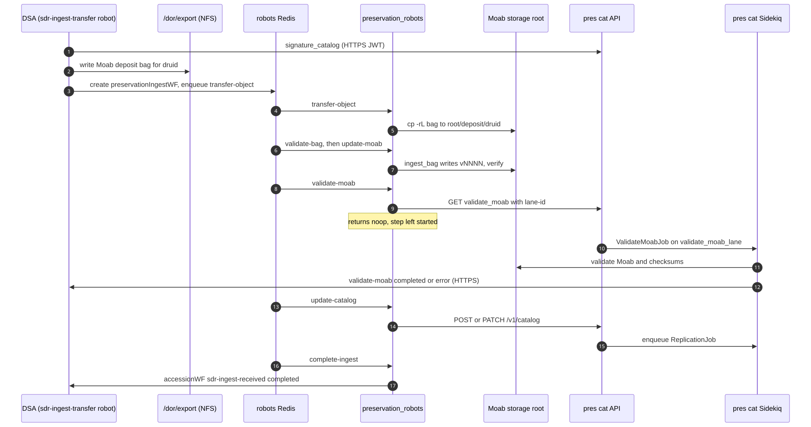

# Preservation

Preservation keeps a durable, audited copy of every accessioned SDR object version. Each version is stored on premises as a Moab (a versioned, file-based object layout with manifests and checksums) and replicated as zip parts to three cloud endpoints: AWS us-west-2, AWS us-east-1 and GCP us-south1 ([ADR 0016](../adr/0016-moab-and-three-cloud-copies.md)). preservation-catalog ("pres cat") records every preserved version, validates and audits the on-prem and cloud copies, runs replication, and serves preserved files to other SDR apps. preservation_robots builds the Moabs from bags that DSA exports during accessioning. This page starts where accessionWF's `sdr-ingest-transfer` step hands off (see [Accessioning](accessioning.md)) and ends with the copies, their audits and the recovery tooling. Terms such as druid, Moab and version are defined in the [Glossary](../../GLOSSARY.md).

Diagram source: [pres-ingest-sequence.mmd](../diagrams/pres-ingest-sequence.mmd)

## Components

| Component | Purpose | Repo | Runtime | Datastores |
| --- | --- | --- | --- | --- |
| preservation-catalog web | REST API (`/v1`, JWT) for catalog updates, Moab validation and file retrieval; ops dashboard; Sidekiq Web at `/queues`; `/status` (okcomputer) | [preservation_catalog](https://github.com/sul-dlss/preservation_catalog) | Rails 8.1, Passenger and Apache | Postgres `pres` |
| preservation-catalog workers | ValidateMoabJob, ReplicationJob, audits (M2C, C2M, checksum validation, replication audit); cron | same | Sidekiq Pro under systemd; whenever cron on the `queue_populator` and `cache_cleaner` hosts | Postgres `pres`; dedicated Redis per env; Moab storage roots; zip cache volume (`zip_storage`) |
| preservation-catalog DB | Catalog of `PreservedObject`, `MoabRecord`, `MoabStorageRoot`, `ZipEndpoint`, `ZippedMoabVersion`, `ZipPart` | same | PostgreSQL 16; prod primary with streaming hot standby | WAL archive and prod dumps on network storage separate from the DB hosts |
| preservation_robots | preservationIngestWF robots: copy the deposit bag, build or extend the Moab, ask pres cat to validate and catalog it, signal accessionWF | [preservation_robots](https://github.com/sul-dlss/preservation_robots) | Plain Ruby, lyber-core, Sidekiq Pro; queues `preservationIngestWF_{high,default,low}` on robots Redis | `/dor/export` (read-only), Moab storage roots |
| preservation-client | Ruby client for the pres cat `/v1` API (bearer JWT, retries, streaming) used by DSA, robots, techmd, Argo, Argo-B3 and H3 | [preservation-client](https://github.com/sul-dlss/preservation-client) | Gem | – |
| moab-versioning | Moab format and storage services: version inventories, signature catalogs, bag ingest, validation, storage root selection | [moab-versioning](https://github.com/sul-dlss/moab-versioning) | Gem (6.1.2) | – |
| druid-tools | Druid validation and druid-tree paths (`ab/123/cd/4567/ab123cd4567`) | [druid-tools](https://github.com/sul-dlss/druid-tools) | Gem | – |

[ocfl-rb](https://github.com/sul-dlss/ocfl-rb) (an OCFL 1.1 library) is maintained but no SDR app depends on it; SDR preservation is Moab-only. SDR plans to implement OCFL; see [R18](recommendations.md#r18-migrate-preservation-storage-from-moab-to-ocfl-in-place-and-without-flag-days) for a proposed in-place migration. LOCKSS hosts in puppet are unrelated to SDR preservation.

### Moab layout

A Moab lives at `<storage root>/sdr2objects/<druid tree>/<druid>/vNNNN/` with `manifests/` (versionInventory, versionAdditions, manifestInventory, signatureCatalog) and `data/{content,metadata}/`. Each new version holds only added or changed files; unchanged files are referenced through the signature catalog. Deposit bags are staged at `<storage root>/deposit/<druid>`. **New objects land on the last storage root listed in config** (moab-versioning `find_storage_root` returns `storage_roots.last` when the druid is on no root); existing objects stay on their root.

## Interfaces

### pres cat API callers

All calls use preservation-client with a bearer JWT minted on the pres cat server with `rake generate_token`; the JWT `sub` names the caller, and every token has the same access ([ADR 0007](../adr/0007-jwt-for-service-auth.md)). Apache also requires either an SDR app host IP or Shibboleth with a staff entitlement for `/v1/` and `/objects/`.

| Caller | Calls | Purpose |
| --- | --- | --- |
| preservation_robots `update-catalog` | POST `/v1/catalog` (version 1) or PATCH `/v1/catalog/:druid` | Record a new or updated Moab version |
| preservation_robots `validate-moab` | GET `/v1/objects/:druid/validate_moab?lane-id=` | Start async validation; pres cat completes the step |
| DSA `sdr-ingest-transfer` | `signature_catalog` | Compute the files a new version adds |
| DSA `VersionService` | `objects.object` (`ok_on_local_storage`) | Refuse to open a version when pres cat reports a preservation error |
| DSA shelving | `content_to_file` | Pull unchanged files when shelving to stacks |
| common-accessioning | `checksum` (start-accession), `content_to_file` (jp2-create, OCR and speech-to-text fetch-files) | Check and fetch preserved files |
| gis-robot-suite | file content (gisDerivativeWF fetch-files) | Fetch preserved geo files |
| technical-metadata-service | `content_to_file` (prod techmd hosts also mount the storage roots directly) | Technical metadata |
| Argo, Argo-B3, H3 | `content`, `checksum`, `current_version`, `signature_catalog` | Downloads, checksum reports, stacks staging |

pres cat URLs: `preservation-catalog-{prod,stage,qa}.stanford.edu`. common-accessioning-prod and dor-techmd-prod use a shorter alias hostname for prod pres cat.

### pres cat outbound

| To | Transport | Detail |
| --- | --- | --- |
| DSA | HTTPS (dor-services-client) to `dor-services-<env>-lb.stanford.edu` | ValidateMoabJob sets preservationIngestWF `validate-moab` started, then completed or error |
| DSA events | AMQP via dor-event-client: exchange `sdr.objects.event` → queue `dsa.create-event` on `sul-rabbit-<env>`, vhost `workflow` | `druid_version_replicated`, `preservation_audit_success`, `preservation_audit_failure` ([ADR 0005](../adr/0005-events-recorded-in-dsa.md)); okcomputer checks that `dsa.create-event` exists |
| Honeybadger | HTTPS | Exceptions; audit failures with critical result codes; cron check-ins |
| Cloud endpoints | S3 API (aws-sdk-s3; GCP through `https://storage.googleapis.com`) | Zip part upload with `checksum_md5` and `size` metadata; HEAD for audits |

## Ingest flow

1. accessionWF `sdr-ingest-transfer` runs as a DSA robot. `PreservationIngestService` writes versionMetadata, contentMetadata and `cocina.json`, calls pres cat `signature_catalog` to compute the version's additions, checks the new version is the preserved version + 1 (a mismatch raises a retriable `VersionMismatchError`), and builds a Moab deposit bag with `Moab::Bagger` in `/dor/export/<druid>` (content is symlinked).
2. DSA creates preservationIngestWF for the version and lane; jobs go to robots Redis as `preservationIngestWF_<lane>`.
3. `transfer-object` checks the bag has `versionMetadata.xml`, then `cp -rL /dor/export/<druid>` into `<root>/deposit/` on the root Moab selects (5 retries, 30 s apart).
4. `validate-bag` checks bag structure and version.
5. `update-moab` runs `ingest_bag` (writes `vNNNN`) and `verify_version_storage`.
6. `validate-moab` calls pres cat and returns `noop`, leaving the step `started`. pres cat runs `ValidateMoabJob` on `validate_moab_<lane>` (structure plus checksums of the latest version) and sets the step completed or error through DSA, which then enqueues the next step.
7. `update-catalog` removes the deposit bag and calls `catalog.update` with version, size and storage location. pres cat creates or updates the `PreservedObject` and `MoabRecord` and enqueues `ReplicationJob`. A 409 Conflict is only noted in Honeybadger.
8. `complete-ingest` sets accessionWF `sdr-ingest-received` to completed (lifecycle `deposited`), which unblocks `reset-workspace`. That step deletes the export bag.

DSA's `VersionService` will not open a new version unless pres cat reports the object `ok_on_local_storage`, so a preservation error blocks further versioning until resolved.

## Storage

Diagram source: [pres-storage.mmd](../diagrams/pres-storage.mmd)

| Env | Storage roots | Backing | Zip cache (`zip_storage`) | Export bags |
| --- | --- | --- | --- | --- |
| prod | Four roots; the last one listed receives new Moabs | CephFS, with the roots split between two Ceph clusters | A dedicated NFS volume | `/dor/export` on a shared NFS volume |
| stage | Two roots; the last one listed receives new Moabs | A general-purpose Ceph NFS volume | A separate Ceph NFS volume | `/dor/export` on an NFS volume shared with qa |
| qa | Two roots; the last one listed receives new Moabs | A general-purpose Ceph NFS volume | A directory on the stage storage volume (see Known issues) | same as stage |

The storage roots are mounted on the pres cat web and worker hosts, preservation-robots1 and 2, and the techmd hosts. pres cat stores each root's `storage_location` as `<path>/sdr2objects`; `db:seed` creates `MoabStorageRoot` and `ZipEndpoint` rows from settings on deploy. The prod pres cat DB archives WAL and writes dumps to network storage separate from the DB hosts. Capacities and free space are not in config.

## Replication

Diagram source: [pres-replication.mmd](../diagrams/pres-replication.mmd)

A single `ReplicationJob` per `PreservedObject` (queue `replication`, with a Redis uniqueness lock and a 3-day lock timeout) does all the work:

1. `populate_zipped_moab_versions!` creates a `ZippedMoabVersion` (status `created`) for every version × endpoint pair that is missing, so a newly added endpoint is backfilled automatically.
2. A replication audit runs first to reconcile state.
3. For each version, skipped unless the `MoabRecord` is `ok`:
   - zip the Moab version with `zip -r0X -s 10g` (no compression, 10 GB parts) into `zip_storage`, with `.md5` sidecars; fail if the zip is not larger than the Moab version;
   - create `ZipPart` rows (suffix, size, MD5) and set the version `incomplete`;
   - upload each part unless the endpoint already has it with matching MD5 metadata; a remote part with a different MD5 is reported as `ZIP_PART_CHECKSUM_MISMATCH`;
   - set the version `ok` and send `druid_version_replicated` (with endpoint and part keys, sizes and MD5s) when every part is there, otherwise `failed`;
   - delete the local zip parts. Hourly cron removes zip cache files older than 7 days; a daily cron removes empty directories.

Keys follow the druid tree: `ab/123/cd/4567/ab123cd4567.v0001.zip`, then `.z01`, `.z02` and so on for larger versions.

Each environment has its own bucket at each endpoint.

| Env | Endpoint name | Provider and region |
| --- | --- | --- |
| prod | `aws_s3_west_2` | AWS S3 us-west-2 (Oregon) |
| prod | `aws_s3_east_1` | AWS S3 us-east-1 (N. Virginia) |
| prod | `gcp_s3_south_1` | GCP Cloud Storage us-south1 (Dallas) |
| stage | `aws_s3_west_2_stage` | AWS S3 us-west-2 |
| stage | `aws_s3_east_1_stage` | AWS S3 us-east-1 |
| stage | `gcp_s3_south_1` | GCP us-south1 |
| qa | `aws_s3_west_2` | AWS S3 us-west-2 |
| qa | `aws_s3_east_1` | AWS S3 us-east-1 |
| qa | `gcp_s3_south_1` | GCP us-south1 |

Endpoint credentials are injected by puppet as `SETTINGS__ZIP_ENDPOINTS__*` variables, not stored in shared_configs (inference from puppet's variable names).

**Endpoint history** (shared_configs commits):

| Change | prod | stage | qa |
| --- | --- | --- | --- |
| IBM `ibm_us_south` added | 2019-02-22 | 2019-01-07 | – |
| GCP `gcp_s3_south_1` added | 2025-05-28 | 2025-05-28 | 2025-05-05 (updated 2025-05-28) |
| IBM removed | 2026-04-08 | 2026-01-23 | 2025-05-23 |

`rake decommission_endpoint` purges a removed endpoint's zip rows and DB records.

## Audits

Cron runs only on the host with the `queue_populator` role. Daily slices audit the oldest `PreservedObject.count / 90` records, so with a 90-day TTL (`fixity_ttl`, `archive_ttl`) every copy is audited about once per 90 days; the weekly jobs sweep anything past its TTL.

| Audit | Schedule | What it checks | Failures surface as |
| --- | --- | --- | --- |
| Validate Moab (ingest) | Per ingest, via preservationIngestWF `validate-moab` | Moab structure and checksums of the new version | Error on the workflow step in DSA (visible in Argo and Argo-B3) |
| Moab to catalog (M2C), queue `m2c` | 11:00 on the 1st of each month (Honeybadger check-in) | Walks every storage root; adds Moabs missing from the catalog; flags version mismatches | Honeybadger for critical codes (e.g. `DB_OBJ_ALREADY_EXISTS`); `preservation_audit_failure` DSA event; `log/m2c-err.log` |
| Catalog to Moab (C2M), queue `c2m` | 11:00 on the 15th of each month (check-in) | For records past their version-audit TTL: the Moab exists and its version matches the catalog | Honeybadger (`MOAB_NOT_FOUND`); DSA event; `log/c2m-err.log` |
| Checksum validation (CV), queue `checksum_validation` | Daily 22:00 slice; Sunday 01:00 expired sweep (check-in) | Full fixity of the on-prem Moab: manifests, signature catalog, content checksums | Honeybadger (`MOAB_FILE_CHECKSUM_MISMATCH`, `MOAB_NOT_FOUND`); DSA event; `log/cv-err.log` |
| Replication audit, queue `moab_replication_audit` | Daily 20:00 slice; weekly on Wednesday, no time set (whenever's default is midnight) (check-in) | Per zipped version and endpoint: part count, total size not less than the Moab version, each part present with `checksum_md5` metadata equal to the DB. Re-enqueues `ReplicationJob` for incomplete versions. **Does not re-hash cloud bytes** | Honeybadger (`ZIP_PART_NOT_FOUND`, `ZIP_PART_CHECKSUM_MISMATCH`, `ZIP_PARTS_COUNT_DIFFERS_FROM_ACTUAL`, `ZIP_PARTS_NOT_ALL_REPLICATED`, `ZIP_PARTS_SIZE_INCONSISTENCY`); DSA event; `log/c2a-err.log` |
| Cloud fixity (manual) | On demand: `bin/fixity_check_replicated_moabs` | Downloads, unzips and checksum-validates a replicated version | Script log |

`ResultsReporter` sends every audit result to three reporters: log files, Honeybadger (only the critical codes listed above), and DSA events (`preservation_audit_failure` with check name `moab-valid` or `preservation-audit`, and `preservation_audit_success` when a check passes). Events appear in the object's event history in Argo and Argo-B3. The pres cat dashboard (`/dashboard/moab_records/with_errors`, `/stuck`; `/dashboard/zipped_moab_versions/with_errors`, `/stuck`, `/incomplete`) lists failures and can re-run CV or a replication audit for one object. Alert routing and on-call are out of scope here.

## Restoration

Restoration is manual; there is no automated restore path.

- **One file from the on-prem Moab:** GET `/v1/objects/:druid/file?category=content|metadata|manifest&filepath=&version=`. Argo, Argo-B3 and H3 downloads, DSA shelving, jp2-create, OCR and techmd all use this.
- **Re-accession an object from preservation:** `bin/create_bag <druid list> <dir>` builds a bag from the Moab.
- **From the cloud:** use `Audit::ReplicatedMoabChecksumValidator` (`bin/fixity_check_replicated_moabs`) to download and verify the zip parts, then unzip by hand. As of May 2026, AWS copies move to Glacier after upload, so they need a restore request (to a temporary bucket) before they can be read; GCP copies are readable immediately. The bucket lifecycle rules are not in any repo examined.
- **Moving Moabs between roots:** copy, then `rake prescat:migrate_storage_root[from,to]`.
- **Rebuilding the catalog:** `CatalogUtils.populate_catalog_for_all_storage_roots` (procedure in the pres cat README).
- **pres cat DB:** promote the hot standby (prod), or restore from the dumps and WAL archive.

## Hosts and environments

All hostnames end in `.stanford.edu`. Hosts are defined in the private puppet repo.

| Role | prod | stage | qa |
| --- | --- | --- | --- |
| pres cat web (load balanced) | `preservation-catalog-web-prod-{01,02}` behind `preservation-catalog-prod` | `preservation-catalog-web-stage-{01,02}` behind `preservation-catalog-stage` | `preservation-catalog-web-qa-{01,02}` (not load balanced; URL `preservation-catalog-qa`) |
| pres cat workers (cap roles) | `worker-prod-01` (db, worker, `queue_populator`), `worker-prod-02` (worker), `worker-prod-03` (worker, `cache_cleaner`) | `worker-stage-01` (all roles) | `worker-qa-01` (all roles) |
| pres cat DB | A primary and a streaming hot standby, on separate database hosts | One database host | One database host |
| pres cat Redis | One dedicated Redis host | One dedicated Redis host | One dedicated Redis host |
| preservation_robots | `preservation-robots1-prod`; `robots2-prod` warm standby | `preservation-robots1-stage`; `robots2-stage` standby | `preservation-robots1-qa`; `robots2-qa` standby |

Worker hosts are `preservation-catalog-worker-<env>-NN`. Each environment's pres cat replicates to its own buckets and talks to that environment's DSA and RabbitMQ.

**pres cat Sidekiq queues.** Each worker host runs several Sidekiq processes, each dedicated to a group of queues: `validate_moab_{high,default,low}`; `c2m` and `m2c`; `replication` and `moab_replication_audit`; and `checksum_validation`. Process counts, concurrency and queue weighting are deployment-configured and differ between prod and the other environments.

Deploy: Capistrano to `/opt/app/pres/preservation_catalog` and `/opt/app/pres/preservation_robots` as `pres`; `shared_configs:update` runs before migrations and `db:seed` after.

## Configuration

`config/settings.yml` in each repo → shared_configs branch → puppet `SETTINGS__*` environment variables for secrets.

| App | Branch | Key settings |
| --- | --- | --- |
| preservation_catalog | [`preservation-catalog-{prod,stage,qa}`](https://github.com/sul-dlss/shared_configs/blob/preservation-catalog-prod/config/settings/production.yml) | `storage_root_map`, `zip_endpoints`, `zip_storage`, `redis_url`, `dor_services`, `rabbitmq`, `worker_hostnames`, `config/sidekiq1..10.yml` |
| preservation_robots | [`preservation_robots_{prod,stage,qa}`](https://github.com/sul-dlss/shared_configs/blob/preservation_robots_prod/config/environments/production.yml) | `transfer_object.from_dir: /dor/export/`, `moab.storage_roots`, robots `redis_url`, pres cat and DSA URLs |

Shared moab settings: `storage_trunk: sdr2objects`, `deposit_trunk: deposit`, `path_method: druid_tree`.

## Known issues and cleanup

- **Obsolete endpoint keys.** shared_configs still sets `delivery_class`, `audit_class` and `provider_class` on every endpoint; the code no longer reads them (per-endpoint delivery jobs were replaced by `ReplicationJob`, and `delivery_class` was dropped in a 2026 migration).
- **QA Sidekiq config** sidekiq5 and sidekiq6 still list removed queues: `zipmaker`, `zips_made`, `zip_endpoint_events`, `s3_us_east_1_delivery`, `s3_us_west_2_delivery`, `gcp_us_south_delivery`.
- **QA `zip_storage`** points at a directory inside the stage storage volume, although puppet mounts dedicated zip cache volumes on `worker-qa-01`. Unverified: whether this is intentional.
- **Stage settings** define the `replication:` key twice.
- **`worker_hostnames`** (okcomputer) lists retired pres cat hosts in every environment.
- **Legacy puppet nodes:** two retired qa and stage hosts that run only Redis (not referenced by config), an unused logical volume on a prod web host, and Resque-era web-server configuration (the app uses Sidekiq at `/queues`). Review the web-server configuration and administrative-interface protection privately.
- **preservation-robots mount `/sdr-deposit-staging` read-write**; robot code does not use it.
- **Hostname drift:** common-accessioning-prod and dor-techmd-prod use an alias hostname while others use `preservation-catalog-prod`; Argo-B3's in-repo default is `preservation-catalog-stage-01.stanford.edu`, which no longer exists; deployed Argo-B3 overrides it with `preservation-catalog-<env>.stanford.edu` in [`config/deploy.<env>.yml`](https://github.com/sul-dlss/argo-b3/blob/main/config/deploy.prod.yml), so only local development sees the stale default.
- **`preservationAuditWF`** remains in DSA `config/workflows` (all `skip-queue`); pres cat now reports audits as events and Honeybadger only, and the `ResultsReporter` comment still mentions the "Workflow Service".
- **Stale docs.**
  - [pres cat README](https://github.com/sul-dlss/preservation_catalog/blob/main/README.md) overview lists an on-prem Ceph cluster as one of three replicas in "northern California, northern Virginia and central Texas"; the replicas are AWS us-west-2 (Oregon), AWS us-east-1 and GCP us-south1, and Ceph holds the primary Moabs.
  - [preservation_robots README](https://github.com/sul-dlss/preservation_robots/blob/main/README.md) says "5 robots" but lists six and links workflow definitions to workflow-server-rails (now DSA `config/workflows`). The `transfer-object` label in `preservationIngestWF.xml` still credits the "common-accessioning sdrIngestTransfer robot", which now runs inside DSA. A `ValidateMoabJob` comment links to workflow-server-rails.
  - [DevOpsDocs](https://github.com/sul-dlss/DevOpsDocs) pres cat ops concerns list old VM names, per-endpoint worker pools and a retired puppet role; the robots page mentions NetApp `/services-disk`.
- **Planned work, not done:** cloud fixity (re-hashing replicated bytes) is mentioned as planned in pres cat `AGENTS.md`; there is no automated cloud restore.

## Sources

- [preservation_catalog README](https://github.com/sul-dlss/preservation_catalog/blob/main/README.md), [`config/schedule.rb`](https://github.com/sul-dlss/preservation_catalog/blob/main/config/schedule.rb), [`config/routes.rb`](https://github.com/sul-dlss/preservation_catalog/blob/main/config/routes.rb), [`openapi.yml`](https://github.com/sul-dlss/preservation_catalog/blob/main/openapi.yml), [`app/jobs/replication_job.rb`](https://github.com/sul-dlss/preservation_catalog/blob/main/app/jobs/replication_job.rb), [`app/jobs/validate_moab_job.rb`](https://github.com/sul-dlss/preservation_catalog/blob/main/app/jobs/validate_moab_job.rb), [`app/services/replication/`](https://github.com/sul-dlss/preservation_catalog/tree/main/app/services/replication), [`app/services/results_reporters/`](https://github.com/sul-dlss/preservation_catalog/tree/main/app/services/results_reporters), [`app/services/audit/replicated_moab_checksum_validator.rb`](https://github.com/sul-dlss/preservation_catalog/blob/main/app/services/audit/replicated_moab_checksum_validator.rb), [`app/models/moab_storage_root.rb`](https://github.com/sul-dlss/preservation_catalog/blob/main/app/models/moab_storage_root.rb), [`bin/create_bag`](https://github.com/sul-dlss/preservation_catalog/blob/main/bin/create_bag)
- [preservation_robots `lib/robots/sdr_repo/preservation_ingest/`](https://github.com/sul-dlss/preservation_robots/tree/main/lib/robots/sdr_repo/preservation_ingest), [`config/deploy/prod.rb`](https://github.com/sul-dlss/preservation_robots/blob/main/config/deploy/prod.rb)
- [preservation-client `lib/preservation/client/objects.rb`](https://github.com/sul-dlss/preservation-client/blob/main/lib/preservation/client/objects.rb)
- [moab-versioning `lib/moab/storage_repository.rb`](https://github.com/sul-dlss/moab-versioning/blob/main/lib/moab/storage_repository.rb), [`lib/moab/storage_object_version.rb`](https://github.com/sul-dlss/moab-versioning/blob/main/lib/moab/storage_object_version.rb)
- [dor-services-app `app/services/preservation_ingest_service.rb`](https://github.com/sul-dlss/dor-services-app/blob/main/app/services/preservation_ingest_service.rb), [`app/services/version_service.rb`](https://github.com/sul-dlss/dor-services-app/blob/main/app/services/version_service.rb), [`config/workflows/preservationIngestWF.xml`](https://github.com/sul-dlss/dor-services-app/blob/main/config/workflows/preservationIngestWF.xml)
- shared_configs: [preservation-catalog-prod](https://github.com/sul-dlss/shared_configs/blob/preservation-catalog-prod/config/settings/production.yml), [preservation-catalog-stage](https://github.com/sul-dlss/shared_configs/blob/preservation-catalog-stage/config/settings/production.yml), [preservation-catalog-qa](https://github.com/sul-dlss/shared_configs/blob/preservation-catalog-qa/config/settings/production.yml), [preservation_robots_prod](https://github.com/sul-dlss/shared_configs/blob/preservation_robots_prod/config/environments/production.yml)
- [puppet](https://github.com/sul-dlss/puppet) (private): node data for the pres cat web, worker and database hosts and the preservation_robots hosts
- ADRs: [0005](../adr/0005-events-recorded-in-dsa.md), [0007](../adr/0007-jwt-for-service-auth.md), [0008](../adr/0008-workflow-engine-in-dsa.md), [0016](../adr/0016-moab-and-three-cloud-copies.md)

_Verified against default branches on 2026-11-16; private-source details redacted 2026-11-17._
