# Recommendations

This page draws together the "Known issues and cleanup" sections of the other architecture pages, the lessons in [History and lessons learned](history-and-lessons.md), the ADR consequences and the [open questions](open-questions.md). From these it proposes a short list of structural changes and cleanup. Every recommendation links its evidence. Claims not already on another page were checked against code on the default branches and are linked to it. Judgement calls are marked **Judgement**. Ops-team processes (paging, on-call, alert routing, data refresh) are out of scope. Terms are defined in the [Glossary](../../GLOSSARY.md).

## Summary

SDR has been consolidated on purpose. DSA (dor-services-app) is now the system of record, the workflow engine, a robot host, the Argo indexer, the event store and the integration point for FOLIO, DataCite and ORCID. That suits a small team, but a DSA or Solr problem now stops deposit, accessioning and staff search together ([lesson 4](history-and-lessons.md#4-fewer-larger-services-suit-a-small-team-but-the-blast-radius-grows)). Downstream of DSA the boundaries are mostly clean: purl-fetcher is the only writer of public data, stacks enforces rights, and preservation-catalog owns preservation. The main duplications are temporary or deliberate: three staff apps during the Argo-B3 transition, two message brokers, two deploy and configuration styles, and environments that share access systems and a SolrCloud. Every past migration left dead config and plumbing behind, and the pages list a lot of it ([lesson 1](history-and-lessons.md#1-a-retirement-is-not-finished-when-the-code-merges)). The highest-value changes are these:

1. Remove the dead messaging and run one tracked decommission sweep (R1, R2).
2. Make DSA's synchronous side effects on Solr and RabbitMQ fail soft instead of failing registration (R3).
3. Finish the Argo-B3 transition with an explicit end state, including observability before cutover (R13, R16).
4. Verify cloud preservation copies by content and rehearse a restore (R10).
5. Finish moving purl-fetcher's writes to S3, once the legacy hard-link question is settled (R7).
6. Start the Moab → OCFL migration with its no-risk phases: put all Moab access behind preservation_catalog, generate and round-trip OCFL inventories outside preservation storage, and make validators and writers hybrid-aware (R18).

## Separation of concerns today

Diagram source: [rec-responsibilities.mmd](../diagrams/rec-responsibilities.mmd). Red: concentration. Purple: duplication.

### Responsibility matrix

| Concern | Owning component | Where the boundary blurs |
| --- | --- | --- |
| System of record (cocina objects, versions) | DSA, Postgres `dor_services` ([ADR 0002](../adr/0002-dsa-postgres-system-of-record.md)) | H3 keeps drafts in its own database, and Argo-B3 keeps permissions in its own. These are app state, not object state, so the boundary holds. |
| Identifiers | SURI, called only by DSA | Each environment's SURI checks uniqueness only in its own database, while QA and stage share access stores ([ADR 0024](../adr/0024-qa-shares-stage-access-systems.md)). |
| Workflow orchestration | DSA (`workflow` database) ([ADR 0008](../adr/0008-workflow-engine-in-dsa.md)) | Inside the monolith. EDA 0023 accepted that this makes it less visible. |
| Step execution | DSA-hosted robots, common-accessioning, gis-robot-suite, was_robot_suite, preservation_robots ([ADR 0009](../adr/0009-robots-as-sidekiq-workers.md)) | Split by "needs DSA internals" rather than by workflow, so one workflow's steps run in two codebases. Vestigial queues and orphaned templates remain ([Accessioning](accessioning.md#known-issues-and-cleanup)). |
| Technical metadata | technical-metadata-service | Reads Moabs directly, which ties it to the preservation layout ([ADR 0016](../adr/0016-moab-and-three-cloud-copies.md)). |
| Argo search index | DSA writes `argo_<env>` synchronously ([ADR 0010](../adr/0010-dsa-writes-argo-index.md)) | Index for every environment is on the access team's prod SolrCloud ([ADR 0025](../adr/0025-shared-prod-solrcloud.md)). |
| SearchWorks indexing | searchworks_traject_indexer, from Kafka ([ADR 0018](../adr/0018-release-tags-drive-discovery.md)) | Stage experiment indexers and content_search uat read prod topics ([Environments](environments.md#cross-environment-wiring)). |
| EarthWorks indexing | EarthWorks' own Kafka consumer ([ADR 0018](../adr/0018-release-tags-drive-discovery.md)) | OpenGeoMetadata harvesting is a separate cron. |
| Publication | DSA `publish` robot (diff and stage) → purl-fetcher, the sole writer ([ADR 0011](../adr/0011-purl-fetcher-publish-api.md)) | DSA still shelves web-archive content to `/web-archiving-stacks` itself. The writer uses a shared filesystem mount while readers use S3 ([ADR 0013](../adr/0013-weka-s3-read-path.md)). |
| Rights enforcement | stacks, per request, against purl's public cocina ([ADR 0015](../adr/0015-stacks-enforces-rights-per-request.md)) | DSA applies access templates and performs embargo release ([ADR 0017](../adr/0017-embargo-release-opens-version.md)). That is a clean split between deciding rights and enforcing them. |
| Preservation | preservation_robots (Moab) and preservation-catalog (catalog, replication, audit) ([ADR 0016](../adr/0016-moab-and-three-cloud-copies.md)) | DSA's `sdr-ingest-transfer` builds the bag. pres cat reports audits back as DSA events. |
| Messaging | RabbitMQ for SDR events and notices, Kafka for discovery ([ADR 0006](../adr/0006-rabbitmq-for-events-kafka-for-discovery.md)) | Two technologies with different owners. RabbitMQ carries dead exchanges and a dead queue. |
| Configuration | shared_configs plus puppet env vars from Vault. argo-b3 uses Kamal `deploy.<env>.yml` plus Vault ([Platform](platform-and-operations.md#configuration)). | Puppet names an `argo-b3` config branch that does not exist. |
| Deploy | Capistrano through sdr-deploy. Kamal for argo-b3. Jenkins for the access apps. GitHub Actions for speech-to-text ([Platform](platform-and-operations.md#deployment)). | Four mechanisms. sdr-deploy wraps the first two. |
| Staff management UI | Argo, Argo-B3 and pre-assembly, all live ([ADR 0023](../adr/0023-argo-b3-replaces-argo-and-pre-assembly.md)) | Temporary. All three read the same Solr index and mounts. |

### Coupling

- **Synchronous HTTP into DSA.** Every management app, and every robot reporting step status, calls DSA over HTTPS with a JWT. DSA is a hard dependency of everything upstream of publication. This is the intended hub-and-spoke shape ([Overview](index.md#component-map)).
- **Synchronous calls out of DSA.** Registration writes the object, then synchronously publishes `sdr.objects.created` to RabbitMQ and indexes Solr. There is no transaction around these steps, and neither message nor index write is needed to commit the object ([`create_object_service.rb` L43–L51](https://github.com/sul-dlss/dor-services-app/blob/main/app/services/create_object_service.rb#L43-L51)). After each workflow step, DSA reindexes synchronously and swallows errors, but the Solr client waits up to 120 s to connect and 120 s to read ([`next_step_service.rb` L82–L88](https://github.com/sul-dlss/dor-services-app/blob/main/app/services/workflow/next_step_service.rb#L82-L88), [`indexer.rb` L57](https://github.com/sul-dlss/dor-services-app/blob/main/app/services/indexer.rb#L57)). The `publish` robot calls purl-fetcher synchronously, and purl-fetcher is one host per environment with no load balancer ([ADR 0011](../adr/0011-purl-fetcher-publish-api.md)).
- **Asynchronous seams that work.** DSA reaches the robots through Sidekiq on a separate robots Redis. Robots and pres cat send fire-and-forget events to DSA over RabbitMQ ([ADR 0005](../adr/0005-events-recorded-in-dsa.md)). purl-fetcher feeds discovery through Kafka, and a topic can be replayed ([ADR 0018](../adr/0018-release-tags-drive-discovery.md)).
- **Shared filesystems as integration points.** `/dor` and `/sdr-deposit-staging` connect the deposit apps, the robots and DSA. `/access-transfer` connects DSA and purl-fetcher. purl-fetcher writes public files through its `/stacks` mount, and readers use S3. `/web-archiving-stacks` and `/globus` are also shared. QA and stage share `/dor` ([Environments](environments.md#cross-environment-wiring)). History shows these are shared failure domains ([lesson 6](history-and-lessons.md#6-storage-assumptions-outlive-the-storage)).
- **Shared stores across environments.** All Argo indexes and the stage access collections are on the prod SolrCloud. QA publishes to stage purl-fetcher. Every environment mounts prod Globus ([ADR 0024](../adr/0024-qa-shares-stage-access-systems.md), [ADR 0025](../adr/0025-shared-prod-solrcloud.md)).
- **Lockstep code coupling.** Twelve repositories must take the same cocina-models version, and Google Books is switched off in prod during the deploy ([ADR 0003](../adr/0003-cocina-shared-model-lockstep.md)).

### Cohesion

- **DSA has low cohesion.** It changes for many unrelated reasons: model changes, workflow templates, robot code, Solr fields, FOLIO, DataCite, ORCID and embargo policy. Its Sidekiq layout already separates some of these concerns at runtime: robot-labelled processes, dedicated publish processes and a serialized `update-marc` process ([Repository core](repository-core.md#dsa-processes)). Those are partial bulkheads to build on.
- **Each downstream service has one job:** purl-fetcher writes public data, stacks enforces rights, pres cat preserves, and each indexer indexes one target. Their weak points are availability (single hosts, a single Kafka broker), not boundaries.
- **The staff tools overlap completely during the transition.** Argo and Argo-B3 cover most of the same capabilities, and pre-assembly overlaps with Multi-Item Deposit ([Management and deposit](management-and-deposit.md#argo-argo-b3-and-the-transition)).

## Recommendations

Effort: **S** is days in one repository. **M** is weeks, or several repositories. **L** is a quarter or more, or work across teams. Goal axes: efficiency, performance, reliability, security, maintainability/simplicity.

### R1. Remove the dead RabbitMQ messaging

- **Goals:** reliability, maintainability/simplicity.
- **Problem.** The queue `dor.indexing-by-druid` is declared and never consumed. The exchanges `sdr.objects.created` and `sdr.objects.embargo_lifted` are published and never consumed. The maintainer confirms all three are believed unused ([Repository core](repository-core.md#known-issues-and-cleanup), [ADR 0006](../adr/0006-rabbitmq-for-events-kafka-for-discovery.md), [ADR 0017](../adr/0017-embargo-release-opens-version.md)). The `sdr.objects.created` publish runs synchronously inside registration, after the object is saved ([`create_object_service.rb` L50](https://github.com/sul-dlss/dor-services-app/blob/main/app/services/create_object_service.rb#L50)). Embargo release publishes the other exchange ([`embargo_release_service.rb` L46](https://github.com/sul-dlss/dor-services-app/blob/main/app/services/embargo_release_service.rb#L46)). The queue declaration is in [`rabbitmq.rake` L25](https://github.com/sul-dlss/dor-services-app/blob/main/lib/tasks/rabbitmq.rake#L25). Inference: when RabbitMQ is unavailable, registration can return an error for an object that was in fact created.
- **Proposal.**
  1. In each environment, confirm in the RabbitMQ management UI that neither exchange has a binding and the queue has no consumer.
  2. Delete `Notifications::ObjectCreated` and `Notifications::EmbargoLifted`, and the queue declaration.
  3. Delete the exchanges and the queue on the brokers.
  4. Fix DevOpsDocs `messaging.md`, which still describes the retired topology.
  5. Keep the `registration` and `embargo_released` events, which live in the DSA database.
- **Trade-offs and risks.** An unknown consumer outside the SDR repositories could break. Step 1 is the guard. Re-adding a notification later is cheap.
- **Effort and dependencies:** S. None.
- **Signals it worked.** `rabbitmqctl list_exchanges` shows no `sdr.objects.created` or `sdr.objects.embargo_lifted`. Registration has no RabbitMQ call in its code path.

### R2. Run one tracked decommission sweep

- **Goals:** maintainability/simplicity, security.
- **Problem.** Every consolidation left references behind ([lesson 1](history-and-lessons.md#1-a-retirement-is-not-finished-when-the-code-merges), [recurring patterns](history-and-lessons.md#recurring-patterns)). The known-issues sections together form a ready backlog:
  - **shared_configs keys:**
    - `workflow.url` / `workflow_url` and `dor_indexing.url` across DSA, Argo, pre-assembly, H3, sdr-api, WRA and the robots;
    - argo-stage's Fedora URL;
    - `release.symphony_path`;
    - pres cat `delivery_class`, `audit_class`, `provider_class` and `worker_hostnames`;
    - stacks `remote_iiif.*` and `cdl.*`;
    - the GeoServer `proxy_url` and `restricted_url` keys;
    - the `sw-indexing-*` `processes:` block.

    Sources: [Repository core](repository-core.md#known-issues-and-cleanup), [Management and deposit](management-and-deposit.md#known-issues-and-cleanup), [Preservation](preservation.md#known-issues-and-cleanup), [Access and discovery](access-and-discovery.md#known-issues-and-cleanup).
  - **Orphaned branches:** `dsa-prod-sidekiq`, `searchworks-symphony`, `searchworks-v3`, `sul-solr-tester` and `sul-stacks-cdn`. Puppet names an `argo-b3` shared_configs branch for argo-b3, which does not exist ([Platform](platform-and-operations.md#known-issues-and-cleanup)).
  - **Firewall rules** (in puppet): review allowlists for retired services and monitoring hosts.
  - **Workflow templates and queues:** the orphaned `gisDeliveryWF`, `captionWF`, `wasSeedDisseminationWF` and `preservationAuditWF`, plus the vestigial `goobiWF_*`, `releaseWF_*` and `disseminationWF_*` listeners in common-accessioning ([Accessioning](accessioning.md#known-issues-and-cleanup)).
  - **Hosts and platform leftovers:**
    - the Redis-only third pres cat qa and stage hosts, and an extra volume on a pres cat prod web host;
    - PostGIS and the `geoserver` database;
    - the dlss-wowza plugin and its Wowza apps;
    - the `/resque/` vhost path and stacks' X-Sendfile setting for `/stacks`;
    - the Nagios remnants ([Platform](platform-and-operations.md#known-issues-and-cleanup)).
- **Proposal.** Open one tracking issue per checklist area (see [Opportunities](#opportunities-to-grow-and-improve)), and work through it in small PRs per repository. Delete dead keys from shared_configs in the same PR that removes their code, or confirm that no code reads them.
- **Trade-offs and risks.** Some deletions depend on open questions: whether the old workflow service DNS names still resolve, and whether any APO still names an orphaned template as its `disseminationWorkflow` ([Open questions](open-questions.md#accessioning)). Answer those first. Removing firewall rules needs a puppet run, so coordinate with ops.
- **Effort and dependencies:** M, spread over several weeks. Depends on the two open questions above.
- **Signals it worked.**
  - `git grep workflow-service` across shared_configs branches returns nothing.
  - The orphaned templates are gone from DSA `config/workflows`.
  - The known-issues lists on these pages get shorter at each re-verification.

### R3. Make DSA's synchronous side effects fail soft

- **Goals:** reliability, performance.
- **Problem.**
  - Registration commits the object, then publishes to RabbitMQ and indexes Solr synchronously, with no rescue ([`create_object_service.rb` L43–L51](https://github.com/sul-dlss/dor-services-app/blob/main/app/services/create_object_service.rb#L43-L51)). Inference: a Solr failure there returns an error for an object that was created. A retry with the same source ID then gets a 409 conflict.
  - Step updates reindex synchronously and swallow errors, which is good. But the Solr client allows 120 s each for connect and read, so a slow Solr can stall step processing ([`indexer.rb` L57](https://github.com/sul-dlss/dor-services-app/blob/main/app/services/indexer.rb#L57)).
  - [ADR 0010](../adr/0010-dsa-writes-argo-index.md) records "a Solr outage surfaces as DSA errors". The code shows that this is true for registration but not for step updates.
- **Proposal.**
  1. At registration, rescue Solr connection errors explicitly and fall back to `Indexer.reindex_later`, as other paths already do.
  2. Use a short timeout for synchronous index writes (a few seconds) and keep 120 s only for batch jobs.
  3. R1 removes the RabbitMQ publish from this path.
  4. Rely on the existing backstops: the daily unindexed-druid check and the weekly full reindex ([Repository core](repository-core.md#dsa-processes)).
- **Trade-offs and risks.**
  - During a Solr incident, a newly registered object may be briefly missing from Argo and Argo-B3 search.
  - Argo-B3's register-then-redirect flow may need to tolerate that gap.
  - Out-of-order writes (argo#3817) do not get worse, because `reindex_later` carries `current_as_of`.
  - This keeps [ADR 0008](../adr/0008-workflow-engine-in-dsa.md)'s reason for indexing step updates synchronously.
- **Effort and dependencies:** S. Best done after R1.
- **Signals it worked.** A Solr outage in stage does not fail registrations. Honeybadger shows rescued index errors instead of 500s from `POST /v1/objects`.

### R4. Keep DSA consolidated, and add bulkheads rather than services

- **Goals:** reliability, maintainability/simplicity.
- **Problem.** A DSA outage stops deposit, accessioning, indexing and the DSA-hosted robots ([ADR 0002](../adr/0002-dsa-postgres-system-of-record.md)). Workflow availability is DSA availability ([ADR 0008](../adr/0008-workflow-engine-in-dsa.md)). DSA's `/status/all` checks FOLIO, Solr, the RabbitMQ event queue and Sidekiq latency on `default` only. It has no check on the robot or publish queues, purl-fetcher or pres cat ([`okcomputer.rb` L65–L110](https://github.com/sul-dlss/dor-services-app/blob/main/config/initializers/okcomputer.rb#L65-L110)).
- **Options weighed.**
  - **Split robots or indexing back out into services.** Rejected (**Judgement**). That reverses the deliberate consolidation in [ADR 0008](../adr/0008-workflow-engine-in-dsa.md) and [ADR 0010](../adr/0010-dsa-writes-argo-index.md). It also repeats the 2014–2019 era of many synchronous services, which EDA 0010 called fragile ([lesson 4](history-and-lessons.md#4-fewer-larger-services-suit-a-small-team-but-the-blast-radius-grows)). DSA robots need DSA's models, so a separate deploy would still share the codebase and the database.
  - **Separate deploys for DSA workers.** Low value. sdr-deploy already deploys hosts in parallel, and Capistrano quiets and restarts Sidekiq around each deploy ([Platform](platform-and-operations.md#capistrano-and-dlss-capistrano)).
  - **Bulkheads inside DSA.** Recommended, and the Sidekiq layout has already started down this road:
    - Add OkComputer latency checks for the robot queues (`accessionWF_*_dsa`, `releaseWF_*_dsa`) and the `publish_*` queues.
    - Record a dependency → effect → mitigation table on [Repository core](repository-core.md).
    - Keep each external integration (FOLIO, DataCite, ORCID, purl-fetcher) on its own queue or process, so a slow partner cannot exhaust shared Sidekiq threads. `update-marc` is already serialized this way.
- **Trade-offs and risks.** More queues mean more Sidekiq processes to size. The table needs upkeep at each re-verification.
- **Effort and dependencies:** M. Follows R3.
- **Signals it worked.** A FOLIO or purl-fetcher slowdown shows up as one named failing check and a backed-up queue, not as general DSA slowness.

### R5. Keep both brokers, write down the contract, and register the Kafka risk

- **Goals:** reliability, maintainability/simplicity.
- **Problem.**
  - Two broker technologies have different owners: RabbitMQ is run by ops, Kafka by the access team ([Platform](platform-and-operations.md#shared-services-sdr-depends-on)).
  - Kafka is a single broker per environment on a Kafka 3.x release, with ZooKeeper on the same host ([ADR 0006](../adr/0006-rabbitmq-for-events-kafka-for-discovery.md)). Kafka 4.0 supports only KRaft mode, and ZooKeeper clusters must migrate to KRaft on a 3.x release first ([Apache Kafka upgrade notes](https://kafka.apache.org/40/getting-started/upgrade/)).
  - EDA 0010 recommended RabbitMQ only. Kafka was added later without a record ([lesson 2](history-and-lessons.md#2-record-what-was-built-not-only-what-was-proposed)).
- **Proposal (Judgement: keep both).**
  - Moving discovery to RabbitMQ would lose topic replay, which rebuilds an index ([ADR 0018](../adr/0018-release-tags-drive-discovery.md)).
  - Moving SDR events to Kafka would put a single-broker system into the accessioning path.
  - Instead, amend ADR 0006 with an explicit contract. RabbitMQ carries SDR-internal events and notices: producers, exchanges, consumers. Kafka carries public discovery state: topics, keys, tombstones, retention, the replay procedure.
  - Raise the Kafka single-broker and version risk with the access team as a dependency SDR relies on. Kafka work is theirs.
- **Trade-offs and risks.** Two technologies stay. The cost is documentation, not a migration.
- **Effort and dependencies:** S for the ADR. The Kafka upgrade is L, and access-team work.
- **Signals it worked.** Each topic and exchange has a named owner and consumer in the ADR. A Kafka KRaft migration plan exists.

### R6. Close the gaps in purl-fetcher's discovery messages

- **Goals:** reliability.
- **Problem** (from code; [Access and discovery](access-and-discovery.md#known-issues-and-cleanup), [Kafka topics](access-and-discovery.md#kafka-topics)):
  - Unpublishing sends no tombstone to the sitemap topic, so dark druids can stay in the purl sitemap.
  - `purl_fetcher_*` messages go out only for objects that have ever had a `Searchworks` release tag. content_search and the SearchWorks preview index therefore miss everything else, although `true_targets` always lists them.
  - A republish with no release-tag change produces no message. `skipReleaseWF` bypasses the indexers entirely.
- **Proposal.**
  1. Settle [open question 3](open-questions.md#access-and-discovery) with the access team.
  2. Then emit a message on every publish and unpublish for every topic whose target is in `true_targets`.
  3. Send a sitemap tombstone on unpublish.
  4. Record the result in [ADR 0018](../adr/0018-release-tags-drive-discovery.md).
- **Trade-offs and risks.** More messages, and consumers must be idempotent. They already handle "ever released" deletes. This needs coordination with access-team consumers.
- **Effort and dependencies:** S–M. Depends on the open question.
- **Signals it worked.** A dark druid leaves the sitemap. Objects never released to SearchWorks appear in content_search.

### R7. Move purl-fetcher's writes to S3

- **Goals:** reliability, maintainability/simplicity, security.
- **Problem.**
  - The writer uses a filesystem mount while every reader uses S3. A failure of either access path breaks one side only ([ADR 0013](../adr/0013-weka-s3-read-path.md)).
  - purl-fetcher is the only service that still mounts the stacks filesystem, and it needs read-write S3 credentials before it can switch.
  - The versioned layout keeps legacy paths and `/globus` copies as hard links to `content/<md5>`, and S3 has no hard links ([ADR 0012](../adr/0012-versioned-public-data.md)).
- **Proposal.**
  1. Settle whether the legacy unversioned paths still have readers ([open question 9](open-questions.md#access-and-discovery)).
  2. Drop them, or replace them with redirects in stacks.
  3. Move purl-fetcher's writes to S3.
  4. Unmount the stacks filesystem from purl-fetcher.
  5. Decide separately whether `/access-transfer` (DSA → purl-fetcher) should become an S3 prefix too.
- **Trade-offs and risks.**
  - The `/globus` read-only copies depend on hard links and would need another mechanism.
  - [ADR 0024](../adr/0024-qa-shares-stage-access-systems.md) lists this change as a reason to reconsider giving access systems a pre-stage environment, because a QA-less rollout is riskier.
  - Writes become non-atomic object PUTs, so ordering matters (content first, then `versions.json`).
- **Effort and dependencies:** L. Depends on R6 (consumers tolerate republish), on the legacy-links decision, and on ops issuing credentials.
- **Signals it worked.** No host mounts the stacks filesystem. One protocol appears in [ADR 0013](../adr/0013-weka-s3-read-path.md)'s successor.

### R8. Purge the image server cache that is actually used

- **Goals:** reliability.
- **Problem.** purl-fetcher-stage purges the stage Cantaloupe server, but stage stacks reads from `imageserver-test`, so stage purges do nothing. In every environment, unpublishing does not purge the image cache. stacks still blocks the requests ([Environments](environments.md#cross-environment-wiring), [Access and discovery](access-and-discovery.md#known-issues-and-cleanup)).
- **Proposal.** Point the stage purge at the server that stage stacks uses, and purge on unpublish. Answer [open question 4](open-questions.md#access-and-discovery) about who still uses the stage Cantaloupe server.
- **Trade-offs and risks.** None significant. Rights enforcement in stacks remains the real control.
- **Effort and dependencies:** S.
- **Signals it worked.** A stage republish of a changed image shows the new image without waiting for cache expiry.

### R9. Revisit environment isolation with cheaper partial options

- **Goals:** reliability, security.
- **Problem.** The shared-environment choices are deliberate, and each has a cost:
  - QA publishes to stage access systems and shares `/dor` with stage ([ADR 0024](../adr/0024-qa-shares-stage-access-systems.md)).
  - Every environment's Argo index is on the prod SolrCloud ([ADR 0025](../adr/0025-shared-prod-solrcloud.md)).
  - Every environment mounts the prod Globus server.
  - content_search uat and stage experiment indexers read prod Kafka.
  - uat stacks streams from prod Wowza.

  QA tests change what stage users see. A prod SolrCloud outage takes down Argo search at every level. Prod Solr upgrades cannot be rehearsed on an SDR cluster ([Environments](environments.md#cross-environment-wiring)).
- **Options, cheapest first (Judgement).**
  1. **Move `argo_qa` and `argo_stage` to the test SolrCloud.** This is a configuration change in DSA, Argo and Argo-B3, plus capacity on an access-team cluster. It matches ADR 0025's trigger "Argo-B3 search changes need testing in isolation".
  2. **Give QA its own `/dor` export.** This is an ops storage request and removes robots seeing each other's files ([ADR 0024](../adr/0024-qa-shares-stage-access-systems.md)).
  3. **Answer the Globus question** ([open question 1](open-questions.md#management-and-deposit)). If the answer is "intended", record it in an ADR. If not, request a test endpoint.
  4. **Leave the prod Kafka reads** by uat and experiments as they are. They are read-only with their own consumer groups, so the risk is low. Note them in ADR 0018.
  5. **A QA level for access systems.** Most expensive. Defer it until one of ADR 0024's triggers fires, for example R7.
- **Trade-offs and risks.** Every option adds hosts or storage to maintain. Option 1 moves load onto a cluster the access team also uses for testing.
- **Effort and dependencies:** S–M for options 1–3. L for option 5.
- **Signals it worked.** A Solr upgrade is rehearsed against the Argo indexes off prod. QA cleanup no longer touches stage workspaces.

### R10. Verify cloud copies by content, and rehearse a restore

- **Goals:** reliability.
- **Problem.**
  - The replication audit compares part counts, sizes and recorded `checksum_md5` metadata. It does not re-hash cloud bytes ([Preservation](preservation.md#audits)).
  - Cloud fixity is a manual script.
  - AWS copies move to Glacier, the lifecycle rules are in no repository, and restoring from the cloud is a manual, undocumented unzip ([Preservation](preservation.md#restoration), [ADR 0016](../adr/0016-moab-and-three-cloud-copies.md)).
  - Re-hashing is planned in pres cat `AGENTS.md` but not done.
  - The concern raised during the 2022 outage response (that replication might copy a version that failed validation) is addressed in code: replication returns early unless the Moab record is `ok` ([`replicate_version_service.rb` L21](https://github.com/sul-dlss/preservation_catalog/blob/main/app/services/replication/replicate_version_service.rb#L21)).
- **Proposal.**
  1. Schedule a small monthly sample of `bin/fixity_check_replicated_moabs` against GCP, which can be read immediately, and report it through the existing `ResultsReporter`.
  2. Once a year, run a drill that restores a sample object from an AWS Glacier copy and from GCP into a scratch location, and compare it with the Moab.
  3. Write the restore procedure in the pres cat repository.
  4. Ask ops where the bucket lifecycle rules live, and link them ([open question 2](open-questions.md#preservation)).
- **Trade-offs and risks.** Egress and Glacier retrieval costs. Keep the sample small and log it. Sampling finds systematic problems, not every bad part.
- **Effort and dependencies:** M.
- **Signals it worked.** A dated drill record exists. The sampled re-hash runs on schedule (Honeybadger check-in). The restore procedure is reviewed at each re-verification.

### R11. Make optimistic locking mandatory

- **Goals:** reliability.
- **Problem.** `PATCH /v1/objects/:druid` without `If-Match` skips the lock check, so the last writer wins ([Data model](data-model.md#33-locks-and-etags), [`objects_controller.rb` L74–L82](https://github.com/sul-dlss/dor-services-app/blob/main/app/controllers/objects_controller.rb#L74-L82)). dor-services-client already requires a lock unless the caller passes `skip_lock: true`. Among the clients checked, only sdr-api's `UpdateJob` does that ([`update_job.rb` L45–L46](https://github.com/sul-dlss/sdr-api/blob/main/app/jobs/update_job.rb#L45-L46)).
- **Proposal.**
  1. Have sdr-api send the lock from a fresh `GET`, and retry once on 412.
  2. Make DSA log PATCHes that have no `If-Match`, for a release cycle.
  3. Then make DSA return 428 for them.
- **Trade-offs and risks.** Any client not found in this search breaks on step 3, so step 2 is the guard. Mandatory `If-Match` only protects edits where the client holds the lock from the version it edited. sdr-api builds the replacement from the depositor's submitted object, so attaching a freshly fetched lock (step 1) enforces the header without protecting against a stale payload: the depositor's object would still overwrite an intervening staff edit. Real protection for sdr-api needs conflict semantics in its API (the depositor sends the lock it read, and gets a conflict back), which is a change for its external clients. Step 1 is therefore a stopgap, not the fix.
- **Effort and dependencies:** S.
- **Signals it worked.** No lock-less PATCHes in the logs. A concurrent edit returns 412 instead of silently overwriting.

### R12. Close the security gaps the evidence shows

- **Goals:** security.
- **Problem and proposal, item by item:**
  - **pres cat `/queues` and `/dashboard`.** The app mounts Sidekiq Web at `/queues` and the dashboard at `/dashboard` with no authentication in the app ([`routes.rb` L5–L10](https://github.com/sul-dlss/preservation_catalog/blob/main/config/routes.rb#L5-L10)), so their protection depends entirely on web-server and network configuration. Sidekiq Web can delete and retry jobs. Add an app-level entitlement gate, as DSA already has for its `/queues` (`sdr:administrator-role`, [Platform](platform-and-operations.md#users-shibboleth-and-workgroup-manager)), and require authentication for `/dashboard`.
  - **Secret scanning for shared_configs.** Add a secret scan to shared_configs CI so credentials committed there instead of Vault are caught.
  - **Service JWTs.** Each service signs all its tokens with one HMAC secret, and there is no central issuer. Revoking one client means rotating the secret and re-issuing tokens to every other client ([ADR 0007](../adr/0007-jwt-for-service-auth.md)). **Judgement:** do not replace this now. Write a per-service rotation runbook, and keep an inventory of issued `sub` claims, so a rotation is a known procedure rather than an incident.
  - **Not a gap: H3's open login.** H3 lets any user authenticated by the Stanford IdP log in, but only collection creators can create collections, and deposit needs a collection role ([`collection_policy.rb` L15–L20](https://github.com/sul-dlss/hungry-hungry-hippo/blob/main/app/policies/collection_policy.rb#L15-L20)). This fits self-deposit. No change is recommended.
- **Trade-offs and risks.** The pres cat change could lock out an ops workflow that uses `/queues`. Choose the entitlement with ops.
- **Effort and dependencies:** S for pres cat and the scan.
- **Signals it worked.** An unauthenticated request to pres cat `/queues` is refused. The shared_configs scan is clean.

### R13. Give Argo-B3 production-grade observability before cutover

- **Goals:** reliability.
- **Problem.**
  - argo-b3's log shipping, URL checks and puppet classification need verifying before cutover ([Platform](platform-and-operations.md#known-issues-and-cleanup)).
  - Its OkComputer setup registers only a Ruby version check beyond the gem's built-in checks ([`okcomputer.rb` L12](https://github.com/sul-dlss/argo-b3/blob/main/config/initializers/okcomputer.rb#L12)). `/status/all` therefore says nothing about DSA, Solr or the SolidQueue `job` container.
- **Proposal.**
  - Declare log shipping, a Zabbix URL check on `/status/all` and the correct classification in puppet, as for other production apps.
  - Add OkComputer checks for DSA, Solr, the database and SolidQueue latency.

  This is check declaration in puppet, not alert routing.
- **Trade-offs and risks.** None significant.
- **Effort and dependencies:** S. A prerequisite for R16.
- **Signals it worked.** argo-b3 logs appear in CloudWatch.

### R14. Decide the deploy and configuration direction before extending containers

- **Goals:** maintainability/simplicity, efficiency.
- **Problem.**
  - There are two deploy models ([ADR 0022](../adr/0022-argo-b3-containers-with-kamal.md)) and two configuration models: shared_configs, which reaches hosts only on deploy and is never updated by puppet, and Kamal `deploy.<env>.yml` plus Vault ([Platform](platform-and-operations.md#configuration)).
  - Kamal containers bind-mount puppet-managed NFS paths, so the VMs are not disposable.
  - The access apps deploy through Jenkins instead.
- **Proposal (Judgement).** Do not containerize more apps yet.
  - Once Argo-B3 has run in prod for a few months, decide against written criteria: deploy time, rollback, logs, health checks, mount handling, and the effort per release.
  - Record the outcome as an ADR either way.
  - Meanwhile, converge on one rule both models can follow: non-secret, environment-specific settings live in a reviewed file, and secrets live only in Vault (R12).
- **Trade-offs and risks.** Waiting delays any benefit of containers. Moving early doubles the tooling sdr-deploy and on-call must understand ([lesson 5](history-and-lessons.md#5-prefer-standard-widely-known-tools-to-bespoke-frameworks)).
- **Effort and dependencies:** S for the decision, L to migrate. Follows R16.
- **Signals it worked.** An ADR states which model new apps use, and why.

### R15. Lower the cost of cocina lockstep upgrades

- **Goals:** efficiency, maintainability/simplicity.
- **Problem.**
  - Twelve repositories must upgrade cocina-models together. `bin/sdr check_cocina` halts on divergence, and Google Books is switched off in prod for each model deploy ([ADR 0003](../adr/0003-cocina-shared-model-lockstep.md)).
  - The gem also carries the MARC → MODS → cocina mapping.
  - cocina-models is at 0.133 and has never been declared stable ([lesson 8](history-and-lessons.md#8-data-model-changes-take-years-to-reach-every-consumer)).
  - An open EDA draft (PR #54) proposes moving display logic out of the gem.
- **Proposal (Judgement: keep lockstep, shrink what it covers).**
  - Move code that does not define the model out of cocina-models, such as mappings and display helpers, so those changes release without a fleet-wide upgrade.
  - Make sdr-api and Google Books deposits retry on a model mismatch instead of failing, so the manual Google Books step can be dropped.
  - Count model-only releases per year to measure progress.
- **Trade-offs and risks.** Splitting the gem adds a dependency to manage, and a mapping change can still need coordination.
- **Effort and dependencies:** M. Decide on EDA PR #54 first ([ADR 0001](../adr/0001-record-architecture-decisions.md)).
- **Signals it worked.** Fewer `-c` cocina releases. The release checklist no longer has the Google Books step.

### R16. Finish the Argo-B3 transition with an explicit end state

- **Goals:** efficiency, maintainability/simplicity.
- **Problem.** Three staff apps run against the same DSA, Solr and mounts ([ADR 0023](../adr/0023-argo-b3-replaces-argo-and-pre-assembly.md)). The known gaps are these ([Management and deposit](management-and-deposit.md#known-gaps-before-argo-and-pre-assembly-can-be-retired)):
  - open-version and close-version bulk actions;
  - MODS spreadsheet upload through modsulator;
  - the sdr-api token page;
  - platform readiness (R13).

  Argo-only dependencies lose their last consumer when Argo goes: DSA GraphQL `find_lite` ([ADR 0021](../adr/0021-graphql-for-cocina-retrieval.md); argo-b3 has no GraphQL call), Agreement uploads through sdr-api, and pre-assembly's `preassembly.accession_complete` consumer.
- **Proposal.**
  1. Agree the gap list with staff and set retirement dates ([lesson 7](history-and-lessons.md#7-add-the-replacement-before-removing-the-original)).
  2. Decide sdr-api's role. It stays for Google Books and sdr-client ([ADR 0004](../adr/0004-deposit-api-for-external-depositors.md)). Either Argo-B3 adds token issuing and Agreement upload, or those move elsewhere ([open question 3](open-questions.md#management-and-deposit)).
  3. When Argo retires, remove GraphQL from DSA, modsulator-app if nothing else uses it, the `sdr:accessioning` entitlement, and the Argo and pre-assembly config branches, hosts, firewall stacks and DNS, using the R2 checklist.
  4. Move the integration specs fully to `argo_b3_*`.
- **Trade-offs and risks.** Staff workflows that depend on a missing capability. Running both apps longer costs a little each release, and that cost grows.
- **Effort and dependencies:** L. Depends on R13. R2 provides the checklist.
- **Signals it worked.** Argo and pre-assembly repositories are archived with a "replaced by" line. DSA has no GraphQL route. Only one staff app reads `argo_<env>`.

### R17. Treat these docs as code

- **Goals:** maintainability/simplicity.
- **Problem.**
  - Docs lag code ([recurring patterns](history-and-lessons.md#recurring-patterns)).
  - This repository has no CI.
  - Nothing checks links: when the former `sdr/` pages were deleted, three pages still linked to them until a manual review caught it.
  - This repository is public, but much of what these pages describe is known only from private repositories (puppet, shared_configs, operations tickets). Nothing stops a private-only hostname, mount, or config value from being published by mistake.
  - EDA statuses went stale ([lesson 2](history-and-lessons.md#2-record-what-was-built-not-only-what-was-proposed)).
- **Proposal.**
  - Add CI that renders every diagram, checks relative links and anchors, and runs the secrets scan from the writing guide.
  - Have the same CI scan the docs for identifiers that appear only in private repositories, such as hostnames, storage exports, bucket names and puppet class or hiera key names, and fail on any that is not on an approved list.
  - Keep the dated "Verified" line on every page and re-verify each quarter (see [Opportunities](#opportunities-to-grow-and-improve)).
- **Trade-offs and risks.** The private-identifier scan needs read access to the private repositories, or a periodically refreshed list of private-only identifiers derived from them, and that list must itself stay out of this public repository. It will raise false positives on common words, so it needs an allowlist.
- **Effort and dependencies:** S for the link and diagram checks; M for the private-identifier scan.
- **Signals it worked.** CI fails on a broken link. A PR that adds a private-only hostname fails CI before review.

### R18. Migrate preservation storage from Moab to OCFL, in place and without flag days

- **Goals:** maintainability/simplicity, reliability, interoperability.
- **Problem.**
  - SDR's preservation copy is Moab, a Stanford-only format, read and written by Stanford-only code. Moab is handled in six codebases: preservation_catalog (audits, the file and checksum API, zip creation), preservation_robots (writes new versions), dor-services-app (builds each deposit bag's version additions from the signature catalog it gets from pres cat; [`preservation_ingest_service.rb`](https://github.com/sul-dlss/dor-services-app/blob/main/app/services/preservation_ingest_service.rb#L36)), technical-metadata-service (reads Moabs directly from preservation storage; [`moab_processing_service.rb`](https://github.com/sul-dlss/technical-metadata-service/blob/main/app/services/moab_processing_service.rb)), Argo-B3 through preservation-client (reads signature-catalog checksums when staging files to stacks), and the [moab-versioning](https://github.com/sul-dlss/moab-versioning) gem itself ([Preservation](preservation.md), [ADR 0016](../adr/0016-moab-and-three-cloud-copies.md)).
  - Stanford helped specify OCFL, which is based on Moab, and states that it plans to implement it ([SDR About](https://sdr.library.stanford.edu/about)). The OCFL 1.1 specification includes a path designed for Moab users: write an OCFL inventory at the root of each Moab, with `contentDirectory` set to `data`, so existing Moab readers keep working while new versions become OCFL-native ([OCFL 1.1 §5.5](https://ocfl.io/1.1/spec/#example-moab-in-ocfl)).
  - The team maintains an OCFL 1.1 library, [ocfl-rb](https://github.com/sul-dlss/ocfl-rb) (latest release v0.6.0, 2024-05), but nothing in SDR uses it.
  - Scale makes a copy-based migration costly and risky: about 5 million objects and 530 million files in 2023 ([Code4Lib Journal 56](https://journal.code4lib.org/articles/17290)), on about 2.2 PB of usable Ceph ([SDR About](https://sdr.library.stanford.edu/about)). The 2022 outage showed how heavy write workloads on CephFS over NFS can go wrong ([lesson 6](history-and-lessons.md#6-storage-assumptions-outlive-the-storage)).
- **Proposal.** Reuse the strategies from the Fedora migration ([Code4Lib Journal 56](https://journal.code4lib.org/articles/17290)): a seam first, testing against real objects, reports, a rolling migration with no flag days, and a final audit. Adopt in place (§5.5) rather than copying, so no preserved bitstream is moved or rewritten. The order matters: every reader and writer must understand the hybrid Moab-plus-OCFL state *before* any object enters it.

  
  Diagram source: [rec-ocfl-migration.mmd](../diagrams/rec-ocfl-migration.mmd)

  0. **Decide and record (ADR).** Drafted as [ADR 0028](../adr/0028-adopt-ocfl-in-place.md) (proposed). In-place adoption versus copying to new OCFL storage roots. Use **sha256** as the OCFL digest: Moab's file signatures carry md5, sha1 and sha256 ([`file_signature.rb`](https://github.com/sul-dlss/moab-versioning/blob/main/lib/moab/file_signature.rb#L53-L61)), OCFL permits sha256 (sha512 is the default), and choosing it avoids re-hashing petabytes. Unverified: whether the oldest Moabs recorded sha256 for every file; phase 2's reports should count any file that lacks it, since those need hashing. Keep Moab's four-digit zero-padded version names (`v0001`), which OCFL allows if used consistently, and note that they cap an object at 9,999 versions. Decide how the druid-tree path maps to an OCFL storage hierarchy (a registered layout extension, or a documented local one). Decide that pres cat keeps owning preservation storage (it already does).
  1. **Build the seam (no storage changes).** Route every Moab consumer through preservation_catalog and preservation-client, and make the remaining consumers format-neutral:
     - technical-metadata-service reads Moabs directly; move it onto pres cat's file API.
     - DSA builds each bag's version additions from a Moab `SignatureCatalog` and uses `Moab::Bagger` ([`preservation_ingest_service.rb`](https://github.com/sul-dlss/dor-services-app/blob/main/app/services/preservation_ingest_service.rb)); give it a format-neutral "already preserved files, with checksums" API.
     - Argo-B3's stacks stager reads signature-catalog entries and MD5s through preservation-client, which fetches and parses `signatureCatalog.xml` ([`stacks_stager.rb`](https://github.com/sul-dlss/argo-b3/blob/main/app/services/contents/stacks_stager.rb), [preservation-client `objects.rb`](https://github.com/sul-dlss/preservation-client/blob/main/lib/preservation/client/objects.rb)); move it to the same API.
     - Inside pres cat, put audits, the file API and zip creation behind one storage interface with a Moab implementation.

     After this phase, only pres cat and preservation_robots know the on-disk format.
  2. **Shadow conversion and round-trip testing (no storage changes).** Build a converter (moab-versioning in, ocfl-rb out) that produces each object's OCFL inventory *outside* preservation storage. For each sample, check that every OCFL version `state` matches the Moab version inventory and signature catalog, and validate with an independent OCFL validator as well as ocfl-rb. Grow the sample to every object, and publish reports of mismatches by category. The Fedora migration tested each mapping change against 100,000 real objects; do the same here.
  3. **Make every reader and writer hybrid-aware (code only, before any adoption).**
     - Validators: moab-versioning's structural validator treats every entry in an object root as a version and rejects inventory files in version directories ([`storage_object_validator.rb`](https://github.com/sul-dlss/moab-versioning/blob/main/lib/moab/storage_object_validator.rb#L70-L78)). A failed validation marks the object invalid, and replication skips it. Teach moab-versioning and pres cat's audits to accept the OCFL files, and add OCFL validation beside the Moab checks.
     - Writers: preservation_robots, when an object has an OCFL inventory, writes each new version with both the Moab manifests and an updated OCFL inventory (the Fedora migration's "write to both" step).
     - Concurrency and crash safety: serialize conversion and ingest per object (one lock, held by pres cat), and publish an inventory atomically: write the inventory and its sidecar to temporary names, rename them into place, then record the new format state. Otherwise an ingest during adoption leaves the OCFL head behind the Moab head, and OCFL readers would see stale content.
     - Test it: adopt a test object, append a version, audit, replicate and restore it, including a crash at each publication boundary.
  4. **Adopt in place, rolling, per storage root.** Write the OCFL object declaration, root `inventory.json` and digest sidecar into each Moab directory. These files are additive: no bitstream or Moab manifest changes. pres cat records each object's format state (`moab`, `moab+ocfl`, later `ocfl`). Run it rate-limited, resumable and idempotent. Replication, audits and deposits keep running throughout.
  5. **Switch readers.** Behind a flag per storage root, pres cat's storage interface reads OCFL first and falls back to Moab. Watch audit results and API errors for a release cycle per root.
  6. **Stop writing Moab manifests (one-way checkpoint).** New versions become OCFL-native, with `vN/inventory.json` and no `manifests` directory (the end state described in §5.5). From here, removing the OCFL files no longer gives a readable Moab, so treat this as roll-forward only and enter it per storage root only after phases 4–5 have run cleanly there. Zips keep the same unit, one version directory; for OCFL-native versions the zip includes that version's inventory copy, so a single-version restore from the cloud carries its own inventory.
  7. **Audit and retire.** Audit that every object has a valid OCFL inventory that agrees with pres cat. Run an R10 restore drill from an OCFL-native version. Then remove the Moab code paths (including `Moab::Bagger` in DSA and the signature-catalog parsing in preservation-client) and the moab-versioning dependency using the R2 checklist, and supersede ADR 0016. Legacy `manifests` directories can stay, since OCFL only warns about extra directories in a version (W002).
- **Why no downtime or data loss.**
  - Preserved bitstreams are never moved, copied or rewritten. Up to phase 5, every storage change is an additive metadata file that can be regenerated from the Moab manifests, which are also in the existing cloud zips; reverting an object means deleting the added files.
  - Readers and writers learn the hybrid state (phases 1 and 3) before any object enters it (phase 4), and each object's conversion and ingest are serialized, so no read sees a stale or half-written inventory.
  - Each phase has a flag, a scope (one storage root at a time) and a removal date ([lesson 7](history-and-lessons.md#7-add-the-replacement-before-removing-the-original)). Phase 6 is the only one-way step and is entered last, per storage root.
  - Deposits, replication and audits run throughout. Nothing requires a freeze.
- **Trade-offs and risks.**
  - In-place adoption keeps legacy `manifests` directories, which OCFL tolerates with a warning, and a mixed history inside each object. Copying to new storage roots would give clean objects, but rewrites about 2.2 PB and needs temporary capacity.
  - sha256 is permitted but not OCFL's default; some tools assume sha512.
  - ocfl-rb hasn't had a release since 2024 and isn't used in production; it needs hardening, and an independent validator, before it can be trusted with phases 3–4.
  - Writing millions of small files adds Ceph metadata load; rate-limit per storage root and schedule around audits.
  - This is years of mostly invisible work. Fold it into project work, as the Fedora migration did under "SDR Evolution" (strategy 8).
  - Judgement call: phase 1 is worth doing even if the migration stalls, because it removes direct Moab coupling from DSA, techmd and Argo-B3.
- **Effort and dependencies:** L (multi-year). Phases 0–3 write nothing to preservation storage and can start any time. Phase 4 depends on R10 (proven restores); phase 7 uses R2's checklist.
- **Signals it worked.** A report shows the share of objects in each format state rising to 100%. Checksum validation results don't change during adoption. An independent OCFL validator passes on a full audit. A restore drill rebuilds an object from its OCFL-native cloud zips. moab-versioning is removed from every Gemfile.

### Considered and not recommended

- **Foreign keys from `events`, `release_tags`, `administrative_tags` and `orcid_works` to `repository_objects`** ([Data model](data-model.md#known-issues-and-cleanup)). `DeleteService` already removes the tag and event rows in one transaction, then records a `delete` event for the deleted druid ([`delete_service.rb` L21–L46](https://github.com/sul-dlss/dor-services-app/blob/main/app/services/delete_service.rb#L21-L46)). An FK on `events` would block that audit trail. One small gap remains: `orcid_works` rows are not deleted there. Fix that one case instead.
- **A separate indexing service again.** History shows it was removed for good reasons ([ADR 0010](../adr/0010-dsa-writes-argo-index.md)). R3 and R4 address the coupling instead.

## Opportunities to grow and improve

These are team, knowledge and process practices within the Infrastructure team's remit. Each is tied to a lesson.

| Practice | What to do | Lesson |
| --- | --- | --- |
| Decommission checklist | One reusable checklist covering every reference category: shared_configs keys and branches, puppet nodes, firewall stacks, vhost paths, monitoring, DNS, RabbitMQ and Sidekiq queues, workflow templates, Solr fields, READMEs, DevOpsDocs, these pages, and archiving with a "replaced by" line. Use it for R2 and R16, and keep it in this repo. | [1](history-and-lessons.md#1-a-retirement-is-not-finished-when-the-code-merges) |
| ADR lifecycle | Update an ADR's status in the PR that ships the change. Write a new ADR when a decision reverses an earlier one. Review the [ADR index](../adr/README.md) at each re-verification. Several ADRs here have "Reconsider when" triggers ([0024](../adr/0024-qa-shares-stage-access-systems.md), [0025](../adr/0025-shared-prod-solrcloud.md)), so check them on the same schedule. | [2](history-and-lessons.md#2-record-what-was-built-not-only-what-was-proposed) |
| Flags with removal dates | Every overlap or feature flag gets an issue with a removal date when it is added, for example Argo and pre-assembly after Argo-B3. | [7](history-and-lessons.md#7-add-the-replacement-before-removing-the-original) |
| Ownership map | A table of each shared service SDR depends on (SolrCloud, Kafka, RabbitMQ, Weka, Ceph, Globus, Vault): owner, how to raise a change, and which SDR flows stop if it fails. The [Platform](platform-and-operations.md#shared-services-sdr-depends-on) table is the start. Add the "what stops" column. | [4](history-and-lessons.md#4-fewer-larger-services-suit-a-small-team-but-the-blast-radius-grows) |
| Restore runbooks and drills | Write the cloud restore procedure (R10), and record each drill with its date and result. Do the same for DSA database promotion and restore from WAL. | [6](history-and-lessons.md#6-storage-assumptions-outlive-the-storage) |
| Durable incident write-ups | A short postmortem template in a repository, so lessons such as preservation_catalog#1896 outlive Slack retention. | [Recurring patterns](history-and-lessons.md#recurring-patterns) |
| Keep these docs verified | Dated "Verified" lines, a quarterly re-verification that walks every "Known issues" list and open question, and CI checks (R17). | [Recurring patterns](history-and-lessons.md#recurring-patterns) |
| Spread knowledge | Pair on DSA's workflow engine and robots, and on the Wowza streaming setup. Today's single points of knowledge are like the Resque era's. | [5](history-and-lessons.md#5-prefer-standard-widely-known-tools-to-bespoke-frameworks) |
| Onboarding path | A reading order for new developers: [Overview](index.md), [Glossary](../../GLOSSARY.md), [Data model](data-model.md), [Repository core](repository-core.md), then the subsystem they work on. Add a first task of running the `sample_accession` integration spec against stage ([Platform](platform-and-operations.md#integration-tests)). | [9](history-and-lessons.md#9-cross-service-safety-nets-pay-off) |
| Own the seams | New front ends talk to SDR through DSA and client gems, not through shared mounts or the Solr schema alone. Check this in review for Argo-B3. | [3](history-and-lessons.md#3-put-your-own-seam-in-front-of-a-platform-before-you-replace-it) |

## Suggested sequencing

Diagram source: [rec-roadmap.mmd](../diagrams/rec-roadmap.mmd)

| When | Recommendations | Why this order |
| --- | --- | --- |
| **Now** (next release cycles) | R1, R2 (first batch), R3, R8, R11, R12, R13, R17 | Small, mostly single-repository changes that remove failure modes or block nothing. R13 must land before the Argo-B3 cutover. |
| **Next** (during the Argo-B3 transition) | R16, R6, R10, R5 (contract), R15, R4, R18 phases 0–3 | Needs decisions from staff, the access team or ops. R16 uses the R2 checklist. R4 builds on R3. R18 phases 0–3 change code and produce reports, but write nothing to preservation storage. |
| **Later** (larger, or triggered) | R7, R9, R14, the Kafka upgrade, R18 phases 4–7 | Cross-team or L-sized. R7 waits on R6 and the legacy-links decision. R9 option 5 waits on an ADR 0024 trigger such as R7. R14 waits until Argo-B3 has run in prod. R18's storage phases wait on a proven restore (R10) and run per storage root over years. |

## Sources

- Architecture pages: the "Known issues and cleanup" sections of [Overview](index.md), [Data model](data-model.md), [Management and deposit](management-and-deposit.md), [Repository core](repository-core.md), [Accessioning](accessioning.md), [Preservation](preservation.md), [Access and discovery](access-and-discovery.md), [Platform and operations](platform-and-operations.md) and [Environments](environments.md); [History and lessons learned](history-and-lessons.md); [Open questions](open-questions.md); [Glossary](../../GLOSSARY.md).
- ADRs: Consequences of [0001](../adr/0001-record-architecture-decisions.md)–[0027](../adr/0027-geoserver-retired-cloud-optimized-gis.md), especially [0002](../adr/0002-dsa-postgres-system-of-record.md), [0003](../adr/0003-cocina-shared-model-lockstep.md), [0006](../adr/0006-rabbitmq-for-events-kafka-for-discovery.md), [0007](../adr/0007-jwt-for-service-auth.md), [0008](../adr/0008-workflow-engine-in-dsa.md), [0010](../adr/0010-dsa-writes-argo-index.md), [0012](../adr/0012-versioned-public-data.md), [0013](../adr/0013-weka-s3-read-path.md), [0016](../adr/0016-moab-and-three-cloud-copies.md), [0021](../adr/0021-graphql-for-cocina-retrieval.md), [0022](../adr/0022-argo-b3-containers-with-kamal.md), [0023](../adr/0023-argo-b3-replaces-argo-and-pre-assembly.md), [0024](../adr/0024-qa-shares-stage-access-systems.md), [0025](../adr/0025-shared-prod-solrcloud.md).
- dor-services-app: [`app/services/create_object_service.rb`](https://github.com/sul-dlss/dor-services-app/blob/main/app/services/create_object_service.rb), [`app/services/indexer.rb`](https://github.com/sul-dlss/dor-services-app/blob/main/app/services/indexer.rb), [`app/services/workflow/next_step_service.rb`](https://github.com/sul-dlss/dor-services-app/blob/main/app/services/workflow/next_step_service.rb), [`app/services/embargo_release_service.rb`](https://github.com/sul-dlss/dor-services-app/blob/main/app/services/embargo_release_service.rb), [`app/services/delete_service.rb`](https://github.com/sul-dlss/dor-services-app/blob/main/app/services/delete_service.rb), [`app/controllers/objects_controller.rb`](https://github.com/sul-dlss/dor-services-app/blob/main/app/controllers/objects_controller.rb), [`config/initializers/okcomputer.rb`](https://github.com/sul-dlss/dor-services-app/blob/main/config/initializers/okcomputer.rb), [`lib/tasks/rabbitmq.rake`](https://github.com/sul-dlss/dor-services-app/blob/main/lib/tasks/rabbitmq.rake).
- preservation_catalog: [`config/routes.rb`](https://github.com/sul-dlss/preservation_catalog/blob/main/config/routes.rb), [`app/services/replication/replicate_version_service.rb`](https://github.com/sul-dlss/preservation_catalog/blob/main/app/services/replication/replicate_version_service.rb).
- sdr-api [`app/jobs/update_job.rb`](https://github.com/sul-dlss/sdr-api/blob/main/app/jobs/update_job.rb); argo-b3 [`config/initializers/okcomputer.rb`](https://github.com/sul-dlss/argo-b3/blob/main/config/initializers/okcomputer.rb); hungry-hungry-hippo [`app/policies/collection_policy.rb`](https://github.com/sul-dlss/hungry-hungry-hippo/blob/main/app/policies/collection_policy.rb).
- [puppet](https://github.com/sul-dlss/puppet) (private): node data for the pres cat web hosts, DSA's prod Redis host and argo-b3.
- [Apache Kafka 4.0 upgrade notes](https://kafka.apache.org/40/getting-started/upgrade/) (KRaft only; ZooKeeper clusters must migrate first).
- Littman, Giarlo, Mangiafico, Wrubel, Dushay, Collier and Falcone, "Strategies for Digital Library Migration", [*Code4Lib Journal* issue 56, 2023-04-21](https://journal.code4lib.org/articles/17290) (the Fedora → cocina migration strategies R18 reuses).
- [OCFL 1.1 specification](https://ocfl.io/1.1/spec/), especially [§5.5 "Moab in an OCFL Object"](https://ocfl.io/1.1/spec/#example-moab-in-ocfl), digest algorithms (E025) and version-directory rules (E015, W002).
- [SDR About](https://sdr.library.stanford.edu/about) (OCFL plan; preservation storage capacity).
- OCFL migration touch points: [moab-versioning `file_signature.rb`](https://github.com/sul-dlss/moab-versioning/blob/main/lib/moab/file_signature.rb), [dor-services-app `preservation_ingest_service.rb`](https://github.com/sul-dlss/dor-services-app/blob/main/app/services/preservation_ingest_service.rb), [technical-metadata-service `moab_processing_service.rb`](https://github.com/sul-dlss/technical-metadata-service/blob/main/app/services/moab_processing_service.rb), [preservation_robots `update_moab.rb`](https://github.com/sul-dlss/preservation_robots/blob/main/lib/robots/sdr_repo/preservation_ingest/update_moab.rb), [preservation_catalog `zip_creator.rb`](https://github.com/sul-dlss/preservation_catalog/blob/main/app/services/replication/zip_creator.rb), [ocfl-rb](https://github.com/sul-dlss/ocfl-rb).

_Verified against default branches on 2026-11-16; private-source details redacted 2026-11-17._
