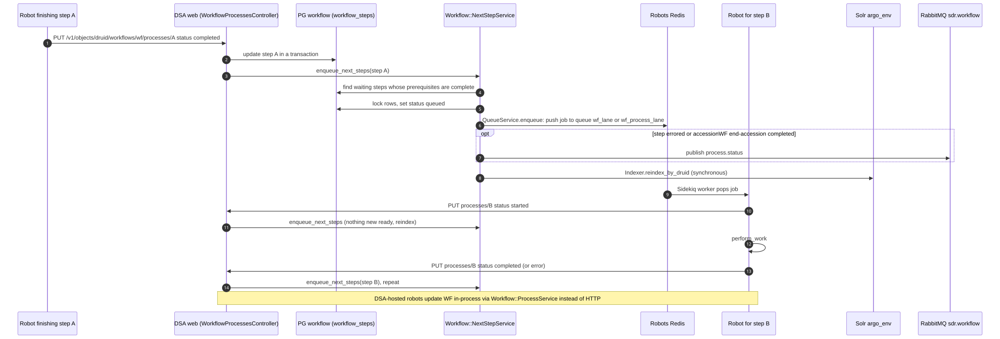

# Repository core

dor-services-app (DSA) is the center of SDR. It is the system of record for cocina objects and their versions, the workflow engine that moves objects through assembly, accessioning, preservation and release, and the only writer of the Argo Solr index. Every management and deposit app reaches SDR through DSA's API. This page covers DSA and the services and libraries around it: dor-services-client, cocina-models, workflow templates, RabbitMQ messaging, events, technical-metadata-service (techmd) and SURI. What individual robots do is covered in [Accessioning](accessioning.md) and [Preservation](preservation.md); the data model is covered in [Data model](data-model.md). For SDR terms, see the [Glossary](../../GLOSSARY.md).

Diagram source: [core-dsa-context.mmd](../diagrams/core-dsa-context.mmd)

## Components

| Component | Purpose | Repo | Runtime | Datastores |
| --- | --- | --- | --- | --- |
| dor-services-app (DSA) | System of record, versioning, workflow engine, DSA-hosted robots, Argo indexing, publish trigger, FOLIO/DataCite/ORCID integration, embargo release | [dor-services-app](https://github.com/sul-dlss/dor-services-app) | Passenger web; Sidekiq Pro (systemd `sidekiq-N`); Sneakers consumer; whenever cron | Postgres `dor_services` and `workflow`; Redis (DSA jobs and robots); Solr `argo_<env>`; NFS `/dor`, `/sdr-deposit-staging`, `/access-transfer`, `/web-archiving-stacks` |
| dor-services-client | Ruby HTTP client for DSA, including the workflow API | [dor-services-client](https://github.com/sul-dlss/dor-services-client) | Gem | — |
| cocina-models | The shared SDR data model: JSON Schema plus generated Ruby classes and validators | [cocina-models](https://github.com/sul-dlss/cocina-models) | Gem | — |
| dor-event-client | Publishes provenance events to RabbitMQ | [dor-event-client](https://github.com/sul-dlss/dor-event-client) | Gem | — |
| lyber-core | Base class for robots (Sidekiq workers) and their workflow status updates | [lyber-core](https://github.com/sul-dlss/lyber-core) | Gem | — |
| technical-metadata-service (techmd) | File identification and characterization (Siegfried, exiftool, poppler, mediainfo) | [technical-metadata-service](https://github.com/sul-dlss/technical-metadata-service) | Rails API + Sidekiq + cron | Local Postgres and Redis |
| SURI | Mints druids | [suri-rails](https://github.com/sul-dlss/suri-rails) | Rails | Local Postgres `suri` |
| druid-tools | Druid syntax and druid-tree paths (`bb/123/cd/4567/<druid>`) | [druid-tools](https://github.com/sul-dlss/druid-tools) | Gem | — |
| RabbitMQ | Event and workflow notification broker | ops-managed | `sul-rabbit-<env>` | — |

Retired: workflow-server-rails and dor-workflow-client are archived; their function is inside DSA ([ADR 0008](../adr/0008-workflow-engine-in-dsa.md)). dor-indexing-app no longer exists; DSA writes the index ([ADR 0010](../adr/0010-dsa-writes-argo-index.md)). Fedora is gone ([ADR 0002](../adr/0002-dsa-postgres-system-of-record.md)).

### DSA responsibilities

- **System of record.** Cocina objects and every version live in Postgres `dor_services` (`repository_objects`, `repository_object_versions`, `user_versions`, `events`, `administrative_tags`, `release_tags`, `orcid_works`, `background_job_results`). See [ADR 0002](../adr/0002-dsa-postgres-system-of-record.md) and [Data model](data-model.md).
- **Registration.** `POST /v1/objects` validates the request, mints a druid from SURI, optionally assigns a DOI (`<prefix>/<bare druid>`), stores version 1, records a `registration` event, publishes `sdr.objects.created`, and indexes the object.
- **Versioning.** Open creates a new version and `versioningWF` (checking with preservation-catalog that the object is openable). Close starts `accessionWF`. Updates use optimistic locking: `GET` returns an `ETag`; a `PATCH` with a stale `If-Match` gets `412`.
- **Workflow engine.** Workflow templates, step state, and the enqueueing of ready steps (see [Workflow](#workflow-templates-and-how-steps-advance)).
- **DSA-hosted robots.** Steps that need DSA internals run as Sidekiq jobs inside DSA ([ADR 0009](../adr/0009-robots-as-sidekiq-workers.md)):
  - accessionWF: `shelve` (WAS crawls only, to `/web-archiving-stacks`), `publish`, `release-initiate`, `update-doi`, `update-orcid-work`, `sdr-ingest-transfer` (writes the bag to `/dor/export/<druid>` and creates `preservationIngestWF`), `reset-workspace` (removes the druid from workspace, assembly and staging roots).
  - releaseWF: `start`, `release-members`, `release-publish`, `update-marc`, `update-holdings`.
  - goobiWF: `goobi-notify` (HTTPS POST to Goobi: the prod Goobi server in prod, `goobi-stage-a` for stage and qa).
- **Argo indexing.** DSA builds the Argo Solr document (`Indexing::Builders::DocumentBuilder` and about 20 indexers) and writes it with RSolr, `commitWithin: 5000` ([ADR 0010](../adr/0010-dsa-writes-argo-index.md)). Triggers: create (synchronous), every workflow step update (synchronous), release tag create, update and version open/close (`ReindexJob` on `low`), `POST /v1/objects/:id/reindex`, a weekly full reindex, and a daily missing-druid check.
- **Publishing trigger.** The `publish` robot diffs files against purl-fetcher, copies new or changed files to `/access-transfer/<uuid>` (stage and qa: `/access-transfer-stage`), and calls `PUT /v1/purls/:druid`; purl-fetcher is the single writer of public data ([ADR 0011](../adr/0011-purl-fetcher-publish-api.md); see [Access and discovery](access-and-discovery.md)). Collection members and virtual-object constituents are republished on `publish_low`.
- **FOLIO.** Description refresh from MARC (`POST /v1/objects/:id/refresh_metadata`), HRID and barcode lookups at registration, and releaseWF `update-marc` (856 links) and `update-holdings`. Okapi endpoints: `folio-prod-api`, `folio-stage-api`, `folio-test-api` (qa).
- **DataCite.** `update-doi` pushes DataCite metadata. Prod uses `api.datacite.org` with prefix `10.25740`; stage and qa use `api.test.datacite.org` with prefix `10.80343`.
- **ORCID.** `update-orcid-work` creates, updates or deletes works for contributors with ORCID iDs, getting user tokens from MaIS (`mais.suapi.stanford.edu`; `mais.suapiuat` outside prod). State is tracked in `orcid_works`.
- **Embargo release.** Daily at 02:16, `rake dsa:embargo_release` finds head versions whose embargo date has passed. For each accessioned, openable object it opens a version, rewrites access, and closes the version, which re-accessions and republishes ([ADR 0017](../adr/0017-embargo-release-opens-version.md)). It records an `embargo_released` event and publishes `sdr.objects.embargo_lifted`.

### DSA processes

| Process | Where | What |
| --- | --- | --- |
| Passenger web | `dor-services-app-<env>-{a,b}` behind `dor-services-<env>-lb.stanford.edu` | REST and GraphQL API; Sidekiq Web at `/queues` |
| Sidekiq (general) | workers | Queues `high`, `default`, `low`, `migration`, `batch_reindex`; `publish_high`, `publish_default`, `publish_low` |
| Sidekiq (label `robot`) | workers | DSA robot queues, read from robots Redis (below) |
| Sneakers | `dor-services-worker-prod-{a,b}`, `-stage-a`, `-qa-a` | `CreateEventJob` on queue `dsa.create-event` |
| cron (whenever) | `dor-services-worker-<env>-a` only | 02:16 embargo release; 06:35 unindexed-druid check; every 6 h `Workflow::Monitor` (steps queued over 24 h or started over 48 h); Fri 20:00 full reindex; weekdays 02:00 cocina export to `/dor/cocina_dump` |

Prod Sidekiq process layout ([shared_configs `dor-services-app-prod` `config/sidekiq1..8.yml`](https://github.com/sul-dlss/shared_configs/tree/dor-services-app-prod/config)):

| Process | Queues |
| --- | --- |
| sidekiq1–2 | `high,default,low,migration,batch_reindex` |
| sidekiq3 | `high,default,low,migration` |
| sidekiq4 | `high,default,low` |
| sidekiq5 | `publish_high,publish_default,publish_low` |
| sidekiq6–7 (label `robot`) | `releaseWF_{high,default,low}_dsa`, `goobiWF_*_dsa`, `accessionWF_<process>_<lane>_dsa` for shelve, publish, release-initiate, update-doi, update-orcid-work, sdr-ingest-transfer, reset-workspace; plus `publish_low` |
| sidekiq8 (label `robot`) | `releaseWF_update-marc_dsa` (serialized) |

Worker `-a` runs 8 Sidekiq processes; workers `-b` to `-e` run 7. Stage and qa have one worker with 6 processes. Job-to-queue mapping in code: `ReindexJob` → `low`; `BatchReindexJob` → `batch_reindex`; `PublishJob` → `publish_default`; `MigrationJob` → `migration`; cleanup, withdraw/restore and virtual-object jobs → `default`.

### Redis hosts

| Redis | Hosts | Used for |
| --- | --- | --- |
| DSA Redis | a dedicated host per environment | DSA Sidekiq jobs, unique-job locks, `RedisLock` (FOLIO holdings, per HRID) |
| Robots Redis | the robots' Redis host in each environment | Every workflow-step job, for DSA robots and all external robot suites. Also read by robot-console |
| techmd Redis | local on `dor-techmd-<env>-a` (prod and stage configured as `techmd-<env>.stanford.edu`, inferred to be an alias) | techmd Sidekiq |

Sidekiq processes labelled `robot` connect to robots Redis; others use DSA Redis. Workflow-step enqueues always go to robots Redis through `ROBOT_SIDEKIQ_CLIENT` ([`config/initializers/sidekiq.rb`](https://github.com/sul-dlss/dor-services-app/blob/main/config/initializers/sidekiq.rb)).

### Databases

| Database | Primary | Standby | Version |
| --- | --- | --- | --- |
| `dor_services` | a dedicated database host | a second host (streaming replica) | PG 13 |
| `dor_services` stage / qa | a dedicated database host per environment | a second host per environment | PG 13 |
| `workflow` | a separate database host | a second host (hot standby) | PG 16 |
| `workflow` stage / qa | a separate database host per environment | none | PG 16 |

DSA uses Rails multi-database (`primary`, `workflow`; env vars `DATABASE_HOSTNAME`, `WORKFLOW_DATABASE_HOSTNAME`). The workflow DB holds `workflow_steps` and `version_contexts`. `MAX_DB_CONNECTIONS` is 2 on web nodes and 7 on workers.

## Interfaces

### DSA API surface

All REST routes are under `/v1` ([`config/routes.rb`](https://github.com/sul-dlss/dor-services-app/blob/main/config/routes.rb)). Requests carry a bearer JWT (HS256, minted with `bin/rails generate_token`; the `sub` claim is recorded as `invoked_by`) ([ADR 0007](../adr/0007-jwt-for-service-auth.md)). Bodies are validated against DSA's `openapi.yml`, which references the cocina schema.

| Group | Routes |
| --- | --- |
| Objects | `POST /objects` (register), `GET/PATCH/PUT/DELETE /objects/:id`, `GET /objects/find`, `POST /objects/find_all`, `GET /objects/:id/solr` |
| Object actions | `POST /objects/:id/{publish, preserve, accession, reindex, indexable, update_orcid_work, refresh_metadata, apply_admin_policy_defaults}` |
| Versions | `POST/GET /objects/:id/versions`, `GET versions/{openable,current,status}`, `POST versions/current/close`, `PATCH/DELETE versions/current`, `POST /objects/versions/status` (batch) |
| User versions | `/objects/:id/user_versions` (index, show, create, update) |
| Workflows | `GET /objects/:id/workflows[/:name]`, `POST /objects/:id/workflows/:name` (create), `POST …/skip_all`, `PUT …/workflows/:name/processes/:process`, `GET /objects/:id/lifecycles`, `GET /workflow_templates[/:name]` |
| Tags | `/objects/:id/administrative_tags`, `GET /administrative_tags/search`, `/objects/:id/release_tags` |
| Events | `GET/POST /objects/:id/events`, `GET /event_types` |
| Other | `/objects/:id/members`, `/objects/:id/query/collections`, `POST/DELETE /objects/:id/workspace`, `POST /virtual_objects`, `GET /background_job_results/:id`, `GET /about` |
| GraphQL | `POST /graphql`: read-only `cocinaObject` query that selects only the requested columns ([ADR 0021](../adr/0021-graphql-for-cocina-retrieval.md)). Argo is the only client. |

### dor-services-client

[dor-services-client](https://github.com/sul-dlss/dor-services-client) is a Faraday client that sends `Authorization: Bearer <JWT>`, retries `GET` on 503, and raises a specific error on `412` (stale lock). It covers objects, versions, user versions, tags, release tags, events, members, workspace, accession, background jobs, virtual objects, and the workflow API (`ObjectWorkflow`, `Process`, `Workflows`, `Milestones`), replacing dor-workflow-client. Callers: Argo, Argo-B3, H3, sdr-api, pre-assembly, Heracles ETD, was-registrar-app, google-books, techmd, preservation_catalog and every robot suite (through lyber-core). See [Management and deposit](management-and-deposit.md).

### cocina-models

[cocina-models](https://github.com/sul-dlss/cocina-models) defines the shared model ([ADR 0003](../adr/0003-cocina-shared-model-lockstep.md)): a JSON Schema (`schema.json`) from which dry-struct classes are generated, plus validators (schema, description, structural, PURL, catalog links and others). Its main types are DRO, Collection and AdminPolicy. Because every app serializes the same model, a cocina-models upgrade is rolled out to all apps together with sdr-deploy and verified with the integration tests. Model details: [Data model](data-model.md).

### Outbound calls from DSA

| Target | Transport | prod (stage / qa) |
| --- | --- | --- |
| SURI | HTTPS `POST /identifiers`, no auth | `sul-suri-prod` (`sul-suri-stage` / `sul-suri-qa`) |
| Solr | HTTPS RSolr | `sul-solr.stanford.edu/solr/argo_prod` (`argo_stage` / `argo_qa`) — all on the prod SolrCloud ([ADR 0025](../adr/0025-shared-prod-solrcloud.md)) |
| preservation-catalog | HTTPS (preservation-client) | `preservation-catalog-prod` (stage / qa) |
| purl-fetcher | HTTPS + NFS `/access-transfer` | `purl-fetcher-prod` (`purl-fetcher-stage` for **both** stage and qa, [ADR 0024](../adr/0024-qa-shares-stage-access-systems.md)) |
| FOLIO | HTTPS Okapi | `folio-prod-api` (`folio-stage-api` / `folio-test-api`) |
| DataCite | HTTPS | `api.datacite.org` (`api.test.datacite.org`) |
| ORCID, MaIS | HTTPS OAuth | the ORCID production API, `mais.suapi.stanford.edu` (ORCID sandbox, `mais.suapiuat`) |
| Goobi | HTTPS | the prod Goobi server (`goobi-stage-a`) |
| RabbitMQ | AMQP, vhost `workflow` | `sul-rabbit-prod` (`sul-rabbit-stage` / `sul-rabbit-qa`) |
| techmd | HTTPS (one report only) | `dor-techmd-prod-a` |

preservation_robots read the bags DSA writes to `/dor/export` over the shared `/dor` NFS mount ([Preservation](preservation.md)).

## Workflow templates and how steps advance

Templates are XML files in [`config/workflows`](https://github.com/sul-dlss/dor-services-app/tree/main/config/workflows). Each process lists its prerequisites; some are `skip-queue` (set by another system rather than a robot) and some set a lifecycle milestone.

| Workflow | Steps (milestone in brackets; * = skip-queue) |
| --- | --- |
| registrationWF | register [registered] |
| versioningWF | start-version [opened] |
| assemblyWF | start-assembly, content-metadata-create, jp2-create, checksum-compute, exif-collect, accessioning-initiate |
| accessionWF | start-accession [submitted], stage, technical-metadata, shelve, publish [published], release-initiate, update-doi, update-orcid-work, sdr-ingest-transfer, sdr-ingest-received* [deposited], reset-workspace, end-accession [accessioned] |
| preservationIngestWF | start-ingest, transfer-object, validate-bag, update-moab, validate-moab, update-catalog, complete-ingest |
| releaseWF | start, release-members, release-publish, update-marc, update-holdings |
| goobiWF | register, start*, goobi-notify |

Others: ocrWF, speechToTextWF, captionWF ([ADR 0020](../adr/0020-derivative-generation-in-accessioning.md); speech-to-text is intentionally off in prod), digitizationWF, gisAssemblyWF, gisDerivativeWF, gisDeliveryWF, the WAS workflows (wasCrawlPreassemblyWF, wasCrawlDisseminationWF, wasSeedPreassemblyWF, wasSeedDisseminationWF, wasDisseminationWF), and preservationAuditWF (logging only). Legacy templates are excluded from indexing through `skip_workflows` in `config/settings.yml`. Per-version workflow variables (for example `skipReleaseWF`, OCR flags) are stored in `version_contexts`.

### Queue naming

`QueueService` names the Sidekiq queue `<workflow>_<lane>` (lane is `high`, `default` or `low`). For accessionWF the process is included (`accessionWF_<process>_<lane>`), and DSA-hosted robots get a `_dsa` suffix. Exceptions: `jp2-create` uses `assemblyWF_jp2`, and `update-marc` uses `releaseWF_update-marc_dsa`. The job class is `Robots::DorRepo::<Workflow>::<Process>` (`Robots::SdrRepo::…` for preservation workflows).

### How a step advances

Diagram source: [core-workflow-advance.mmd](../diagrams/core-workflow-advance.mmd)

1. A robot (through lyber-core and dor-services-client) or techmd sends `PUT /v1/objects/:druid/workflows/:wf/processes/:process` with `started`, `completed`, `skipped`, `retrying` or `error`. DSA-hosted robots call `Workflow::ProcessService` in-process instead.
2. DSA updates the `workflow_steps` row in a transaction.
3. `Workflow::NextStepService` finds waiting steps in the same workflow and version whose prerequisites are complete and that are not `skip-queue`. It locks those rows and sets them to `queued`.
4. After the transaction commits, `QueueService` pushes one Sidekiq job per ready step to robots Redis.
5. If the step errored, or `accessionWF:end-accession` completed, DSA publishes `<process>.<status>` to `sdr.workflow`.
6. DSA reindexes the object synchronously. A reindex failure is reported to Honeybadger and does not block the workflow.
7. A robot worker pops the job, marks the step `started`, does the work, and marks it `completed` or `error`; the cycle repeats.

A new workflow (`Workflow::Creator`) writes rows for all its processes, marks earlier versions' rows inactive, and runs the same next-step logic. `Workflow::Monitor` reports steps stuck in `queued` or `started`.

## RabbitMQ topology

Clusters: a three-node cluster for prod (apps connect to `sul-rabbit-prod`) and for stage (`sul-rabbit-stage`), and a single node `sul-rabbit-qa`. Vhost `workflow`, classic queues mirrored to every node. Management UI at `https://sul-rabbit-<env>.stanford.edu/` behind Shibboleth. DSA declares its queues with `rake rabbitmq:setup` at deploy; H3 and pre-assembly declare their own. Publishing is gated by `Settings.rabbitmq.enabled` (true in all environments). RabbitMQ carries SDR events and workflow notices; Kafka is used only for discovery ([ADR 0006](../adr/0006-rabbitmq-for-events-kafka-for-discovery.md)).

Diagram source: [core-rabbitmq.mmd](../diagrams/core-rabbitmq.mmd)

| Exchange (topic) | Publishers | Routing key | Queue (binding) | Consumer | Status |
| --- | --- | --- | --- | --- | --- |
| `sdr.objects.event` | dor-event-client users: Argo-B3, H3, preservation_catalog, EarthWorks, searchworks_traject_indexer, dataworks-etl | event type | `dsa.create-event` (`#`) | DSA Sneakers `CreateEventJob` → `events` table | Live |
| `sdr.workflow` | DSA `Notifications::WorkflowStepUpdated` (step error or end-accession completed only) | `<process>.<status>`, e.g. `end-accession.completed` | `h3.deposit_complete` (`end-accession.completed`) | H3 `DepositCompleteJob` | Live |
| `sdr.workflow` | ″ | ″ | `preassembly.accession_complete` (`end-accession.completed`, `*.error`) | pre-assembly `AccessionCompleteJob` | Live (goes away with pre-assembly) |
| `sdr.workflow` | ″ | ″ | `dor.indexing-by-druid` (`#`) | none | **Dead**: left from dor-indexing-app; durable queue with no consumer |
| `sdr.objects.created` | DSA `Notifications::ObjectCreated` (not APOs) | first project tag | none | none | **Dead**: published, nothing bound |
| `sdr.objects.embargo_lifted` | DSA `Notifications::EmbargoLifted` | first project tag; `SDR` for APOs | none | none | **Dead**: published, nothing bound |

## Events

Provenance events are stored centrally in the DSA `events` table (`druid`, `event_type` from `Event::EVENT_TYPES`, JSONB `data`, timestamps) ([ADR 0005](../adr/0005-events-recorded-in-dsa.md)).

- DSA writes its own events through `EventFactory` (for example `registration`, `embargo_released`).
- Other apps publish through dor-event-client to `sdr.objects.event` (preferred), or `POST /v1/objects/:id/events`.
- Argo, Argo-B3 and H3 show events from `GET /v1/objects/:id/events`; events are also indexed into Argo Solr.

## technical-metadata-service (techmd)

- API (JWT): `POST /v1/technical-metadata` (asynchronous; enqueues `TechnicalMetadataWorkflowJob`), `GET /v1/technical-metadata/druid/:druid`, `GET …/druid/:druid/file?filename=`, `POST /v1/technical-metadata/audit/:druid`.
- The common-accessioning `technical-metadata` robot POSTs the file list and returns `noop`; techmd marks `accessionWF:technical-metadata` completed or errored in DSA itself.
- Stores only current-version file metadata in Postgres (`DroFile`, `DroFilePart`). Can also characterize files from Moabs on preservation storage.
- Hosts: `dor-techmd-<env>-a` (web, local Redis and Postgres 16, Sidekiq, cron) and `dor-techmd-worker-<env>-a` (Sidekiq). Mounts `/dor`, `/sdr-deposit-staging`, and in prod also preservation storage and `/maps`.
- Wiring: prod → `dor-services-prod-lb`, `preservation-catalog`; stage → `dor-services-stage-lb`; qa → `dor-services-qa-lb`.

## SURI

[suri-rails](https://github.com/sul-dlss/suri-rails) mints druids: `POST /identifiers`, `GET /identifiers/:id`, plus the legacy `/suri2/namespaces/druid/identifiers`. DSA is the only caller (`SuriService`, no auth header; the firewall limits access). One VM per environment (`sul-suri-{prod,stage,qa}`) runs the app and its Postgres 16 database.

## Hosts and environments

| Role | prod | stage | qa |
| --- | --- | --- | --- |
| DSA web | `dor-services-app-prod-{a,b}` | `dor-services-app-stage-{a,b}` | `dor-services-app-qa-{a,b}` |
| DSA workers | `dor-services-worker-prod-{a..e}` | `dor-services-worker-stage-a` | `dor-services-worker-qa-a` |
| DSA DB / workflow DB | see [Databases](#databases) | | |
| DSA Redis | one host | one host | one host |
| Robots Redis | one host | one host | one host |
| RabbitMQ | `sul-rabbit-prod` (three nodes) | `sul-rabbit-stage` (three nodes) | `sul-rabbit-qa` (one node) |
| techmd | `dor-techmd-prod-a`, `dor-techmd-worker-prod-a` | stage equivalents | qa equivalents |
| SURI | `sul-suri-prod` | `sul-suri-stage` | `sul-suri-qa` |

Prod DSA mounts its own `/dor` volume; qa and stage share one. QA DSA publishes to stage purl-fetcher and shares `/access-transfer-stage` with stage. Both choices are deliberate because access systems have no qa environment, and worth reconsidering ([ADR 0024](../adr/0024-qa-shares-stage-access-systems.md)). Hosts are defined in the private puppet repo's node data.

All of these deploy with Capistrano; DSA is deployed across the fleet with sdr-deploy (see [Platform and operations](platform-and-operations.md)).

## Configuration

- Defaults in [`config/settings.yml`](https://github.com/sul-dlss/dor-services-app/blob/main/config/settings.yml), overridden per environment by shared_configs [`dor-services-app-prod`](https://github.com/sul-dlss/shared_configs/blob/dor-services-app-prod/config/settings/production.yml) (and `-stage`, `-qa`), which also holds the `config/sidekiqN.yml` process files. Secrets come from puppet env vars.
- techmd: `dor-techmd-<env>`. SURI: `suri-rails-<env>` (README only).
- Puppet: node data in the private [puppet](https://github.com/sul-dlss/puppet) repository.

## Known issues and cleanup

- **Dead RabbitMQ queue and exchanges.** `rake rabbitmq:setup` still declares `dor.indexing-by-druid`, bound to `sdr.workflow` with `#`, and nothing consumes it. DSA still publishes `sdr.objects.created` and `sdr.objects.embargo_lifted` with no subscribers. All three need cleanup.
- **Dead config.** shared_configs DSA branches keep `workflow.url`, `dor_indexing.url`, `release.symphony_path` (qa) and many `enabled_features.*` flags that DSA code does not read; `config/settings.yml` still has `dor_indexing` and `catalog.symphony` blocks. The `dsa-prod-sidekiq` branch (last commit 2023) appears orphaned.
- **Stale DSA README.** It says DSA robots must be added to workflow-server-rails' QueueService (now in DSA), lists `accessionWF_{high,default,low}` (code uses per-process queues), and names both `sdr-deploy` and `sdr-infra` as the export host.
- **Stale messaging docs.** This repo's former `sdr/messages.md` (2022, now removed; see git history) listed messages no longer published and retired subscribers. DevOpsDocs `messaging.md` says DSA subscribes to `sdr.objects.created`; it consumes `sdr.objects.event`.
- **DevOpsDocs operations-concerns** for DSA omits `dor-services-worker-prod-{c,d,e}` and the workflow DB hosts, and still mentions Symphony.
- **Puppet classification.** Some repository-core hosts carry incorrect puppet classifications, which affects their monitoring and firewall rules ([Platform and operations](platform-and-operations.md#known-issues-and-cleanup)).
- **EDA ADR 0023** (merge workflow service) still says "proposed" though implemented; superseded by [ADR 0008](../adr/0008-workflow-engine-in-dsa.md).
- **techmd README** describes direct workflow updates as future work; they are already in place.

## Sources

- dor-services-app: [`README.md`](https://github.com/sul-dlss/dor-services-app/blob/main/README.md), [`config/routes.rb`](https://github.com/sul-dlss/dor-services-app/blob/main/config/routes.rb), [`config/schedule.rb`](https://github.com/sul-dlss/dor-services-app/blob/main/config/schedule.rb), [`config/initializers/sidekiq.rb`](https://github.com/sul-dlss/dor-services-app/blob/main/config/initializers/sidekiq.rb), [`lib/tasks/rabbitmq.rake`](https://github.com/sul-dlss/dor-services-app/blob/main/lib/tasks/rabbitmq.rake), [`app/services/notifications`](https://github.com/sul-dlss/dor-services-app/tree/main/app/services/notifications), [`app/services/workflow/next_step_service.rb`](https://github.com/sul-dlss/dor-services-app/blob/main/app/services/workflow/next_step_service.rb#L19-L62), [`app/services/workflow/process_service.rb`](https://github.com/sul-dlss/dor-services-app/blob/main/app/services/workflow/process_service.rb), [`app/services/queue_service.rb`](https://github.com/sul-dlss/dor-services-app/blob/main/app/services/queue_service.rb), [`app/services/version_service.rb`](https://github.com/sul-dlss/dor-services-app/blob/main/app/services/version_service.rb), [`app/services/create_object_service.rb`](https://github.com/sul-dlss/dor-services-app/blob/main/app/services/create_object_service.rb), [`app/services/indexer.rb`](https://github.com/sul-dlss/dor-services-app/blob/main/app/services/indexer.rb), [`app/services/embargo_release_service.rb`](https://github.com/sul-dlss/dor-services-app/blob/main/app/services/embargo_release_service.rb), [`app/graphql/types/query_type.rb`](https://github.com/sul-dlss/dor-services-app/blob/main/app/graphql/types/query_type.rb), [`app/jobs/robots`](https://github.com/sul-dlss/dor-services-app/tree/main/app/jobs/robots), [`config/workflows`](https://github.com/sul-dlss/dor-services-app/tree/main/config/workflows), [`db/structure.sql`](https://github.com/sul-dlss/dor-services-app/blob/main/db/structure.sql)
- [lyber-core `lib/lyber_core/robot.rb`](https://github.com/sul-dlss/lyber-core/blob/main/lib/lyber_core/robot.rb), [`lib/lyber_core/workflow.rb`](https://github.com/sul-dlss/lyber-core/blob/main/lib/lyber_core/workflow.rb)
- [dor-services-client `lib/dor/services/client.rb`](https://github.com/sul-dlss/dor-services-client/blob/main/lib/dor/services/client.rb); [dor-event-client `create_operation.rb`](https://github.com/sul-dlss/dor-event-client/blob/main/lib/dor/event/client/create_operation.rb); [cocina-models `README.md`](https://github.com/sul-dlss/cocina-models/blob/main/README.md)
- [technical-metadata-service `README.md`](https://github.com/sul-dlss/technical-metadata-service/blob/main/README.md), [`config/routes.rb`](https://github.com/sul-dlss/technical-metadata-service/blob/main/config/routes.rb); [suri-rails `openapi.yml`](https://github.com/sul-dlss/suri-rails/blob/main/openapi.yml)
- [hungry-hungry-hippo `lib/tasks/rabbitmq.rake`](https://github.com/sul-dlss/hungry-hungry-hippo/blob/main/lib/tasks/rabbitmq.rake#L16-L18); [pre-assembly `lib/tasks/rabbit.rake`](https://github.com/sul-dlss/pre-assembly/blob/main/lib/tasks/rabbit.rake#L16-L19)
- Puppet (private): [node data](https://github.com/sul-dlss/puppet) for DSA, its databases and Redis, RabbitMQ, techmd and SURI hosts
- shared_configs: [`dor-services-app-prod`](https://github.com/sul-dlss/shared_configs/blob/dor-services-app-prod/config/settings/production.yml), [`dor-techmd-prod`](https://github.com/sul-dlss/shared_configs/blob/dor-techmd-prod/config/settings/production.yml)
- [Engineering design ADR 0023 (historical)](https://github.com/sul-dlss-labs/engineering-design-adrs/blob/main/0023-merge-workflow-service.md)

_Verified against default branches on 2026-11-16; private-source details redacted 2026-11-17._
